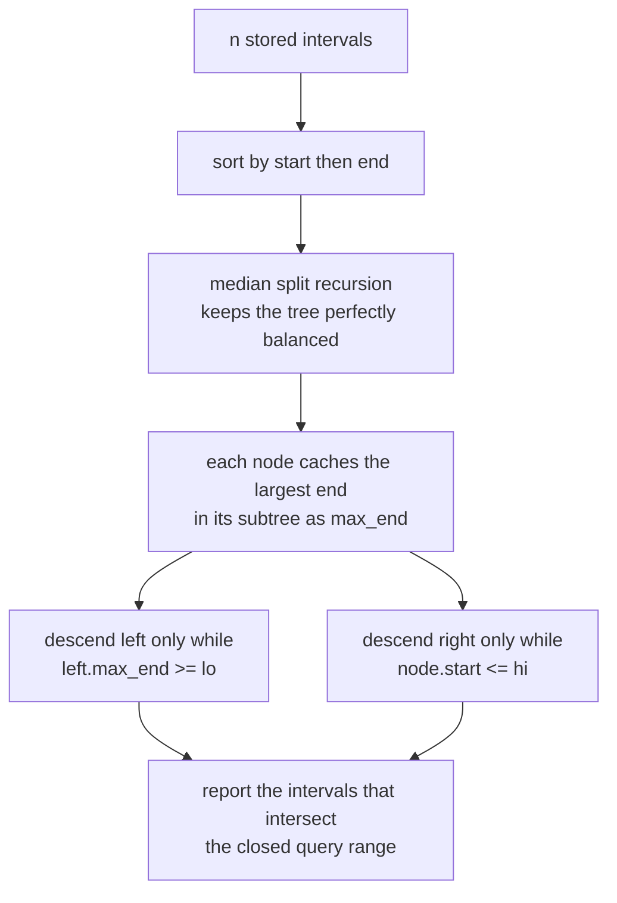
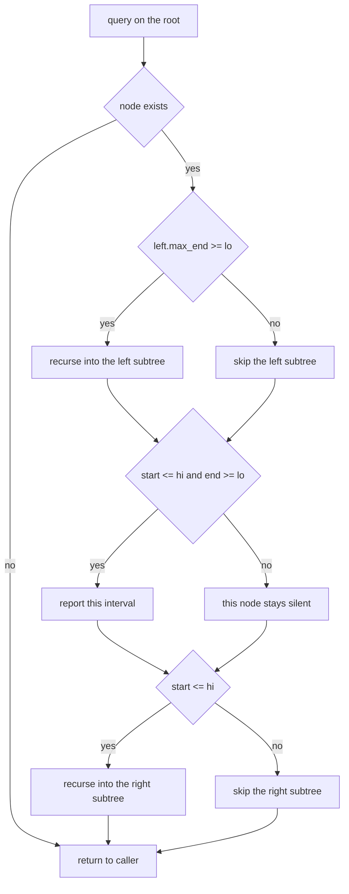
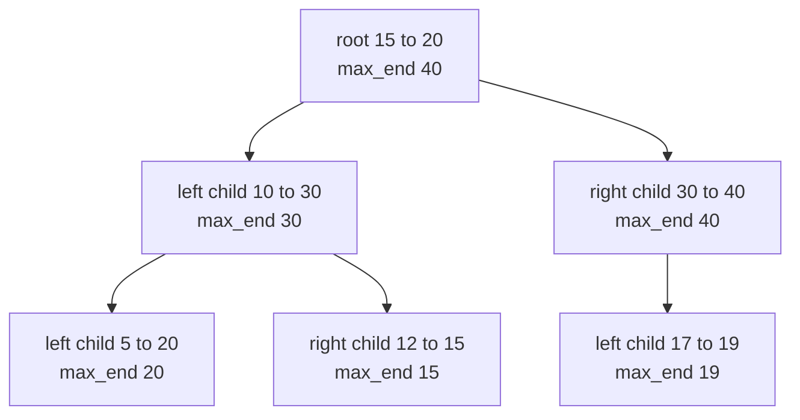
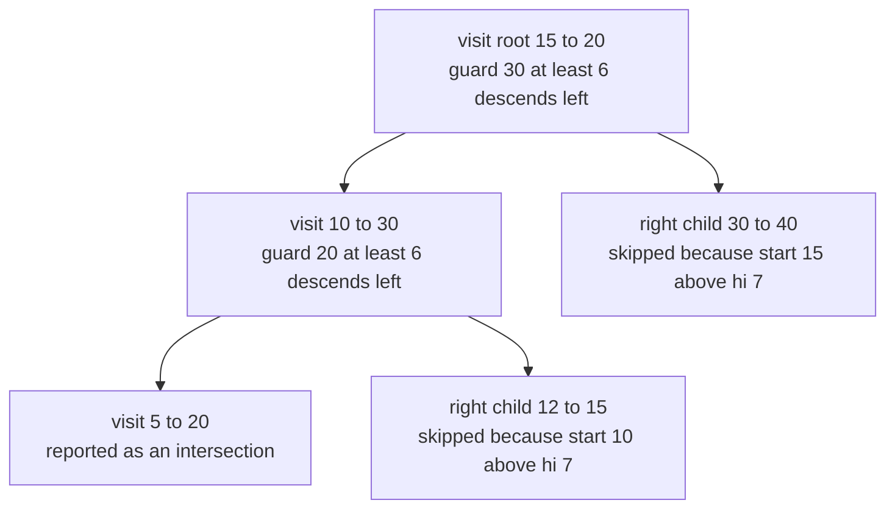

# 329 — Range intersection queries (interval trees basics).

> **Tier:** Intermediate · **CTCI chapter:** Ch 4 — Trees and Graphs
> **Task spec:** [329-range-intersection-queries-interval-trees-basics.md](../../../tasks/intermediate/329-range-intersection-queries-interval-trees-basics.md)
> **Solutions:** [Python](../../../solutions/python/intermediate/329-range-intersection-queries-interval-trees-basics/solution.py) ·
> [Java](../../../solutions/java/intermediate/329-range-intersection-queries-interval-trees-basics/Solution.java) ·
> [JavaScript](../../../solutions/javascript/intermediate/329-range-intersection-queries-interval-trees-basics/solution.js) ·
> [C#](../../../solutions/csharp/intermediate/329-range-intersection-queries-interval-trees-basics/Solution.cs)

## 1. Problem restatement

**Input:** a fixed set of closed integer intervals `[start, end]`, plus a stream of queries, each
one closed range `[lo, hi]`.

**Output:** for every query, all stored intervals that intersect `[lo, hi]`, where intersection is
the closed test `start <= hi and end >= lo`. Intervals that merely touch count: the probe
`[30, 35]` does report `[10, 30]`. Results come out in start order, ties broken by end order.

The four solution files do not leave the contract to prose. They all build the same fixed set
`FIXED = [[15, 20], [10, 30], [17, 19], [5, 20], [12, 15], [30, 40]]` and assert the same six
answers:

| Query | Result | Why |
| --- | --- | --- |
| `query(6, 7)` | `[[5, 20]]` | only `[5, 20]` starts at or before 7 and ends at or after 6 |
| `query(14, 16)` | `[[5, 20], [10, 30], [12, 15], [15, 20]]` | everything overlapping the middle band |
| `query(30, 35)` | `[[10, 30], [30, 40]]` | touching at 30 still intersects |
| `query(19, 19)` | `[[5, 20], [10, 30], [15, 20], [17, 19]]` | a degenerate one-point query |
| `query(0, 4)` | `[]` | below every interval |
| `query(41, 50)` | `[]` | above every interval |

Two more rows are asserted separately: an empty tree answers `[]` for every query, and the
degenerate point interval `[4, 4]` is found by the query `[4, 4]`. Nothing here mutates the
caller's interval arrays — every solution clones or copies the input before sorting.

## 2. Intuition

The naive reading of the problem is a filter: keep every interval with `start <= hi and end >= lo`.
That is one pass over `n` intervals per query, `O(n)` each time, and it throws away all the
structure the set already has. Building an index once and paying less per query is the whole point
of the exercise.

The structure the solutions build is a **binary search tree keyed by `start`**, with one extra
field per node: `max_end`, the largest `end` anywhere in that node's subtree. The bonus field is
what makes pruning legal. To reach an interval that could intersect `[lo, hi]` you only ever need
to look into a subtree whose stored `end` values can still reach `lo`:

- descend into the **left** subtree only while `left.max_end >= lo`, because a bigger start can no
  longer intersect, but a long interval can;
- descend into the **right** subtree only while `node.start <= hi`, because every start to the
  right is at least `node.start`, and once `node.start > hi` no deeper interval can start early
  enough.

The trees are not built by repeated insertion in input order. All four constructors first sort the
intervals by `(start, end)`, then recurse on the median of each range, so the tree is perfectly
balanced no matter what order the intervals arrived in. The `max_end` values are then filled on
the way back up the recursion.



Read the two guards as a promise: a subtree is skipped only when *every* interval inside it is
provably disjoint from the query.

## 3. Algorithm

1. Sort the intervals by `(start, end)`.
2. Build the tree by repeated median split: take the middle interval of the current slice as the
   node, recurse on the left half and the right half.
3. On the way back up, set `max_end` to the maximum of the node's own `end`, the left child's
   `max_end` and the right child's `max_end`.
4. For a query `[lo, hi]`, walk the tree: recurse left when `left.max_end >= lo`, report the node
   when `start <= hi and end >= lo`, recurse right when `start <= hi`.

```text
procedure build(ordered, from, to)
    if from >= to then
        return no node
    mid ← (from + to) // 2
    node ← new node holding ordered[mid]
    node.max_end ← end of ordered[mid]
    node.left ← build(ordered, from, mid)
    node.right ← build(ordered, mid + 1, to)
    if node.left exists then
        node.max_end ← max(node.max_end, node.left.max_end)
    if node.right exists then
        node.max_end ← max(node.max_end, node.right.max_end)
    return node
end

procedure query(node, lo, hi, found)
    if node does not exist then
        return
    if node.left exists and node.left.max_end >= lo then
        query(node.left, lo, hi, found)
    if node.start <= hi and node.end >= lo then
        append the pair node.start and node.end to found
    if node.start <= hi then
        query(node.right, lo, hi, found)
end
```

The in-order shape of the recursion matters: left, then self, then right is exactly a traversal of
the sorted array, which is why the reported pairs arrive in start order.



## 4. Worked example

Build the tree for `FIXED`. After sorting by `(start, end)` the array is

`[5, 20] · [10, 30] · [12, 15] · [15, 20] · [17, 19] · [30, 40]`

and the median split over six elements takes index `6 // 2 = 3` as the root:



Now trace `query(6, 7)`. The answer the files assert is `[[5, 20]]`, and the walk reaches it after
visiting only three of the six nodes:

| Step | Node visited | Left guard `left.max_end >= lo` | Node test `start <= hi and end >= lo` | Right guard `start <= hi` |
| --- | --- | --- | --- | --- |
| 1 | `[15, 20]`, `max_end` 40 | `30 >= 6` → descend into `[10, 30]` | `15 <= 7` false → silent | `15 <= 7` false → skip `[30, 40]` |
| 2 | `[10, 30]`, `max_end` 30 | `20 >= 6` → descend into `[5, 20]` | `10 <= 7` false → silent | `10 <= 7` false → skip `[12, 15]` |
| 3 | `[5, 20]`, `max_end` 20 | no left child → nothing to do | `5 <= 7` and `20 >= 6` → report `[5, 20]` | no right child → return |

Three nodes visited, one interval reported, and the three intervals that are never touched —
`[12, 15]`, `[17, 19]`, `[30, 40]` — are excluded by an argument rather than by a comparison.
Step 2 is the interesting one: the left guard `20 >= 6` fires even though the child's own start
`5` is far below `lo`, because `[5, 20]` is a long interval that reaches into the query.



The same walk seen as a machine: every node passes through exactly one left decision, one self-check
and one right decision before the recursion unwinds, and no character ever causes a fourth action.

## 5. Complexity

Let `n` be the number of stored intervals and `k` the number of intervals a query reports.

| Measure | Bound | Why it holds |
| --- | --- | --- |
| Build time | O(n log n) | the comparison sort dominates; the median split itself is O(n) |
| Build space | O(n) | one node per interval, holding three integers and two references |
| Query time, output-sensitive | O(log n + k) | the walk stays on the search spine for `lo` and `hi` plus one node per reported interval |
| Query time, worst | O(n) | a query whose range covers the whole universe reports every interval |
| Query space | O(log n) | recursion depth, which is the balanced-tree height |
| Naive filter, build | O(1) | nothing is preprocessed |
| Naive filter, query | O(n) | every interval is tested exactly once |

The `O(log n + k)` figure is a property of the shape, not of the data: the median split makes the
height `O(log n)`, so the two guards can only be wrong on a logarithmic number of levels plus the
subtrees that actually contain hits. The naive filter beats this only for sets so small that `n`
is comparable to `log n`.

## 6. Pitfalls and edge cases

- **Closed versus half-open intervals.** The solutions use the closed test `start <= hi and
  end >= lo`, so touching counts. Task 330 makes the opposite choice and calls two jobs compatible
  when `finish <= start`. Decide which convention the problem wants before writing the guard.
- **Degenerate point intervals.** `[4, 4]` must survive the sort and be reported by the query
  `[4, 4]`. A solution that assumes `start < end` fails this assertion.
- **Empty input.** `IntervalTree([])` stores a null root and every query returns `[]`; all four
  files assert it. The recursive walk therefore has to test for an absent node before touching
  `max_end`.
- **Duplicates.** Duplicate intervals are kept, not deduplicated, and the random cross-check
  compares element by element, so a set-based implementation would be wrong. The in-order walk
  replays the sorted array exactly — including ties — which is what makes the comparison with the
  oracle a plain equality in Python.
- **Wrong field in the guard.** The left guard reads the *child's* `max_end` (`left.max_end >= lo`);
  the right guard reads the *node's* `start` (`start <= hi`). Swapping them, or forgetting the
  guards entirely, silently degrades into the naive filter — still correct, no longer fast.
- **Stale augmentation.** `max_end` must include the node's own `end` even when both children are
  missing; a leaf reports its own `end`.
- **Recursion depth.** Because the tree comes from a median split, its height is logarithmic even
  for adversarially ordered input. A tree built by plain insertion would be `O(n)` deep on sorted
  input and could overflow the stack.
- **Mutable arrays.** Every language copies before sorting, so a caller's original array order is
  preserved. The Java and C# query results are fresh arrays; returning an alias of a stored
  interval would let a caller corrupt the tree.
- **Fixed-width arithmetic.** Coordinates are compared only, never added, so there is no overflow;
  a dynamic version that maintains interval lengths would have to be more careful.

## 7. Variants and follow-ups

- **Applications of the same interval algebra.** [330-weighted-interval-scheduling-dp.md](../../../tasks/intermediate/330-weighted-interval-scheduling-dp.md)
  and [331-weighted-job-scheduling-with-reconstruction.md](../../../tasks/intermediate/331-weighted-job-scheduling-with-reconstruction.md)
  reuse the "does this interval end before that one starts" test in a dynamic program, and
  [326-meeting-rooms-required-interval-partitioning.md](../../../tasks/intermediate/326-meeting-rooms-required-interval-partitioning.md)
  computes the maximum number of intervals that overlap at one point.
- **Sweep instead of tree.** [328-skyline-problem-heap-sweep-line.md](../../../tasks/intermediate/328-skyline-problem-heap-sweep-line.md)
  and [327-car-pooling-capacity-check-difference-array-sweep.md](../../../tasks/intermediate/327-car-pooling-capacity-check-difference-array-sweep.md)
  process intervals in sorted order with a heap or a difference array; the same questions about
  touching endpoints reappear there.
- **Dynamic sets.** [332-implement-calendar-booking-mycalendar-i-ii-iii-style.md](../../../tasks/intermediate/332-implement-calendar-booking-mycalendar-i-ii-iii-style.md)
  inserts and rejects intervals online, so it cannot rebuild by median split. The usual upgrade is
  a balanced BST (AVL or red-black) that repairs `max_end` on every rotation.
- **Reduce to a prefix query.** If the queries are known up front, offline answers often beat any
  tree: task 338 and task 339 in this tier replace the pointer walk with precomputed tables and
  Mo's ordering respectively.
- The chapter walkthrough in [Trees and Graphs](../../ctci/04-trees-and-graphs.md) puts interval
  trees next to segment trees and Fenwick trees as the three augmented-tree shapes.

## 8. Check yourself

1. Why is `[10, 30]` still reported for the query `[6, 7]` even though its start `10` is greater
   than `hi = 7`?

<details><summary>Show answer</summary>

Because it is never the node being tested — it is the node *whose child* is tested. The walk from
the root `[15, 20]` goes left because `left.max_end = 30 >= lo = 6`, and that left child is
`[10, 30]`. The interval has to reach down to 6, which it does, because its `end` is 30.

</details>

2. What is the maximum number of stored intervals a query can report, and what does that do to the
   running time?

<details><summary>Show answer</summary>

All `n` of them, for instance with the query `[0, 100]` over `FIXED`. The walk then visits every
node, so the bound degrades from `O(log n + k)` to `O(n)` — output-sensitive cost is the honest
way to state it.

</details>

3. Why does the traversal order give results sorted by start, and what do the Java, C# and
   JavaScript files do instead of relying on that?

<details><summary>Show answer</summary>

The tree is built by median split over the array sorted by `(start, end)`, and an in-order
traversal of such a tree replays that array, so equal starts also come out in end order. Java, C#
and JavaScript nonetheless re-sort the result before comparing it with the oracle — a cheap way to
make the test independent of traversal order.

</details>

4. Where exactly does `max_end` get its value, and what breaks if a leaf keeps the default?

<details><summary>Show answer</summary>

In the constructor's recursive build: the node starts with its own `end`, then takes the maximum
with the left and right children's `max_end` after those subtrees are built. A leaf with a default
of 0 would fail the left guard for every query with `lo > 0`, so the long interval at `[5, 20]`
would be missed by `query(6, 7)`.

</details>

5. What single line would you change to make touching intervals disjoint?

<details><summary>Show answer</summary>

Both guards of the intersection test: `start <= hi and end >= lo` becomes `start < hi and end > lo`
for strictly overlapping closed intervals, with the mirrored change in the oracle's filter. Every
assertion involving `query(30, 35)` or `query(19, 19)` would change with it, which is why the
solutions document the closed convention explicitly.

</details>
