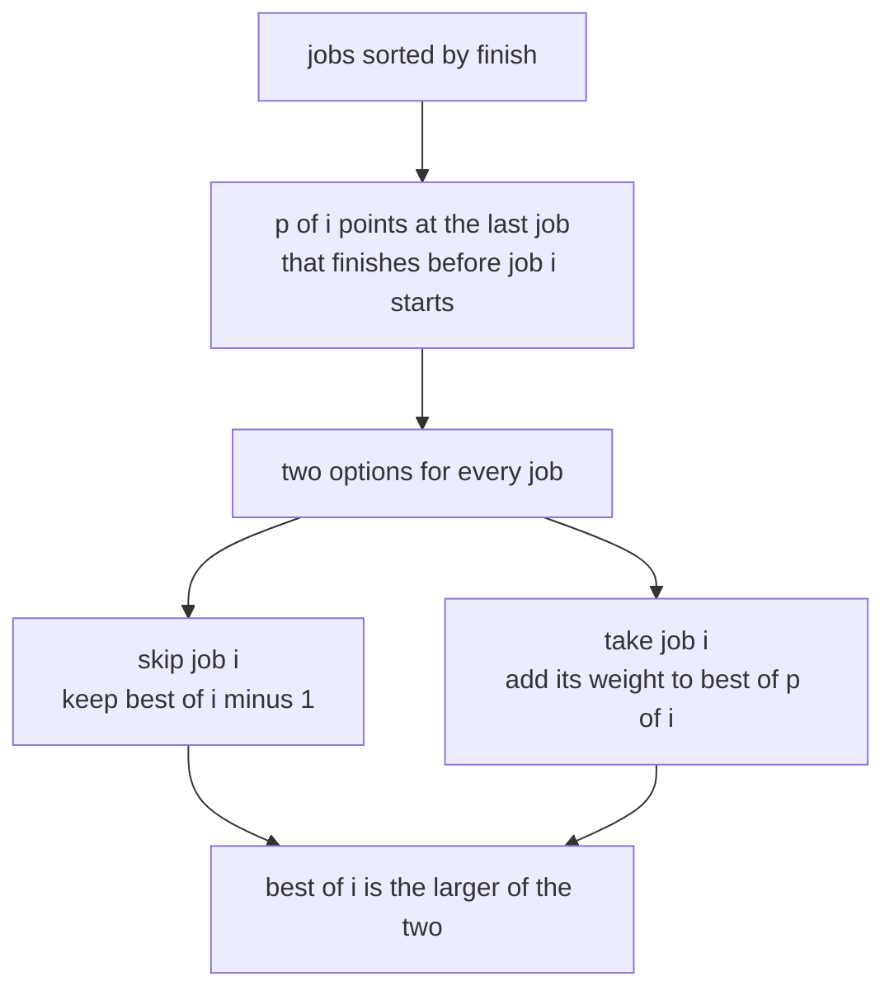
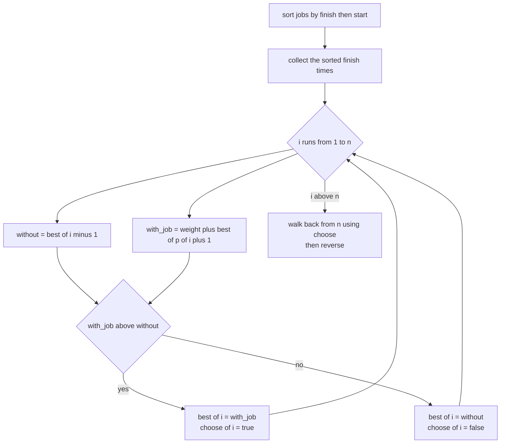
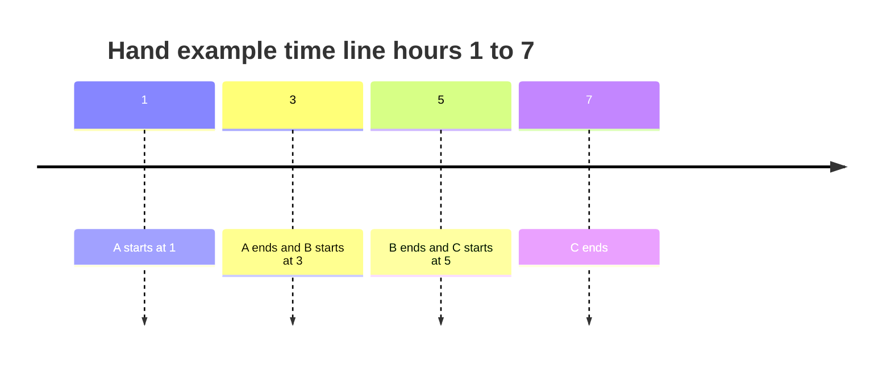
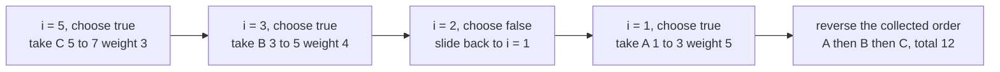

# 330 — Weighted interval scheduling (DP).

> **Tier:** Intermediate · **CTCI chapter:** Ch 8 — Recursion and Dynamic Programming
> **Task spec:** [330-weighted-interval-scheduling-dp.md](../../../tasks/intermediate/330-weighted-interval-scheduling-dp.md)
> **Solutions:** [Python](../../../solutions/python/intermediate/330-weighted-interval-scheduling-dp/solution.py) ·
> [Java](../../../solutions/java/intermediate/330-weighted-interval-scheduling-dp/Solution.java) ·
> [JavaScript](../../../solutions/javascript/intermediate/330-weighted-interval-scheduling-dp/solution.js) ·
> [C#](../../../solutions/csharp/intermediate/330-weighted-interval-scheduling-dp/Solution.cs)

## 1. Problem restatement

**Input:** `n` jobs, each a triple `(start, finish, weight)`. Two jobs are *compatible* when one
finishes at or before the other starts — the files document the half-open `[start, finish)`
convention, so a job ending at 3 and a job starting at 3 do not overlap.

**Output:** the maximum total weight of any set of pairwise compatible jobs, together with one set
that achieves it. An empty input yields a total of 0 and an empty selection; a single job yields
its own weight and itself.

Every solution ships the same deterministic generator (a linear congruential generator with
`seed = (seed * 75 + 74) % 65537`, producing `start`, `finish` and `weight` for 4 to 9 jobs) and the
same hand-checked examples:

| Jobs | Best total | Chosen set |
| --- | --- | --- |
| `[[1,3,5], [2,5,6], [4,6,5], [6,7,4]]` | `14` | `[[1,3,5], [4,6,5], [6,7,4]]` |
| `[[1,3,5], [3,5,4], [5,7,3], [1,7,10], [2,3,2]]` | `12` | `[[1,3,5], [3,5,4], [5,7,3]]` |
| `[]` | `0` | `[]` |
| `[[4,9,7]]` | `7` | `[[4,9,7]]` |

The first row carries a correction that all four files spell out in a comment and in an assertion:
the brief's example claims a total of `12`, but the best set `(1,3) + (4,6) + (6,7)` weighs
`5 + 5 + 4 = 14`, and the exhaustive brute-force oracle confirms 14. The files assert 14 and say
in the header that 12 is wrong.

## 2. Intuition

The naive idea is to enumerate subsets, keep the compatible ones and take the best total. That is
exactly what the `brute_force` oracle does, and it is `O(2^n)` — usable for the eight-job test
batteries, hopeless in general.

The insight is that compatibility is a **suffix property**: if you process jobs in order of
increasing finish time, the only thing you need to know about the earlier jobs is how much weight
you can still collect before a given start time. Define

- `p(i)` = the index of the last job (in finish order) that finishes at or before job `i` starts,
  or `-1` when no such job exists.

Then the optimal answer obeys a two-way recurrence, because every job is either skipped or taken
and, once taken, the rest of the schedule must be optimal on the prefix ending at `p(i)`:

`best[i] = max(best[i-1], weight[i] + best[p(i)])`

Since the jobs are sorted by finish time, `finish[p(i)] <= start[i]` is a *sorted* array scan, so
`p(i)` is found by binary search rather than by walking backwards through every earlier job.



The mirror image of the same test shows up in the interval-tree task of this tier: task 329 uses
closed intervals and counts touching as an intersection, while this task uses the half-open
convention and counts touching as compatible. Both are the comparison `a.finish` versus `b.start`;
only the inequality flips.

## 3. Algorithm

1. Sort the jobs by `(finish, start)` and collect the sorted finish times in their own array.
2. For each job `i`, binary-search `p(i)`: the largest index `j < i` whose finish is at most
   `start[i]`; use `-1` when there is none.
3. Fill `best[1..n]` left to right with `best[i] = max(best[i-1], weight[i] + best[p(i) + 1])` and
   record in `choose[i]` whether the *take* branch won.
4. Reconstruct: start at `i = n`; when `choose[i]` is true, emit job `i` and jump to
   `p(i) + 1`, otherwise step back to `i - 1`. Reverse the collected jobs and return them with
   `best[n]`.

```text
procedure weighted_interval_scheduling(jobs)
    if jobs is empty then
        return total 0 with an empty selection
    ordered ← jobs sorted by finish, then by start
    finishes ← the finish times of ordered
    best ← array of n + 1 zeros
    choose ← array of n + 1 flags set to false
    for i ← 1 to n do
        without ← best[i - 1]
        with_job ← weight of ordered[i - 1] + best[last_compatible(finishes, i - 1) + 1]
        if with_job > without then
            best[i] ← with_job
            choose[i] ← true
        else
            best[i] ← without
        end
    end
    return best[n] with reconstruct(finishes, choose)
end

function last_compatible(finishes, i)
    lo ← 0
    hi ← i - 1
    result ← -1
    while lo <= hi do
        mid ← (lo + hi) // 2
        if finishes[mid] <= start of ordered[i] then
            result ← mid
            lo ← mid + 1
        else
            hi ← mid - 1
        end
    end
    return result
end

procedure reconstruct(finishes, choose)
    chosen ← empty list
    i ← n
    while i > 0 do
        if choose[i] then
            append ordered[i - 1] to chosen
            i ← last_compatible(finishes, i - 1) + 1
        else
            i ← i - 1
        end
    end
    reverse chosen
    return chosen
end
```

The off-by-one that trips people up is caught by the `+1`: `best` is indexed by "how many jobs of
the prefix", so the answer for the prefix ending at job `p(i)` lives at `best[p(i) + 1]`, and
`p(i) = -1` correctly reads `best[0] = 0`.



## 4. Worked example

Take the hand-checked set `A = [1,3,5]`, `B = [3,5,4]`, `C = [5,7,3]`, `D = [1,7,10]`,
`E = [2,3,2]`. Sorting by `(finish, start)` gives `A(3)`, `E(3)`, `B(5)`, `D(7)`, `C(7)` — the two
finish-7 jobs are ordered by start, so the long decoy `D` comes before `C`.



The DP then walks the sorted order once:

| `i` | job | start | `p(i)` | `without = best[i-1]` | `with_job` | `best[i]` | `choose[i]` |
| --- | --- | --- | --- | --- | --- | --- | --- |
| 1 | `A [1,3,5]` | 1 | `-1` | `0` | `5 + best[0] = 5` | `5` | true |
| 2 | `E [2,3,2]` | 2 | `-1` | `5` | `2 + best[0] = 2` | `5` | false |
| 3 | `B [3,5,4]` | 3 | `1` | `5` | `4 + best[2] = 9` | `9` | true |
| 4 | `D [1,7,10]` | 1 | `-1` | `9` | `10 + best[0] = 10` | `10` | true |
| 5 | `C [5,7,3]` | 5 | `2` | `10` | `3 + best[3] = 12` | `12` | true |

Row 3 is the first place the recurrence pays off: `B` starts at 3, so it may follow anything that
finished by 3, and `finishes[1] = 3` makes `p = 1` — the *last* such job, which is `E`, whose
schedule is only worth 5 rather than a hypothetical schedule that included `A` directly. Row 4 is
the trap: the heavy decoy `D` reaches 10 on its own, beating every prefix before it, yet row 5
overtakes it. Row 2 is skipped silently: `E` cannot beat the prefix that already contains `A`.

Reconstruction walks backwards, visiting the `choose` decisions in reverse:



The jump from `i = 3` to `i = 1` is `p(2) + 1 = 1 + 1 = 2`, which lands on the `choose = false`
slot for `E`; one more step reaches `A`. The emitted list is `[C, B, A]` before the reversal, and
`[[1,3,5], [3,5,4], [5,7,3]]` after it, exactly what the assertion expects. The verification then
re-sums the chosen weights (`5 + 4 + 3 = 12`) and re-checks pairwise compatibility, so a
reconstruction bug cannot hide behind a correct optimum.

## 5. Complexity

Let `n` be the number of jobs and `k` the size of the chosen set.

| Measure | Bound | Why it holds |
| --- | --- | --- |
| Time, pre-processing | O(n log n) | the sort by `(finish, start)` dominates |
| Time, DP | O(n log n) | one binary search over the finish array per job |
| Time, reconstruction | O(k log n) | each emitted job re-runs `last_compatible` over a prefix |
| Space | O(n) | the `best` array, the `choose` flags, the finish array and one sorted copy |
| Brute force oracle | O(2^n · n log n) | every subset is summed and the expensive ones are sorted to test compatibility |
| Alternative: recursion without memoising | exponential | the take/skip tree re-explores the same prefixes |
| Alternative: memoised recursion | O(n log n) | same bound as the iterative version, but with recursion depth `n` |

The `O(n log n)` DP is also the reason the tests can afford the `O(2^n)` oracle: it only runs on
4 to 9 jobs, generated deterministically, so the comparison is exact rather than statistical.

## 6. Pitfalls and edge cases

- **Half-open versus closed compatibility.** The files define compatibility as `finish <= start`,
  which is what makes `[1,3)` and `[3,5)` compatible. Task 329 makes the opposite choice for closed
  intervals. Changing this test flips answers such as the hand example's total from 12.
- **Empty input.** `[]` must return total 0 and an empty selection, not `null` or an exception; all
  four files assert it before the single-job case.
- **Single job.** `[[4,9,7]]` returns weight 7 and itself. The DP's `best[0] = 0` sentinel is what
  lets a job with no compatible predecessor be taken.
- **The brief's arithmetic.** The example set that the brief totals at 12 is really 14
  (`5 + 5 + 4`); the solutions assert 14 and cross-check it against brute force. Do not "fix" a
  solution to match the wrong number.
- **Ties in finish time.** Two jobs may finish at the same instant. Sorting by `(finish, start)`
  makes the order deterministic, and — because compatibility allows `finish <= start` — touching
  jobs can both be taken, as `A` and `B` are.
- **Strict greater-than in the recurrence.** `with_job > without` picks the skip branch on ties, so
  a zero-weight job is never preferred over skipping it. Either choice optimises the weight; the
  flag keeps the reconstruction consistent with the value, which is what the "chosen weights sum to
  the total" assertion checks.
- **The `+1` shift.** `best` is 1-indexed while the jobs are 0-indexed; `p(i) + 1` and `i - 1` must
  not be mixed up, or the reconstruction slips one job out of step with the reported total.
- **Overlapping decoys.** A single heavy job (`D` with weight 10) can beat every two-job prefix
  before it; the DP only survives that because row 5 compares against `best[3]`, which already
  includes the best of all earlier choices.
- **Integer extremes.** Weights are `1 + seed % 20` in the generated sets, so no overflow is
  reachable in the fixed-width languages; summing genuinely large weights in Java or C# would need
  a 64-bit accumulator.

## 7. Variants and follow-ups

- **Reconstruction as a first-class feature.** [331-weighted-job-scheduling-with-reconstruction.md](../../../tasks/intermediate/331-weighted-job-scheduling-with-reconstruction.md)
  makes the backtracking the headline task; the `choose` flags here are the minimal version of it.
- **When the intervals are queried instead of scheduled.** [329-range-intersection-queries-interval-trees-basics.md](../../../tasks/intermediate/329-range-intersection-queries-interval-trees-basics.md)
  stores the same intervals in an augmented BST and answers intersection queries.
- **Counting overlaps rather than scheduling them.** [326-meeting-rooms-required-interval-partitioning.md](../../../tasks/intermediate/326-meeting-rooms-required-interval-partitioning.md)
  sorts by start and uses a min-heap of finishing times; [325-minimum-number-of-platforms-for-trains-sweep-line.md](../../../tasks/intermediate/325-minimum-number-of-platforms-for-trains-sweep-line.md)
  answers the same question with a sweep line.
- **Online intervals.** [332-implement-calendar-booking-mycalendar-i-ii-iii-style.md](../../../tasks/intermediate/332-implement-calendar-booking-mycalendar-i-ii-iii-style.md)
  cannot re-sort, because intervals arrive one at a time; it keeps a running list and rejects
  conflicts. The bookkeeping is the same inequality, evaluated incrementally.
- The chapter walkthrough in [Recursion and Dynamic Programming](../../ctci/08-recursion-and-dp.md)
  places this recurrence next to longest increasing subsequence and knapsack as the three
  "sort first, then decide" DPs.

## 8. Check yourself

1. Why does the sort key include `start` when the DP only reads finish times?

<details><summary>Show answer</summary>

To make the ordered list deterministic when two jobs finish at the same instant. Compatibility
still allows both to be chosen, but the recursion's indices and the reconstruction walk need a
fixed order, and the printed chosen set must not depend on the sort's stability.

</details>

2. What is `p(i)` for a job that starts before every stored finish, and what does the recurrence do
   with it?

<details><summary>Show answer</summary>

`p(i) = -1`, meaning no earlier job can precede it. The recurrence reads `best[p(i) + 1] = best[0]`,
the sentinel zero, so the take branch is exactly the job's own weight. That is why `[[4,9,7]]`
returns 7.

</details>

3. Why is the hand example's optimum 12 rather than the decoy's 10?

<details><summary>Show answer</summary>

Because the three compatible short jobs `[1,3)`, `[3,5)` and `[5,7)` chain to `5 + 4 + 3 = 12`,
which is larger than `D`'s single 10. The DP discovers this at row 5, where `with_job = 3 + best[3]`
uses the prefix value 9 built from `A` and `B`.

</details>

4. How does the reconstruction know to skip `E`?

<details><summary>Show answer</summary>

It never visits `E` as a decision: the jump from `i = 3` goes to `p(2) + 1 = 2`, the slot whose
`choose` flag is false for `E`, and the next iteration falls to `i = 1`. The `choose` flags record
exactly the branches the optimal path took.

</details>

5. What makes the brute-force cross-check trustworthy as an oracle?

<details><summary>Show answer</summary>

It uses no part of the DP: it enumerates all `2^n` subsets, sums the weights, sorts each candidate
and validates pairwise `finish <= start`. On the generated sets of 4 to 9 jobs it is fast enough to
run for 60 trials, and the DP's total must match it exactly on every one.

</details>
