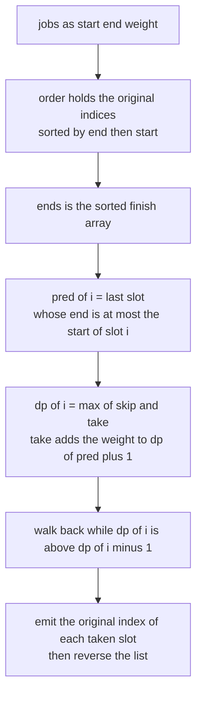
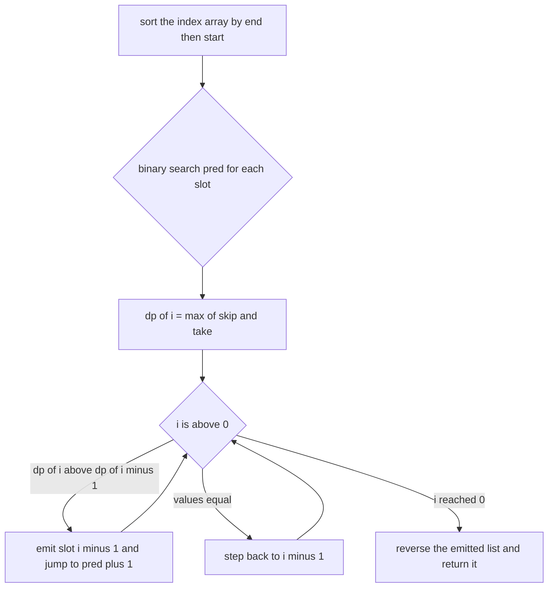
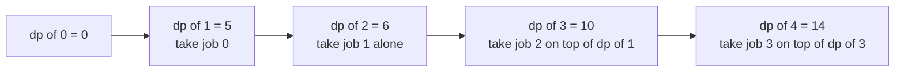
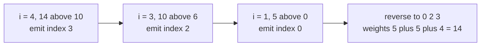

# 331 — Weighted job scheduling with reconstruction.

> **Tier:** Intermediate · **CTCI chapter:** Ch 8 — Recursion and Dynamic Programming
> **Task spec:** [331-weighted-job-scheduling-with-reconstruction.md](../../../tasks/intermediate/331-weighted-job-scheduling-with-reconstruction.md)
> **Solutions:** [Python](../../../solutions/python/intermediate/331-weighted-job-scheduling-with-reconstruction/solution.py) ·
> [Java](../../../solutions/java/intermediate/331-weighted-job-scheduling-with-reconstruction/Solution.java) ·
> [JavaScript](../../../solutions/javascript/intermediate/331-weighted-job-scheduling-with-reconstruction/solution.js) ·
> [C#](../../../solutions/csharp/intermediate/331-weighted-job-scheduling-with-reconstruction/Solution.cs)

## 1. Problem restatement

**Input:** `n` jobs as triples `(start, end, weight)`, interpreted as half-open intervals. Two jobs
*overlap* when `a.start < b.end and b.start < a.end` — the strict test the files keep in a shared
`overlaps` helper, so `end == next start` is not an overlap.

**Output:** the best total weight of a set of pairwise non-overlapping jobs, **plus the original
indices of one such set**, in increasing index order. The indices refer to the caller's array, not
to the internally sorted order.

Every solution asserts the same battery, with `weighted_schedule` returning a value and an index
list:

| Jobs (as given) | Best value | Chosen indices |
| --- | --- | --- |
| `[(1,3,5), (2,5,6), (4,6,5), (6,7,4)]` | `14` | `[0, 2, 3]` |
| `[]` | `0` | `[]` |
| `[(5,9,7)]` | `7` | `[0]` |
| `[(0,5,3), (5,10,4)]` — touching | `7` | `[0, 1]` |
| `[(0,10,100), (0,4,3), (6,10,3)]` — heavy decoy | `100` | `[0]` |

Beyond the fixed rows, each file runs 200 deterministic trials (`seed = 9091`, generator
`seed = (seed * 75 + 74) % 65537`, `n` between 1 and 12 jobs) and checks four things at once: the
value equals the exhaustive brute-force optimum, the chosen indices are distinct, no two chosen
jobs overlap, and the chosen weights sum exactly to the reported value. That last assertion is what
makes the reconstruction — not just the optimum — part of the contract.

## 2. Intuition

Task 330 already computes the optimal value. The new work here is to hand back the *set* that
achieves it, and to prove it is feasible. Two details keep the reconstruction honest:

- The recursion must run over an order in which the predecessor is always to the left. Sorting the
  **indices** by `(end, start)` gives that order while leaving the caller's array untouched, so a
  slot number and an original index are two different integers that must not be confused.
- The reconstruction needs no extra bookkeeping: a job is part of the optimum exactly when it
  improved the prefix value, i.e. when `dp[i] > dp[i-1]`. The `dp` table already encodes the
  take/skip decision, so the walk back can read it instead of storing a flag.

The predecessor array is computed once, for every slot, with a lower-bound search over the sorted
end times:

```text
lo ← 0, hi ← i
while lo < hi do
    mid ← (lo + hi) // 2
    if ends[mid] <= start of slot i then lo ← mid + 1 else hi ← mid
pred[i] ← lo - 1
```

After the loop `ends[0..lo-1]` are all at most the start time of slot `i`, and `ends[lo]` is
greater, so `pred[i] = lo - 1` is the last compatible slot — or `-1` when nothing finishes early
enough. This is the same quantity task 330 computes with an inclusive `hi = i - 1` search and a
running `best`; the two formulations must agree, and the cross-checks in both files confirm they do.



## 3. Algorithm

1. If there are no jobs, return `(0, [])`.
2. Build `order`, the original indices sorted by `(end, start)`, and `ends`, the finish times in
   that order.
3. For each slot `i`, binary-search `pred[i]`: the last slot whose end is at most the start of slot
   `i`, or `-1`.
4. Fill `dp[i] = max(dp[i-1], weight of slot i + dp[pred[i] + 1])` from `i = 1` to `n`.
5. Walk `i` from `n` down to `0`: if `dp[i] > dp[i-1]`, slot `i - 1` is in this optimum — record
   `order[i - 1]` and jump to `pred[i - 1] + 1`; otherwise step back to `i - 1`.
6. Reverse the recorded indices and return them with `dp[n]`.

```text
procedure weighted_schedule(jobs)
    n ← number of jobs
    if n is 0 then
        return total 0 and an empty index list
    order ← indices 0 to n - 1 sorted by (end, start) of jobs
    ends ← array with ends[i] = end of jobs[order[i]]

    pred ← array of n entries
    for i ← 0 to n - 1 do
        lo ← 0
        hi ← i
        while lo < hi do
            mid ← (lo + hi) // 2
            if ends[mid] <= start of jobs[order[i]] then
                lo ← mid + 1
            else
                hi ← mid
            end
        end
        pred[i] ← lo - 1
    end

    dp ← array of n + 1 zeros
    for i ← 1 to n do
        skip ← dp[i - 1]
        take ← weight of jobs[order[i - 1]] + dp[pred[i - 1] + 1]
        dp[i] ← max(skip, take)
    end

    chosen ← empty list
    i ← n
    while i > 0 do
        if dp[i] > dp[i - 1] then
            append order[i - 1] to chosen
            i ← pred[i - 1] + 1
        else
            i ← i - 1
        end
    end
    reverse chosen
    return dp[n] and chosen
end
```

Two invariants make the walk safe. First, `pred[i - 1] + 1 <= i - 1 < i`, so every jump strictly
decreases `i` and the loop terminates. Second, whenever `dp[i] == dp[i-1]` the optimum does not
need slot `i - 1`, so the loop simply steps back; ties are resolved in favour of skipping, exactly
as in task 330.



## 4. Worked example

Run the hand-checked set `0:(1,3,5) 1:(2,5,6) 2:(4,6,5) 3:(6,7,4)` — the same four jobs whose
optimum task 330 computes, and the one the files assert is `(14, [0, 2, 3])`. Sorting by
`(end, start)` is already the identity here, so `order = [0, 1, 2, 3]` and `ends = [3, 5, 6, 7]`.

Step 3 fills `pred` slot by slot. Slot `2` is where the first predecessor appears:

| Slot `i` | `order[i]` | `start` | Binary search over `ends` | `pred[i]` |
| --- | --- | --- | --- | --- |
| 0 | 0 | 1 | `lo` can only be 0, so `lo - 1 = -1` | `-1` |
| 1 | 1 | 2 | `ends[0] = 3 > 2`, so `lo` stays 0 | `-1` |
| 2 | 2 | 4 | `ends[0] = 3 <= 4`, so `lo` becomes 1 | `0` |
| 3 | 3 | 6 | `ends[1] = 5` and `ends[2] = 6` are both `<= 6`, so `lo` becomes 3 | `2` |

Step 4 then fills `dp`. Slot 3 is the interesting row: it may follow anything ending by 6, and
`pred[3] = 2` says the *last* such slot is the one holding job 2, so the take branch reads
`dp[3] = 10`.

| `i` | slot `i-1` | `skip = dp[i-1]` | `take` | `dp[i]` | decision |
| --- | --- | --- | --- | --- | --- |
| 1 | 0 `(1,3,5)` | `0` | `5 + dp[0] = 5` | `5` | take |
| 2 | 1 `(2,5,6)` | `5` | `6 + dp[0] = 6` | `6` | take |
| 3 | 2 `(4,6,5)` | `6` | `5 + dp[1] = 10` | `10` | take |
| 4 | 3 `(6,7,4)` | `10` | `4 + dp[3] = 14` | `14` | take |



Step 5 walks the table back. Every row improves on its predecessor, so every slot is emitted:

| `i` | comparison | action | next `i` |
| --- | --- | --- | --- |
| 4 | `14 > 10` | emit `order[3] = 3` | `pred[3] + 1 = 3` |
| 3 | `10 > 6` | emit `order[2] = 2` | `pred[2] + 1 = 1` |
| 1 | `5 > 0` | emit `order[0] = 0` | `pred[0] + 1 = 0` |
| 0 | loop ends | — | — |



The emitted list is `[3, 2, 0]`; reversing gives `[0, 2, 3]`, which the assertion compares against
directly. Note the jump at row 2: the walk does not step from `i = 3` to `i = 2`, it lands on the
slot after `pred[2]`, because slot 1 (`(2,5,6)`) conflicts with job 2 and cannot appear in the same
optimum. The file then re-sums `5 + 5 + 4 = 14`, re-checks pairwise non-overlap and confirms the
value matches the exhaustive brute-force oracle — three independent guards against a reconstruction
that reports a plausible-looking but infeasible set.

## 5. Complexity

Let `n` be the number of jobs and `k` the size of the reconstructed set.

| Measure | Bound | Why it holds |
| --- | --- | --- |
| Time, sorting | O(n log n) | one sort of the index array by `(end, start)`, plus an O(n) pass to build `ends` |
| Time, predecessors | O(n log n) | one lower-bound search over a prefix of `ends` per slot |
| Time, DP | O(n) | one constant-time recurrence step per slot |
| Time, reconstruction | O(n) | each step either decreases `i` or jumps to `pred[i-1] + 1 < i`, so at most `n` steps |
| Space | O(n) | `order`, `ends`, `pred` and `dp` are each `n` (or `n + 1`) entries; the result adds `k` indices |
| Brute force oracle | O(2^n · n²) | every subset is enumerated and each selected job is compared with the ones already picked |
| Alternative: store a `choose` flag | O(n) space for the same answer | the `dp` comparison already decides the branch, so the extra array only documents the choice |

The brute-force oracle is quadratic per subset rather than `n log n`-per-subset because it tests
overlap incrementally instead of sorting. With `n` capped at 12 that is at most 4096 subsets, which
is why 200 trials still run in well under a second.

## 6. Pitfalls and edge cases

- **Slots versus indices.** `order[i - 1]` is the original index of the taken job. Returning `i - 1`
  instead passes the hand example only because that set happens to be already sorted by end; the
  random trials with `n` up to 12 catch it immediately.
- **Ascending output order.** The walk emits jobs from the end backwards, so the reversal is not
  cosmetic; the assertions compare the index list directly.
- **Ties between skip and take.** The strict `dp[i] > dp[i-1]` prefers skipping a job whose weight
  improves nothing. Either branch is optimal in value, but the choice must be consistent with the
  walk-back or the reconstruction slides out of step with `dp[n]`.
- **Touching intervals.** `[(0,5,3), (5,10,4)]` chains to 7 because `overlaps` uses strict
  inequalities. Reusing task 329's closed-interval test here would make the two jobs conflict and
  drop the answer to 4.
- **A heavy decoy beats a chain.** For `[(0,10,100), (0,4,3), (6,10,3)]` the two light jobs together
  weigh only 6, so the optimum is the single 100-weight job — and the sorted order puts it after
  the light jobs, not first.
- **Empty and single-job inputs.** `[]` returns `(0, [])` and `[(5,9,7)]` returns `(7, [0])`; both
  are asserted before the randomized loop.
- **Duplicate jobs.** Two identical triples are distinct jobs with distinct indices, and the trials
  assert `len(set(chosen)) == len(chosen)` so a job cannot be scheduled twice.
- **Brute force must not count invalid subsets.** The Python oracle adds a job's weight only while
  the subset stays feasible and uses a `for ... else` to discard the mask as soon as an overlap is
  found. Adding the weight before validating would inflate the oracle and hide a real bug.
- **Cutting the search short.** `pred` is looked up over `ends[0..i-1]` only; searching the whole
  array would let a job be its own predecessor.
- **Fixed-width sums.** Weights are `1 + seed % 20` over at most 12 jobs (240 in total), so 32-bit
  accumulators are safe here; a production version would still want a 64-bit total.

## 7. Variants and follow-ups

- **Value only.** [330-weighted-interval-scheduling-dp.md](../../../tasks/intermediate/330-weighted-interval-scheduling-dp.md)
  solves the same recurrence without reconstruction and stores an explicit `choose` flag; this task
  derives the same information from `dp` itself.
- **Index intervals instead of scheduling them.** [329-range-intersection-queries-interval-trees-basics.md](../../../tasks/intermediate/329-range-intersection-queries-interval-trees-basics.md)
  answers intersection queries on the same interval algebra, with the closed-interval convention.
- **Counting conflicts instead of avoiding them.** [326-meeting-rooms-required-interval-partitioning.md](../../../tasks/intermediate/326-meeting-rooms-required-interval-partitioning.md)
  sorts by start and keeps a min-heap of end times; the answer there is a resource count, not a
  schedule.
- **Reconstruction in other DPs.** The same "read the table backwards" trick drives edit distance
  alignment in [297-multi-dimensional-dp-example-edit-distance-variants.md](../../../tasks/intermediate/297-multi-dimensional-dp-example-edit-distance-variants.md)
  and the row-by-row path recovery tasks in this tier.
- The chapter walkthrough in [Recursion and Dynamic Programming](../../ctci/08-recursion-and-dp.md)
  groups this recurrence with knapsack and grid paths as the DPs where reconstruction is the second
  half of the interview question.

## 8. Check yourself

1. Why is `pred` computed for every slot before the DP starts, rather than inside the DP loop?

<details><summary>Show answer</summary>

Because `pred[i]` depends only on the sorted end times and the start of slot `i`, not on any `dp`
value. Computing all of them once keeps the DP loop to one constant-time step per slot and lets the
reconstruction reuse the same array instead of re-running the binary search.

</details>

2. In the worked example, why does the walk-back jump from `i = 3` straight to `i = 1`?

<details><summary>Show answer</summary>

Because slot 2 is job `(4,6,5)` and `pred[2] = 0`, so `pred[2] + 1 = 1`. Any job that must follow
`(4,6,5)` has to finish by 4, and slot 1 — job `(2,5,6)` — does not. The jump is the DP's schedule
information resurfacing during the reconstruction.

</details>

3. What does `dp[i] == dp[i-1]` mean, and what does the code do with it?

<details><summary>Show answer</summary>

It means slot `i - 1` adds nothing to the best prefix value, so the optimum does not need it. The
code steps back to `i - 1` without emitting, which is also the tie-breaking rule when a zero-weight
job could be added for free.

</details>

4. How would the answer change if the intervals were closed instead of half-open?

<details><summary>Show answer</summary>

Jobs that merely touch would overlap, so `[(0,5,3), (5,10,4)]` could no longer both be taken and
its assertion would drop from 7 to 4. The fix is symmetric in both places the convention appears:
the `overlaps` helper and the `ends[mid] <= start` comparison inside the predecessor search.

</details>

5. Why does the verification re-check feasibility and the weight sum instead of only comparing
   totals?

<details><summary>Show answer</summary>

Because the total alone cannot detect a broken reconstruction. A set with overlapping jobs, a
duplicated index, or weights that do not add up to `dp[n]` would still "match" a value-only check if
the DP itself were wrong in a compensating way. The four assertions
(value, distinctness, feasibility, sum) pin the output from independent angles.

</details>
