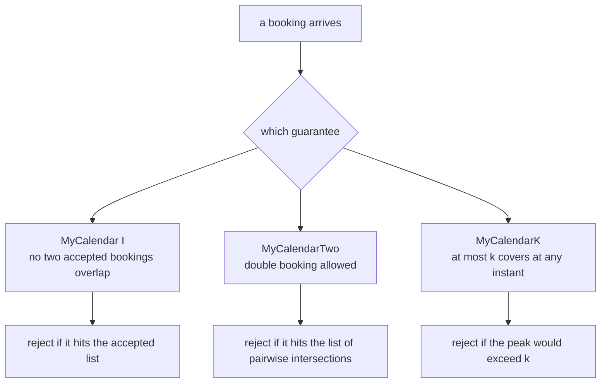
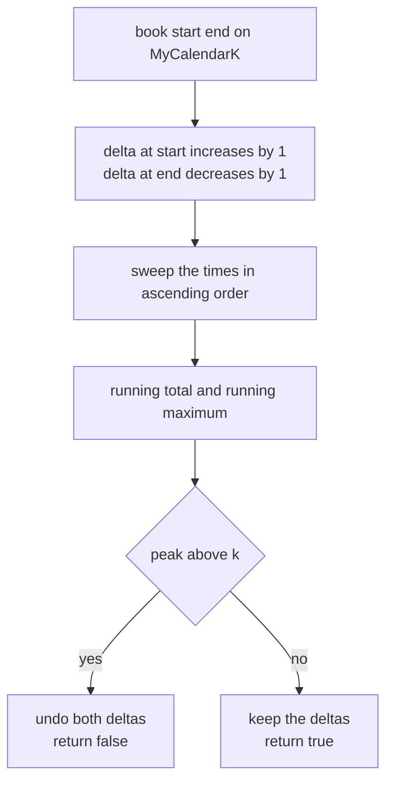
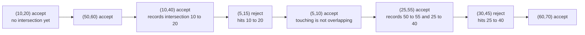
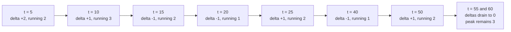

# 332 — Implement calendar booking (MyCalendar I/II/III style).

> **Tier:** Intermediate · **CTCI chapter:** Ch 7 — Object-Oriented Design
> **Task spec:** [332-implement-calendar-booking-mycalendar-i-ii-iii-style.md](../../../tasks/intermediate/332-implement-calendar-booking-mycalendar-i-ii-iii-style.md)
> **Solutions:** [Python](../../../solutions/python/intermediate/332-implement-calendar-booking-mycalendar-i-ii-iii-style/solution.py) ·
> [Java](../../../solutions/java/intermediate/332-implement-calendar-booking-mycalendar-i-ii-iii-style/Solution.java) ·
> [JavaScript](../../../solutions/javascript/intermediate/332-implement-calendar-booking-mycalendar-i-ii-iii-style/solution.js) ·
> [C#](../../../solutions/csharp/intermediate/332-implement-calendar-booking-mycalendar-i-ii-iii-style/Solution.cs)

## 1. Problem restatement

**Input:** a stream of bookings, each a half-open interval `[start, end)`. Bookings that merely
touch — one ending exactly when the next begins — do **not** overlap; every file states this and
tests it (`(20, 30)` is accepted right after `(10, 20)`, and `sweep_peak([(1,2), (2,3)]) == 1`).

**Output:** three classes, each answering `book(start, end)` with a boolean and each keeping the
accepted bookings:

- **`MyCalendar` (I)** — accept only bookings that overlap nothing accepted so far.
- **`MyCalendarTwo` (II)** — double booking is allowed, so a booking is rejected only when it would
  create a **triple** overlap.
- **`MyCalendarK(k)` (III)** — at most `k` bookings may cover the same instant; `k < 1` is a
  programming error and raises.

The fixed assertions across the four files:

| Class | Sequence | Results |
| --- | --- | --- |
| `MyCalendar` | `(10,20) (15,25) (20,30) (5,10) (19,20) (10,15)` | `T F T T F F` |
| `MyCalendarTwo` | `(10,20) (50,60) (10,40) (5,15) (5,10) (25,55)` | `T T T F T T` |
| `MyCalendarK(3)` | the same six bookings | `T T T T T T`, `max_overlap() == 3` |
| `MyCalendarK(2)` | the same six bookings | `T T T F T T`, `max_overlap() == 2` |

`MyCalendar` additionally asserts the exact accepted list `[(10,20), (20,30), (5,10)]`, so rejected
bookings must never leak into the state. `MyCalendarTwo` rejects `(30, 45)` at the end (it would
triple-cover `[30, 40)`) and accepts `(60, 70)`. Both `K(3)` and `K(2)` reject `(12, 13)`, and the
independent oracle asserts `sweep_peak([(5,15), (10,20), (10,40)]) == 3`, `sweep_peak([]) == 0`,
`sweep_peak([(1,2)]) == 1` and `sweep_peak([(1,5), (2,6), (3,7)]) == 3`.

## 2. Intuition

The naive answer to all three questions is "keep every accepted booking and re-scan them", and the
files deliberately keep one such implementation as the **oracle**: `sweep_peak` builds a map of
`+1` at every start and `-1` at every end, walks the times in order and returns the highest running
total. That is the ground truth for "how deep is the deepest overlap", recomputed from scratch for
every candidate.

Each class then needs a cheaper invariant that answers its own question:

- **I** only needs the accepted list: a candidate is acceptable iff it misses every stored
  interval. Since the list is maintained, it never contains two overlapping entries.
- **II** can never hold a triple. The trick is to store the overlaps themselves: every time a
  candidate overlaps an accepted booking, record the **intersection** — `max` of the starts,
  `min` of the ends. That intersection is exactly the set of instants already covered twice, so a
  candidate is rejected iff it touches the intersection list, and no scan of deeper structure is
  needed.
- **III** replaces the list with a compressed **delta map**: `+1` at each start, `-1` at each end,
  aggregated per instant. The peak overlap is the maximum running sum over the sorted times, which
  is the sweep oracle operating on a map that is usually much smaller than the booking list.
  Acceptance is "add the two deltas, recompute the peak, and roll the deltas back if the peak
  exceeds `k`".



The three designs share one helper, `overlaps(a, b) = a.start < b.end and b.start < a.end`, and one
convention: half-open intervals. Touching bookings are therefore compatible, which is what makes
the delta map's `+1` and `-1` at the same instant cancel.

## 3. Algorithm

**`MyCalendar.book`.** Scan `accepted`; if any entry overlaps the candidate return false; otherwise
append and return true.

**`MyCalendarTwo.book`.**

1. If any stored intersection overlaps the candidate, reject — that would be a third cover.
2. Otherwise, for every accepted single that overlaps the candidate, append the intersection
   `[max(starts), min(ends)]`.
3. Append the candidate to the singles and return true.

**`MyCalendarK.book`.**

1. Add `+1` at `start` and `-1` at `end` to the delta map.
2. Sweep the map in increasing time order, tracking the running sum and its maximum.
3. If the maximum exceeds `k`, undo the two deltas and return false; otherwise return true.

```text
procedure book_second(start, end)
    for each pair in intersections do
        if overlaps(start, end, pair) then
            return false
        end
    end
    for each other in accepted_singles do
        if overlaps(start, end, other) then
            append the intersection of start end and other to intersections
        end
    end
    append start end to accepted_singles
    return true
end

procedure book_k(start, end, k)
    delta[start] ← delta[start] + 1
    delta[end] ← delta[end] - 1
    if peak(delta) > k then
        delta[start] ← delta[start] - 1
        delta[end] ← delta[end] + 1
        return false
    end
    return true
end

function peak(delta)
    running ← 0
    highest ← 0
    for each time in increasing order of delta do
        running ← running + delta[time]
        highest ← max(highest, running)
    end
    return highest
end
```

The rollback in `book_k` is what keeps a rejected booking out of the state: the map is mutated
first, tested, and then restored, so no separate "candidate" copy is allocated. Order matters in
`book_second` too — the rejection test runs before any intersection is appended, so a rejected
booking cannot pollute the intersection list.



## 4. Worked example

Trace `MyCalendarTwo` over the classic sequence. The state is the pair list and the single list;
each row shows what the rejection test saw and what was stored.

| Booking | Intersection list before | Hit? | Singles that overlap | Verdict | Intersections after |
| --- | --- | --- | --- | --- | --- |
| `(10, 20)` | `[]` | no | none | accept | `[]` |
| `(50, 60)` | `[]` | no | none | accept | `[]` |
| `(10, 40)` | `[]` | no | `(10, 20)` → `(10, 20)` | accept | `[(10, 20)]` |
| `(5, 15)` | `[(10, 20)]` | `(10, 20)` covers `[10, 15)` | — | **reject** | unchanged |
| `(5, 10)` | `[(10, 20)]` | no, it ends where `(10, 20)` starts | none | accept | `[(10, 20)]` |
| `(25, 55)` | `[(10, 20)]` | no | `(50, 60)` → `(50, 55)`, `(10, 40)` → `(25, 40)` | accept | `[(10, 20), (50, 55), (25, 40)]` |
| `(30, 45)` | `[(10, 20), (50, 55), (25, 40)]` | `(25, 40)` covers `[30, 40)` | — | **reject** | unchanged |
| `(60, 70)` | as above | no, `60` only touches `(50, 60)` | none | accept | unchanged |

The two rejections are different kinds of evidence: row 4 is caught by an intersection recorded one
step earlier, and row 7 is caught by the `(25, 40)` intersection that row 6 created. `max_overlap()`
then re-derives the answer with the sweep oracle over `singles` and returns 2.



For `MyCalendarK(3)` the same six bookings are all accepted, because the peak is exactly 3. The
delta map after those six bookings is `5:+2`, `10:+1`, `15:-1`, `20:-1`, `25:+1`, `40:-1`, `50:+1`,
`55:-1`, `60:-1`:



`t = 10` is the peak: `(10, 20)`, `(10, 40)` and `(5, 15)` all cover it. The candidate `(12, 13)`
would add `+1` at 12, raising that running total to 4, so `book(12, 13)` is rejected and both
deltas are undone. With `k = 2` the accepted set is the same as `MyCalendarTwo`'s, the peak is 2,
and `(12, 13)` is still rejected — at `t = 12` it would sit on top of `(10, 20)` and `(10, 40)`.
The random trials drive this equality the other way round as well: 240 generated bookings are fed
to `MyCalendarK(2)` and `MyCalendarTwo` in lockstep, and every verdict must match, alongside a
recomputed oracle sweep.

## 5. Complexity

Let `m` be the number of accepted bookings and `p` the number of stored intersections (`p <= m` in
practice, and bounded by the number of overlapping accepted pairs).

| Class | `book` time | Memory | Why |
| --- | --- | --- | --- |
| `MyCalendar` | O(m) | O(m) | one linear scan of the accepted list per booking |
| `MyCalendarTwo` | O(p + m) | O(m + p) | the intersection list is scanned first, then every single |
| `MyCalendarK` (Java, C#) | O(m) | O(m) | a `TreeMap` / `SortedDictionary` iterates in key order, so the peak sweep is one linear pass |
| `MyCalendarK` (Python, JS) | O(m log m) | O(m) | the map is unordered, so `peak` sorts the keys on every call |
| `sweep_peak` oracle | O(n log n) | O(n) | events are aggregated and the distinct times are sorted |

The delta map never re-scans the bookings, only the compressed event points, and it is updated in
place rather than rebuilt — which is why `MyCalendarK` answers III without materialising the
interval structure `MyCalendarTwo` needs. The oracle is deliberately the slow, obvious version: it
is only called once per booking in the trials, on inputs of 40 distinct times.

## 6. Pitfalls and edge cases

- **Half-open intervals.** `(20, 30)` is accepted after `(10, 20)` and `sweep_peak([(1,2), (2,3)])`
  is 1, not 2. Using `<=` in `overlaps` breaks the first assertion and inflates the second.
- **Rejected bookings must not change state.** `MyCalendar` asserts the accepted list is exactly
  `[(10,20), (20,30), (5,10)]` after three rejections. The same discipline is why `book_k` rolls the
  deltas back and `book_second` tests before appending intersections.
- **Order of the two scans in `MyCalendarTwo`.** The intersection list is checked first; if the
  loops were merged, a rejected booking could still record new intersections.
- **Intersections, not bookings.** The second list stores `[max(starts), min(ends)]`, a genuine
  interval intersection. Storing the candidate itself would reject legitimate double bookings.
- **Empty and touching bookings.** `sweep_peak([])` is 0 and `sweep_peak([(1,2)])` is 1. A degenerate
  zero-length booking contributes `+1` and `-1` at the same time, so the map nets out to zero and it
  is always accepted — the generator never produces one, but the code is safe for it.
- **`k < 1`.** All four constructors reject it (Python raises `ValueError`, JavaScript `Error`, Java
  `IllegalArgumentException`, C# `Exception`). A silently clamped `k = 0` calendar would reject
  everything with no error message.
- **Peak versus interval count.** `max_overlap()` is the peak depth, not the number of accepted
  bookings: six accepted bookings with a peak of 3 are asserted for `K(3)`.
- **Aggregated deltas.** Several bookings may share a start or an end; the map sums them, and the
  sweep must apply the whole aggregate at that instant, not one booking at a time.
- **The oracle shares the convention.** `sweep_peak` and the classes agree on half-open intervals by
  construction, so a wrong convention would not be caught by the random trials — the fixed,
  hand-checked rows are what pin it down.
- **Numeric guards.** Times are `0..40` with lengths `1..9` in the generated sequences, so nothing
  overflows. A production calendar would need to handle unbounded timestamps and time zones, which
  this task deliberately leaves out.

## 7. Variants and follow-ups

- **Time-window counting instead of interval bookkeeping.** [333-design-hit-counter-sliding-time-window.md](../../../tasks/intermediate/333-design-hit-counter-sliding-time-window.md)
  answers a related question — "how many events in the last 300 seconds" — with a ring buffer of
  buckets rather than an interval structure.
- **Interval algebra again.** [329-range-intersection-queries-interval-trees-basics.md](../../../tasks/intermediate/329-range-intersection-queries-interval-trees-basics.md)
  answers intersection queries on a static set, and [326-meeting-rooms-required-interval-partitioning.md](../../../tasks/intermediate/326-meeting-rooms-required-interval-partitioning.md)
  computes the peak depth directly — the same number `MyCalendarK(k)` constrains.
- **Sweeps with a heap.** [328-skyline-problem-heap-sweep-line.md](../../../tasks/intermediate/328-skyline-problem-heap-sweep-line.md)
  maintains a running structure over the same `+1`/`-1` event stream, and
  [325-minimum-number-of-platforms-for-trains-sweep-line.md](../../../tasks/intermediate/325-minimum-number-of-platforms-for-trains-sweep-line.md)
  uses the classic start/end two-pointer sweep.
- **Scaling the structure.** The linear scans are fine for interview-sized inputs; a real booking
  system would keep the accepted intervals in a balanced tree ordered by start (or a segment tree
  with lazy max, as in task 335) so that a single `book` costs O(log m).
- The chapter walkthrough in [Object-Oriented Design](../../ctci/07-object-oriented-design.md)
  places this trio next to the parking lot and call-centre exercises as the canonical
  "three requirements, three data structures" question.

## 8. Check yourself

1. Why can `MyCalendarTwo` decide triple overlap by looking only at stored intersections?

<details><summary>Show answer</summary>

An instant is covered twice exactly when it lies in the intersection of two accepted bookings, so
the list of pairwise intersections is precisely the "already at depth 2" region. A candidate that
overlaps any of those regions would reach depth 3, and one that misses them all can reach at most
depth 2.

</details>

2. What is the difference between `max_overlap()` on `MyCalendarK(3)` and the count of accepted
   bookings?

<details><summary>Show answer</summary>

`max_overlap()` is the deepest coverage at any single instant. The classic sequence makes all six
bookings acceptable with `k = 3`, yet no instant is covered more than three times; the count of
accepted bookings is irrelevant to the guarantee.

</details>

3. Why does `(12, 13)` get rejected by `MyCalendarK(2)` even though it is very short?

<details><summary>Show answer</summary>

Because depth is about simultaneous coverage, not duration. At `t = 12` the accepted set already
has `(10, 20)` and `(10, 40)` covering that instant, so the candidate would raise the peak to 3,
above `k = 2`. The delta map detects this by moving `+1` at 12 through the running total.

</details>

4. Which line in `overlaps` implements the half-open convention, and what breaks if it is changed?

<details><summary>Show answer</summary>

The strict comparisons: `start < other.end and other.start < end`. Making either one `<=` turns
touching intervals into conflicts, which breaks the `(20, 30)` acceptance in `MyCalendar`,
the `(5, 10)` acceptance in `MyCalendarTwo`, and the `sweep_peak([(1,2), (2,3)]) == 1` oracle row.

</details>

5. Why do the trials compare `MyCalendarK(1)` with `MyCalendar` and `MyCalendarK(2)` with
   `MyCalendarTwo` on generated sequences?

<details><summary>Show answer</summary>

Because both pairs must make the same accept/reject decisions: "no overlap" is `k = 1` and "no
triple" is `k = 2`. Feeding the same 200 to 240 bookings through two implementations written with
different data structures is a stronger check than asserting each one's `max_overlap()` alone.

</details>
