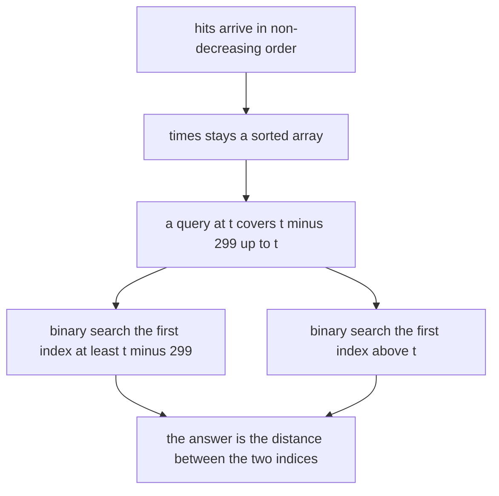
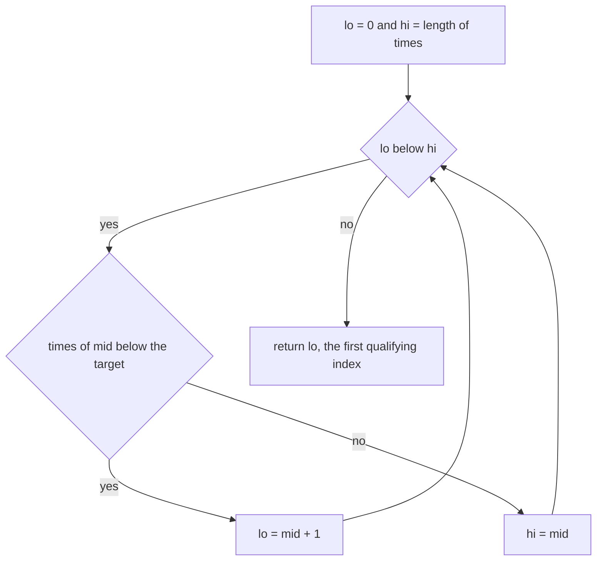
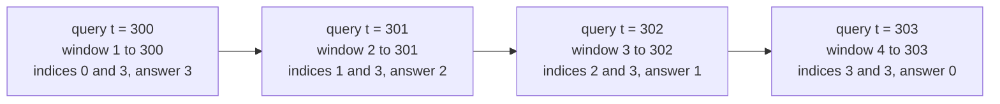
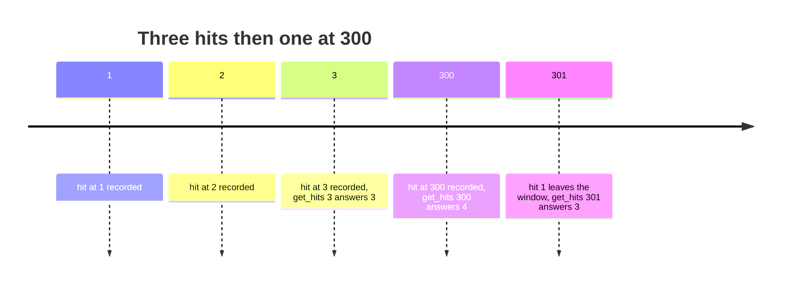

# 333 — Design hit counter (sliding time window).

> **Tier:** Intermediate · **CTCI chapter:** Ch 7 — Object-Oriented Design
> **Task spec:** [333-design-hit-counter-sliding-time-window.md](../../../tasks/intermediate/333-design-hit-counter-sliding-time-window.md)
> **Solutions:** [Python](../../../solutions/python/intermediate/333-design-hit-counter-sliding-time-window/solution.py) ·
> [Java](../../../solutions/java/intermediate/333-design-hit-counter-sliding-time-window/Solution.java) ·
> [JavaScript](../../../solutions/javascript/intermediate/333-design-hit-counter-sliding-time-window/solution.js) ·
> [C#](../../../solutions/csharp/intermediate/333-design-hit-counter-sliding-time-window/Solution.cs)

## 1. Problem restatement

**Input:** a stream of `hit(timestamp)` calls whose timestamps never go backwards, and queries
`get_hits(timestamp)`.

**Output:** for a query at time `t`, the number of recorded hits `h` with `t - 299 <= h <= t` — the
classic 300-second sliding window, where `WINDOW = 300` and the query instant itself is included.

The four files assert the same hand-checked rows. With hits at 1, 2 and 3:

| Query | Window | Answer | Which hits |
| --- | --- | --- | --- |
| `get_hits(1)` | `-298 .. 1` | `1` | 1 |
| `get_hits(2)` | `-297 .. 2` | `2` | 1, 2 |
| `get_hits(3)` | `-296 .. 3` | `3` | 1, 2, 3 |
| `get_hits(4)` | `-295 .. 4` | `3` | 1, 2, 3 |
| `get_hits(299)` | `0 .. 299` | `3` | 1, 2, 3 |
| `get_hits(300)` | `1 .. 300` | `3` | 1, 2, 3 |
| `get_hits(301)` | `2 .. 301` | `2` | 2, 3 |
| `get_hits(302)` | `3 .. 302` | `1` | 3 |
| `get_hits(303)` | `4 .. 303` | `0` | none |

Then `hit(300)` arrives and the tail of the window changes shape: `get_hits(300)` becomes 4,
`get_hits(301)` is 3, `get_hits(302)` is 2, `get_hits(599)` is 1 and `get_hits(600)` is 0.

Three more behaviours are pinned down by assertions:

- **Queries do not move time.** After hits at 1, 2, 3 and 300, `get_hits(2)` is 2, not 4: the hits
  that lie after `t` are simply outside `[t - 299, t]`.
- **A query before everything** returns 0 (`get_hits(0)`), and an empty counter answers 0.
- **Bursts share a timestamp.** Five hits at time 7 give `get_hits(7) = 5`, `get_hits(306) = 5` and
  `get_hits(307) = 0`.
- **Backwards timestamps are rejected.** `hit` raises when the new timestamp is smaller than the
  last one — an `assert` in Python, `IllegalArgumentException` in Java, `Error` in JavaScript and
  a plain `Exception` in C#.

## 2. Intuition

The naive answer is a linear scan per query: count every stored timestamp in the window. The files
keep exactly that as the oracle (`naive_hits`) and then beat it with one observation — because the
timestamps never decrease, the history is a **sorted array**, and the window `[t - 299, t]` is a
contiguous block of it.

That turns the query into two binary searches:

- `first_at_least(t - 299)` — the first index whose timestamp is inside or above the window's left
  edge;
- `first_greater(t)` — the first index whose timestamp is above the window's right edge.

The hits in the window are precisely the slots between those two indices, so the answer is their
difference. No hits are touched individually, so the query cost no longer grows with the density of
the region it measures.



A different design — the one most people reach for first — is a ring of 300 buckets keyed by
timestamp modulo 300. It answers in O(1) and stores 300 entries, but it can only be used when time
advances predictably and old detail may be discarded. The solution files deliberately keep every
timestamp instead, in one list, because that makes the independent oracle trivial to recompute and
because the header documents the trade explicitly: "keeps the timestamps in one list and answers
with two binary searches (first index >= t - 299 and first index > t): O(1) per hit, O(log n) per
query".

## 3. Algorithm

1. `hit(t)`: raise if `t` is smaller than the last recorded timestamp, then append `t`.
2. `first_at_least(target)`: lower-bound search over `times` — the first index whose value is
   `>= target`.
3. `first_greater(target)`: upper-bound search over `times` — the first index whose value is
   `> target`.
4. `get_hits(t)`: return `first_greater(t) - first_at_least(t - 299)`.

```text
procedure hit(timestamp)
    if times is not empty and timestamp < last element of times then
        raise an error about backwards timestamps
    end
    append timestamp to times
end

function first_at_least(target)
    lo ← 0
    hi ← length(times)
    while lo < hi do
        mid ← (lo + hi) // 2
        if times[mid] < target then
            lo ← mid + 1
        else
            hi ← mid
        end
    end
    return lo
end

function first_greater(target)
    lo ← 0
    hi ← length(times)
    while lo < hi do
        mid ← (lo + hi) // 2
        if times[mid] <= target then
            lo ← mid + 1
        else
            hi ← mid
        end
    end
    return lo
end

function get_hits(timestamp)
    return first_greater(timestamp) - first_at_least(timestamp - (WINDOW - 1))
end
```

The two searches differ in exactly one symbol: `first_at_least` keeps moving `lo` while the value is
**below** the target, `first_greater` while it is **at most** the target. That is what makes the pair
count equal timestamps exactly as many times as they were recorded.



## 4. Worked example

Take the first battery: three hits at 1, 2 and 3, so `times = [1, 2, 3]` throughout. Every query uses
the same pair of searches; only the window start moves.

| Query `t` | Window start `t - 299` | `first_at_least` | `first_greater(t)` | Answer | Hits counted |
| --- | --- | --- | --- | --- | --- |
| 3 | `-296` | `0` | `3` | `3` | 1, 2, 3 |
| 300 | `1` | `0` (index 0 holds 1) | `3` | `3` | 1, 2, 3 |
| 301 | `2` | `1` (index 0 holds 1, which is too old) | `3` | `2` | 2, 3 |
| 302 | `3` | `2` | `3` | `1` | 3 |
| 303 | `4` | `3` (past the end) | `3` | `0` | none |

Row 3 is the off-by-one that the comments in all four files call out: at `t = 300` the window still
starts at 1, so hit 1 counts and the answer is 3; the first hit only leaves at `t = 301`, when the
window start becomes 2. Row 5 shows the empty result: both searches land on index 3, the distance is
zero, and no slot is inspected.



Adding a fourth hit at 300 makes the same table read differently — `times = [1, 2, 3, 300]`, so
`get_hits(300)` becomes 4 while `get_hits(301)` drops back to 3, because the new hit is inside both
windows but hit 1 is inside only the first.



The 4000-step event stream repeats this on a larger scale: the generator advances a clock by
`seed % 5` per step, records a hit at `now + seed % 3` on one step in four, and on every other step
asks the counter a query at `now`, comparing against the linear oracle. A periodic check every 97
steps and a final check close the loop, so a query bug cannot hide in a quiet region of the stream.

## 5. Complexity

Let `n` be the number of recorded hits.

| Measure | Bound | Why it holds |
| --- | --- | --- |
| `hit` time | O(1) amortised | one append to a growing array |
| `get_hits` time | O(log n) | two binary searches, each halving the remaining range |
| Space | O(n) | every timestamp is retained, which is what lets the oracle be recomputed exactly |
| Naive oracle | O(n) per query | it scans the whole history |
| Ring-buffer alternative | O(1) time, O(300) space | buckets keyed by `timestamp % 300` collapse same-second hits, but the answer is only valid while the clock advances and the caller does not need "a query before the newest hit" semantics |

The query in this task cannot use the ring buffer without losing the ability to answer arbitrary `t`
retrospectively, which the assertions exercise (`get_hits(2)` after a hit at 300). That is the
reason the files accept O(log n) instead of O(1).

## 6. Pitfalls and edge cases

- **The window is 300 wide, not 301.** The left edge is `t - 299`, so both `t - 299` and `t` are
  counted. A window of `t - 300` would answer 4 for `get_hits(301)` with hits at 1, 2 and 3.
- **Backwards timestamps.** All four files reject them instead of silently re-sorting; the stream is
  documented as non-decreasing, and the invariant is what makes the binary searches legal.
- **Queries in the past.** `get_hits(2)` after a hit at 300 answers 2, not 3 — hits after `t` are
  excluded by the upper search, and the stored history is never truncated by a query.
- **Same-timestamp bursts.** The two searches must use different comparisons. Using `<` twice would
  count only one of five hits recorded at time 7, and using `<=` twice would count one hit too many
  at the right edge.
- **Empty history.** With `times` empty both searches return 0, so `get_hits(0)` is 0 and no special
  case is needed.
- **Queries far in the future.** `get_hits(599)` with the last hit at 300 still answers 1, because
  the window is anchored on the query timestamp, not on the newest hit. Only at `t = 600` does the
  last hit slide out.
- **Negative window starts.** `get_hits(1)` computes a left edge of `-298`, which is a perfectly
  valid search target; the code must not clamp it to zero, since clamping would still be correct here
  but changes the reasoning for negative timestamps.
- **Fixed-width arithmetic.** `timestamp - 299` can underflow for timestamps near the minimum
  representable value; the generated stream stays in small non-negative times, so this is a
  production concern rather than a test one.
- **What the oracle does not protect.** `naive_hits` shares the window definition with the counter,
  so a wrong window size would match in both. The hand-checked rows — especially `get_hits(300) = 3`
  and `get_hits(301) = 2` — are what pin the boundary down.

## 7. Variants and follow-ups

- **Deletes instead of expiry.** [334-implement-rolling-median-with-delete-operation-multiset-or-two-h.md](../../../tasks/intermediate/334-implement-rolling-median-with-delete-operation-multiset-or-two-h.md)
  removes values explicitly rather than letting a timestamp window slide them away; the same
  "amortise the cleanup" idea appears there as lazy deletion.
- **Windows over bookings.** [332-implement-calendar-booking-mycalendar-i-ii-iii-style.md](../../../tasks/intermediate/332-implement-calendar-booking-mycalendar-i-ii-iii-style.md)
  keeps a peak-depth invariant over half-open intervals; a hit counter is the same sweep applied to
  a single query instant.
- **Versioned reads.** [336-design-a-snapshot-array-persisting-versions-basic.md](../../../tasks/intermediate/336-design-a-snapshot-array-persisting-versions-basic.md)
  answers queries "as of" an earlier version, which is the same retrospective-query requirement that
  rules out the ring-buffer design here.
- **Batched and offline counting.** [338-implement-sparse-table-for-rmq-immutable.md](../../../tasks/intermediate/338-implement-sparse-table-for-rmq-immutable.md)
  and [339-range-minimum-query-with-offline-queries-mo-s-algorithm-simple.md](../../../tasks/intermediate/339-range-minimum-query-with-offline-queries-mo-s-algorithm-simple.md)
  show what changes when all queries are known up front: preprocessing can be amortised against them.
- The chapter walkthrough in [Object-Oriented Design](../../ctci/07-object-oriented-design.md)
  groups this task with the calendar and cache exercises as "choose the invariant, then choose the
  structure".

## 8. Check yourself

1. Why is `get_hits(300)` equal to 3 when the hits are at 1, 2 and 3?

<details><summary>Show answer</summary>

Because the window is `[t - 299, t] = [1, 300]`, and hit 1 sits exactly on the left edge. The
boundary is inclusive on both ends, so a hit slides out only when its timestamp is strictly below
`t - 299` — which first happens at `t = 301`.

</details>

2. What exactly does the difference of the two binary searches count?

<details><summary>Show answer</summary>

The number of slots whose timestamp lies in `[t - 299, t]`: everything before `first_at_least` is
too old, everything from `first_greater` on is too new, and the sorted array means those two sets are
contiguous prefixes and suffixes.

</details>

3. Why can the counter not truncate old hits, the way a ring buffer would?

<details><summary>Show answer</summary>

Because queries may target earlier timestamps than the newest hit. Truncation would have to assume
time only moves forward and that no retrospective query arrives; the assertions deliberately ask
`get_hits(2)` after a hit at 300.

</details>

4. Five hits are recorded at time 7. What breaks if `first_greater` uses `<` instead of `<=`?

<details><summary>Show answer</summary>

The upper search would stop at the first timestamp equal to 7 rather than after the last one, so
`get_hits(7)` would return 1 instead of 5. Equal timestamps have to be counted individually, which is
why the two searches must use different comparison operators.

</details>

5. How does `hit` enforce its precondition, and why does the algorithm need it?

<details><summary>Show answer</summary>

By comparing the new timestamp with the last stored one and raising when it is smaller. Without the
non-decreasing guarantee the array would stop being sorted, and both binary searches — along with the
contiguous-range argument — would be invalid.

</details>
