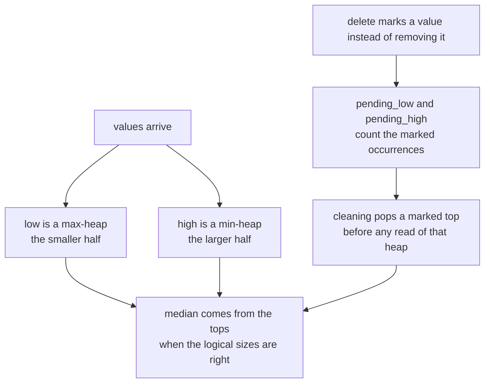
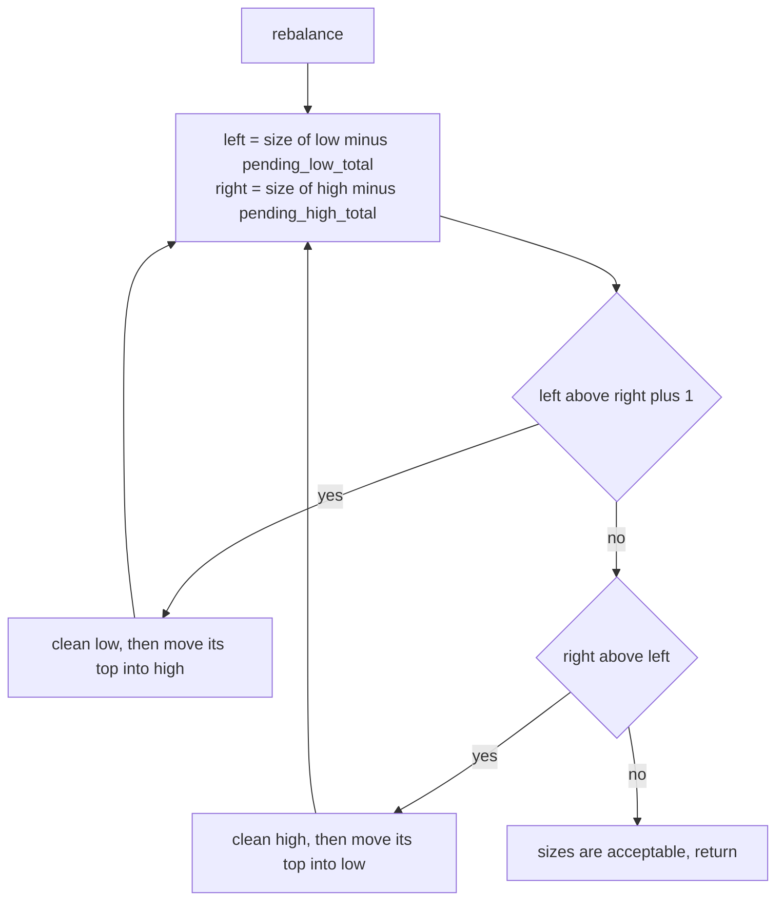
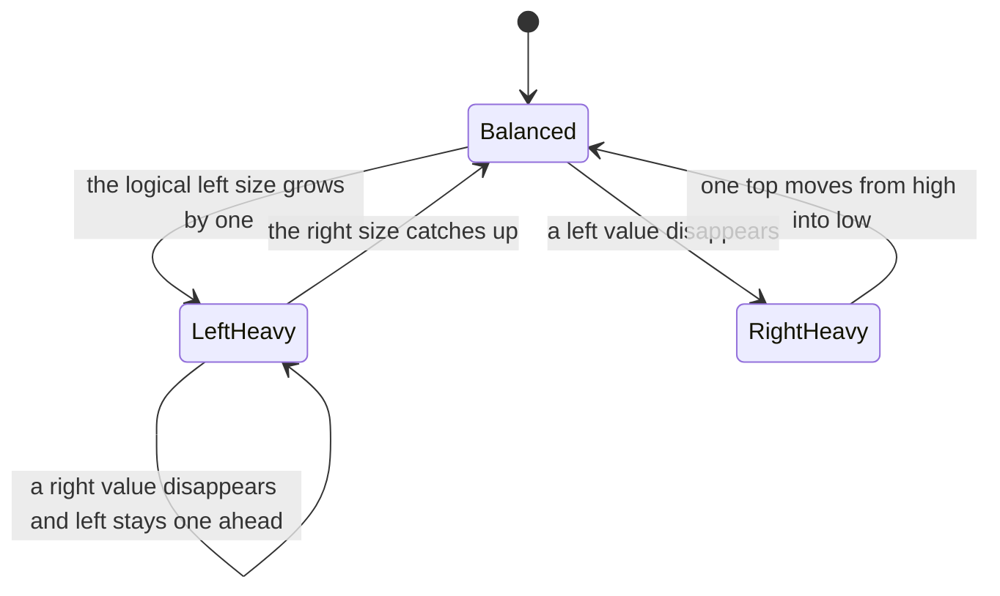
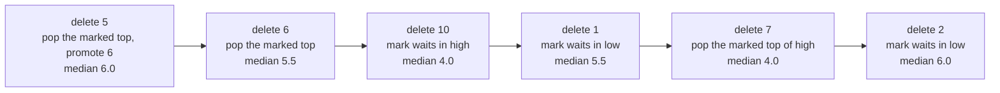

# 334 — Implement rolling median with delete operation (multiset or two heaps + lazy deletion).

> **Tier:** Intermediate · **CTCI chapter:** Ch 7 — Object-Oriented Design
> **Task spec:** [334-implement-rolling-median-with-delete-operation-multiset-or-two-h.md](../../../tasks/intermediate/334-implement-rolling-median-with-delete-operation-multiset-or-two-h.md)
> **Solutions:** [Python](../../../solutions/python/intermediate/334-implement-rolling-median-with-delete-operation-multiset-or-two-h/solution.py) ·
> [Java](../../../solutions/java/intermediate/334-implement-rolling-median-with-delete-operation-multiset-or-two-h/Solution.java) ·
> [JavaScript](../../../solutions/javascript/intermediate/334-implement-rolling-median-with-delete-operation-multiset-or-two-h/solution.js) ·
> [C#](../../../solutions/csharp/intermediate/334-implement-rolling-median-with-delete-operation-multiset-or-two-h/Solution.cs)

## 1. Problem restatement

**Input:** a bag of integers with three operations — `add(value)`, `delete(value)` and `median()` —
plus `size()`. Duplicates are independent occurrences: adding three 4s and deleting one of them
still leaves a median of 4.

**Output:** `median()` returns `None` (or `null`) for an empty multiset, the middle value as a
`double` when the logical size is odd, and the average of the two middle values when it is even.
`delete(value)` raises when the value is absent — `ValueError` in Python, `IllegalArgumentException`
in Java, and a plain `Error` / `Exception` in JavaScript and C#.

The shared hand-checked battery follows one value through the structure:

| Operation | Logical content | `size()` | `median()` |
| --- | --- | --- | --- |
| start | `{}` | 0 | `None` |
| `add(5)` | `{5}` | 1 | `5.0` |
| `add(3)` | `{3, 5}` | 2 | `4.0` |
| `add(8)` | `{3, 5, 8}` | 3 | `5.0` |
| `add(1)` | `{1, 3, 5, 8}` | 4 | `4.0` |
| `delete(5)` | `{1, 3, 8}` | 3 | `3.0` |
| `delete(1)` | `{3, 8}` | 2 | `5.5` |
| `delete(3)` | `{8}` | 1 | `8.0` |
| `delete(8)` | `{}` | 0 | `None` |
| `delete(7)` | `{}` | 0 | raises |

Two more batteries pin down the parts that a single value cannot reach: three copies of `4` produce
a median of `4.0` before, between and after two deletes, and a deletes-only sequence over
`{1..10}` — removing `5, 6, 10, 1, 7, 2` — walks the median through `6.0, 5.5, 4.0, 5.5, 4.0, 6.0`
with a final size of 4. Both boundaries of the median are exercised, because `5` and `6` live in
different heaps.

## 2. Intuition

The classic median structure keeps the smaller half of the values in a **max-heap** and the larger
half in a **min-heap**, so the median is either the top of the left heap or the average of the two
tops. Insertion is easy: push, then rebalance until the two halves differ by at most one.

Deletion is the hard part. A heap cannot delete an arbitrary value without a search, and the
position map that a true indexed-heap would need is exactly what the library heaps do not expose —
that is why the task title offers "multiset or two heaps **+ lazy deletion**". The solutions take
the second route: `delete(value)` does not remove anything. It records the value in a **pending
map** belonging to whichever heap physically holds it, decrements the logical size, and lets the
mark be consumed the next time that value reaches the top of its heap:

```text
while low is not empty and pending_low holds the top of low do
    pop the top of low
    decrement the pending count of that value
    decrement pending_low_total
end
```



Three bookkeeping numbers make the laziness safe. `pending_low_total` and `pending_high_total` track
how many marks are still inside each heap, so the *logical* size of a heap is
`physical size - pending total`. The `active` map counts live occurrences per value and is what
`delete` consults to reject an absent value — a pending mark is invisible to a heap, so a presence
test cannot be answered from the heaps alone.

## 3. Algorithm

**`add(value)`.**

1. Clean both heaps (drop marked tops).
2. Push `value` into `low` when `low` is non-empty and `value <= top of low`, otherwise into `high`.
3. Increment the logical count and the `active` counter for `value`.
4. Rebalance until the logical sizes are equal, or the left size is exactly one larger.

**`delete(value)`.**

1. Raise if `active[value] < 1`.
2. Decrement `active[value]` and the logical count.
3. Clean `low`, then mark `value` in `pending_low` when `value <= top of low`, otherwise in
   `pending_high`.
4. Clean both heaps and rebalance.

**`median()`.** Clean both heaps; return nothing when the logical count is zero, the negated top of
`low` when it is odd, and the average of the two tops when it is even.

```text
procedure add(value)
    clean_low()
    clean_high()
    if low is not empty and value <= top of low then
        push value into low
    else
        push value into high
    end
    count ← count + 1
    active[value] ← active[value] + 1
    rebalance()
end

procedure delete(value)
    if active[value] is missing or active[value] < 1 then
        raise an error about the missing value
    end
    active[value] ← active[value] - 1
    clean_low()
    if low is not empty and value <= top of low then
        pending_low[value] ← pending_low[value] + 1
        pending_low_total ← pending_low_total + 1
    else
        pending_high[value] ← pending_high[value] + 1
        pending_high_total ← pending_high_total + 1
    end
    count ← count - 1
    clean_low()
    clean_high()
    rebalance()
end

procedure rebalance()
    looping ← true
    while looping do
        left ← physical size of low - pending_low_total
        right ← physical size of high - pending_high_total
        if left > right + 1 then
            clean_low()
            move the top of low into high
        else if right > left then
            clean_high()
            move the top of high into low
        else
            looping ← false
        end
    end
end

function median()
    clean_low()
    clean_high()
    if count is 0 then
        return nothing
    end
    if count is odd then
        return the top of low
    end
    return (top of low + top of high) / 2
end
```

The routing in `delete` is exact rather than a guess: because the heaps are kept in order, every
value in `low` is at most every value in `high`, so a value at or below `low`'s top must be
physically stored in `low`. Values equal to the top may exist in both heaps, and marking either is
harmless because the marks are counted by value.





## 4. Worked example

Add `1` through `10` in order. Every push goes to `high` (each new value exceeds `low`'s top) and the
rebalance loop then moves exactly one value across for every odd count, ending with
`low = {1, 2, 3, 4, 5}` and `high = {6, 7, 8, 9, 10}` — logical sizes 5 and 5, physical sizes 5 and
5, no pending marks, median `(5 + 6) / 2 = 5.5`.

Now the deletes. The table records where the mark went, what cleaning saw, and what the median became:

| `delete` | Heap that received the mark | Cleaning and rebalancing | Logical content | `median()` |
| --- | --- | --- | --- | --- |
| `5` | `pending_low`, since `5 <= 5` | the top of `low` is the marked `5`, so it is popped; `low` is then 4 against 5, so `6` moves from `high` into `low` | `{1,2,3,4,6,7,8,9,10}` | `6.0` |
| `6` | `pending_low`, since `6 <= 6` (it was moved in the step before) | the marked top of `low` is popped; sizes are already 4 and 4 | `{1,2,3,4,7,8,9,10}` | `5.5` |
| `10` | `pending_high`, since `10 > 4` | `10` is not at a top yet, so nothing is popped; logical sizes become 4 and 3, which is allowed | `{1,2,3,4,7,8,9}` | `4.0` |
| `1` | `pending_low`, since `1 <= 4` | the top of `low` is `4`, not `1`, so the mark waits; sizes become 3 and 3 | `{2,3,4,7,8,9}` | `5.5` |
| `7` | `pending_high`, since `7 > 4` | `7` is the top of `high`, so it is popped; sizes become 3 and 2 | `{2,3,4,8,9}` | `4.0` |
| `2` | `pending_low`, since `2 <= 4` | the top of `low` is `4`, not `2`, so the mark waits; sizes become 2 and 2 | `{3,4,8,9}` | `6.0` |

The first two rows show the interesting interaction: deleting `5` empties the top of `low` and the
rebalance immediately promotes `6`, so the very next delete of `6` marks a value that changed heaps
in between. Rows 3 to 6 show the marks that wait — `10` and the `1` and `2` stay physically in their
heaps while the median is computed from unmarked tops.



The randomized battery drives the same machinery harder: 2000 steps with `seed = 4242`, roughly two
steps in five a delete of a randomly chosen element of the oracle list, otherwise an add of
`1 + seed % 50`. The logical size must equal the oracle's length after every step, and the median is
compared on every fifth step and on every seventh step. A final drain phase deletes
`oracle.data[0]` until the structure is empty, checking the median each time and ending at `None` —
so every pending mark is eventually consumed rather than merely tolerated.

## 5. Complexity

Let `n` be the logical size and `m` the total number of operations.

| Measure | Bound | Why it holds |
| --- | --- | --- |
| `add` time | O(log n) amortised | one heap push plus at most one move in the rebalance loop |
| `delete` time | O(log n) amortised | one map update plus the cleaning it triggers |
| `median` time | O(log n) worst, O(1) typical | the arithmetic reads two tops; cleaning may pop marked tops first |
| Cleaning, whole run | O(m log n) | a value is popped at most once per heap, so total pops are bounded by pushes |
| Space | O(n) | two heaps, two pending maps, the `active` map and one integer counter |
| Alternative: sorted list | O(n) per delete, O(1) median | insertion and removal shift the tail — the oracle does exactly this |
| Alternative: balanced BST with subtree sizes | O(log n) deterministic per operation | every step is a real deletion, at the price of an indexed tree instead of two library heaps |

The amortised argument is what makes laziness acceptable: no operation ever removes more elements
than were marked, so the total cleaning work over a run is bounded by the total number of pushes.

## 6. Pitfalls and edge cases

- **Logical versus physical sizes.** Every size comparison subtracts the pending totals; comparing
  the raw heap sizes would rebalance against elements that are already deleted and corrupt the
  halves.
- **Cleaning before reading.** `add`, `delete` and `median` all clean first, because a marked value
  can be sitting on a top. `median()` in particular would otherwise return a deleted value.
- **Deleting an absent value.** The `active` map exists purely for this check; the pending marks are
  not enough, since two deletes of the same value look identical to one. Rejecting instead of
  silently ignoring keeps `size()` honest.
- **Duplicates.** Three copies of `4` survive two deletes with a median of `4.0`; marking by value
  works because occurrences are interchangeable.
- **Values that change heaps.** Deleting `5` promotes `6` into `low`, and the next delete of `6`
  marks it in `low` rather than in `high`. The routing rule `value <= top of low` handles this
  without a search.
- **Even versus odd counts.** The median is the top of `low` when the count is odd and the average
  of both tops when it is even, which is why the invariant allows `low` to be one larger but never
  smaller.
- **Empty structure.** `median()` returns `None`/`null` rather than raising, and both the initial
  battery and the drain phase end there.
- **Float formatting.** The median is a floating-point value even for odd counts (`5.0`, not `5`), so
  callers comparing with integers must compare numerically; the Java and C# files return boxed
  `Double` values and use an equality that tolerates the boxing.
- **Integer-only values.** The heaps store plain integers, so there is no tie-breaking rule to worry
  about; a version supporting arbitrary comparable values would need the same value-based marking.
- **What the oracle does not share.** The oracle is a sorted list with binary-search insertion, so it
  has no heaps, no marks and no rebalancing — a bug in the two-heap design cannot be reproduced there.

## 7. Variants and follow-ups

- **Sliding windows instead of explicit deletes.** [333-design-hit-counter-sliding-time-window.md](../../../tasks/intermediate/333-design-hit-counter-sliding-time-window.md)
  lets a timestamp window expire entries for free; here the caller names the value to remove.
- **Rolling median without deletes** is the textbook two-heap problem; the extra difficulty in this
  task is entirely the removal path.
- **Versioned state instead of deletion.** [336-design-a-snapshot-array-persisting-versions-basic.md](../../../tasks/intermediate/336-design-a-snapshot-array-persisting-versions-basic.md)
  answers queries against old snapshots, which is another way to avoid removing anything eagerly.
- **Order-statistic structures.** [249-implement-treap-bst-heap-insert-delete.md](../../../tasks/intermediate/249-implement-treap-bst-heap-insert-delete.md)
  and [250-implement-splay-tree-access-operation-basic.md](../../../tasks/intermediate/250-implement-splay-tree-access-operation-basic.md)
  support real deletion and rank queries, which removes the need for lazy marks altogether.
- The chapter walkthrough in [Object-Oriented Design](../../ctci/07-object-oriented-design.md)
  frames this as the canonical example of matching a data-structure invariant to an operation set.

## 8. Check yourself

1. Why can the structure not simply remove a deleted value from the middle of a heap?

<details><summary>Show answer</summary>

A binary heap stores no position index, so finding an arbitrary value costs a full scan and removing
it would break the heap property. Lazy deletion records the value instead, and the mark is consumed
when that value eventually reaches the top, where removal is O(log n).

</details>

2. What exactly do `pending_low_total` and `pending_high_total` represent?

<details><summary>Show answer</summary>

The number of marked-but-still-physically-present occurrences inside each heap. Subtracting them
from the physical heap sizes yields the logical sizes that the rebalance rule compares, and the
cleaning loops decrement them as they pop marked tops.

</details>

3. In the worked example, why is the delete of `6` routed to `low`?

<details><summary>Show answer</summary>

Because the previous delete popped `5` from `low` and the rebalance moved `6` from `high` into `low`.
The rule `value <= top of low` then compares `6` with `low`'s top, which is now `6` itself, and marks
`low` — the heap that actually holds it.

</details>

4. Why is `median()` still correct while a marked value is stuck in the middle of a heap?

<details><summary>Show answer</summary>

Because the median is read from the tops, and the cleaning loops guarantee that no marked value is
sitting on a top when the value is read. Marks deeper in a heap contribute nothing to the answer and
are counted out of the logical sizes already.

</details>

5. What does the drain phase of the randomized battery prove that the mixed phase does not?

<details><summary>Show answer</summary>

It forces every remaining value to be deleted, so every pending mark is consumed and the heaps end
up physically empty. It also compares the median after each removal down to the empty case, which the
mixed phase only reaches by chance.

</details>
