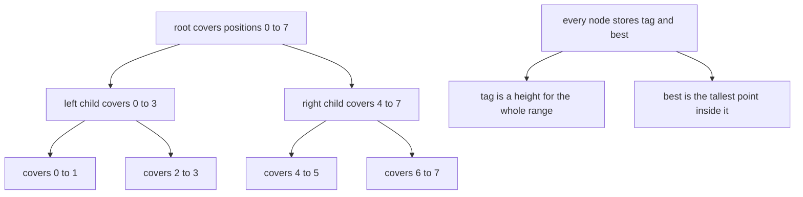
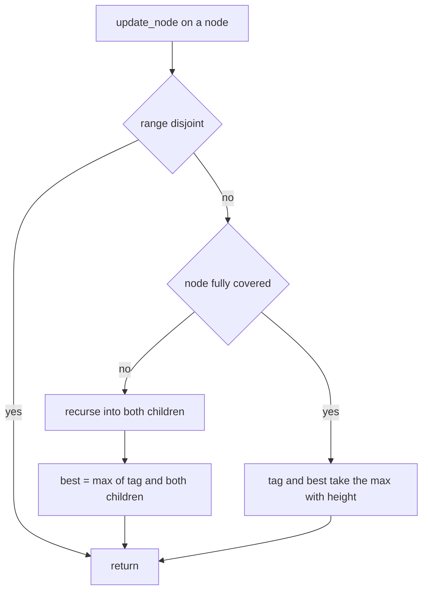
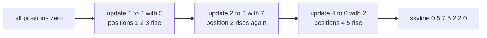
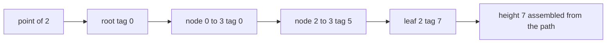

# 335 — Implement data structure for skyline queries (segment tree variant).

> **Tier:** Intermediate · **CTCI chapter:** Ch 4 — Trees and Graphs
> **Task spec:** [335-implement-data-structure-for-skyline-queries-segment-tree-varian.md](../../../tasks/intermediate/335-implement-data-structure-for-skyline-queries-segment-tree-varian.md)
> **Solutions:** [Python](../../../solutions/python/intermediate/335-implement-data-structure-for-skyline-queries-segment-tree-varian/solution.py) ·
> [Java](../../../solutions/java/intermediate/335-implement-data-structure-for-skyline-queries-segment-tree-varian/Solution.java) ·
> [JavaScript](../../../solutions/javascript/intermediate/335-implement-data-structure-for-skyline-queries-segment-tree-varian/solution.js) ·
> [C#](../../../solutions/csharp/intermediate/335-implement-data-structure-for-skyline-queries-segment-tree-varian/Solution.cs)

## 1. Problem restatement

**Input:** an integer count `n` of x-positions, `0 .. n-1`, all starting at height 0. Four operations:

| Operation | Contract |
| --- | --- |
| `update(left, right, height)` | raise every position in the half-open range `[left, right)` to **at least** `height`; heights never decrease |
| `point(index)` | the skyline height at `index` |
| `range_max(left, right)` | the tallest position in `[left, right)`, and `0` when the range is empty |
| `skyline()` | the whole height array |

**Validation.** `n >= 1` (otherwise the constructor raises), `0 <= left < right <= n` for `update`,
`0 <= index < n` for `point`, and `0 <= left <= right <= n` for `range_max` — so an empty range is
legal and answers 0. Python raises `ValueError`, Java `IllegalArgumentException`, JavaScript `Error`
and C# `Exception`.

With `n = 7` and the three updates `(1,4,5)`, `(2,3,7)`, `(4,6,2)` the queries are pinned down
exactly:

| Query | Positions | Answer |
| --- | --- | --- |
| `skyline()` | all | `[0, 5, 7, 5, 2, 2, 0]` |
| `point(2)` / `point(6)` / `point(0)` | — | `7` / `0` / `0` |
| `range_max(0, 3)` | 0, 1, 2 | `7` |
| `range_max(2, 5)` | 2, 3, 4 | `7` |
| `range_max(3, 6)` | 3, 4, 5 | `5` |
| `range_max(0, 7)` | all | `7` |
| `range_max(5, 5)` | none | `0` |
| `range_max(6, 7)` | 6 | `0` |

Three further behaviours are asserted: a *smaller* update is a no-op (`update(2,3,4)` leaves
`point(2) == 7`) while a larger one raises (`update(2,3,9)` makes `point(2) == 9` and
`range_max(1,3) == 9`); a single-position tree works (`n = 1`, then `update(0,1,42)` gives
`point(0) == 42`); and four boundary-hugging updates over `n = 4` — `(0,4,1)`, `(0,1,2)`, `(3,4,3)`,
`(1,3,4)` — produce `[2, 4, 4, 3]` with `range_max(3,4) == 3`.

## 2. Intuition

The obvious implementation is an array of `n` heights: `update` touches every position in the range
and `range_max` scans it. That is exactly what the oracle (`brute_schedule`) does, and it costs
`O(right - left)` per update — hopeless when updates are long and frequent.

A **segment tree** fixes both costs by making every node answer for a whole range. Each node carries
two integers, and the second one is what makes the first one safe:

- `tag[node]` — a height that has been applied to the node's entire range, but not (yet) written down
  to its children. This is the lazy part.
- `best[node]` — the tallest skyline point inside the node's range, whatever the source.

The header of every solution states the simplification that removes the usual push-down machinery:
"updates only raise heights, so applying max is monotone and no push-down is needed". Because `max`
never shrinks a value, a stale tag can be safely left at an ancestor — any query that walks through
that ancestor can fold it in on the way down. A decrement-style update ("lower this range") would
break that, and the tree would need to push tags into children before descending.



The tree is built over `size`, the smallest power of two `>= n`, so the recursion is perfectly
balanced and every node's range is `[lo, hi)` with `hi - lo` a power of two. For `n = 7`, `size = 8`
and there is one phantom position that stays at height 0; the public validation against `n` keeps it
invisible.

## 3. Algorithm

1. **Constructor.** Raise when `n < 1`; set `size` to the next power of two; allocate `tag` and
   `best` with `2 * size` zeros.
2. **`update(left, right, height)`.** Recurse from the root:
   - disjoint (`right <= lo or hi <= left`) — return;
   - fully covered (`left <= lo and hi <= right`) — apply `max` to `tag[node]` and `best[node]` and
     return;
   - otherwise recurse into both children and set
     `best[node] = max(tag[node], best[left child], best[right child])`.
3. **`point(index)`.** Walk from the root to the leaf of `index`, accumulating the maximum tag seen;
   the accumulated value is the answer.
4. **`range_max(left, right)`.** Return 0 for an empty range; otherwise recurse: disjoint → 0, fully
   covered → `best[node]`, partial → `max(tag[node], left result, right result)`.

```text
procedure update(left, right, height)
    validate that 0 <= left < right <= n
    update_node(1, 0, size, left, right, height)
end

procedure update_node(node, lo, hi, left, right, height)
    if right <= lo or hi <= left then
        return
    end
    if left <= lo and hi <= right then
        tag[node] ← max(tag[node], height)
        best[node] ← max(best[node], height)
        return
    end
    mid ← (lo + hi) // 2
    update_node(2 * node, lo, mid, left, right, height)
    update_node(2 * node + 1, mid, hi, left, right, height)
    best[node] ← max(tag[node], best[2 * node], best[2 * node + 1])
end

function point(index)
    validate that 0 <= index < n
    node ← 1
    lo ← 0
    hi ← size
    height ← 0
    loop
        height ← max(height, tag[node])
        if hi - lo is 1 then
            return height
        end
        mid ← (lo + hi) // 2
        if index < mid then
            node ← 2 * node
            hi ← mid
        else
            node ← 2 * node + 1
            lo ← mid
        end
    end
end

function range_max(left, right)
    validate that 0 <= left <= right <= n
    if left is right then
        return 0
    end
    return range_max_node(1, 0, size, left, right)
end

function range_max_node(node, lo, hi, left, right)
    if left >= right or right <= lo or hi <= left then
        return 0
    end
    if left <= lo and hi <= right then
        return best[node]
    end
    mid ← (lo + hi) // 2
    return max(tag[node],
               range_max_node(2 * node, lo, mid, left, right),
               range_max_node(2 * node + 1, mid, hi, left, right))
end
```

An `update` decomposes `[left, right)` into O(log n) canonical nodes, exactly the nodes the recursion
stops at with the full-cover test. The recomputation line on the way back up is what keeps `best`
correct for ancestors: it must fold in `tag[node]` itself, because a full-cover update may have
written a tag there with no child ever touched.



## 4. Worked example

Start from seven zeroes and apply the three hand-checked updates. Each update only raises positions,
so the array evolves as follows:

| Update | Positions touched | Heights after |
| --- | --- | --- |
| start | — | `0 0 0 0 0 0 0` |
| `(1, 4, 5)` | 1, 2, 3 | `0 5 5 5 0 0 0` |
| `(2, 3, 7)` | 2 | `0 5 7 5 0 0 0` |
| `(4, 6, 2)` | 4, 5 | `0 5 7 5 2 2 0` |



With `size = 8` those three updates land on canonical nodes `[1,2)`, `[2,4)`, `[2,3)` and `[4,6)`:
the first range splits into `[1,2)` plus `[2,4)`, the second is a single node, and the third is a
single node as well. So the tree stores tags 5, 5, 7 and 2 at those four nodes, and every leaf answer
is assembled by walking down. `point(2)` is the clearest trace, because it collects all three
sources:

| Node on the path | Range | `tag` | Running height |
| --- | --- | --- | --- |
| root | `[0, 8)` | 0 | 0 |
| left child | `[0, 4)` | 0 | 0 |
| right child of that | `[2, 4)` | 5 | 5 |
| leaf | `[2, 3)` | 7 | 7 |

The walk stops at a leaf-width node; the accumulated maximum is 7, which is `point(2)`. Nothing was
ever pushed down: the tags stayed where the updates put them and the query folded them in.

The range queries are answered by decomposing the requested range into canonical nodes and taking the
largest `best` among them:

| Query | Canonical nodes | `best` values | Answer |
| --- | --- | --- | --- |
| `range_max(0, 3)` | `[0,2)`, `[2,3)` | 5, 7 | `7` |
| `range_max(3, 6)` | `[3,4)`, `[4,6)` | 5, 2 | `5` |
| `range_max(2, 5)` | `[2,4)`, `[4,5)` | 7, 2 | `7` |
| `range_max(5, 5)` | none | — | `0` |

Finally the monotonicity checks: `update(2, 3, 4)` changes nothing because 4 is below the existing 7,
and `update(2, 3, 9)` wins, after which `range_max(1, 3)` is 9 because position 2 participates in
that range.



## 5. Complexity

Let `n` be the number of positions and `size` the next power of two above it.

| Measure | Bound | Why it holds |
| --- | --- | --- |
| `update` time | O(log n) | the recursion stops at O(log n) canonical nodes plus the two boundary paths |
| `point` time | O(log n) | one root-to-leaf walk of height `log2(size)` |
| `range_max` time | O(log n) | the same canonical decomposition as an update |
| `skyline` time | O(n log n) | it calls `point` for every index |
| Space | O(n) | two arrays of `2 * size` integers, and `size < 2n` |
| Oracle: per update | O(right - left) | it raises each position in the range individually |
| Oracle: per range query | O(right - left) | a direct scan |

The tree's advantage grows with the length of the ranges, not with the number of operations: a single
update covering a million positions costs the same O(log n) recursion steps as one covering two. That
is why the oracle is only used on the test-sized instances, where it produces the ground truth for
every position and every sub-range.

## 6. Pitfalls and edge cases

- **No push-down is a *consequence* of monotonicity.** The tags are not merged into children before
  recursion, so a variant that can *lower* a height would silently keep stale tall values. If the
  task ever needs "set the height to exactly h", tag and best must be pushed down first.
- **Recomputing `best` must include `tag[node]`.** A full-cover update writes the tag and returns
  without touching children; if the ancestor's recomputation reads only the two children, that height
  disappears from every range query above it.
- **`point` must read `best` nowhere.** `best` describes a whole range; the height of one index is the
  maximum of the tags along its own root-to-leaf path.
- **Partial nodes in `range_max` fold in their own tag.** The fully covered case may return
  `best[node]` directly, but the partial case must add `tag[node]` to the candidates, because the tag
  applies to the queried sub-range as well.
- **Empty ranges.** `range_max(5, 5)` is legal and returns 0; the recursion also treats "empty after
  clipping" as 0, so there is no need for a second check inside.
- **Untouched regions.** `range_max(6, 7)` is 0 even though position 6 was never updated; zero is both
  the initial height and the neutral element of the max, which is why it is the sensible empty answer.
- **Padding to a power of two.** For `n = 7` the tree spans `[0, 8)` but `right` is validated against
  `n`, so a query can never observe the phantom position. Dropping the validation would silently
  return heights of positions that do not exist.
- **The smallest instance.** `n = 1` builds a tree whose root is a leaf (`size = 1`), so the point walk
  terminates on the first iteration. `update(0, 1, 42)` then makes every query answer 42.

## 7. Variants and follow-ups

- **The skyline as an outline.** [328-skyline-problem-heap-sweep-line.md](../../../tasks/intermediate/328-skyline-problem-heap-sweep-line.md)
  computes the visible outline of a set of rectangles with a sweep line and a heap — the same
  `max`-over-ranges question, answered offline.
- **Stabbing instead of range maxima.** [361-implement-interval-stabbing-queries-with-segment-tree.md](../../../tasks/intermediate/361-implement-interval-stabbing-queries-with-segment-tree.md)
  builds a segment tree over intervals rather than over heights, and
  [362-implement-2d-segment-tree-for-range-sum-conceptual.md](../../../tasks/intermediate/362-implement-2d-segment-tree-for-range-sum-conceptual.md)
  lifts the same node structure to two dimensions.
- **Where a delta map is enough.** [332-implement-calendar-booking-mycalendar-i-ii-iii-style.md](../../../tasks/intermediate/332-implement-calendar-booking-mycalendar-i-ii-iii-style.md)
  answers the peak-depth question with an event map, because its coordinates are compressed and the
  whole sweep is cheap; the segment tree wins when positions are sparse or updates are interleaved
  with queries.
- **Broader tree applications.** [329-range-intersection-queries-interval-trees-basics.md](../../../tasks/intermediate/329-range-intersection-queries-interval-trees-basics.md)
  augments a BST with subtree maxima and [338-implement-sparse-table-for-rmq-immutable.md](../../../tasks/intermediate/338-implement-sparse-table-for-rmq-immutable.md)
  precomputes range minima for a static array — the immovable, offline counterpart of this structure.
- The chapter walkthrough in [Trees and Graphs](../../ctci/04-trees-and-graphs.md) introduces
  augmented and lazy trees alongside interval trees and Fenwick trees.

## 8. Check yourself

1. Why can the tree skip the push-down step that a general lazy segment tree needs?

<details><summary>Show answer</summary>

Because every update is a `max` with a new height, and `max` is monotone: a tag left at an ancestor can
only ever be a lower bound for the positions below it, never an outdated value that must be corrected.
Any query folds the ancestor tags in while descending, so leaving them in place stays correct.

</details>

2. Why does `best[node]` get recomputed as `max(tag[node], best[left], best[right])` rather than just
   the maximum of the two children?

<details><summary>Show answer</summary>

Because a full-cover update stores its height in `tag[node]` and returns without recursing, so neither
child knows about it. Including `tag[node]` in the recomputation is what propagates that height into
the ancestor's `best`.

</details>

3. What does `range_max(2, 5)` return for the hand example, and which nodes decide it?

<details><summary>Show answer</summary>

7. The range `[2, 5)` decomposes into the canonical nodes `[2, 4)` — whose `best` is 7 from the
`(2,3,7)` update, giving 7 at position 2 — and `[4, 5)`, whose `best` is 2. The maximum is 7.

</details>

4. Why is `update(2, 3, 4)` a no-op, and what does that say about the structure?

<details><summary>Show answer</summary>

Position 2 already stands at 7, and the update only raises, so `max(7, 4) = 7`. Nothing changes in the
array, and the tag at the node covering `[2,3)` is likewise left at its larger value — a demonstration
that the structure is monotone rather than an assignment structure.

</details>

5. What makes `range_max(5, 5)` a legal call while `update(5, 5, 1)` is not?

<details><summary>Show answer</summary>

`range_max` accepts `left == right` because an empty range has an obvious answer: 0, the height of no
positions at all. An update with `left == right` would touch no positions but had to be given a
height, so the contract declares it invalid — and all four files validate it that way.

</details>
