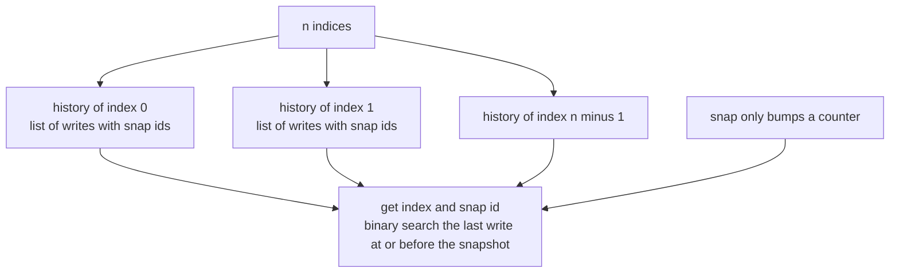
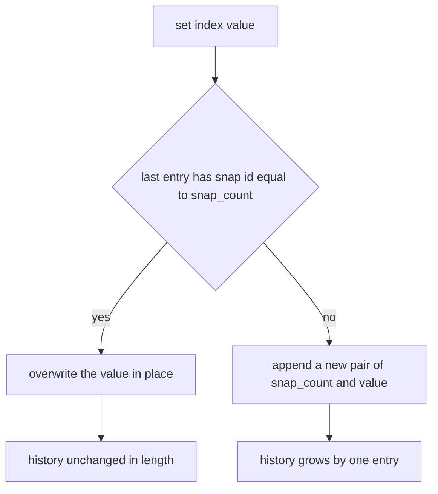
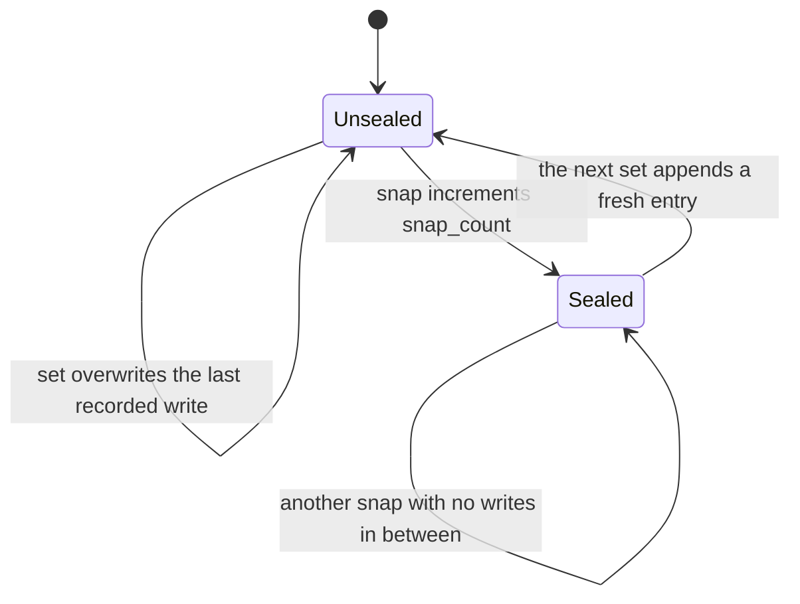
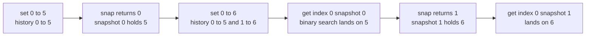

# 336 — Design a snapshot array (persisting versions basic).

> **Tier:** Intermediate · **CTCI chapter:** Ch 7 — Object-Oriented Design
> **Task spec:** [336-design-a-snapshot-array-persisting-versions-basic.md](../../../tasks/intermediate/336-design-a-snapshot-array-persisting-versions-basic.md)
> **Solutions:** [Python](../../../solutions/python/intermediate/336-design-a-snapshot-array-persisting-versions-basic/solution.py) ·
> [Java](../../../solutions/java/intermediate/336-design-a-snapshot-array-persisting-versions-basic/Solution.java) ·
> [JavaScript](../../../solutions/javascript/intermediate/336-design-a-snapshot-array-persisting-versions-basic/solution.js) ·
> [C#](../../../solutions/csharp/intermediate/336-design-a-snapshot-array-persisting-versions-basic/Solution.cs)

## 1. Problem restatement

**Input:** an array length `n >= 1` and three operations:

| Operation | Contract |
| --- | --- |
| `set(index, value)` | write `value` at `index` in the *current*, unsealed state |
| `snap()` | seal the current state and return its snapshot id; ids start at 0 and increase by one |
| `get(index, snap_id)` | the value of `index` as of the sealed snapshot `snap_id` |

**Output:** `get` must answer historical reads after later writes, and `set`/`snap` must stay cheap.
Validation is part of the contract: `length >= 1`, `0 <= index < length`, and
`0 <= snap_id < snap_count` — reading a snapshot that does not exist yet raises (`ValueError` in
Python, `IllegalArgumentException` in Java, `Error` in JavaScript, `Exception` in C#).

The canonical LeetCode sequence over `n = 3` is asserted by all four files:

| Operation | State | Result |
| --- | --- | --- |
| `set(0, 5)` | unsealed write at index 0 | — |
| `snap()` | seals snapshot 0, which contains `5` | `0` |
| `set(0, 6)` | new unsealed write | — |
| `get(0, 0)` | snapshot 0 is sealed | `5` |
| `snap()` | seals snapshot 1, which contains `6` | `1` |
| `get(0, 0)` / `get(0, 1)` | both snapshots readable | `5` / `6` |
| `get(1, 0)` / `get(2, 1)` | never written | `0` / `0` |

Three more behaviours are pinned down:

- **Writes before the first snap are visible in snapshot 0.** `set(1, 7)` followed by `set(1, 9)`
  yields `get(1, 0) == 9` — the first write is overwritten, not versioned, because it was never
  sealed.
- **Unsealed writes are invisible.** After `snap() == 0` and `set(1, 11)`, the read `get(1, 0)` is
  still `9`; only after `snap() == 1` does `get(1, 1)` become `11`.
- **Snapshots with no writes in between repeat the previous value.** With `set(0, 1)`,
  `snap() == 0`, `snap() == 1`, `set(0, 2)`, `snap() == 2`, the three reads are `[1, 1, 2]`.
- **Unknown snapshots raise.** `get(0, 3)` after three snaps is an error, not a silent `0`.

## 2. Intuition

The obvious implementation is the oracle's: keep the live array and, on every `snap`, store a full
copy. Reads are then O(1) and trivial, but each snapshot costs O(n) memory and time — with `S`
snapshots the structure holds `n * S` integers.

The insight that shrinks this is that **an array version is defined by its writes, not by its
values**. Most writes need not be recorded at all: a `get` for an index that was never touched
answers `0` forever. So the structure keeps, for every index, only the list of writes that index
ever received, each tagged with the snapshot it belongs to:

```text
history[i] = [(snap_id, value), ...] with strictly increasing snap ids
```

The sentinel `(0, 0)` seeds every index, so an untouched index has exactly one entry and reads of it
are free. A `get(index, s)` then becomes a predecessor search: find the last entry whose `snap_id` is
at most `s`, and return its value. That is the whole design — `set` is O(1), `snap` is O(1), and only
historical reads pay a logarithm, over the writes of that single index.



Note what `snap()` does *not* do: it never touches the histories. Sealing is just the counter
increment, which is why snapshotting is free and why a write that arrives before the first `snap`
belongs to snapshot 0 by construction.

## 3. Algorithm

1. **Constructor.** Raise when `length < 1`; create `history[i] = [(0, 0)]` for every index; set
   `snap_count = 0`.
2. **`set(index, value)`.** Raise on an out-of-range index. If the last entry of `history[index]`
   already carries `snap_count`, overwrite its value; otherwise append `(snap_count, value)`.
3. **`snap()`.** Return `snap_count` and increment it.
4. **`get(index, snap_id)`.** Raise on a bad index or an unknown snapshot. Binary-search
   `history[index]` for the **last** entry with `snap_id <= snap_id`, and return that value.

```text
procedure set(index, value)
    validate that 0 <= index < length
    entries ← history[index]
    if snap id of the last entry of entries is snap_count then
        replace the value of that last entry with value
    else
        append the pair of snap_count and value to entries
    end
end

function snap()
    id ← snap_count
    snap_count ← snap_count + 1
    return id
end

function get(index, snap_id)
    validate that 0 <= index < length
    validate that 0 <= snap_id < snap_count
    entries ← history[index]
    lo ← 0
    hi ← length(entries) - 1
    while lo < hi do
        mid ← (lo + hi + 1) // 2
        if snap id of entries[mid] <= snap_id then
            lo ← mid
        else
            hi ← mid - 1
        end
    end
    return value of entries[lo]
end
```

The two details that make the history small are the overwrite branch in `set` and the sentinel. The
overwrite means a burst of writes between two snaps collapses into a single entry, and the snap id
stored on that entry is the id of the snapshot that will eventually contain it. The sentinel means
the binary search always has a qualifying entry, so no "no predecessor" case has to be handled —
every `snap_id >= 0` reaches at least `(0, 0)`.





## 4. Worked example

Trace the canonical sequence over `n = 3`. Every row shows what `history[0]` holds — index 1 and
index 2 stay at their sentinel `[(0, 0)]` throughout.

| Step | Operation | `snap_count` | `history[0]` | Explanation |
| --- | --- | --- | --- | --- |
| 1 | `set(0, 5)` | 0 | `[(0, 5)]` | the sentinel's id equals `snap_count`, so it is overwritten |
| 2 | `snap()` | 1 | `[(0, 5)]` | snapshot 0 is sealed; it contains 5 |
| 3 | `set(0, 6)` | 1 | `[(0, 5), (1, 6)]` | the last id is 0, not 1, so a new entry is appended |
| 4 | `get(0, 0)` | 1 | `[(0, 5), (1, 6)]` | last id `<= 0` is the first entry → `5` |
| 5 | `snap()` | 2 | `[(0, 5), (1, 6)]` | snapshot 1 is sealed; it contains 6 |
| 6 | `get(0, 1)` | 2 | `[(0, 5), (1, 6)]` | last id `<= 1` is the second entry → `6` |

Step 1 is the subtle one: the value 5 is not stored as a new version, it *replaces* the sentinel,
because a write made before the first `snap` belongs to snapshot 0 and nothing sealed yet could have
observed an older value at that index.



The read itself is a predecessor search over a list that grows only when writes are sealed:

| Query | `entries` | `lo`/`hi` walk | Answer |
| --- | --- | --- | --- |
| `get(0, 0)` | `[(0,5), (1,6)]` | `lo=0, hi=1` → `mid=1`, id 1 > 0 → `hi=0` | `5` |
| `get(0, 1)` | `[(0,5), (1,6)]` | `lo=0, hi=1` → `mid=1`, id 1 <= 1 → `lo=1` | `6` |
| `get(1, 0)` | `[(0,0)]` | `lo=0, hi=0`, loop never runs | `0` |
| `get(0, 2)` | two entries, `snap_count` is 2 | same as `get(0, 1)` | `6` |

The mid choice `mid = (lo + hi + 1) // 2` is what makes this the *last* qualifying entry rather than
the first: when the condition holds, the range collapses upward (`lo = mid`), so the search cannot
settle on an earlier entry. A conventional lower bound would return the first entry with
`snap_id >= s`, which is the wrong predecessor.

The randomized battery runs this design against the full-copy oracle for 3000 steps with
`seed = 3141` and `n = 8`: half the steps are `set`, a fifth are `snap` (both ids compared), and the
rest are `get` at a random index and a random existing snapshot id. On top of that, every single step
probes all eight indices at the newest snapshot and compares against the oracle, so a stale value can
only survive if the oracle is stale in the same way — which it cannot be, since it reconstructs the
answer from a copy.

## 5. Complexity

Let `n` be the array length, `S` the number of snapshots and `V` the number of recorded writes for a
single index (at most one per snapshot plus the sentinel).

| Measure | Bound | Why it holds |
| --- | --- | --- |
| `set` time | O(1) amortised | either an in-place overwrite or one append |
| `snap` time | O(1) | a counter increment; no history is touched |
| `get` time | O(log V) | predecessor search over one index's write list |
| Space | O(n + W) | one sentinel per index plus one entry per recorded write, where `W` is the total across indices |
| Oracle: `snap` | O(n) | it copies the whole live array |
| Oracle: `get` | O(1) | direct indexing into the copy |
| Oracle: space | O(n * S) | every snapshot holds a full array |

The trade is explicit: the fast design spends a logarithm on historical reads to make snapshotting
free and memory proportional to the writes rather than to `n * S`. An index that is written once and
read a thousand times pays for a two-entry list; an index never touched pays nothing at all.

## 6. Pitfalls and edge cases

- **Snapshots start at 0, not 1.** The assertion `arr.snap() == 0` for the very first seal is what
  makes "writes before the first snap are in snapshot 0" true; off-by-one here shifts every read.
- **The overwrite rule in `set`.** Without it, each write between two snaps would append a new entry
  with the same snap id, and the predecessor search would return the *first* of them — the value from
  before the burst. Correctness would survive only if the search took the last, and memory would grow
  with writes instead of with snapshots.
- **Unsealed writes must stay invisible.** `set(1, 11)` after snapshot 0 must not change `get(1, 0)`;
  the new entry carries id 1, which the search for 0 skips.
- **Repeated snaps without writes.** Two seals in a row produce ids 0 and 1 whose reads are identical,
  because both searches land on the same entry. Nothing has to be recorded for the second snapshot.
- **The sentinel is load-bearing.** `(0, 0)` guarantees that the search always finds an entry, so
  untouched indices answer 0 without a special case; removing it would require an explicit "no
  predecessor" branch.
- **Search direction.** `mid = (lo + hi + 1) // 2` with `lo = mid` finds the last qualifying entry.
  The mirrored formulation (`hi = mid`) finds the first, which returns a value one snapshot too old
  whenever the requested snapshot is not exactly a write boundary.
- **Unknown snapshot ids.** `get(index, snap_count)` is a programming error, not a read of the
  current state, and all four files raise. Silently clamping to the newest snapshot would hide bugs
  and make the "unsealed writes are invisible" contract unverifiable.
- **Index validation.** `set` and `get` both reject out-of-range indices, and the constructor rejects
  `length < 1`; a zero-length array would make every `get` invalid anyway.
- **In-place mutation of a stored entry.** In Java the overwrite replaces the value inside the stored
  `int[]`; in Python the tuple is rebuilt and assigned to the last slot. Both work because the entry is
  reachable only through the history list, but aliasing a stored entry into a return value would break
  the immutability of sealed history.
- **What the oracle cannot see.** Because the oracle recomputes every read from a copy, it validates
  values but not the *structure* — a history that grows without bound or a search that scans linearly
  would still pass. That is why the memory argument above has to be argued, not measured.

## 7. Variants and follow-ups

- **Time-based instead of snapshot-based reads.** [333-design-hit-counter-sliding-time-window.md](../../../tasks/intermediate/333-design-hit-counter-sliding-time-window.md)
  answers "as of this timestamp" with a sorted array of hits and two binary searches; the predecessor
  search here is the same primitive with snapshot ids in place of timestamps.
- **Deletion instead of versioning.** [334-implement-rolling-median-with-delete-operation-multiset-or-two-h.md](../../../tasks/intermediate/334-implement-rolling-median-with-delete-operation-multiset-or-two-h.md)
  keeps tombstone-like pending marks so that removals stay cheap; persisted versions are the mirror
  image — nothing is deleted, everything is kept with a tag.
- **Range queries over versions.** [335-implement-data-structure-for-skyline-queries-segment-tree-varian.md](../../../tasks/intermediate/335-implement-data-structure-for-skyline-queries-segment-tree-varian.md)
  shows how a tree keeps per-range state instead of per-index history.
- **Cheaper snapshots.** The obvious upgrade over this task is copy-on-write with a persistent
  balanced tree, which makes `set` O(log n) instead of O(1) but keeps `snap` free and gives structural
  sharing between snapshots.
- The chapter walkthrough in [Object-Oriented Design](../../ctci/07-object-oriented-design.md)
  treats persistence as the canonical example of choosing a representation that makes the *rare*
  operation cheap.

## 8. Check yourself

1. Why does `set` sometimes overwrite the last entry instead of appending?

<details><summary>Show answer</summary>

Because the last entry already carries the current `snap_count`, which means that write has never been
observable by a read: any `get` is limited to sealed snapshots, all of which are older. Replacing the
value is both correct and smaller, and it keeps the "one entry per snapshot that saw the index"
bound.

</details>

2. What exactly does `snap()` change?

<details><summary>Show answer</summary>

Only the `snap_count` counter. It returns the old value as the new snapshot id and increments.
Because nothing in the histories moves, snapshotting is O(1) and cannot fail or block reads.

</details>

3. What does the sentinel entry `(0, 0)` accomplish?

<details><summary>Show answer</summary>

It guarantees that every index has at least one entry with `snap_id <= s` for any legal `s >= 0`, so
the predecessor search always has a landing place and untouched indices answer 0. It also gives the
first `set` an entry to overwrite, which is why a write before the first snap lands in snapshot 0.

</details>

4. Why is `mid = (lo + hi + 1) // 2` used instead of the usual `(lo + hi) // 2`?

<details><summary>Show answer</summary>

The loop needs the **last** entry with `snap_id <= s`. Biasing `mid` upward and moving `lo` to `mid`
means the search converges to the right-hand end of the qualifying prefix; the symmetric version would
converge to the first entry, returning a value from an earlier snapshot whenever `s` falls between two
write points.

</details>

5. How many entries can `history[i]` hold after `S` snapshots?

<details><summary>Show answer</summary>

At most one per snapshot in which index `i` was written, plus the sentinel — with overwrites collapsing
all the writes of a single snapshot interval into one entry. An index written once holds a list of
size 2 regardless of how many snapshots have been taken since.

</details>
