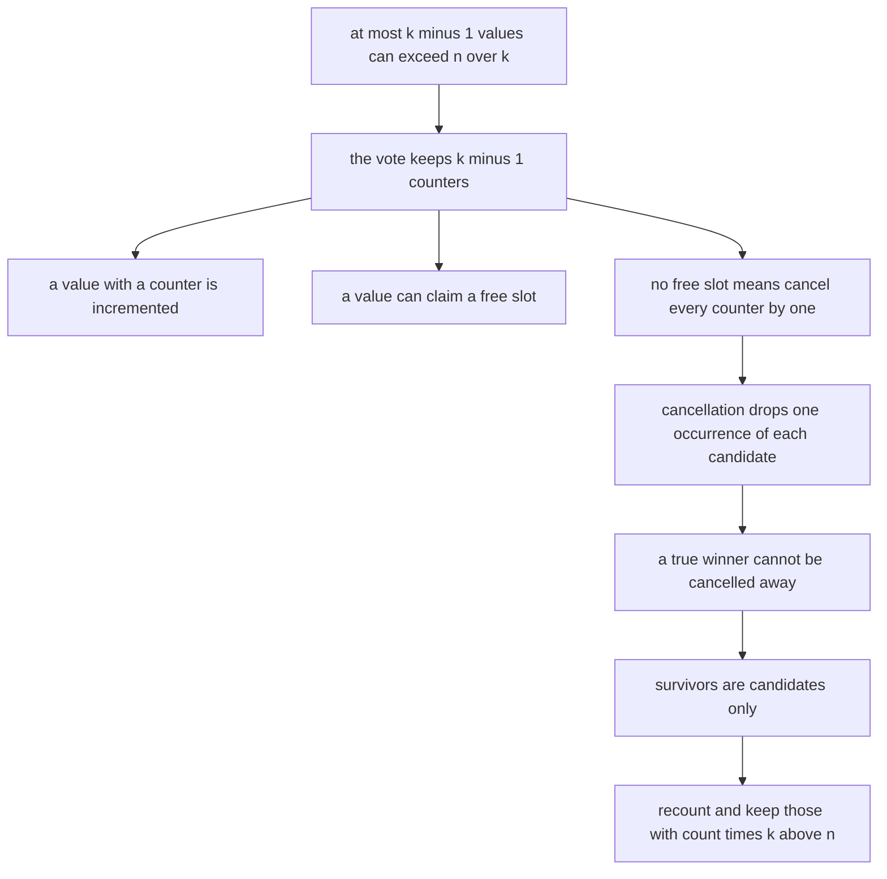
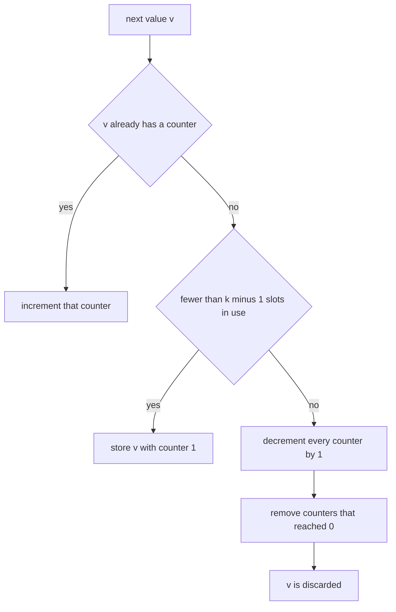
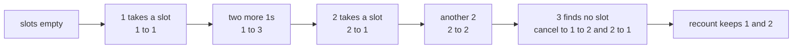
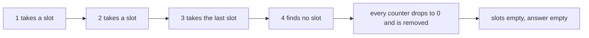

# 337 — Design majority vote generalized (> n/k) using count map.

> **Tier:** Intermediate · **CTCI chapter:** Ch 7 — Object-Oriented Design
> **Task spec:** [337-design-majority-vote-generalized-n-k-using-count-map.md](../../../tasks/intermediate/337-design-majority-vote-generalized-n-k-using-count-map.md)
> **Solutions:** [Python](../../../solutions/python/intermediate/337-design-majority-vote-generalized-n-k-using-count-map/solution.py) ·
> [Java](../../../solutions/java/intermediate/337-design-majority-vote-generalized-n-k-using-count-map/Solution.java) ·
> [JavaScript](../../../solutions/javascript/intermediate/337-design-majority-vote-generalized-n-k-using-count-map/solution.js) ·
> [C#](../../../solutions/csharp/intermediate/337-design-majority-vote-generalized-n-k-using-count-map/Solution.cs)

## 1. Problem restatement

**Input:** an array of `n` values and a parameter `k >= 2`.

**Output:** every value whose occurrence count `c` satisfies the **strict** bar `c * k > n`, that is
`c > n / k`, returned sorted and without duplicates. `k < 2` is a programming error and raises
(`ValueError`, `IllegalArgumentException`, `Error`, `Exception` respectively).

The four files assert the same battery, which is designed so that every branch of the algorithm fires:

| Values | `k` | Bar | Result | Why |
| --- | --- | --- | --- | --- |
| `[1, 1, 1, 2, 2, 3]` | 4 | `c * 4 > 6` → `c >= 2` | `[1, 2]` | 1 occurs 3 times, 2 occurs twice, 3 only once |
| `[3, 2, 3]` | 2 | `c * 2 > 3` → `c >= 2` | `[3]` | the classic majority vote |
| `[2, 2, 1, 1, 1, 2, 2]` | 2 | `c * 2 > 7` → `c >= 4` | `[2]` | 2 occurs four times, 1 only three |
| `[1, 2, 3, 4]` | 4 | `c * 4 > 4` → `c >= 2` | `[]` | every value occurs once |
| `[1, 2, 2, 3, 3, 4]` | 3 | `c * 3 > 6` → `c >= 3` | `[]` | counts 1, 2, 2, 1 |
| `[5, 5, 6, 6]` | 2 | `c * 2 > 4` → `c >= 3` | `[]` | exactly on the boundary is not enough |
| `[5, 5, 6, 6]` | 3 | `c * 3 > 4` → `c >= 2` | `[5, 6]` | the same array, a laxer bar |
| `[7, 8, 9, 7, 8, 9]` | 4 | `c * 4 > 6` → `c >= 2` | `[7, 8, 9]` | all three pass |
| `[]` | 3 | — | `[]` | empty input |

The randomized battery adds a structural check that the answer alone would not catch: the number of
returned values can never exceed `k - 1`, and every returned value is re-counted and re-tested against
`c * k > n` before being accepted.

## 2. Intuition

The direct solution is a count map: tally every value, filter by `c * k > n`. That is O(n) time and
O(distinct) space, and it is exactly what the oracle (`brute_majority`) does. The interview question
is really "can you do it in O(k) space?", which is the generalized form of the Boyer–Moore vote.

The pigeonhole principle supplies the reason `k` is enough to talk about: **at most `k - 1` values can
exceed `n / k`**, because `k` values each above `n / k` would already sum past `n`. So a single
counter per possible answer — `k - 1` counters — is all the state the vote needs.

The vote itself generalizes the majority algorithm's `cancel` step. Each value either
increments an existing counter, claims a free slot, or — when all `k - 1` slots are taken by other
values — **cancels one vote from every counter** and is itself discarded:

```text
for each candidate slot do
    decrement the counter by 1
    drop the slot when it reaches 0
end
```

A cancellation removes one occurrence of the incoming value along with one occurrence of each
current candidate, so it can never remove more occurrences of a value than that value actually has.
That is the invariant that lets a true winner survive: a value with more than `n / k` occurrences
must still be holding a counter at the end.

Surviving is necessary but not sufficient — a cancellation round can leave a counter alive for a value
that never had a real majority. Hence the mandatory second pass: recount and filter.



## 3. Algorithm

1. If `k < 2`, raise. If the array is empty, return the empty list.
2. Walk the values with a map `slots` holding at most `k - 1` candidates:
   - the value is already a candidate → increment its counter;
   - otherwise a slot is free (`size < k - 1`) → take it with counter 1;
   - otherwise decrement every counter by one, deleting any that reach 0, and drop the incoming value.
3. Recount every value in the array.
4. Return the sorted list of candidate values whose recount satisfies `count * k > n`.

```text
function majority_elements(values, k)
    if k < 2 then
        raise an error about k
    end
    n ← length of values
    if n is 0 then
        return an empty list
    end

    slots ← empty map from value to counter
    for each value in values do
        if slots contains value then
            slots[value] ← slots[value] + 1
        else if number of keys in slots < k - 1 then
            slots[value] ← 1
        else
            for each candidate in a copy of the keys of slots do
                slots[candidate] ← slots[candidate] - 1
                if slots[candidate] is 0 then
                    remove candidate from slots
                end
            end
        end
    end

    counts ← empty map from value to occurrences
    for each value in values do
        counts[value] ← counts[value] + 1
    end

    survivors ← empty list
    for each value in slots do
        if counts[value] * k > n then
            append value to survivors
        end
    end
    sort survivors
    return survivors
end
```

Two details are easy to get wrong and both are load-bearing. The cancellation iterates over a
**copy** of the key set, because deleting a zero counter while iterating the live map is illegal in
every one of the four languages. And a counter that reaches zero must be **removed**, not kept at
zero: a zero-valued key still counts as an occupied slot, so the next unseen value would be cancelled
instead of claiming it.



## 4. Worked example

Trace the first hand-checked case, `values = [1, 1, 1, 2, 2, 3]` with `k = 4`, so three slots are
available and the bar is `count * 4 > 6`, i.e. `count >= 2`:

| Value | `slots` before | Branch taken | `slots` after |
| --- | --- | --- | --- |
| `1` | `{}` | free slot | `{1: 1}` |
| `1` | `{1: 1}` | counter exists | `{1: 2}` |
| `1` | `{1: 2}` | counter exists | `{1: 3}` |
| `2` | `{1: 3}` | free slot | `{1: 3, 2: 1}` |
| `2` | `{1: 3, 2: 1}` | counter exists | `{1: 3, 2: 2}` |
| `3` | `{1: 3, 2: 2}` | no free slot | `{1: 2, 2: 1}` |

The last row is the cancellation: 3 never received a counter, and each existing counter lost one vote.
After the vote the survivors are `{1: 2, 2: 1}`; the recount gives `1 → 3`, `2 → 2`, `3 → 1`, and the
bar `count * 4 > 6` keeps 1 and 2 while 3 was never a candidate at all. The result is `[1, 2]`.



The empty result is just as instructive. With `values = [1, 2, 3, 4]` and `k = 4` there are three
slots, and the fourth distinct value triggers a cancellation that wipes the board:

| Value | `slots` after | Note |
| --- | --- | --- |
| `1` | `{1: 1}` | free slot |
| `2` | `{1: 1, 2: 1}` | free slot |
| `3` | `{1: 1, 2: 1, 3: 1}` | last free slot |
| `4` | `{}` | cancellation zeroes all three counters, so all are dropped |

The recount then has nothing to verify, and the answer is `[]`.



The boundary pair shows why the inequality is strict and why the same array can answer differently:
for `[5, 5, 6, 6]` with `k = 2` only one slot exists and the bar is `count >= 3`, so the vote ends
with an empty map and the answer is `[]`; with `k = 3` there are two slots and the bar is
`count >= 2`, so both candidates survive and are confirmed as `[5, 6]`.

Surviving the vote is not the same as passing the bar. For `values = [1, 1, 2, 2, 2, 3]` with `k = 3`
(two slots, bar `count * 3 > 6`, i.e. `count >= 3`) the vote ends with `{1: 1, 2: 2}`, yet the recount
drops 1, which occurs only twice, and the answer is `[2]`. That is the whole reason the second pass is
part of the algorithm rather than an optional sanity check.

## 5. Complexity

Let `n` be the array length, `k` the parameter and `d` the number of distinct values.

| Measure | Bound | Why it holds |
| --- | --- | --- |
| Vote time | O(n * k) | each value costs O(1) or one cancellation pass over at most `k - 1` counters |
| Vote space | O(k) | the map never holds more than `k - 1` candidates |
| Verification time | O(n) | one recount of the array |
| Verification space | O(d) | the shipped implementations build a full count map; a per-candidate recount would keep it O(k) |
| Total time | O(n * k) | the vote dominates for `k >= 2` |
| Brute force oracle | O(n) time, O(d) space | one count map and one filter |
| Maximum result size | `k - 1` | `k` values each above `n / k` would exceed `n` |

For the classic `k = 2` case the vote is linear, which is the familiar Boyer–Moore bound; the general
case costs a factor of `k` because a cancellation touches every counter. The memory claim is the point
of the exercise: with `k` fixed, the structure uses constant extra space no matter how large `n` grows.

## 6. Pitfalls and edge cases

- **The bar is strict.** `count * k > n`, not `>=`. The pair `[5, 5, 6, 6]` answers `[]` for `k = 2`
  and `[5, 6]` for `k = 3`, and both rows are asserted.
- **`k` must be at least 2.** With `k = 1` there would be no slots at all and the bar would be
  unsatisfiable; all four files raise instead of returning nonsense.
- **Survivors are not answers.** The map's keys must be verified by recount. The `[1, 1, 2, 2, 2, 3]`
  case with `k = 3` leaves a candidate that fails the bar, and the randomized battery re-tests every
  reported value independently.
- **Cancellation must iterate a copy of the keys.** Deleting a zeroed counter while walking the live
  key set is illegal in Java, C# and JavaScript and would raise or skip entries in Python; the files
  snapshot the keys first.
- **Zero counters must be deleted.** A key retained at zero still occupies a slot, so the next unseen
  value would cancel instead of taking a free slot — the vote would then miss a genuine winner.
- **The incoming value is discarded on cancellation.** That is the point of the exchange: one
  occurrence of the new value buys one cancellation of each other candidate. Adding it back would break
  the invariant that no value is cancelled more times than it occurs.
- **Empty input.** `[]` returns `[]` for any legal `k`, and the generator produces `n = 0` in the
  randomized trials (`n = seed % 60`), so this case is exercised rather than merely asserted.
- **Sorted, duplicate-free output.** All four files sort the survivors before returning; the assertions
  compare entire lists (or comma-joined strings) rather than sets.
- **Duplicates in the input.** Repeated values increment a single counter, so the multiplicity is
  captured exactly; a value is never reported twice.
- **Counting arithmetic.** `count * k` is evaluated over the whole array length, so in a fixed-width
  language with an `n` near the integer limit this product could overflow; the tests stay far below
  that, but a production version would want a division or a wider type.
- **What the oracle does not share.** The oracle has no slots, no cancellation and no candidate map —
  it recomputes the full count. A bug in the vote phase cannot be mirrored there, which is why the
  comparison is meaningful.

## 7. Variants and follow-ups

- **Counting structures with removals.** [334-implement-rolling-median-with-delete-operation-multiset-or-two-h.md](../../../tasks/intermediate/334-implement-rolling-median-with-delete-operation-multiset-or-two-h.md)
  also leans on value-keyed maps, but there the counters must shrink on demand instead of on a
  cancellation round.
- **Invariant-based answers.** [343-graph-isomorphism-simple-checks-degree-sequence-invariants.md](../../../tasks/intermediate/343-graph-isomorphism-simple-checks-degree-sequence-invariants.md)
  filters candidates by a cheap invariant and then verifies — the same two-phase shape as the vote plus
  recount.
- **Other design exercises in this tier.** [336-design-a-snapshot-array-persisting-versions-basic.md](../../../tasks/intermediate/336-design-a-snapshot-array-persisting-versions-basic.md)
  and [332-implement-calendar-booking-mycalendar-i-ii-iii-style.md](../../../tasks/intermediate/332-implement-calendar-booking-mycalendar-i-ii-iii-style.md)
  show the same discipline of stating the invariant first and the data structure second.
- **Streaming majority.** The vote phase can consume a stream and never needs the array again, which
  is what makes it attractive for unbounded inputs; the verification pass is what forces a second
  traversal when the data is still available.
- The chapter walkthrough in [Object-Oriented Design](../../ctci/07-object-oriented-design.md) puts this
  with the other "pick the invariant, then pick the structure" questions.

## 8. Check yourself

1. Why are `k - 1` counters sufficient, and why can they not be fewer?

<details><summary>Show answer</summary>

Sufficient because at most `k - 1` values can satisfy `count > n / k`; `k` such values would need more
than `k * (n / k) = n` occurrences among them. Not fewer because an array can genuinely have `k - 1`
winning values, for instance `k - 1` distinct values each repeated more than `n / k` times.

</details>

2. What invariant makes a true winner survive the vote?

<details><summary>Show answer</summary>

Each cancellation consumes one occurrence of the incoming value together with one occurrence of every
current candidate. So a value with `c` occurrences can be involved in at most `c` cancellations, and a
value with `c > n / k` has too many occurrences to be cancelled away by the other `k - 1` groups.

</details>

3. What does the vote phase alone return for `[1, 1, 2, 2, 2, 3]` with `k = 3`, and what does the
   final answer have to be?

<details><summary>Show answer</summary>

The vote ends with the candidates `{1: 1, 2: 2}`; the bar is `count >= 3`, so 1 fails the recount and
the answer is `[2]`. The counter value is a vote tally, not an occurrence count — it is not a count of
anything meaningful except through the invariant.

</details>

4. Why must the cancellation loop iterate over a snapshot of the key set?

<details><summary>Show answer</summary>

Because counters that reach zero are removed during the loop. Removing keys while iterating a live map
raises in Java, C# and JavaScript and can skip entries elsewhere; taking a copy of the keys first makes
the removals safe.

</details>

5. How does the randomized battery catch a vote-phase bug that the fixed cases might miss?

<details><summary>Show answer</summary>

It compares against `brute_majority` on 400 generated arrays with `n` from 0 to 59, `k` from 2 to 6 and
alphabet sizes from 1 to 9 — a much wider spread of cancellation patterns — and it additionally asserts
that at most `k - 1` values come back and that every returned value really satisfies `count * k > n`.

</details>
