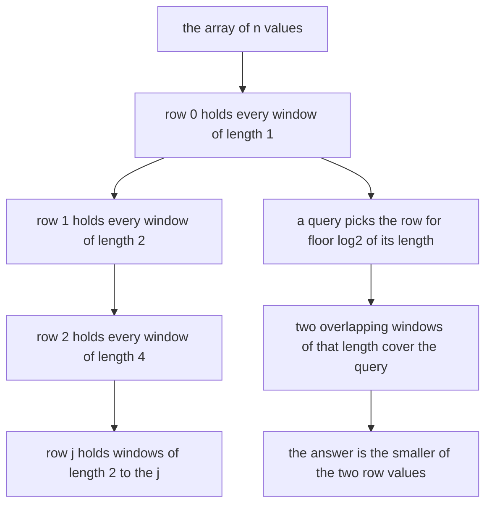
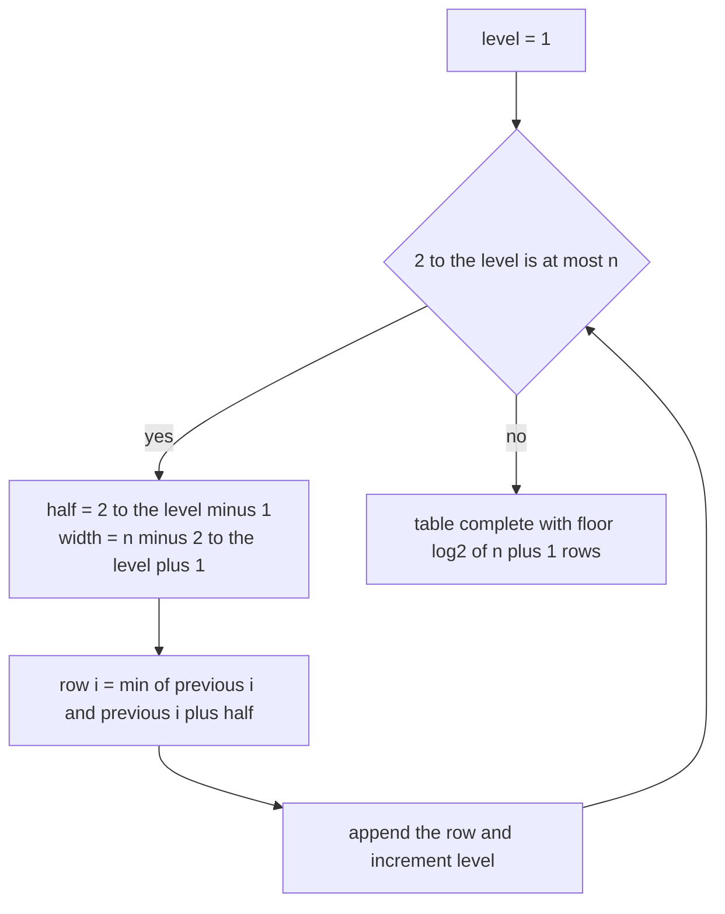
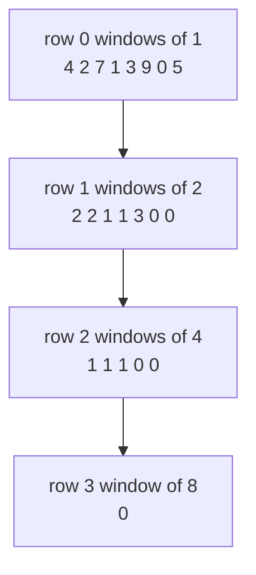
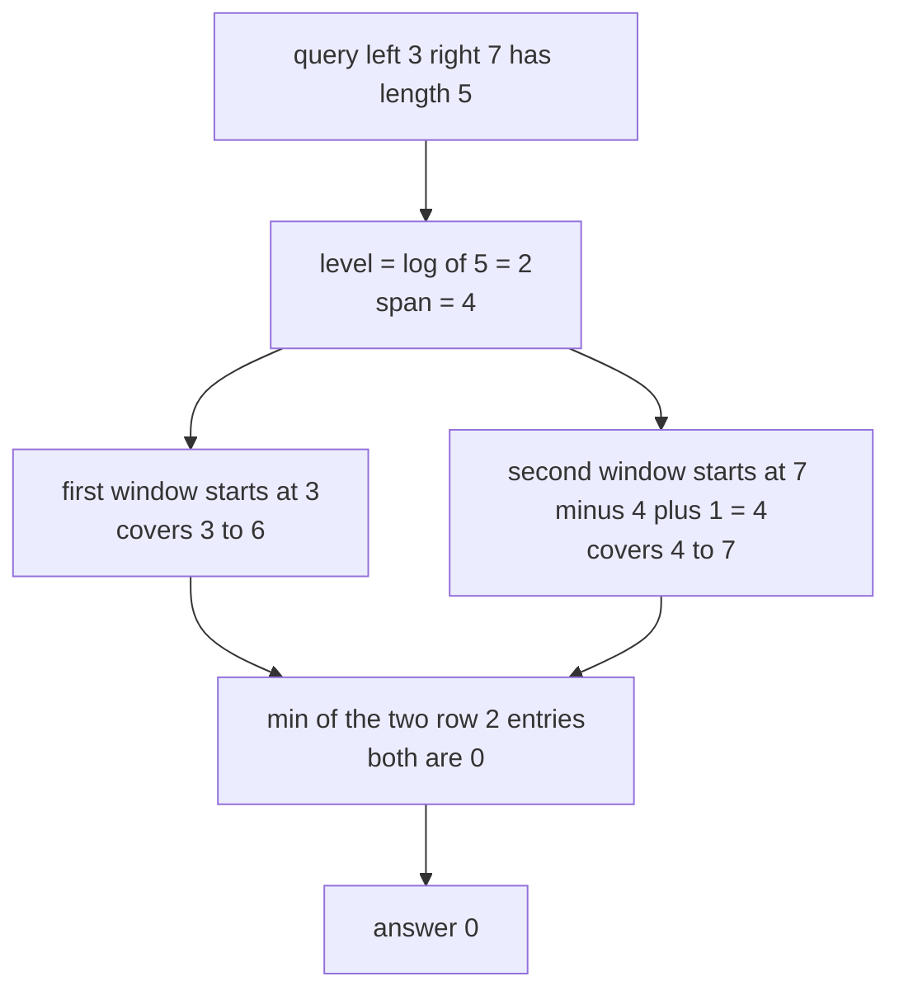

# 338 — Implement sparse table for RMQ (immutable).

> **Tier:** Intermediate · **CTCI chapter:** Beyond — Advanced Data Structures & Algorithms
> **Task spec:** [338-implement-sparse-table-for-rmq-immutable.md](../../../tasks/intermediate/338-implement-sparse-table-for-rmq-immutable.md)
> **Solutions:** [Python](../../../solutions/python/intermediate/338-implement-sparse-table-for-rmq-immutable/solution.py) ·
> [Java](../../../solutions/java/intermediate/338-implement-sparse-table-for-rmq-immutable/Solution.java) ·
> [JavaScript](../../../solutions/javascript/intermediate/338-implement-sparse-table-for-rmq-immutable/solution.js) ·
> [C#](../../../solutions/csharp/intermediate/338-implement-sparse-table-for-rmq-immutable/Solution.cs)

## 1. Problem restatement

**Input:** a non-empty, read-only array of integers, and range-minimum queries.

**Output:** for each query, the smallest value in the inclusive range `values[left..right]` — both
ends included, which is the first thing to notice about this task, because the segment-tree task in
this tier uses half-open ranges instead. An empty array is a construction error
(`ValueError` / `IllegalArgumentException` / `Error` / `Exception`), and a query with
`0 <= left <= right < n` fails validation.

The hand-checked array `[4, 2, 7, 1, 3, 9, 0, 5]` pins the answers down:

| Query | Range content | Answer |
| --- | --- | --- |
| `query(0, 7)` | `4 2 7 1 3 9 0 5` | `0` |
| `query(1, 3)` | `2 7 1` | `1` |
| `query(3, 7)` | `1 3 9 0 5` | `0` |
| `query(4, 6)` | `3 9 0` | `0` |
| `query(2, 5)` | `7 1 3 9` | `1` |
| `query(0, 2)` | `4 2 7` | `2` |
| `query(5, 7)` | `9 0 5` | `0` |
| `query(0, 0)`, `query(1, 1)`, `query(2, 2)`, `query(6, 6)` | one element | `4`, `2`, `7`, `0` |

The floor-log table is also asserted directly: `log[1] == 0`, `log[2] == 1`, `log[3] == 1`,
`log[4] == 2`, `log[7] == 2`, `log[8] == 3`, and for a one-element table the whole table is `[0, 0]`.
Three more batteries cover duplicates (`[5,5,5,5]`), negative values with ties
(`[3,-1,4,-1,5,-9,2,6,-9,7]`, where the answers include `-9` twice from different positions, and
`query(0, 3) == -1`), and a single element. Finally, eight generated arrays of up to 64 values are
checked **for every pair** `(left, right)` against a naive scan.

## 2. Intuition

A naive query scans the range, which is O(length). Precomputing `min` for all ranges would cost
O(n²) memory. The sparse table finds the sweet spot by precomputing only the ranges whose length is a
power of two — there are `n log n` of them — and then covering an arbitrary range with exactly **two**
of those windows.

Row `j` of the table holds the minimum of every window of length `2^j`. Row 0 is the array itself;
row `j` is built from row `j - 1` by taking `min` of two adjacent half-length windows:

```text
table[j][i] = min(table[j-1][i], table[j-1][i + 2^(j-1)])
```

For a query of length `L = right - left + 1`, let `level = floor(log2(L))`. The two windows of length
`2^level` that start at `left` and at `right - 2^level + 1` both lie inside `[left, right]`, and
because `2^level > L / 2` they overlap and together cover the whole range. The answer is the smaller of
their two precomputed minima — two array lookups and a `min`, regardless of `L`.



The idempotence of `min` is what makes overlap harmless: an element counted twice contributes the same
value twice. The same trick works for `max`, `gcd` and bitwise `and`, but **not** for `sum`, where the
overlap would double-count.

## 3. Algorithm

1. Reject an empty input.
2. Build the floor-log table `log[0..n]` with `log[i] = log[i // 2] + 1` for `i >= 2`, so `log[i]` is
   the largest `j` with `2^j <= i`.
3. Row 0 is a copy of the values. For each `level` with `2^level <= n`, build the row of width
   `n - 2^level + 1` by taking the minimum of two windows from the previous row.
4. **Query.** Validate the range, take `level = log[right - left + 1]`, and return
   `min(table[level][left], table[level][right - 2^level + 1])`.

```text
procedure build(values)
    if values is empty then
        raise an error about the empty input
    end
    n ← length of values
    log ← array of n + 1 zeros
    for i ← 2 to n do
        log[i] ← log[i // 2] + 1
    end
    table ← list holding one row
    table[0] ← copy of values
    level ← 1
    while 2 to the level is at most n do
        half ← 2 to the level minus 1
        width ← n - (2 to the level) + 1
        previous ← table[level - 1]
        row ← new array of width entries
        for i ← 0 to width - 1 do
            row[i] ← min(previous[i], previous[i + half])
        end
        append row to table
        level ← level + 1
    end
end

function query(left, right)
    validate that 0 <= left and left <= right and right < n
    length ← right - left + 1
    level ← log[length]
    span ← 2 to the level
    return min(table[level][left], table[level][right - span + 1])
end
```

Every row is shorter than the one above it: row `level` has `n - 2^level + 1` entries, so the last
valid start index for a window of that length is exactly `n - 2^level`. That is why the second lookup
in the query (`right - span + 1`) can never fall off the end of its row.



## 4. Worked example

Build the table for `[4, 2, 7, 1, 3, 9, 0, 5]`, `n = 8`. The log row is
`log = [0, 0, 1, 1, 2, 2, 2, 2, 3]`, and the three computed rows are:

| Row | Window length | Width | Contents |
| --- | --- | --- | --- |
| `table[0]` | 1 | 8 | `4 2 7 1 3 9 0 5` |
| `table[1]` | 2 | 7 | `2 2 1 1 3 0 0` |
| `table[2]` | 4 | 5 | `1 1 1 0 0` |
| `table[3]` | 8 | 1 | `0` |

Each entry of `table[2]` is the smaller of two neighbouring entries of `table[1]`: for instance
`table[2][3] = min(table[1][3], table[1][5]) = min(1, 0) = 0`, the minimum of positions 3 to 6.



Now trace the query that needs a level most people get wrong by one. `query(3, 7)` has length 5, so
`level = log[5] = 2` and the window length is 4 — smaller than the query, which is exactly why two
windows are needed:

| Step | Value | Note |
| --- | --- | --- |
| `left` / `right` | `3` / `7` | inclusive endpoints |
| `length` | `5` | `7 - 3 + 1` |
| `level = log[5]` | `2` | `2^2 = 4 <= 5` |
| `span` | `4` | the row's window length |
| first lookup | `table[2][3] = 0` | covers positions 3, 4, 5, 6 |
| second lookup | `table[2][7 - 4 + 1] = table[2][4] = 0` | covers positions 4, 5, 6, 7 |
| answer | `min(0, 0) = 0` | positions 4, 5, 6 are counted twice, which is harmless for `min` |



Two more short traces round it out. `query(2, 5)` has length 4, so `level = log[4] = 2` and both
lookups use the same start: `table[2][2]` and `table[2][5 - 4 + 1] = table[2][2]` — a single window
already covers the query, and the answer is 1. `query(2, 2)` has length 1, so `level = log[1] = 0` and
both lookups read `table[0][2] = 7`, the element itself. The single lookup case is the common one when
the query length happens to be a power of two, and it is the reason the formula keeps both terms
rather than special-casing it.

The randomized battery does not sample: for each of eight generated arrays it compares **every**
inclusive pair `(left, right)` against a naive scan, which for `n = 64` is 2080 queries per array and
covers every row, every level and every alignment of the two windows.

## 5. Complexity

Let `n` be the array length and `L` the length of a query range.

| Measure | Bound | Why it holds |
| --- | --- | --- |
| Build time | O(n log n) | row `level` costs `n - 2^level + 1` minima, and there are `floor(log2 n) + 1` rows |
| Build space | O(n log n) | the rows hold `sum over levels of (n - 2^level + 1)` entries |
| Log table | O(n) time and space | one integer per length, built with `log[i] = log[i // 2] + 1` |
| Query time | O(1) | two array lookups, one `min`, no loop over the range |
| Query space | O(1) | no allocation, the table is immutable |
| Naive scan | O(L) per query, O(1) extra | it re-reads the range every time |
| Segment tree (task 335) | O(n) space, O(log n) per query | mutable, so it can also support updates |

The trade this structure makes is memory for query speed: it spends O(n log n) once so that each of
`Q` queries costs O(1) instead of O(L). It also gives up mutability — there is no update operation,
because every row would have to be rebuilt.

## 6. Pitfalls and edge cases

- **Inclusive ranges.** `query(left, right)` includes both endpoints here, while task 335's
  `range_max` is half-open. Mixing the two conventions yields answers that are wrong by exactly one
  element at the right edge.
- **Level versus length.** `level = floor(log2(length))` gives a window length that is at most the
  query length; using `ceil` would index a row that does not hold enough windows and read past the
  end of the row.
- **Two windows are needed precisely when the length is not a power of two.** For `length = 4` both
  lookups coincide; for `length = 5` they differ. Special-casing the first case is unnecessary — the
  formula handles both.
- **Overlap is safe only for idempotent aggregates.** `min`, `max`, `gcd` and bitwise `and` tolerate a
  doubly counted element; `sum` and `product` do not, and need a prefix-sum or a segment tree instead.
- **Row widths shrink.** Row `level` holds `n - 2^level + 1` entries, so `right - span + 1` is always a
  valid index; forgetting the `+ 1` in the width would truncate the last window of every row.
- **Empty input.** The constructor rejects it rather than building a table with no rows, and the
  single-element table (`[42]`) is asserted separately, including its `[0, 0]` log row.
- **Duplicates and ties.** Repeated minima (`[5,5,5,5]`) and two separate `-9` values in the mixed
  array both work, because the table stores values, not positions. A variant that must return the
  *index* of the minimum needs a tie-breaking rule added on top.
- **Negative values.** Nothing in the build or the query assumes non-negativity: `min` is the only
  operation. The mixed battery asserts `-9` and `-1` answers.
- **Immutability is the feature.** There is no `update`; a mutable RMQ belongs in a segment tree
  (task 335) or a Fenwick tree. Rebuilding the sparse table after each change would cost O(n log n)
  per edit.
- **Build cost dominates for few queries.** If the query count is tiny, the naive scan is faster than
  paying O(n log n) up front; the structure earns its keep from many queries.
- **Integer width.** Values here are `seed % 1000`, so 32-bit arithmetic is safe; a version over large
  magnitudes would need a wider type only for the `sum`-style aggregates it cannot support anyway.

## 7. Variants and follow-ups

- **Offline queries instead of a table.** [339-range-minimum-query-with-offline-queries-mo-s-algorithm-simple.md](../../../tasks/intermediate/339-range-minimum-query-with-offline-queries-mo-s-algorithm-simple.md)
  answers the same range-minimum question by sorting the queries into blocks and moving two pointers —
  the right choice when the array is mutable or when a different aggregate is needed.
- **Mutable ranges.** [335-implement-data-structure-for-skyline-queries-segment-tree-varian.md](../../../tasks/intermediate/335-implement-data-structure-for-skyline-queries-segment-tree-varian.md)
  supports range updates and range maxima in O(log n) with O(n) memory; that is the structure to reach
  for when the input is not frozen.
- **Augmented trees as an alternative.** [329-range-intersection-queries-interval-trees-basics.md](../../../tasks/intermediate/329-range-intersection-queries-interval-trees-basics.md)
  keeps a subtree-wide aggregate (max end) in a balanced BST — the same "precompute over ranges"
  instinct, arranged along a different axis.
- **Two-dimensional RMQ.** The idea lifts cleanly to 2D grids, where the table stores O(n·m·log n·log m)
  minima and a query combines four windows; [362-implement-2d-segment-tree-for-range-sum-conceptual.md](../../../tasks/intermediate/362-implement-2d-segment-tree-for-range-sum-conceptual.md)
  shows the tree-based counterpart.
- The chapter walkthrough in [Advanced Topics](../../ctci/x-advanced-topics.md) covers sparse tables
  alongside Mo's algorithm and Fenwick trees as the three precomputation tricks for range queries.

## 8. Check yourself

1. Why do the two windows always cover the whole query range?

<details><summary>Show answer</summary>

Both have length `2^level` with `2^level <= L < 2^(level + 1)`, so together they span from `left` to
`left + 2^level - 1` and from `right - 2^level + 1` to `right`. Since `2 * 2^level >= L`, the two
intervals overlap, and their union is exactly `[left, right]`.

</details>

2. Why is it acceptable for the two windows to overlap?

<details><summary>Show answer</summary>

Because `min` is idempotent: an element included in both windows contributes its value twice to a
`min`, which changes nothing. The same holds for `max`, `gcd` and bitwise `and`, but not for `sum`,
where the overlap would be counted twice.

</details>

3. How many rows does the table hold for `n = 8`, and what is the width of the last one?

<details><summary>Show answer</summary>

Four rows, for levels 0 to 3, because `log[8] = 3`. The last row holds windows of length 8, so it has
`8 - 8 + 1 = 1` entry — the minimum of the entire array.

</details>

4. What does the `log` array buy, and how is it computed?

<details><summary>Show answer</summary>

It turns `floor(log2(length))` into an O(1) array read instead of a loop or a floating-point call in
the query path. It is built with `log[i] = log[i // 2] + 1` for `i >= 2`, starting from
`log[0] = log[1] = 0`.

</details>

5. When is a sparse table the wrong structure?

<details><summary>Show answer</summary>

When the array changes, because there is no update path — every edit would force a rebuild. It is also
wrong for non-idempotent aggregates such as `sum`, and wasteful when there are only a handful of
queries, since the build costs O(n log n) while a naive scan costs O(L) each.

</details>
