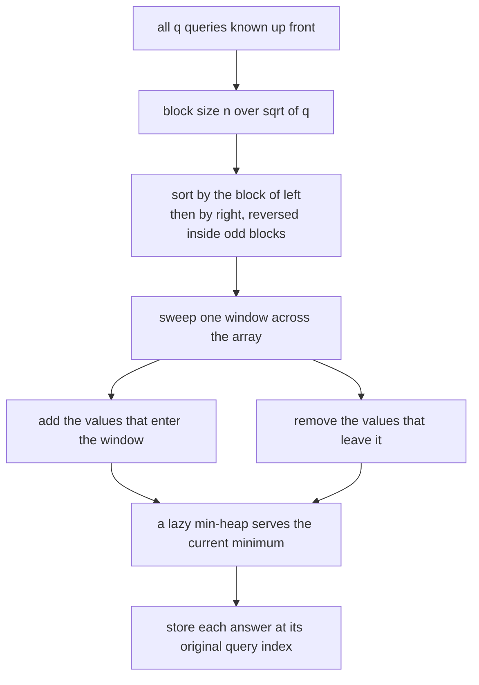
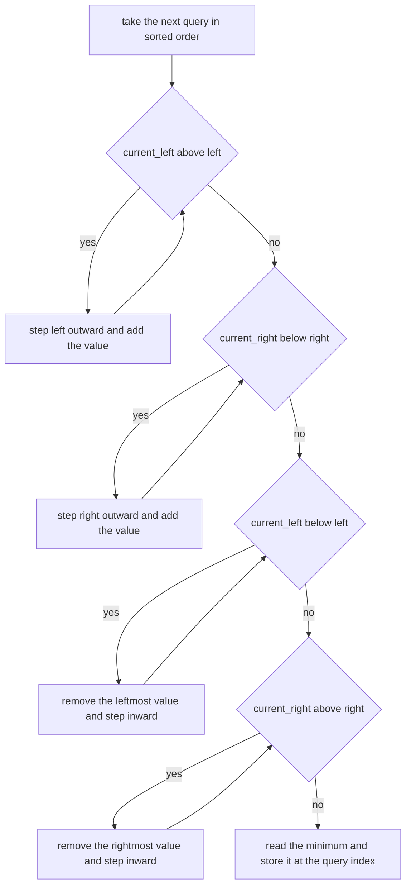
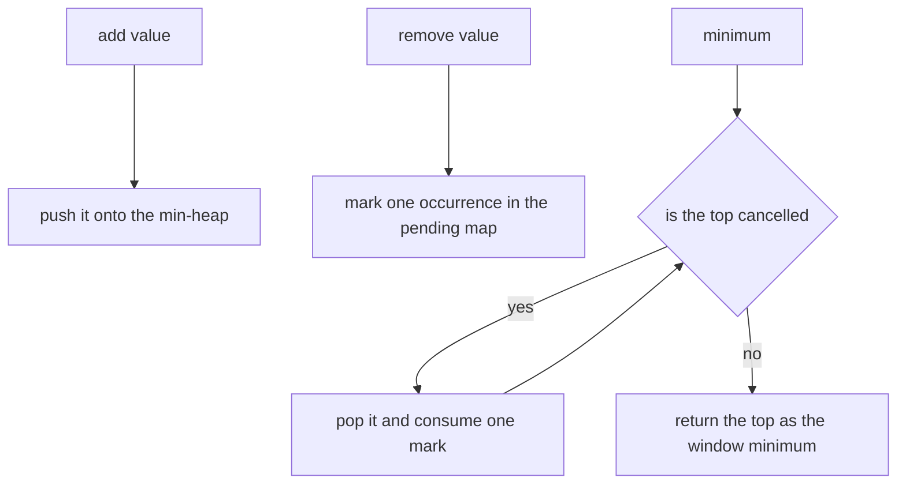
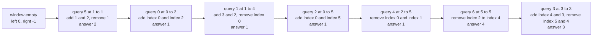

# 339 — Range minimum query with offline queries (Mo's algorithm simple).

> **Tier:** Intermediate · **CTCI chapter:** Beyond — Advanced Data Structures & Algorithms
> **Task spec:** [339-range-minimum-query-with-offline-queries-mo-s-algorithm-simple.md](../../../tasks/intermediate/339-range-minimum-query-with-offline-queries-mo-s-algorithm-simple.md)
> **Solutions:** [Python](../../../solutions/python/intermediate/339-range-minimum-query-with-offline-queries-mo-s-algorithm-simple/solution.py) ·
> [Java](../../../solutions/java/intermediate/339-range-minimum-query-with-offline-queries-mo-s-algorithm-simple/Solution.java) ·
> [JavaScript](../../../solutions/javascript/intermediate/339-range-minimum-query-with-offline-queries-mo-s-algorithm-simple/solution.js) ·
> [C#](../../../solutions/csharp/intermediate/339-range-minimum-query-with-offline-queries-mo-s-algorithm-simple/Solution.cs)

## 1. Problem restatement

**Input:** an array and a **batch** of `q` range queries `(left, right)`, both ends inclusive, all
known before any answer is produced. Queries may repeat, overlap or arrive in any order.

**Output:** the minimum of `values[left..right]` for every query, in the original query order. The
empty batch returns an empty list, and the generated queries always satisfy
`0 <= left <= right < n`.

The hand-checked battery uses `[1, 2, 1, 3, 2, 4]`:

| Query | Range content | Answer |
| --- | --- | --- |
| `(0, 2)` | `1 2 1` | `1` |
| `(1, 4)` | `2 1 3 2` | `1` |
| `(0, 5)` | the whole array | `1` |
| `(3, 3)` | `3` | `3` |
| `(2, 5)` | `1 3 2 4` | `1` |
| `(1, 1)` | `2` | `2` |
| `(5, 5)` | `4` | `4` |

Four more batteries cover the shapes that a moving window can get wrong: a single-element array with
a single query (`[7]`, `(0,0)` → `7`); an empty query batch; a flat array (`[5]*10` with `(0,9)`,
`(2,3)`, `(4,4)` → `5, 5, 5`); a strictly rising array (`0..9` with `(0,9)`, `(0,0)`, `(3,7)` → `0, 0, 3`);
and a duplicate-heavy array (`[2,2,3,2,3,3]` with four windows → all `2`). Then 12 generated instances
with `n` up to 120, `q` up to 200 and values drawn from alphabets of up to 12 symbols are compared, in
full, against a naive scan. A final battery feeds 50 single-position queries in order, then in reverse,
and asserts the answers come back as `values` and `reversed(values)` — proof that the answers are
reassembled by the original query index rather than by sweep order.

## 2. Intuition

A naive batch costs O(sum of lengths) — for `q` full-range queries on an array of `n` values that is
O(n q). The sparse table of task 338 solves that with O(n log n) preprocessing, but it needs the array
to be frozen and the aggregate to be idempotent.

Mo's algorithm takes a completely different route: **reorder the queries so that a single window can
be swept across the array**, adding and removing one value at a time, and answer each query when the
window matches it. The trick that makes the sweep cheap is the sort order:

- split the query starts into blocks of size `B`;
- process the blocks left to right;
- inside a block, visit queries by increasing right endpoint — except in every second block, where the
  right endpoints are visited in decreasing order, so the right pointer does not have to travel all
  the way back to the start of the block each time.

The files use `B = n / sqrt(q)` and document the resulting classic bound: the sweep performs
`O((n + q) * sqrt(n))` add/remove moves in total. Each move costs O(log n) amortised on a min-heap
with lazy deletion, which is what keeps the current window's minimum available in one read.



The price is that the answers come out of order and that removals must be supported. A min-heap cannot
remove an arbitrary value, so the window is implemented as a heap plus a **pending map**: a removal
marks one occurrence of the value, and the mark is consumed when that value eventually reaches the top
of the heap.

## 3. Algorithm

1. If there are no queries, return immediately.
2. Compute `root = floor(sqrt(q))` and `block = max(1, n / root)`.
3. Sort the query indices by `(left / block, right)` with `right` negated for odd blocks.
4. Start an empty window at `left = 0`, `right = -1`.
5. For each query in sorted order: expand the window left, expand it right, shrink it left, shrink it
   right, then read the minimum and store it at the query's own index.
6. Return the answers array.

```text
function mo_range_min(values, queries)
    n ← length of values
    q ← number of queries
    if q is 0 then
        return an empty list
    end
    root ← floor of the square root of q
    block ← max(1, n // root) when root is above 0 otherwise n
    order ← indices 0 to q - 1 sorted by block of left of query, then by right of query
            with the right key negated when the block index is odd

    window ← new lazy minimum multiset
    answers ← array of q entries
    current_left ← 0
    current_right ← -1
    for each index in order do
        left ← left endpoint of queries[index]
        right ← right endpoint of queries[index]
        while current_left > left do
            current_left ← current_left - 1
            window.add(values[current_left])
        end
        while current_right < right do
            current_right ← current_right + 1
            window.add(values[current_right])
        end
        while current_left < left do
            window.remove(values[current_left])
            current_left ← current_left + 1
        end
        while current_right > right do
            window.remove(values[current_right])
            current_right ← current_right - 1
        end
        answers[index] ← window.minimum()
    end
    return answers
end

procedure add(value)
    push value onto the min-heap
    size ← size + 1
end

procedure remove(value)
    pending[value] ← pending[value] + 1
    size ← size - 1
end

function minimum()
    while the heap is not empty and pending holds the top of the heap do
        value ← pop the heap
        pending[value] ← pending[value] - 1
    end
    assert size is above 0
    return the top of the heap
end
```

The order of the four loops is not arbitrary. Expansions run first so the window always covers the
union of the old and the new range before anything is removed; with shrinking first, a move such as
`(5,5) → (3,3)` would remove the entire window and the multiset's size would go negative.





## 4. Worked example

Take the hand-checked array `[1, 2, 1, 3, 2, 4]` with its seven queries. With `n = 6` and `q = 7`,
`root = floor(sqrt(7)) = 2` and `block = max(1, 6 / 2) = 3`, so the block of a query is `left / 3`.
Sorting by `(block, right)` with the right key negated in odd blocks gives the visiting order
`q5, q0, q1, q2, q4, q6, q3` — the queries are answered completely out of input order, which is why
each answer must be written back to its own slot.

| Visit | Query | Window after the four loops | Add moves | Remove moves | Answer |
| --- | --- | --- | --- | --- | --- |
| 1 | `q5 = (1,1)` | positions 1 | `v0, v1` | `v0` | `2` |
| 2 | `q0 = (0,2)` | positions 0..2 | `v0, v2` | — | `1` |
| 3 | `q1 = (1,4)` | positions 1..4 | `v3, v4` | `v0` | `1` |
| 4 | `q2 = (0,5)` | positions 0..5 | `v0, v5` | — | `1` |
| 5 | `q4 = (2,5)` | positions 2..5 | — | `v0, v1` | `1` |
| 6 | `q6 = (5,5)` | position 5 | — | `v2, v3, v4` | `4` |
| 7 | `q3 = (3,3)` | position 3 | `v4, v3` | `v5, v4` | `3` |

The sixth row is the one that shows why expansions must precede removals: going from the window
`2..5` to the single position 5 removes three values and would leave a stale heap top if the window
were ever emptied mid-update. The seventh row then moves from position 5 back to position 3, adding
`v4` and `v3` before removing `v5` and `v4`, so the values 2 and 3 enter and leave again.



Note the last step's bookkeeping: `v5 = 4` was removed and then `v4 = 2` was removed, while both had
just been added. The pending map absorbs that — `remove` only records a mark, and the heap keeps the
values; the minimum call pops the marked tops it can reach and then returns the true smallest live
value, which is 3.

The generated battery widens this to `n` up to 120 and `q` up to 200 per trial, and compares the whole
answer array against a naive scan. The final battery is the one that would catch a subtle assembly bug:
50 single-position queries answered in input order must equal the array, and the same 50 in reverse
must equal the reversed array — impossible if answers were stored in sweep order.

## 5. Complexity

Let `n` be the array length and `q` the number of queries.

| Measure | Bound | Why it holds |
| --- | --- | --- |
| Sorting the queries | O(q log q) | one comparator sort, with the block index and a sign flip as the key |
| Sweep moves | O((n + q) * sqrt(n)) | the classic block-decomposition bound with `B = n / sqrt(q)` |
| Cost per move | O(log n) amortised | one heap push for an add; a remove only marks, and each value is popped at most once overall |
| Minimum read | O(log n) amortised | the cancellation loop pops each dead entry at most once across the whole run |
| Total time | O((n + q) * sqrt(n) * log n) | moves times per-move cost |
| Space | O(n + q) | the heap holds at most the window, the pending map and the answers array are O(n) and O(q) |
| Naive batch | O(sum of query lengths) | each query scans its own range |
| Sparse table (task 338) | O(n log n) build, O(1) per query | cheaper per query, but only for a frozen array and an idempotent aggregate |

The block size is the tuning knob: larger blocks cut the number of block transitions but lengthen the
right-pointer travel inside a block. `B = n / sqrt(q)` equalises the two contributions, which is where
the `sqrt(n)` factor in the bound comes from.

## 6. Pitfalls and edge cases

- **Answers must be written by original index.** The sweep visits queries in sorted order; storing
  answers sequentially would silently permute them. The reversed-singles battery exists precisely to
  catch that.
- **Expand before you shrink.** The window must always cover the union of the old and new ranges while
  it is being updated; shrinking first can empty the window and drive the logical size negative.
- **Removing a value you never added.** Every shrink step removes a position that is currently inside
  the window by construction, so the pending map only ever records real removals — provided the four
  loops stay in the order above.
- **Duplicates in the window.** The structure is a multiset, not a set: `[5]*10` and `[2,2,3,2,3,3]`
  both require the counts to be tracked individually, which the pending map's per-value counter does.
- **Lazy deletion is approximate until the minimum is read.** The heap contains dead entries between
  calls; only `minimum()` cleans them, and it must decrement the mark when it pops so the counts stay
  balanced.
- **Empty window is a bug, not a case.** `minimum()` asserts a positive size; a query range is always
  non-empty (`left <= right`), so an empty window means the sweep loops were mis-ordered, and the
  assertion turns a wrong answer into a loud failure.
- **The parity trick is an optimisation, not a requirement.** Negating the right key in odd blocks
  reduces pointer travel; removing it keeps the answers correct and only makes the sweep slower.
- **Empty batch.** `q == 0` returns before the block size is computed, which also avoids the
  `sqrt(0)` corner in the block formula.
- **Query validation.** The generator enforces `left <= right < n`; a malformed query would make the
  shrink loops run past the array bounds, so the final battery re-asserts the bounds of every generated
  query.
- **Offline only.** Mo's algorithm needs every query up front. An online stream would have to fall back
  to a segment tree or a sparse table.
- **Monotone sweeps only.** The add/remove pair must be exact inverses for the aggregate to stay
  correct. Minimum works because removing a value can only raise the answer; a variant that needs
  "the second smallest" would need a different window structure entirely.

## 7. Variants and follow-ups

- **The online counterpart.** [338-implement-sparse-table-for-rmq-immutable.md](../../../tasks/intermediate/338-implement-sparse-table-for-rmq-immutable.md)
  answers the same range-minimum question in O(1) after O(n log n) preprocessing, at the cost of
  immutability and of requiring an idempotent aggregate.
- **The mutable counterpart.** [335-implement-data-structure-for-skyline-queries-segment-tree-varian.md](../../../tasks/intermediate/335-implement-data-structure-for-skyline-queries-segment-tree-varian.md)
  handles interleaved updates and queries in O(log n) each, which neither the sparse table nor Mo's
  algorithm can do.
- **Interval structure behind the same question.** [329-range-intersection-queries-interval-trees-basics.md](../../../tasks/intermediate/329-range-intersection-queries-interval-trees-basics.md)
  indexes intervals rather than positions and prunes the same way a sweep does.
- **Lazy removal elsewhere in this tier.** [334-implement-rolling-median-with-delete-operation-multiset-or-two-h.md](../../../tasks/intermediate/334-implement-rolling-median-with-delete-operation-multiset-or-two-h.md)
  applies the same "mark now, clean when it reaches the top" trick to two heaps.
- The chapter walkthrough in [Advanced Topics](../../ctci/x-advanced-topics.md) groups Mo's algorithm
  with sparse tables and Fenwick trees as the three range-query workhorses.

## 8. Check yourself

1. Why does the sort order matter at all, if every query is ultimately answered correctly?

<details><summary>Show answer</summary>

Because correctness is free but cost is not: the sweep pays for every single step of the window
boundaries. Ordering the queries by block and by right endpoint (with the parity flip) keeps the total
number of add/remove moves near O((n + q) * sqrt(n)), whereas an adversarial order such as alternating
full-range and single-position queries would move the pointers back and forth across the array and
cost O(n q).

</details>

2. Why does the minimum need a `pending` map instead of just popping the heap?

<details><summary>Show answer</summary>

Because a heap cannot remove an arbitrary value: the value to be removed may sit anywhere inside it.
`remove` therefore records a mark, and `minimum` discards marked top entries when they surface. Each
value is pushed once and popped at most once, so the total cleaning work stays linear in the number of
adds.

</details>

3. What breaks if the right-shrink loop runs before the left-expand loop?

<details><summary>Show answer</summary>

Moving from a window entirely to the right of the target, such as `(5,5) → (3,3)`, the shrink loop
would remove positions 5 and 4 while `current_left` is still 5, so the window empties and the logical
size goes negative before the expansions run. `minimum()` then fails its assertion — a deliberate
loud failure rather than a wrong answer.

</details>

4. How is the answer for a query identified after the sweep reorders everything?

<details><summary>Show answer</summary>

The sorted order holds query *indices*, not query objects, so after computing the minimum the sweep
writes `answers[index] = minimum`. The reversed-singles battery (50 queries answered in reverse input
order) fails immediately if the writes are positional instead.

</details>

5. When is a sparse table a better choice than Mo's algorithm?

<details><summary>Show answer</summary>

When the array never changes, the aggregate is idempotent such as `min`, `max` or `gcd`, and queries
arrive online. A sparse table then answers each query in O(1) with a one-off O(n log n) build, whereas
Mo's algorithm needs every query up front and pays O(sqrt n) per move — its advantage is being able to
handle aggregates and windows a sparse table cannot express.

</details>
