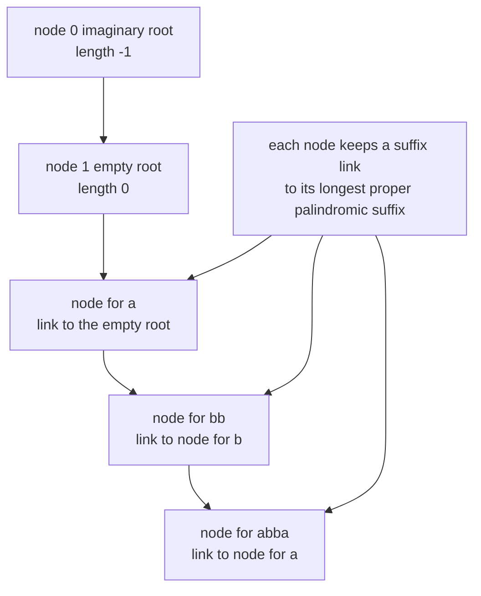
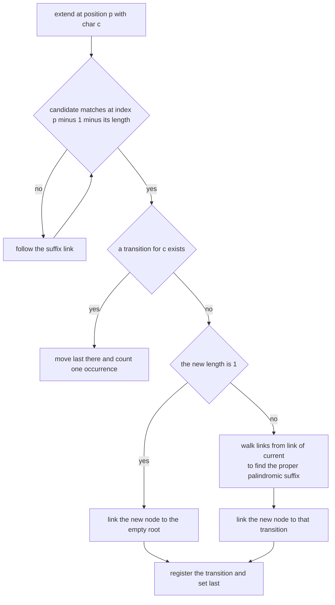
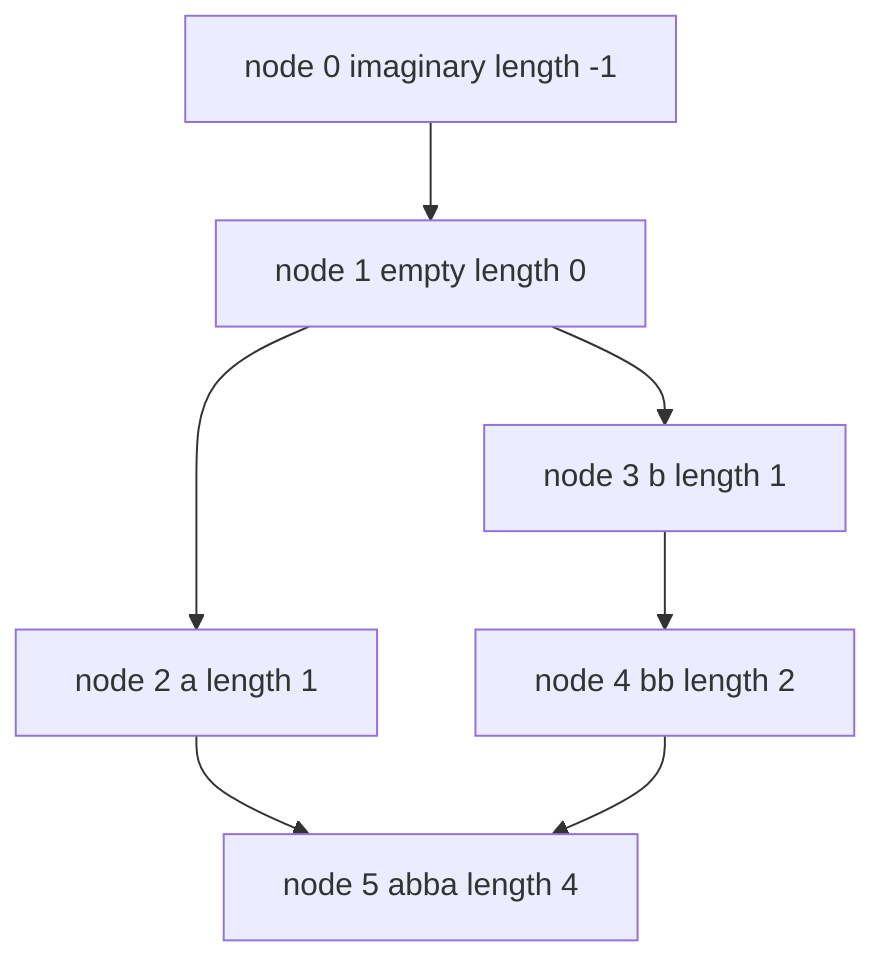
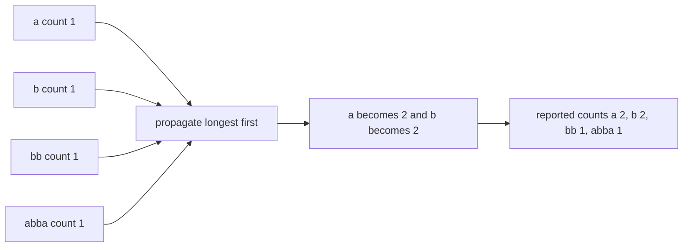

# 340 — Implement palindrome tree (Eertree) overview & small test.

> **Tier:** Intermediate · **CTCI chapter:** Beyond — Advanced Data Structures & Algorithms
> **Task spec:** [340-implement-palindrome-tree-eertree-overview-small-test.md](../../../tasks/intermediate/340-implement-palindrome-tree-eertree-overview-small-test.md)
> **Solutions:** [Python](../../../solutions/python/intermediate/340-implement-palindrome-tree-eertree-overview-small-test/solution.py) ·
> [Java](../../../solutions/java/intermediate/340-implement-palindrome-tree-eertree-overview-small-test/Solution.java) ·
> [JavaScript](../../../solutions/javascript/intermediate/340-implement-palindrome-tree-eertree-overview-small-test/solution.js) ·
> [C#](../../../solutions/csharp/intermediate/340-implement-palindrome-tree-eertree-overview-small-test/Solution.cs)

## 1. Problem restatement

**Input:** a string `text`.

**Output:** the set of **distinct palindromic substrings**, each with its full occurrence count in
`text`, plus the size of that set. The four files expose this as `distinct_count()` and
`counts()`, and they pin the answers down on hand-checked strings:

| Text | Distinct palindromes | Counts |
| --- | --- | --- |
| `"abba"` | 4 | `a → 2, b → 2, bb → 1, abba → 1` |
| `"aaaa"` | 4 | `a → 4, aa → 3, aaa → 2, aaaa → 1` |
| `""` | 0 | — |
| `"x"` | 1 | `x → 1` |
| `"abcd"` | 4 | `a → 1, b → 1, c → 1, d → 1` |
| `"aba"` | 3 | `a → 2, b → 1, aba → 1` |
| `"abccba"` | 6 | `a → 2, b → 2, c → 2, cc → 1, bccb → 1, abccba → 1` |

`"abba"` is also checked twice against an independent oracle: the set of palindromes found by
enumerating every substring must equal the tree's key set, and the full count map must equal
`brute_counts`. Then 60 generated strings of length up to 39 over the alphabets `"ab"` and `"abc"`
(seed 1717, generator `seed = (seed * 75 + 74) % 65537`) are compared, count map against count map,
with two extra invariants: every reported key is really a palindrome, and every count is at least 1
with a length no greater than the text.

## 2. Intuition

The naive approach enumerates all O(n²) substrings, tests each for palindromicity and counts
occurrences — an O(n³)-flavoured oracle, which is exactly what the test battery uses as ground truth.

The eertree answers both questions in one pass. Two ideas carry it:

- **There are at most `n` distinct palindromic substrings**, so a single tree node per palindrome is
  affordable; the tree has two roots, node 0 with length `-1` (imaginary) and node 1 with length `0`
  (the empty palindrome).
- **Every position of the text has exactly one longest palindromic suffix**, so walking prefix by
  prefix, appending one character at a time, is enough to create every node exactly once.

Each node also stores a **suffix link**: the node of its longest proper palindromic suffix. That link
is what makes the walk short — to find the longest palindromic suffix of the current prefix, start
from the previous answer and follow suffix links until the character at the matching position agrees
with the new character.



Occurrence counts come from a second, cheaper idea. During construction a node can only be incremented
when it is the **longest palindromic suffix of the current prefix**, so the raw counter is "how often
this node was the answer for some position". A palindrome occurs once for every position where it is
*any* palindromic suffix, not just the longest — and those are exactly the positions counted by the
nodes reachable through the suffix-link chain. So one pass from the longest node down, adding each
node's count into its link, turns the raw counters into true occurrence counts.

## 3. Algorithm

1. Create the two roots: node 0 with length `-1` and node 1 with length `0`, both linked to node 0,
   with `last = 1`.
2. For each position and character, run `extend`:
   - walk from `last` along suffix links while the candidate cannot be extended by the new character,
     testing `index = position - 1 - length[current]` and the character at `text[index]`;
   - if a transition for the character already exists, move `last` to it, increment its counter, done;
   - otherwise create a node with length `length[current] + 2`, compute its palindrome string, set its
     link to the empty root if it is a single character or to `next[candidate][char]` where `candidate`
     is found by walking from `link[current]`, register the transition, and increment its counter.
3. Sort the real nodes by decreasing palindromic length and add each counter into its suffix link's
   counter.
4. Report the key set (the palindrome strings) with their counts, and the node count minus the two
   roots.

```text
procedure extend(position, char)
    current ← last
    looping ← true
    while looping do
        index ← position - 1 - length[current]
        if index >= 0 and text[index] is char then
            looping ← false
        else
            current ← link[current]
        end
    end

    if next[current] contains char then
        last ← next[current][char]
        occurrences[last] ← occurrences[last] + 1
        return
    end

    node ← number of existing nodes
    length[node] ← length[current] + 2
    if length[node] is 1 then
        palindrome[node] ← string of char
        link[node] ← 1
    else
        palindrome[node] ← char + palindrome[current] + char
        candidate ← link[current]
        looping ← true
        while looping do
            index ← position - 1 - length[candidate]
            if index >= 0 and text[index] is char then
                looping ← false
            else
                candidate ← link[candidate]
            end
        end
        link[node] ← next[candidate][char]
    end
    next[current][char] ← node
    occurrences[node] ← 1
    last ← node
end

procedure build(text)
    create node 0 with length -1 and node 1 with length 0, both linked to node 0
    last ← 1
    for position ← 0 to length of text - 1 do
        extend(position, text[position])
    end
    for node in real nodes sorted by decreasing length do
        occurrences[link[node]] ← occurrences[link[node]] + occurrences[node]
    end
end
```

The imaginary root is not decoration: with `length = -1`, the test index `position - 1 - length[0]`
becomes `position`, so a brand new single character always matches against itself. Without that root,
every length-1 palindrome would need its own special case. `link[0] = 0` also guarantees the walk
terminates, because the imaginary root always "matches".



## 4. Worked example

Build the tree for `"abba"`. Nodes start as 0 (`length -1`) and 1 (`length 0`), with `last = 1`.

| Position | Char | Walk | Action | Node created | Link |
| --- | --- | --- | --- | --- | --- |
| 0 | `a` | node 1 fails (`index -1`), node 0 matches at index 0 | new | 2, length 1 | 1 (empty root) |
| 1 | `b` | node 2 fails (`index -1`), node 1 fails at index 0, node 0 matches at index 1 | new | 3, length 1 | 1 |
| 2 | `b` | node 3 fails at index 0, node 1 matches at index 1 | new | 4, length 2 | 3 (node `b`) |
| 3 | `a` | node 4 matches at index 0 | new | 5, length 4 | 2 (node `a`) |

Position 2 is where the suffix link of a real node is computed: the new node is `bb`, built from the
empty root, and its link is found by walking from `link[1] = 0` and reading `next[0]['b']`, which is
node 3. Position 3 is the same dance one level deeper: `abba` is built from `bb`, and its link walk
goes `link[4] = 3` (fails, `text[1]` is `b`), then `link[3] = 1` (fails, `text[2]` is `b`), then
`link[1] = 0` (matches at index 3), so the link is `next[0]['a'] = 2`, the palindrome `a`.



Before propagation the occurrence counters record only "was the longest palindromic suffix":
`a → 1` (position 0), `b → 1` (position 1), `bb → 1` (position 2), `abba → 1` (position 3). The second
pass processes nodes from longest to shortest:

| Node processed | Length | `occurrences` before | Link | Link counter after |
| --- | --- | --- | --- | --- |
| 5 `abba` | 4 | 1 | 2 (`a`) | `a` becomes 2 |
| 4 `bb` | 2 | 1 | 3 (`b`) | `b` becomes 2 |
| 3 `b` | 1 | 1 | 1 (empty root) | empty root becomes 2, not reported |
| 2 `a` | 1 | 2 | 1 (empty root) | empty root becomes 4, not reported |



The final map is `{a: 2, b: 2, bb: 1, abba: 1}` with four distinct palindromes, which is exactly what
the assertions require. The mechanism generalises: in `"aaaa"` the nodes form a chain of lengths
1, 2, 3, 4 linked downwards, and the propagation gives each of them one count more than the next
longer one — `a → 4, aa → 3, aaa → 2, aaaa → 1`. Notice that `a` is counted 4 times because it is a
palindromic suffix of four different prefixes, and that the chain is exactly what makes the
propagation order matter.

## 5. Complexity

Let `n` be the text length, `d <= n` the number of distinct palindromic substrings, and `σ` the
alphabet size.

| Measure | Bound | Why it holds |
| --- | --- | --- |
| Nodes | at most `n + 2` | a string has at most `n` distinct palindromic substrings, plus the two roots |
| Build time | O(n) amortised link steps | each `extend` walks suffix links, and the total number of steps across all positions is linear in `n` |
| Transition cost | O(1) expected | hash maps (`dict`, `HashMap`, `Map`, `Dictionary`) are used in all four files |
| Propagation | O(d log d) | the nodes are sorted by decreasing length before the counts are folded into the links |
| Space | O(n) nodes plus the stored palindrome strings | see the warning below |
| Oracle | O(n³) | O(n²) substrings, each reversed and then scanned for occurrences |

One honest caveat the files themselves imply: they store the **palindrome string** of every node, so
the strings together occupy `O(sum of palindrome lengths)` characters — quadratic in the worst case,
as `"aaaa…"` shows (lengths 1, 2, 3, …, n). The node count stays linear, but a production eertree keeps
only lengths and transitions and reconstructs a palindrome on demand; that is the trade this overview
implementation makes so that `counts()` can return readable keys.

## 6. Pitfalls and edge cases

- **The imaginary root is required.** Its length of `-1` makes the matching index equal `position`,
  which is what lets a single new character attach with no special case; `link[0] = 0` is what makes
  the walk terminate instead of running off the edge.
- **The link walk starts from `link[current]`, not `current`.** A node's suffix link must point to the
  *proper* palindromic suffix; starting from the node itself would make it its own link.
- **Length-1 nodes link to the empty root directly.** They are asserted by `"abcd"`, where the map is
  exactly the four single characters with count 1.
- **The existing-transition branch still counts.** When `extend` finds a node that already exists, it
  must increment that node's counter — that is the "longest palindromic suffix here" tally, and
  skipping it undercounts every palindrome in the propagation.
- **Propagation order is by decreasing length.** A node's link always has strictly smaller length, so
  processing longest first guarantees every count is final before it is added upward. Processing in
  creation order happens to work for many strings and fails for others.
- **Counts land in the roots too.** The empty root accumulates a number that is meaningless on its own;
  `counts()` and `distinct_count()` both skip nodes 0 and 1, which is why the reported size is the node
  count minus two.
- **Empty text.** No `extend` runs, so the result is an empty map and a count of 0 — asserted directly,
  not just implied.
- **Distinctness.** The map key is the palindrome itself, so repeated palindromes collapse to one
  entry with a count greater than 1, exactly as `"aaaa"` demonstrates.
- **Unicode.** Python, JavaScript and C# build their palindrome strings from code points or UTF-16
  units depending on the runtime, and Java's reversal of UTF-16 code units can split astral
  characters. The generated alphabets are `"ab"` and `"abc"`, so the tests never reach that case.
- **Storage growth.** Because the files materialise the palindrome strings, the memory profile is
  quadratic on repetitive input even though the node count is linear; the LCG battery keeps lengths
  under 40, where that is irrelevant.
- **What the oracle cannot share.** `brute_counts` is a completely independent enumeration — sorted
  slices of the string rather than tree structure — so a link or propagation bug cannot hide behind a
  matching bug in the oracle.

## 7. Variants and follow-ups

- **The simplest palindrome question.** [002-check-if-a-string-is-a-palindrome.md](../../../tasks/beginner/002-check-if-a-string-is-a-palindrome.md)
  answers "is this one string a palindrome" with a two-pointer walk; the eertree answers "which
  palindromes occur how often" for all of them at once.
- **Other one-pass string structures.** [313-implement-z-function-for-pattern-matching.md](../../../tasks/intermediate/313-implement-z-function-for-pattern-matching.md)
  precomputes prefix matches in O(n), and [314-implement-aho-corasick-for-multiple-pattern-match-outline.md](../../../tasks/intermediate/314-implement-aho-corasick-for-multiple-pattern-match-outline.md)
  builds an automaton over many patterns — both share the eertree's "one node per interesting
  substring, plus links that encode suffix structure" design.
- **Precomputed tables instead of a tree.** [338-implement-sparse-table-for-rmq-immutable.md](../../../tasks/intermediate/338-implement-sparse-table-for-rmq-immutable.md)
  shows the opposite trade: pay O(n log n) up front for O(1) queries rather than building incremental
  structure as the text is consumed.
- **Count propagation as a pattern.** The "raw tally, then fold into the link" pass reappears in
  suffix automata and in tree DP generally; [343-graph-isomorphism-simple-checks-degree-sequence-invariants.md](../../../tasks/intermediate/343-graph-isomorphism-simple-checks-degree-sequence-invariants.md)
  uses the same idea of cheap invariants computed from a structure.
- The chapter walkthrough in [Advanced Topics](../../ctci/x-advanced-topics.md) covers string
  automata and eertrees as the beyond-the-book string structures.

## 8. Check yourself

1. Why are there at most `n` distinct palindromic substrings, and what does that bound buy?

<details><summary>Show answer</summary>

Each position of the text introduces at most one new distinct palindrome — its longest palindromic
suffix — so the total is at most `n`. That is what makes a node-per-palindrome tree affordable, with a
node count of `n + 2` including the roots.

</details>

2. What exactly does a node's raw occurrence counter mean before propagation?

<details><summary>Show answer</summary>

How many positions had that palindrome as their **longest** palindromic suffix. It is not the
occurrence count: a shorter palindrome also occurs at every position where a longer one with it as a
suffix occurs, and the propagation along suffix links adds those positions in.

</details>

3. Why must the propagation visit nodes in decreasing order of length?

<details><summary>Show answer</summary>

Because each node's count is added into its suffix link, whose palindrome is strictly shorter. Adding a
node's count before all longer nodes have contributed to it would propagate a partial total upward.
Sorting by decreasing length guarantees every count is final when it is folded in.

</details>

4. What would break without the imaginary root of length `-1`?

<details><summary>Show answer</summary>

Single-character palindromes would need a special case: with `length = -1`, the match index for the
imaginary root is `position - 1 - (-1) = position`, so a new character matches itself and the walk
terminates. It also gives `link[0] = 0` a place to stop, so no match ever runs off the string.

</details>

5. For `"abba"`, why is `a` counted twice while `bb` is counted once?

<details><summary>Show answer</summary>

Single characters `a` occur at positions 0 and 3, so `a` is a palindromic suffix of two prefixes — one
of them through the node `abba`, which is why the propagation adds `abba`'s single count into `a`'s
counter. `bb` occurs only at positions 1 and 2, and it is the longest palindromic suffix there once,
so its raw count is already final.

</details>
