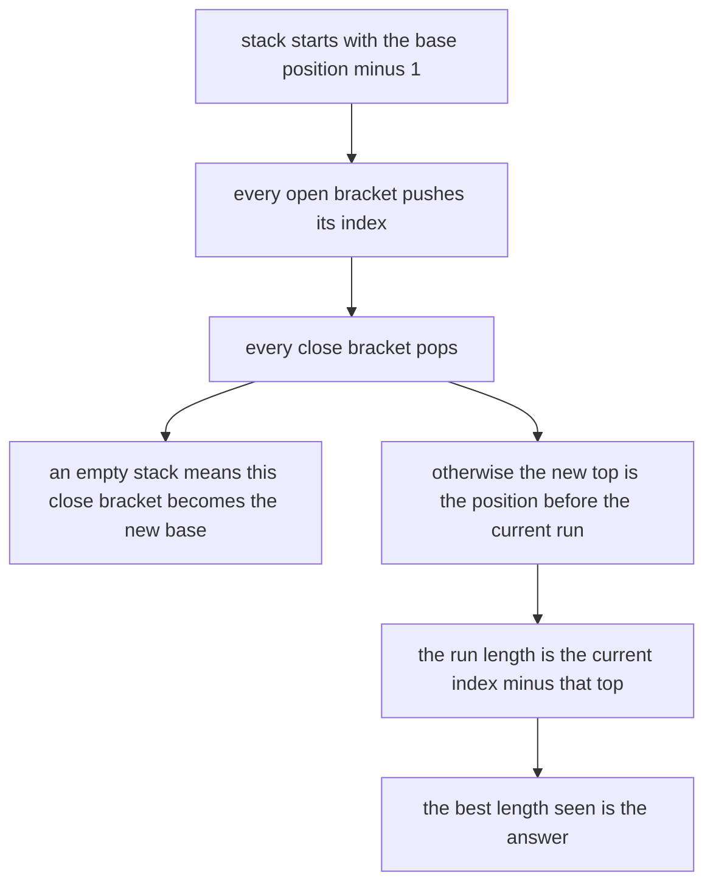
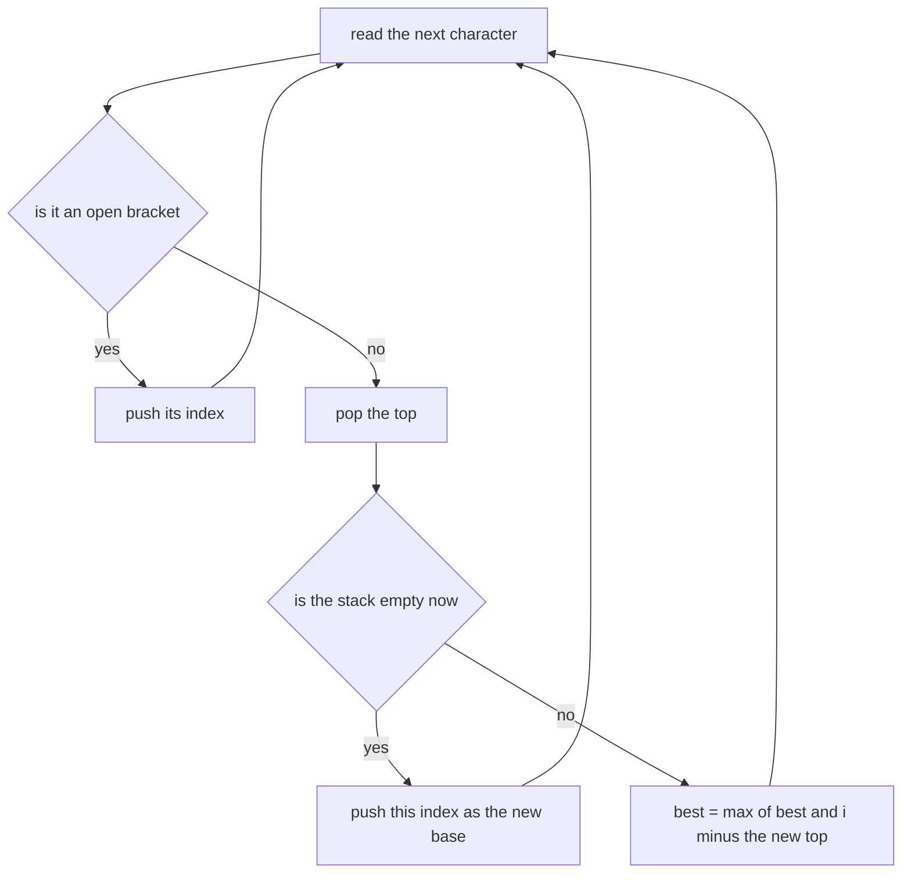
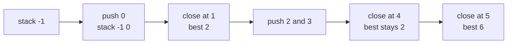
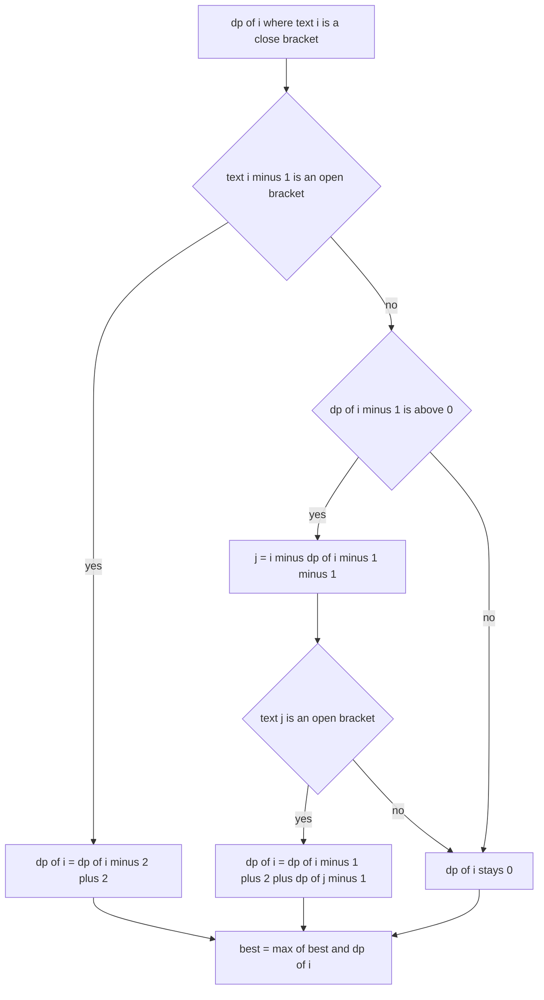

# 341 — Balanced parentheses longest valid substring (stack).

> **Tier:** Intermediate · **CTCI chapter:** Ch 3 — Stacks and Queues
> **Task spec:** [341-balanced-parentheses-longest-valid-substring-stack.md](../../../tasks/intermediate/341-balanced-parentheses-longest-valid-substring-stack.md)
> **Solutions:** [Python](../../../solutions/python/intermediate/341-balanced-parentheses-longest-valid-substring-stack/solution.py) ·
> [Java](../../../solutions/java/intermediate/341-balanced-parentheses-longest-valid-substring-stack/Solution.java) ·
> [JavaScript](../../../solutions/javascript/intermediate/341-balanced-parentheses-longest-valid-substring-stack/solution.js) ·
> [C#](../../../solutions/csharp/intermediate/341-balanced-parentheses-longest-valid-substring-stack/Solution.cs)

## 1. Problem restatement

**Input:** a string of `(` and `)` characters, of any length, possibly empty.

**Output:** the length of the longest **contiguous substring** that is a balanced parentheses
sequence. The substring must be contiguous — a subsequence answer would be different — and it must
return to depth 0 with the depth never going negative inside it.

Every file ships **three** implementations and compares them on every test input: the stack of
indices, a dynamic program, and a brute-force oracle that tries every start position. The hand-checked
answers are:

| Input | Answer | Note |
| --- | --- | --- |
| `(()` | `2` | the valid run is `()` |
| `)()())` | `4` | the valid run is `()()` |
| `()(())` | `6` | the whole string is valid |
| `()(()` | `2` | the trailing `(()` never closes |
| `((())` | `4` | the run `(())` sits inside the outer pair |
| `())` | `2` | the extra `)` at the end is ignored |
| `)()(` | `2` | an unmatched bracket on each side |
| `)(` | `0` | no balanced substring |
| `(((` | `0` | nothing closes |
| `()` / `()()` | `2` / `4` | the trivial chains |
| `""` | `0` | the empty input |

The twelve hand strings are run through all three implementations and must agree, and then 150
generated strings of length 0 to 24 over `"()"` (seed 34142, generator
`seed = (seed * 75 + 74) % 65537`) are compared against the brute-force oracle — so the stack and DP
variants are validated against an independent definition, not against each other.

## 2. Intuition

The naive definition is the oracle's: for every starting index, walk forward keeping a depth counter,
stop as soon as the depth goes negative, and record the length each time the counter returns to zero.
That is O(n²) time (and O(1) space), and it is the definition to keep in mind when reasoning about the
faster versions.

The stack version is easier to see through a concrete example than through a proof. Push the index of
every `(`. On a `)`, pop: the top of the stack is now the position of the unmatched bracket that
precedes the current valid run, so the run's length is `i - top`. If the pop empties the stack, the
`)` just read has no partner and **becomes the new base** — the new "position just before everything
that can still start a valid run". The stack is seeded with `-1` so that a run beginning at index 0
measures `i - (-1) = i + 1` correctly.



The second implementation is the classic dynamic program: `dp[i]` is the length of the longest valid
substring **ending exactly at `i`**. Only a `)` can end a run, and there are two ways for a run to end
at `i`:

- `s[i-1]` is `(`, so `i` closes a two-character pair — the run is that pair plus whatever valid run
  ends at `i - 2`;
- `s[i-1]` is `)` and `dp[i-1] > 0`, so the run ending at `i - 1` is wrapped: the character in front
  of it, at `j = i - dp[i-1] - 1`, must be `(`, and then the answer also absorbs the valid run ending
  at `j - 1`.

## 3. Algorithm

**Stack of indices.**

1. Initialise the stack with the single entry `-1` and `best = 0`.
2. For each index `i` and character: push `i` on `(`; on `)` pop, then either push `i` (stack empty —
   a new base) or update `best = max(best, i - top)`.

**Dynamic program.**

1. Allocate `dp` of length `n`, all zeros, and `best = 0`.
2. For each index `i`: skip anything that is not `)`; apply the pair rule when `s[i-1]` is `(`;
   otherwise apply the wrapped rule through `j = i - dp[i-1] - 1`; then update `best`.
3. Return `best`.

```text
function longest_valid_stack(text)
    stack ← list holding the single value -1
    best ← 0
    for i ← 0 to length of text - 1 do
        if text[i] is '(' then
            append i to stack
        else
            remove the last element of stack
            if stack is empty then
                append i to stack
            else
                best ← max(best, i - last element of stack)
            end
        end
    end
    return best
end

function longest_valid_dp(text)
    n ← length of text
    dp ← array of n zeros
    best ← 0
    for i ← 0 to n - 1 do
        if text[i] is not ')' then
            continue with the next i
        end
        if i >= 1 and text[i - 1] is '(' then
            dp[i] ← (dp[i - 2] if i >= 2 else 0) + 2
        else if i >= 1 and dp[i - 1] > 0 then
            j ← i - dp[i - 1] - 1
            if j >= 0 and text[j] is '(' then
                dp[i] ← dp[i - 1] + 2 + (dp[j - 1] if j >= 1 else 0)
            end
        end
        best ← max(best, dp[i])
    end
    return best
end
```

Both versions are single passes with the same asymptotics; the DP spells the case analysis out
explicitly, which makes it the easier one to verify by induction, while the stack is the easier one to
explain in an interview.



## 4. Worked example

Trace the stack on `()(())`, where the answer is the whole string:

| `i` | Char | Stack after the step | `best` | Comment |
| --- | --- | --- | --- | --- |
| start | — | `[-1]` | 0 | base is "one before the start" |
| 0 | `(` | `[-1, 0]` | 0 | push |
| 1 | `)` | `[-1]` | 2 | pop 0, top is `-1` → `1 - (-1) = 2` |
| 2 | `(` | `[-1, 2]` | 2 | push |
| 3 | `(` | `[-1, 2, 3]` | 2 | push |
| 4 | `)` | `[-1, 2]` | 2 | pop 3, top is 2 → `4 - 2 = 2` |
| 5 | `)` | `[-1]` | 6 | pop 2, top is `-1` → `5 - (-1) = 6` |

The final row is the payoff: the second `)` closes the run that began at index 2, and because the
stack had already forgotten the inner pair, the measurement reaches all the way back to the base and
the concatenated run `()( () )` counts as 6.



Now the same string through the DP, which shows the three-way case analysis:

| `i` | Char | Case taken | `dp[i]` | `best` |
| --- | --- | --- | --- | --- |
| 1 | `)` | `s[0]` is `(` → pair rule with `dp[-1] = 0` | 2 | 2 |
| 4 | `)` | `s[3]` is `(` → pair rule with `dp[2] = 0` | 2 | 2 |
| 5 | `)` | wrapped rule: `j = 5 - dp[4] - 1 = 2`, `s[2]` is `(`, and `dp[1] = 2` | `2 + 2 + 2 = 6` | 6 |

Rows 1 and 4 are the trivial pair rule; row 5 is the interesting one, where the run ending at 4 gets
wrapped by the `(` at index 2 and then absorbs the run ending at index 1. Both implementations produce
6, as does the brute-force oracle.



A second trace shows the base handling. On `)()())` the first character is unmatched, so the stack
becomes `[0]` — the base moves to index 0 — and the run `()()` from indices 1 to 4 measures
`4 - 0 = 4`. The final `)` pops the base itself, empties the stack and is pushed as index 5, which
cannot improve the answer because nothing follows it.

## 5. Complexity

Let `n` be the length of the input string.

| Measure | Bound | Why it holds |
| --- | --- | --- |
| Stack time | O(n) | one push or pop per character, one comparison per close bracket |
| Stack space | O(n) | the stack holds at most one entry per open bracket plus the base; Java and C# preallocate `n + 1` |
| DP time | O(n) | one constant-time case analysis per character |
| DP space | O(n) | the `dp` array; `dp[i]` reads `dp[i-1]`, `dp[i-2]` and `dp[j-1]` |
| Brute force | O(n²) time, O(1) space | every start position scans forward until the depth goes negative |
| Two-pass counter variant | O(n) time, O(1) space | one left-to-right and one right-to-left sweep with a running depth, no stack at all |

The stack representation is the one this task is named for, and the reason is pedagogical rather than
performance: it makes the invariant "the top is the position before the current run" explicit, which is
the same bookkeeping the O(1)-space two-pass variant hides inside two counter sweeps.

## 6. Pitfalls and edge cases

- **The seed entry `-1` is the base.** It represents a virtual unmatched bracket before the string, so
  a run starting at index 0 measures `i + 1`. Removing it makes every answer off by one.
- **An unmatched `)` replaces the base.** After the pop, an empty stack means the bracket just read
  cannot join anything to its left, so its own index is pushed. Skipping this push makes the base
  stale and breaks inputs such as `)()(` and `)()())`.
- **Measure after popping, not before.** The run length is `i` minus the *new* top; using the popped
  value instead measures a run that includes an unmatched open bracket.
- **Empty and all-open strings.** `""`, `)("`, `(((` and `()(()` all answer 0 or 2 as the table shows;
  the algorithms need no special case, and the empty string never enters the loop at all.
- **`dp[i-1] > 0` in the wrapped rule.** A zero `dp[i-1]` means there is no run to wrap, and the guard
  also keeps the index `j` meaningful; a `(` at `j` would have been caught by the pair rule anyway, so
  the guard is defensive but harmless.
- **The `j` index must be bounds-checked.** `j = i - dp[i-1] - 1` can be `-1` for a run that starts at
  index 0, and the code checks `j >= 0` before reading `s[j]` and `dp[j-1]`.
- **Contiguous, not subsequence.** `((()))` has a valid substring, but a string like `())(()` has two
  separate runs of 2 whose total is 4 and whose longest single run is 2. The oracle's rule — depth
  never negative and returning to zero — encodes contiguity.
- **Odd length is not a proof of anything.** `(()` has odd length and answers 2; the answer is never
  greater than the largest even prefix length, but there is no shorter cut-off to apply.
- **Three implementations, one definition.** The stack and DP are compared to each other *and* to the
  brute force, so a shared misunderstanding could survive only if the oracle shared it too — which it
  cannot, since it scans substrings directly.
- **Very long inputs.** Both fast versions are single pass and allocate O(n), so the string length is
  the only limit; the O(1)-space two-pass variant exists if even the stack allocation matters.

## 7. Variants and follow-ups

- **Just deciding balance.** [042-check-balanced-parentheses-with-three-bracket-types.md](../../../tasks/beginner/042-check-balanced-parentheses-with-three-bracket-types.md)
  answers "is the whole string balanced" with the same stack, extended to three bracket types and
  without tracking positions.
- **Generating the sequences.** [288-generate-parentheses-balanced-parentheses-generator.md](../../../tasks/intermediate/288-generate-parentheses-balanced-parentheses-generator.md)
  enumerates the balanced strings of length `2n`, which is the opposite direction: the same balance
  invariant used to build rather than to measure.
- **The same stack with operators.** [342-implement-expression-evaluator-with-variables-and-precedence.md](../../../tasks/intermediate/342-implement-expression-evaluator-with-variables-and-precedence.md)
  keeps operands on a stack while parentheses and precedence drive the reductions.
- **Another measure over strings.** [313-implement-z-function-for-pattern-matching.md](../../../tasks/intermediate/313-implement-z-function-for-pattern-matching.md)
  precomputes prefix matches in one pass, and the palindrome structure of
  [340-implement-palindrome-tree-eertree-overview-small-test.md](../../../tasks/intermediate/340-implement-palindrome-tree-eertree-overview-small-test.md)
  answers a related "how long can a substring be" question about palindromes.
- The chapter walkthrough in [Stacks and Queues](../../ctci/03-stacks-and-queues.md) places this task
  with the other stack-of-indices exercises.

## 8. Check yourself

1. What invariant does the stack maintain at every step?

<details><summary>Show answer</summary>

The stack holds the indices of unmatched `(` characters, with one extra entry at the bottom: the
position of the last unmatched `)`, or `-1` if there is none. That bottom entry is the boundary before
which no valid run can start, which is why a run's length is `i` minus the new top.

</details>

2. Why does an unmatched `)` get pushed, and what breaks without it?

<details><summary>Show answer</summary>

Because it becomes the new left boundary: no valid run can contain it, so the measurement base must
move past it. Without the push the stack would keep an older base, and runs would be measured across
an unmatched close bracket — `)()(` would report 4 instead of 2.

</details>

3. In `()(())`, why does the DP row for `i = 5` add three terms?

<details><summary>Show answer</summary>

`dp[5] = dp[4] + 2 + dp[1]`: the run ending at 4 is `(())`? — more precisely `dp[4] = 2` covers the
inner `()`, the `+ 2` is the outer pair whose `(` is at index 2 and whose `)` is at index 5, and
`dp[1] = 2` is the run immediately before that `(`, which is `()` at indices 0 and 1. All three pieces
are contiguous, so they concatenate into the whole string.

</details>

4. Why can the answer not simply count matched pairs?

<details><summary>Show answer</summary>

Because the longest valid substring is contiguous and must not cross an unmatched bracket. `((())` has
two matched pairs, but the answer 4 comes only from the inner `(())`, and `())(()` has two pairs that
can never be part of one substring, so the answer is 2 rather than 4.

</details>

5. Where does the brute-force oracle's early `break` come from?

<details><summary>Show answer</summary>

Once the running depth goes negative for a fixed start, the substring has more `)` than `(`; prefixing
it or extending it can never repair that, so every longer substring with the same start is invalid too
and the inner loop can stop. That makes the oracle O(n²) in the worst case instead of O(n³).

</details>
