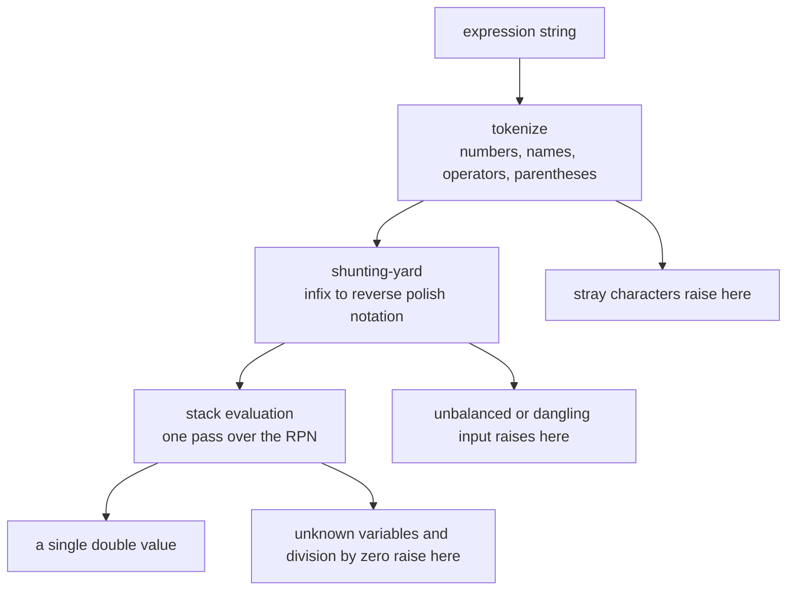
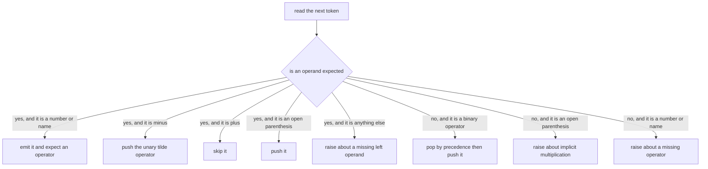
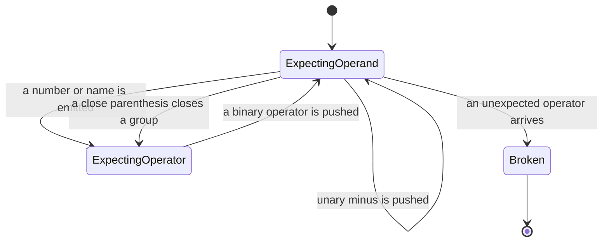
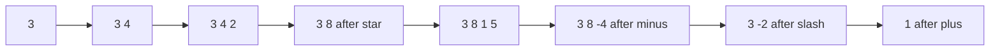

# 342 — Implement expression evaluator with variables and precedence.

> **Tier:** Intermediate · **CTCI chapter:** Ch 3 — Stacks and Queues
> **Task spec:** [342-implement-expression-evaluator-with-variables-and-precedence.md](../../../tasks/intermediate/342-implement-expression-evaluator-with-variables-and-precedence.md)
> **Solutions:** [Python](../../../solutions/python/intermediate/342-implement-expression-evaluator-with-variables-and-precedence/solution.py) ·
> [Java](../../../solutions/java/intermediate/342-implement-expression-evaluator-with-variables-and-precedence/Solution.java) ·
> [JavaScript](../../../solutions/javascript/intermediate/342-implement-expression-evaluator-with-variables-and-precedence/solution.js) ·
> [C#](../../../solutions/csharp/intermediate/342-implement-expression-evaluator-with-variables-and-precedence/Solution.cs)

## 1. Problem restatement

**Input:** an infix expression string over the four binary operators `+ - * /`, parentheses, unary
minus and (optionally) unary plus, plus a map of variable names to numbers. Whitespace is ignored,
identifiers start with a letter and may continue with letters, digits or `_`.

**Output:** the numeric value. Two policy decisions are fixed by the files and asserted:

- **Everything is floating point** — IEEE-754 doubles, identical in all four languages — so
  `100/8 == 12.5` and `7/2 == 3.5`. There is no integer truncation anywhere.
- **Malformed input raises** with a message: unbalanced parentheses, dangling or adjacent operators,
  implicit multiplication, unknown variables, stray characters and division by zero (Python
  `ValueError`, Java `IllegalArgumentException`, JavaScript `Error`, C# `ArgumentException`).

The value battery, cross-checked against CPython's own expression parser:

| Expression | Variables | Value |
| --- | --- | --- |
| `3+4*2/(1-5)` | — | `1` |
| `x+y*2` | `x=3, y=4` | `11` |
| `(1+2)*(3+4)` | — | `21` |
| `1+2*3-4/8` | — | `6.5` |
| `100/8` | — | `12.5` |
| `-(3+4)*2` | — | `-14` |
| `3*-2` | — | `-6` |
| `10-4-3` | — | `3` |
| `--5` / `-(-5)` / `3--2` | — | `5` / `5` / `5` |
| `2*(1+2*(3-1))` | — | `10` |
| ` 1 + 2 ` | — | `3` |
| `+x` | `x=7` | `7` |
| `price*quantity` | `price=2.5, quantity=4` | `10` |

The first row carries a correction that all four files state in their headers: the brief's example
`3+4*2/(1-5)` is **1**, not 2 — `3 + 8/(1-5) = 3 - 2 = 1`. The assertion uses 1.

The error battery is equally explicit: `""`, `"1+"`, `"*3"`, `"1**2"`, `"(1+2"`, `"1+2)"`, `"()"`,
`"( )"`, `"1 2"`, `"3x"`, `"1(2)"`, `"&"`, `"1&2"`, `"4/0"`, `"0/0"`, `"(1+)"`, plus the unknown
variable `"x+1"` with no variables and `"sum"` with only `total` bound — each must raise.

## 2. Intuition

Evaluating infix by hand is a matter of remembering what is still pending. The classic two-phase
answer is the **shunting-yard** algorithm: turn the infix token stream into reverse Polish notation
with an operator stack, then evaluate the RPN with an operand stack. Both phases are single passes.

Two ideas do the real work:

- **Precedence and associativity live in one pop rule.** When a binary operator arrives, pop every
  stacked operator with strictly higher precedence, or with equal precedence when it is left
  associative, then push the new one. That single rule produces `2+3*4 = 14`, `10-4-3 = 3` and
  `16/4/2 = 2` without any special cases.
- **Unary minus is just a tight, right-associative operator.** It is rewritten to `~` with precedence
  4 — above `*` and `/` — so `-(3+4)*2` becomes `(-(3+4))*2 = -14` and `3*-2` needs no lookahead hack.



Malformed detection falls out of a single flag rather than a separate validation pass: the parser
tracks whether it **expects an operand** or an operator at each point. An operator while an operand is
expected is either a unary minus (rewritten), a no-op unary plus, or an error; an operand while an
operator is expected is a case of implicit multiplication, which the contract rejects instead of
supporting.

## 3. Algorithm

1. **Tokenize.** Walk the string: skip spaces, gather digit runs into number tokens, letter-initial
   runs into variable tokens, accept the eight punctuation characters, and raise on anything else.
2. **Shunting-yard.** Maintain an output list and an operator stack:
   - number or variable: raise if an operator was expected, otherwise emit it and expect an operator;
   - `(`: raise if an operator was expected (implicit multiplication), otherwise push;
   - `)`: raise if an operand was expected, pop until the matching `(`, raise if there is none;
   - an operator with an operand expected: push `~` for `-`, skip `+`, raise otherwise;
   - a binary operator: pop while the stacked top has higher precedence, or equal precedence and is
     not `~`, then push it;
   - at the end: raise if an operator was expected, then flush the stack, raising on any `(`.
3. **Evaluate.** Walk the RPN: push numbers, look up variables (raising on unknown names), apply `~`
   to the top, and apply binary operators to the top two values — raising on division by zero.
4. Raise if the operator token stream was empty, and if the final operand stack does not hold exactly
   one value.

```text
procedure tokenize(expr)
    scan expr left to right, emitting one token per digit run, letter run,
    operator or parenthesis, and skipping spaces
    raise an error about the unexpected character for anything else
end

function to_rpn(tokens)
    output ← empty list
    ops ← empty stack of pairs of symbol and precedence
    expect_operand ← true
    for each kind and value in tokens do
        if kind is a number or a variable then
            raise an error about a missing operator when expect_operand is false
            append the token to output
            expect_operand ← false
        else if value is an open parenthesis then
            raise an error about implicit multiplication when expect_operand is false
            push the pair of value and no precedence onto ops
        else if value is a close parenthesis then
            if expect_operand is true then
                raise an error about an empty parenthesis group
            end
            pop operators into output until an open parenthesis is on top
            raise an error about an unbalanced close parenthesis when there is none
            discard the open parenthesis
            expect_operand ← false
        else if expect_operand is true then
            push the pair of tilde and 4 onto ops when value is minus
            continue with the next token when value is plus
            raise an error about an operator with no left operand otherwise
        else
            precedence ← 1 for plus and minus, 2 for star and slash
            while ops is not empty do
                top ← the top symbol and precedence of ops
                if top symbol is an open parenthesis then
                    stop
                end
                if top precedence is above precedence
                   or top precedence is precedence and top symbol is not tilde then
                    append the popped operator to output
                else
                    stop
                end
            end
            push the pair of value and precedence onto ops
            expect_operand ← true
        end
    end
    if expect_operand is true and tokens is not empty then
        raise an error about a dangling operator
    end
    while ops is not empty do
        pop the top of ops
        raise an error about an unbalanced open parenthesis when the symbol is an open parenthesis
        append the symbol to output
    end
    return output
end

function evaluate_rpn(rpn, variables)
    stack ← empty stack of numbers
    for each kind and value in rpn do
        if kind is a number then
            push value onto stack
        else if kind is a variable then
            if variables does not hold value then
                raise an error about the unknown variable
            end
            push the bound number onto stack
        else if value is tilde then
            push the negation of the popped top of stack
        else
            second ← pop from stack
            first ← pop from stack
            if value is plus then push first plus second
            else if value is minus then push first minus second
            else if value is star then push first times second
            else
                if second is 0 then
                    raise an error about division by zero
                end
                push first divided by second
            end
        end
    end
    if the stack does not hold exactly one value then
        raise an error about a malformed expression
    end
    return the single value
end
```

The `expect_operand` flag doubles as the malformed-input detector, which is why the three phases can
each raise immediately instead of validating a separate grammar.





## 4. Worked example

Trace `3+4*2/(1-5)` — the expression whose brief value of 2 the files correct to 1.

| Token | Action | Output so far | Operator stack | Expects |
| --- | --- | --- | --- | --- |
| `3` | emit | `3` | — | operator |
| `+` | push | `3` | `+` | operand |
| `4` | emit | `3 4` | `+` | operator |
| `*` | top `+` has lower precedence, so push | `3 4` | `+ *` | operand |
| `2` | emit | `3 4 2` | `+ *` | operator |
| `/` | top `*` has equal precedence and is left associative, so pop, then push | `3 4 2 *` | `+ /` | operand |
| `(` | push | `3 4 2 *` | `+ / (` | operand |
| `1` | emit | `3 4 2 * 1` | `+ / (` | operator |
| `-` | top is `(`, so push | `3 4 2 * 1` | `+ / ( -` | operand |
| `5` | emit | `3 4 2 * 1 5` | `+ / ( -` | operator |
| `)` | pop until `(`, discard it | `3 4 2 * 1 5 -` | `+ /` | operator |
| end | flush the stack | `3 4 2 * 1 5 - / +` | — | — |

The final RPN is `3 4 2 * 1 5 - / +`, which evaluates strictly left to right with one stack: `3`, `4`
and `2` are pushed, `*` reduces the top two to `8`, `/` against the group's `-4` gives `-2`, and the
final `+` gives `1`. So `8 / -4 = -2` and `3 + (-2) = 1`. The brief's stated answer of 2 would require `3 + 8/4`, which is
what a mis-parenthesised or right-to-left evaluation produces — the files assert 1 and say so in their
headers.



The unary rewrite deserves its own trace. For `3*-2` the `-` arrives while an operand is expected, so
it becomes `~` with precedence 4 and the RPN is `3 2 ~ *`, giving `3 * -2 = -6`; for `--5` the second
`-` is pushed on top of the first and the flush produces `5 ~ ~`, which is `5`.

## 5. Complexity

Let `n` be the length of the expression and `m` the number of tokens.

| Measure | Bound | Why it holds |
| --- | --- | --- |
| Tokenize | O(n) | one character scan, one token per consumed run |
| Shunting-yard | O(m) | each operator is pushed once and popped at most once |
| Evaluation | O(m) | one stack operation per RPN token |
| Total time | O(n) | three linear passes |
| Space | O(m) | token list, output list, operator stack and operand stack |
| Alternative: recursive descent | O(n) time, O(depth) stack | parses the same grammar with one function per precedence level; same asymptotics, no explicit RPN |

The linear behaviour is the point of the operator stack: the nested parentheses in
`1+((2+3)*4)` are handled by pushing and popping, never by re-scanning the expression.

## 6. Pitfalls and edge cases

- **The brief's example value.** `3+4*2/(1-5)` is 1, and every file says so in its header and asserts
  it. Matching a wrong expectation would mean deliberately breaking left-to-right evaluation.
- **Unary versus binary minus.** The same character means two things; the `expect_operand` flag decides
  which, and the unary form becomes a distinct symbol (`~`). Trying to disambiguate it in the
  tokenizer by looking at the previous token re-implements the same flag in a less reliable place.
- **Implicit multiplication is rejected, not supported.** `1(2)`, `3x` and `1 2` all raise. Accepting
  them silently would change the grammar; the contract says the evaluator refuses them.
- **Empty input.** `""` produces no tokens and raises an "empty expression" error before the RPN phase.
- **Division by zero.** Checked as `second == 0.0` before dividing, so both `4/0` and `0/0` raise
  instead of producing an infinity or a NaN.
- **Floating point everywhere.** There is deliberately no integer path: `100/8` is `12.5`, `7/2` is
  `3.5`, and `1+2*3-4/8` is `6.5`. All the asserted values are exactly representable in binary, so the
  exact comparisons in the tests are safe.
- **Unknown variables.** Looked up only at evaluation time, which is why `x+1` with an empty map gives
  a variable error rather than a syntax error.

## 7. Variants and follow-ups

- **Just the parentheses.** [341-balanced-parentheses-longest-valid-substring-stack.md](../../../tasks/intermediate/341-balanced-parentheses-longest-valid-substring-stack.md)
  uses the same stack-of-indices idea to measure balanced runs, without operators or values.
- **Validating the bracket types first.** [042-check-balanced-parentheses-with-three-bracket-types.md](../../../tasks/beginner/042-check-balanced-parentheses-with-three-bracket-types.md)
  answers the "is this well formed" half of the problem before any evaluation happens.
- **A second evaluator in this repository.** [192-evaluate-arithmetic-expression-with-parentheses-shunting-yard-ev.md](../../../tasks/beginner/192-evaluate-arithmetic-expression-with-parentheses-shunting-yard-ev.md)
  is the same shunting-yard exercise; comparing the two shows how much of the work is the token
  contract rather than the algorithm.
- **Variables in a bigger setting.** The design tasks of this tier — for instance
  [337-design-majority-vote-generalized-n-k-using-count-map.md](../../../tasks/intermediate/337-design-majority-vote-generalized-n-k-using-count-map.md) —
  show the same discipline of pinning a contract before choosing a data structure.
- The chapter walkthrough in [Stacks and Queues](../../ctci/03-stacks-and-queues.md) introduces
  shunting-yard as the canonical two-stack exercise.

## 8. Check yourself

1. Why is unary minus given precedence 4 instead of sharing the precedence of binary minus?

<details><summary>Show answer</summary>

Because it must bind tighter than every binary operator: `-(3+4)*2` should negate the parenthesised
sum and then multiply, and `-x*2` should be `(-x)*2`. Sharing precedence 1 with binary minus would make
the operator stack pop in the wrong order for expressions where a product follows a negation.

</details>

2. What produces the left-associativity of `10-4-3` and `16/4/2`?

<details><summary>Show answer</summary>

The `top_precedence == precedence and top != "~"` branch of the pop rule. On equal precedence a
left-associative operator pops the stacked one, so the RPN becomes `10 4 - 3 -` and `16 4 / 2 /`,
which evaluate left to right.

</details>

3. How does the parser know that a `-` is unary?

<details><summary>Show answer</summary>

From the `expect_operand` flag: after an operator or an open parenthesis an operand is expected, so a
`-` in that position is a unary negation and is rewritten to `~`. Any other operator in that position
raises, and a number or name in the opposite position raises about a missing operator.

</details>

4. What would a recursive-descent parser replace in this design?

<details><summary>Show answer</summary>

The shunting-yard pass. Recursive descent parses the same grammar with one function per precedence
level — expression, term, unary, primary — calling each other; it produces the value directly instead
of an RPN list, at the cost of a call stack proportional to the nesting depth. The tokenizer, the
`expect_operand` errors and the double-only value policy would all be unchanged.

</details>
