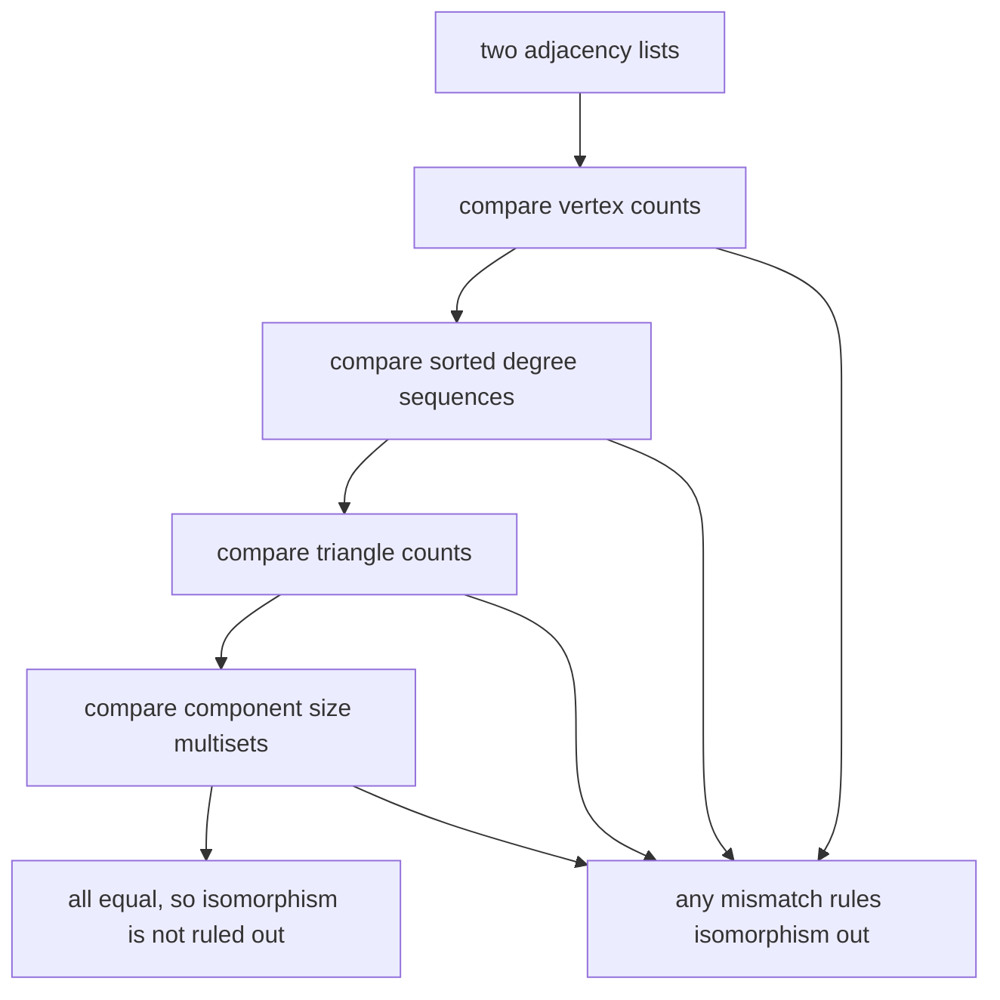
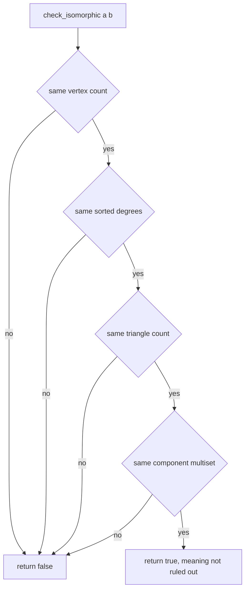
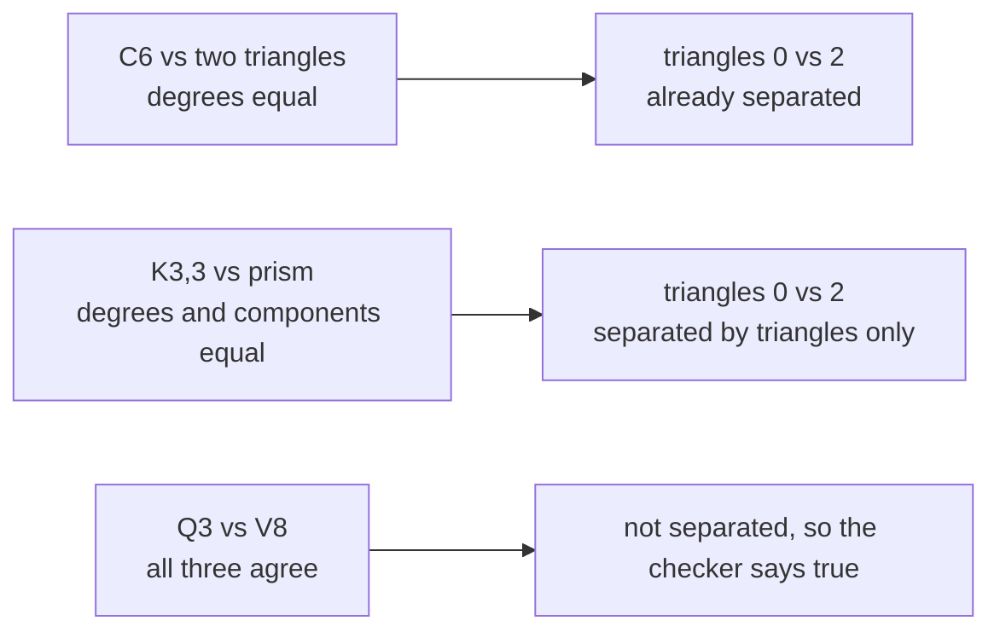
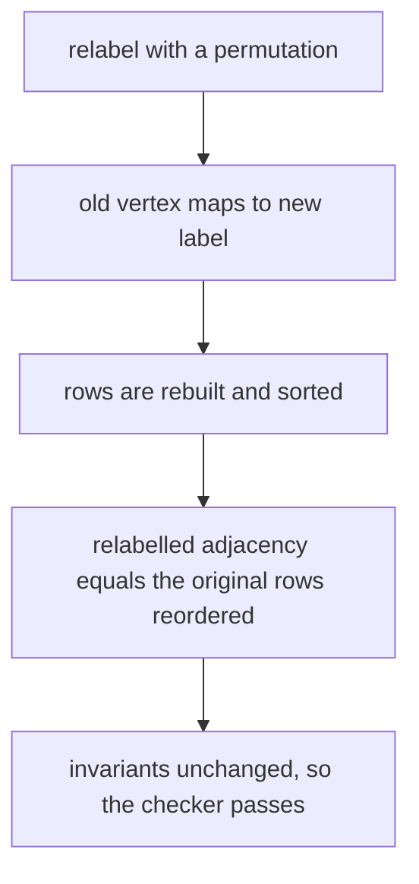

# 343 — Graph isomorphism simple checks (degree sequence, invariants).

> **Tier:** Intermediate · **CTCI chapter:** Ch 4 — Trees and Graphs
> **Task spec:** [343-graph-isomorphism-simple-checks-degree-sequence-invariants.md](../../../tasks/intermediate/343-graph-isomorphism-simple-checks-degree-sequence-invariants.md)
> **Solutions:** [Python](../../../solutions/python/intermediate/343-graph-isomorphism-simple-checks-degree-sequence-invariants/solution.py) ·
> [Java](../../../solutions/java/intermediate/343-graph-isomorphism-simple-checks-degree-sequence-invariants/Solution.java) ·
> [JavaScript](../../../solutions/javascript/intermediate/343-graph-isomorphism-simple-checks-degree-sequence-invariants/solution.js) ·
> [C#](../../../solutions/csharp/intermediate/343-graph-isomorphism-simple-checks-degree-sequence-invariants/Solution.cs)

## 1. Problem restatement

**Input:** two graphs as adjacency lists, each a list of neighbour lists (possibly unsorted, possibly
with repeats — the helpers deduplicate).

**Output:** `check_isomorphic(a, b)` answers **False** when a cheap invariant differs, and **True**
otherwise. The files are explicit that this is a *necessary-condition* checker: True means "not ruled
out", never "proved isomorphic". Four checks run in order, short-circuiting on the first mismatch:

1. the vertex counts agree;
2. the sorted degree sequences agree;
3. the triangle counts agree;
4. the sorted multisets of connected-component sizes agree.

The hand-checked cases pin every branch:

| Pair | Degrees | Triangles | Components | Verdict |
| --- | --- | --- | --- | --- |
| `C5` vs its pentagram relabelling | equal | equal | equal | `True` |
| `P4`, star `K1,5`, bowtie vs their relabellings | equal | equal | equal | `True` |
| empty graphs / single vertex | equal | equal | equal | `True` |
| star `K1,3` vs `P4` | `[1,1,1,3]` vs `[1,1,2,2]` | — | — | `False` |
| bowtie vs `C5` | differ | — | — | `False` |
| `C6` vs two disjoint triangles | `[2]*6` both | `0` vs `2` | `[6]` vs `[3,3]` | `False` |
| `K3,3` vs triangular prism | `[3]*6` both | `0` vs `2` | `[6]` both | `False` |
| cube `Q3` vs Möbius ladder `V8` | `[3]*8` both | `0` both | `[8]` both | **`True` (wrong by design)** |

The last row is the documented counterexample: `Q3` and `V8` pass all three checks and are **not**
isomorphic, which the files assert separately — `Q3` is bipartite and `V8` is not, and their diameters
are 3 and 2. The header of every file states that a vertex-refinement step would be needed to separate
more such pairs.

The randomized battery builds 40 graphs on 7 vertices (seed 20261016, `seed = (seed * 75 + 74) % 65537`,
each of the 21 possible edges included when the next value is even), relabels each one by a Fisher–Yates
shuffle, and asserts the three invariants are unchanged, that the component multiset matches an
independent union-find oracle, and that relabelling by the inverse permutation reproduces the original
adjacency exactly.

## 2. Intuition

Two graphs are isomorphic when a bijection of their vertices preserves edges. Deciding that is hard in
general — the brute force is `n!` permutations — so a practical first move is to compute **invariants**:
functions of the graph that do not change under relabelling. Equal invariants prove nothing, but a
single inequality proves the graphs are different, and each invariant is cheap.

The three shipped invariants are chosen to be cheap and to fail on different pairs:

- the **degree sequence** catches almost everything immediately and costs one pass over the edges;
- the **triangle count** catches regular pairs such as `K3,3` versus the prism, where every vertex has
  degree 3 yet only the prism has triangles;
- the **component size multiset** catches pairs that are regular and triangle-free but split
  differently, such as `C6` versus two triangles.



The counterexample is the honest part of the design. `Q3` (the cube) and `V8` (the Möbius ladder, an
8-cycle plus the four opposite rungs) are 3-regular, triangle-free and connected, so all three checks
pass — and they are still not isomorphic, because every cycle in the cube has even length while `V8`
contains odd cycles and a triangle-free configuration with diameter 2. The files record this, assert
both separating facts, and state plainly that these checks are necessary and not sufficient.

## 3. Algorithm

1. **Degrees.** For each vertex take the size of its neighbour *set* (deduplicating) and sort the
   resulting list.
2. **Triangles.** For every vertex `u`, for every neighbour `v > u`, count the common neighbours `w`
   with `w > v`. The two ordering guards count each triangle exactly once.
3. **Components.** Iterative DFS marking visited vertices and recording each component's size, sorted.
4. **Check.** Compare the vertex counts, then the degree sequences, then the triangle counts, then the
   component multisets, returning False on the first difference.

```text
function degrees(adjacency)
    result ← empty list
    for each row in adjacency do
        append the number of distinct values in row to result
    end
    sort result
    return result
end

function triangle_count(adjacency)
    sets ← the rows of adjacency converted to sets
    count ← 0
    for u ← 0 to number of vertices - 1 do
        for each v in sets[u] do
            if v <= u then
                continue with the next v
            end
            for each w in the intersection of sets[u] and sets[v] do
                if w > v then
                    count ← count + 1
                end
            end
        end
    end
    return count
end

function component_sizes(adjacency)
    seen ← array of flags set to false
    sizes ← empty list
    for start ← 0 to number of vertices - 1 do
        if seen[start] then
            continue with the next start
        end
        seen[start] ← true
        stack ← list holding start
        size ← 0
        while stack is not empty do
            u ← remove the last element of stack
            size ← size + 1
            for each v in adjacency[u] do
                if seen[v] is false then
                    seen[v] ← true
                    append v to stack
                end
            end
        end
        append size to sizes
    end
    sort sizes
    return sizes
end

function check_isomorphic(a, b)
    if number of vertices in a is not number of vertices in b then
        return false
    end
    if degrees(a) is not degrees(b) then
        return false
    end
    if triangle_count(a) is not triangle_count(b) then
        return false
    end
    if component_sizes(a) is not component_sizes(b) then
        return false
    end
    return true
end
```

A fourth routine, `relabel(adjacency, permutation)`, is used by the tests rather than by the checker:
it maps every old vertex to its new label and sorts the resulting rows, which makes adjacency lists
comparable with a plain equality test. Its inverse is computed by inverting the permutation array, and
the randomized battery asserts that relabelling twice round-trips.



## 4. Worked example

Take `C6` (a six-cycle) and the graph made of two disjoint triangles. Both are 2-regular, so the degree
sequence check passes, and the pair is separated only by the two remaining invariants:

| Invariant | `C6` | two triangles | Equal? |
| --- | --- | --- | --- |
| degree sequence | `[2, 2, 2, 2, 2, 2]` | `[2, 2, 2, 2, 2, 2]` | yes |
| triangle count | `0` | `2` | **no** |
| component multiset | `[6]` | `[3, 3]` | **no** |

The triangle count is computed with the ordering guards: in `C6` a neighbour `v` of `u` never shares a
third neighbour with `u` other than `u` itself, which fails the `w > v` test; in each triangle the
triple `(u, v, w)` with `u < v < w` is counted exactly once. Row 3 then confirms the split.

The `K3,3` versus prism pair is the mirror image: the component multisets agree (`[6]` for both) and
the degrees agree (`[3]*6`), so the triangle count is the only separator — 0 for the bipartite complete
graph, 2 for the prism, one per triangular face.



The counterexample deserves its own table, since it is the reason the checker's True is qualified:

| Property | cube `Q3` | Möbius ladder `V8` | Same? |
| --- | --- | --- | --- |
| degree sequence | `[3]*8` | `[3]*8` | yes |
| triangle count | `0` | `0` | yes |
| component multiset | `[8]` | `[8]` | yes |
| checker verdict | — | — | `True` |
| bipartite? | yes | **no** | **no** |
| diameter | `3` | `2` | **no** |

`V8` is defined in the files as the 8-cycle plus the four rungs `i` to `i + 4` for `i < 4`, and both
extra invariants are computed by short BFS routines: a 2-colouring test for bipartiteness and a
BFS-from-every-vertex maximum for the diameter. They separate this pair, but they are just as
insufficient in general — which is exactly what the header says.



## 5. Complexity

Let `n` be the vertex count, `m` the edge count and `Δ` the maximum degree.

| Measure | Bound | Why it holds |
| --- | --- | --- |
| Degree sequence | O(n + m) | one pass over the rows to deduplicate, plus an O(n log n) sort |
| Triangle count | O(sum over vertices of degree squared) in the probing form, O(m^1.5) with set intersection | Java, JavaScript and C# walk the neighbour set of one endpoint and probe the other; the Python version intersects the two sets, whose cost is the smaller degree |
| Component sizes | O(n + m) | each vertex and edge is visited once by the iterative DFS |
| `check_isomorphic` | O(n + m + triangles) | the four checks run in order and short-circuit |
| Space | O(n + m) | the neighbour sets, the visited array and the DFS stack |
| Relabelling (tests only) | O(n + m log m) | rows are rebuilt and each row is sorted |
| Bipartiteness / diameter | O(n + m) / O(n * (n + m)) | BFS once, or BFS from every vertex |
| Brute-force isomorphism | O(n! * m) | every bijection is tested, which is why invariants exist in the first place |

The checker's cost is dominated by the triangle count on dense graphs; the degree check alone is enough
to reject most random pairs, which is why it comes first.

## 6. Pitfalls and edge cases

- **True does not mean isomorphic.** The cube and the Möbius ladder pass all three checks and are not
  isomorphic. Any caller of this checker must treat True as "unknown", and the files say so in their
  headers.
- **Degrees must be deduplicated.** The degree is the size of the neighbour *set*; counting a repeated
  neighbour twice would break the invariant. The Python rows are raw lists, so `len(set(row))` matters.
- **Degrees must be sorted before comparing.** `[1,1,1,3]` and `[3,1,1,1]` describe the same multiset;
  an unsorted comparison rejects isomorphic graphs.
- **Count each triangle exactly once.** The `v > u` and `w > v` guards are what prevents the six-fold
  over-count that naive triple enumeration produces.
- **Self-loops and multi-edges.** No generated graph has them, and the union-find oracle and degree
  helper both deduplicate with sets, which keeps multi-edges harmless; a self-loop would still add one
  to that vertex's degree, so the invariant would only be right if both graphs treated it the same way.
- **Vertex counts first.** Comparing multisets of different lengths is meaningless, so the count check
  runs first; the empty graph and the single-vertex graph are both asserted.
- **Isolated vertices matter.** A component of size 1 shows up in the multiset, so a graph with an
  extra isolated vertex cannot masquerade as another with the same components; the star-with-five
  vertices case is asserted through its relabelling.
- **Component count is weaker than the multiset.** `[3,3]` and `[2,2,2]` have different counts — but
  `[1,4]` and `[2,3]` share the count of 2, so the multiset is the right invariant.
- **Two independent component computations.** The DFS walk is cross-checked against a union-find
  implementation on every random graph, so a traversal bug cannot hide behind a matching bug.
- **Relabelling direction.** The permutation maps old to new; undoing it needs the inverse array, which
  the battery builds explicitly and asserts round-trips.
- **Sorted rows after relabelling.** Adjacency equality is a plain list comparison in all four
  languages, so `relabel` sorts each rebuilt row; without that, isomorphic graphs with shuffled rows
  compare unequal.
- **Refinement is a separate step.** Bipartiteness and diameter are implemented in the files as helpers
  used by the tests, not wired into `check_isomorphic`; making the checker stronger would mean adding a
  proper color-refinement pass, which changes it from a cheap filter into a real algorithm.

## 7. Variants and follow-ups

- **Where invariants are not enough.** The canonical-labelling approach (nauty-style) plus the
  Weisfeiler–Lehman colour refinement is the standard upgrade; it turns the "necessary conditions" into
  a decision procedure for most graphs.
- **Other graph algorithms on the same input.** [281-tarjan-s-strongly-connected-components.md](../../../tasks/intermediate/281-tarjan-s-strongly-connected-components.md)
  decomposes a directed graph with one DFS, and [282-bridge-edges-in-undirected-graph-tarjan.md](../../../tasks/intermediate/282-bridge-edges-in-undirected-graph-tarjan.md)
  finds bridges — both reuse the traversal skeleton that computes component multisets here.
- **Trees instead of general graphs.** [329-range-intersection-queries-interval-trees-basics.md](../../../tasks/intermediate/329-range-intersection-queries-interval-trees-basics.md)
  builds an augmented BST over intervals; the same "augment a structure with an invariant" idea drives
  both tasks, one for ranges and one for graphs.
- **Degree sequences as an input.** The Havel–Hakimi construction answers the related question "is there
  any simple graph with this degree sequence", which is the direction this task deliberately does not
  take.
- The chapter walkthrough in [Trees and Graphs](../../ctci/04-trees-and-graphs.md) covers traversal,
  components and the idea of graph invariants.

## 8. Check yourself

1. Why can equal degree sequences never be enough on their own?

<details><summary>Show answer</summary>

Because many non-isomorphic graphs share a degree sequence — `C6` and two disjoint triangles are both
2-regular, and `K3,3` and the prism are both 3-regular. Degrees constrain each vertex locally and say
nothing about how the edges connect.

</details>

2. What exactly does the checker guarantee when it returns True?

<details><summary>Show answer</summary>

Only that three specific invariants agree, so isomorphism has not been ruled out. The files even ship
the counterexample that proves the point: the cube and the Möbius ladder pass all three checks and are
not isomorphic.

</details>

3. How does the triangle counter avoid counting each triangle six times?

<details><summary>Show answer</summary>

By fixing an ordering on the three vertices: the outer loop considers `v > u` and the inner test
requires `w > v`, so exactly one of the six orderings of a triangle's vertices survives the filters.

</details>

4. Why is the component *multiset* a better invariant than the component count?

<details><summary>Show answer</summary>

Because two different graphs can have the same number of components with different sizes — `[1,4]`
versus `[2,3]` both have two components but cannot be relabellings of each other. The sorted multiset
captures the sizes, which relabelling preserves.

</details>

5. What does the randomized battery actually prove about the invariants?

<details><summary>Show answer</summary>

That they are genuine invariants: 40 random 7-vertex graphs are relabelled by a shuffled permutation and
all three values must be unchanged, the component multiset must match an independent union-find oracle,
and relabelling by the inverse permutation must reproduce the original adjacency. It says nothing about
sufficiency — that is what the cube-versus-`V8` counterexample is there for.

</details>
