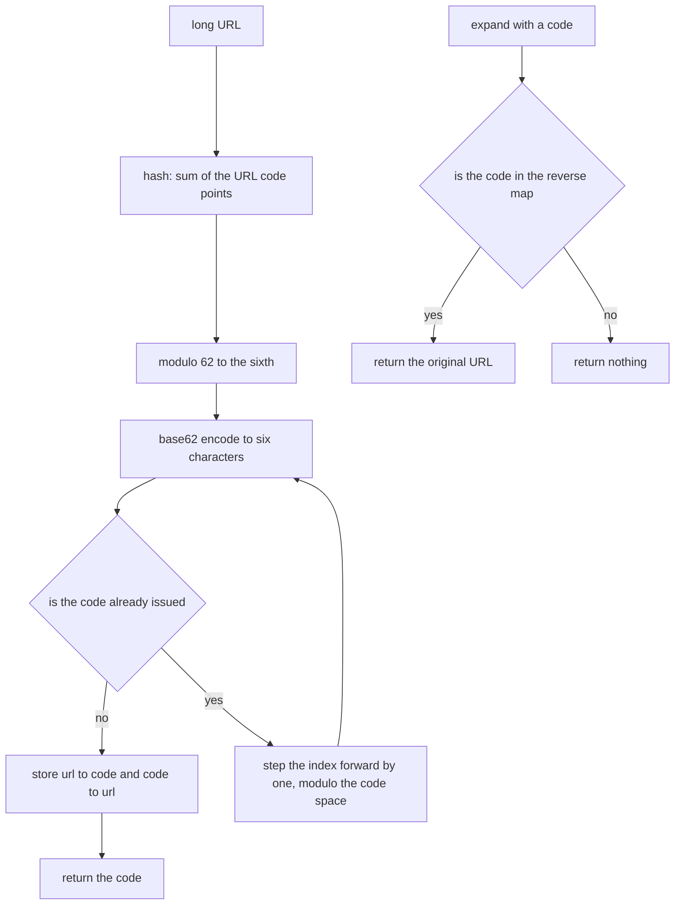
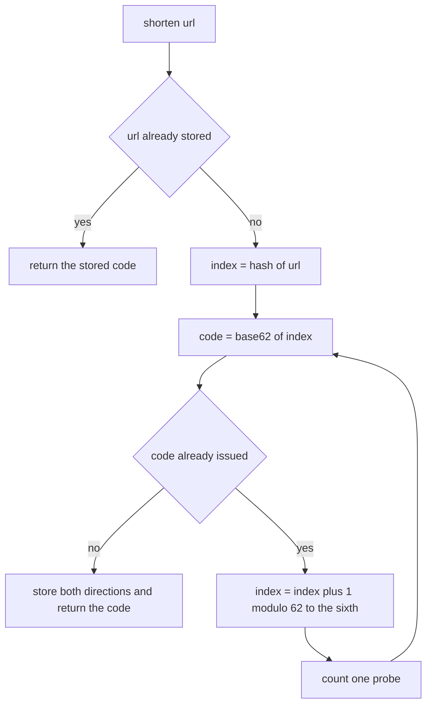
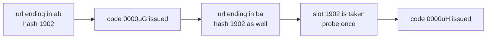

# 344 — Design and implement a URL shortener basic (hash + collision handling).

> **Tier:** Intermediate · **CTCI chapter:** Ch 7 — Object-Oriented Design
> **Task spec:** [344-design-and-implement-a-url-shortener-basic-hash-collision-handli.md](../../../tasks/intermediate/344-design-and-implement-a-url-shortener-basic-hash-collision-handli.md)
> **Solutions:** [Python](../../../solutions/python/intermediate/344-design-and-implement-a-url-shortener-basic-hash-collision-handli/solution.py) ·
> [Java](../../../solutions/java/intermediate/344-design-and-implement-a-url-shortener-basic-hash-collision-handli/Solution.java) ·
> [JavaScript](../../../solutions/javascript/intermediate/344-design-and-implement-a-url-shortener-basic-hash-collision-handli/solution.js) ·
> [C#](../../../solutions/csharp/intermediate/344-design-and-implement-a-url-shortener-basic-hash-collision-handli/Solution.cs)

## 1. Problem restatement

**Input:** a stream of long URLs for `shorten`, and 6-character codes for `expand`.

**Output:** for each URL a **deterministic** six-character base62 code, and for each code the original
URL or `None`/`null` if the code was never issued. The exact contract, as fixed by the four files:

| Piece | Definition |
| --- | --- |
| alphabet | `0123456789abcdefghijklmnopqrstuvwxyzABCDEFGHIJKLMNOPQRSTUVWXYZ` (62 symbols, digits first) |
| code space | `62^6 = 56_800_235_584` slots, codes zero-padded to six characters, most significant digit first |
| hash | `(sum of the URL's code points) % 62^6` |
| initial code | `encode_base62(hash(url))` |
| collision rule | linear probing: try `index`, `index + 1`, …, cyclically modulo the code space, and take the first free slot |
| `shorten` | idempotent — the same URL always returns the same code |
| `expand` | `None`/`null` for an unknown code, including `""` and `"!!!!!!"` |
| `decode_base62` | the independent inverse used by the tests; it *raises* on an invalid character |

The hash is deliberately weak and the files say so: it is the additive sum of code points, which makes
collisions engineerable. They exploit this throughout the tests.

| Check | Expectation |
| --- | --- |
| `encode_base62(0)` / `encode_base62(SPACE - 1)` | `"000000"` / `"ZZZZZZ"` |
| 200 generated values (seed 9137, `value = seed * 12345 % SPACE`) | `decode(encode(v)) == v` |
| `"…/pages/ab"` vs `"…/pages/ba"` | same hash, distinct codes, exactly one probe |
| 250 colliding pairs (500 URLs) | 500 distinct codes, `probes > 0`, `size == 500` |
| replay in a fresh instance | identical code list in the same order |
| unknown codes `"zzzzzz"`, `""`, `"!!!!!!"` | `None` / `null` |

A first URL already pins several invariants at once: the code is six characters wide, all characters
are in the alphabet, it equals `encode_base62(hash(url))` (so the initial slot was free and no probing
happened), `expand` round-trips, a second `shorten` returns the same code, `size() == 1` and
`probes == 0`.

## 2. Intuition

A URL shortener is a dictionary with a compact key. The design question is what the key is made of:
a counter, a random value, or a hash of the URL. Hashing is what makes `shorten` **deterministic and
idempotent** — asking twice for the same URL cannot create a second entry, and no server-side counter
is needed.

Hash-based keys collide, and this task makes collisions a first-class part of the contract instead of
a rarity. Two decisions follow:

- **Linear probing with a second map.** The index from the hash names a slot; if that slot is taken,
  walk forward one code at a time until a free one appears. A `code → url` map answers `expand` in
  O(1) and, crucially, also answers "is this slot free?" during `shorten`.
- **The code is the state.** Nothing else needs to be stored: `expand` is a single map lookup, and
  `shorten` is the hash, the encode and the probe walk.



Because the alphabet is fixed and the encoding is positional, the code space is a bijection with the
integers `0 .. 62^6 - 1`, so "probe the next slot" is exactly "try the next integer". That is what
makes the collision rule simple: collisions are consecutive integers, and the tests can even assert
that the second of two colliding URLs landed at `first_index + 1`.

## 3. Algorithm

1. **`hash_url(url)`** — sum the code points of the URL and reduce modulo `62^6`.
2. **`encode_base62(value)`** — reduce modulo `62^6`, then emit six digits most significant first by
   repeatedly taking `value % 62` and dividing by 62.
3. **`decode_base62(code)`** — the inverse: accumulate `value = value * 62 + index_of(ch)`, raising on
   a character outside the alphabet.
4. **`shorten(url)`** — return the stored code when the URL is already known; otherwise start at
   `hash_url(url)`, encode the index, and while the code is taken step to `(index + 1) % 62^6`,
   counting one probe per step; on the first free code, record both directions and return it.
5. **`expand(code)`** — a single lookup in the reverse map.
6. **`size()`** — the number of distinct URLs shortened.

```text
function hash_url(url)
    total ← 0
    for each character ch in url do
        total ← total + code point of ch
    end
    return total modulo SPACE
end

function encode_base62(value)
    value ← value modulo SPACE
    digits ← empty list
    for i ← 1 to CODE_WIDTH do
        append ALPHABET[value modulo BASE] to digits
        value ← value // BASE
    end
    reverse digits
    return the string of digits
end

function decode_base62(code)
    value ← 0
    for each character ch in code do
        index ← position of ch in ALPHABET
        if index is below 0 then
            raise an error about the invalid base62 character
        end
        value ← value * BASE + index
    end
    return value
end

function shorten(url)
    if url_to_code holds url then
        return url_to_code[url]
    end
    index ← hash_url(url)
    looping ← true
    while looping do
        code ← encode_base62(index)
        if code_to_url does not hold code then
            url_to_code[url] ← code
            code_to_url[code] ← url
            return code
        end
        index ← (index + 1) modulo SPACE
        probes ← probes + 1
    end
end

function expand(code)
    return the URL stored for code in code_to_url, or nothing when code is absent
end
```

Nothing in `shorten` consults the clock or a random source, so the mapping is a pure function of the
insertion history: the replay assertion — a fresh instance producing the identical code list — is
therefore a real property of the design rather than a coincidence of one run.



## 4. Worked example

Take the engineered collision pair. Both URLs are anagrams of each other in their last two characters,
so their code-point sums are identical:

- `"http://x.com/pages/ab"` → sum `1902` → index `1902`
- `"http://x.com/pages/ba"` → sum `1902` → index `1902`

Encoding index `1902` by hand: `1902 = 30 * 62 + 42`, and in the alphabet index 30 is `u` (digits
occupy 0-9, `a` is 10, so `u` is 30) while index 42 is `G` (uppercase `A` starts at 36). The six
digits are therefore `0 0 0 0 u G`.

| Step | URL | Index | Code tried | Slot free? | State after |
| --- | --- | --- | --- | --- | --- |
| 1 | `…/pages/ab` | 1902 | `0000uG` | yes | `url → 0000uG`, `code → url`, `probes = 0` |
| 2 | `…/pages/ba` | 1902 | `0000uG` | no | index becomes 1903, `probes = 1` |
| 3 | `…/pages/ba` | 1903 | `0000uH` | yes | both maps updated, `probes = 1` |

The assertions match this exactly: the two codes differ, `decode_base62(c1) == hash_url(u1)`, and
`decode_base62(c2) == (decode_base62(c1) + 1) % SPACE` — the "one probe step" claim, verified through
the decoder rather than by re-deriving the index.



The batch battery scales the same shape: for each `k` from 0 to 249 the pair
`"http://bench/<k>/ab"` and `"http://bench/<k>/ba"` is asserted to collide, which means all 500
insertions are collision exercise. Every code must be six characters wide and inside the alphabet,
the same URL asked twice must return the same code, every code must expand back to its URL, and the
500 codes must be pairwise distinct. A final replay on a fresh instance reproduces the identical list,
which is the determinism claim.

Encoding and decoding get their own check because they are the arithmetic backbone of the scheme:
`encode_base62(0) == "000000"` (zero-padded, not empty), `encode_base62(SPACE - 1) == "ZZZZZZ"` (the
top of the alphabet), and 200 generated values round-trip through the pair of functions.

## 5. Complexity

Let `L` be the URL length and `N` the number of URLs already shortened.

| Measure | Bound | Why it holds |
| --- | --- | --- |
| `hash_url` | O(L) | one pass over the characters |
| `encode_base62` / `decode_base62` | O(6) | a fixed number of base-62 steps, independent of the input size |
| `shorten`, no collision | O(L) | hash plus encoding plus two map inserts |
| `shorten`, with probing | O(L + p) | `p` forward steps, one per occupied slot met |
| `shorten`, idempotent call | O(L) | the URL lookup short-circuits before any hashing |
| `expand` | O(1) | one hash-map lookup |
| `size` | O(1) | the URL map's size |
| Space | O(N) | two maps, one entry per distinct URL |
| Worst case | O(L + N) per insertion | with the additive hash, `N` same-length anagrams all cluster into consecutive slots |

That last row is the honest consequence of choosing a weak hash: the tests use it on purpose, and the
250 colliding pairs each cost exactly one probe, so the batch performs 250 probes in total. A
production shortener would use a keyed hash (or a counter) so that clustering cannot be manufactured
by an attacker, which is also the reason the code space is so large.

## 6. Pitfalls and edge cases

- **The hash is weak by design.** Summing code points means every anagram of a URL collides; the files
  document this and the tests depend on it. Do not "fix" it without also fixing the assertions that
  rely on the engineered collision.
- **Idempotency is a requirement, not an optimisation.** `shorten` must consult `url → code` first;
  without it a second call would probe and could produce a *different* code for the same URL, breaking
  the contract that the mapping is a function.
- **`probes` counts only collision steps.** The initial attempt is not a probe, which the first test
  pins down (`probes == 0` after one insertion). Off-by-one here would make the collision assertions
  fail even when the codes are right.
- **Probing must wrap.** The step is `(index + 1) % 62^6`, so the walk never leaves the code space;
  without the modulo the encode of an oversized index would silently disagree with the decoder used to
  verify the position.
- **Zero-padding and most-significant-first order.** `encode_base62(0)` is `"000000"`, and the digits
  are emitted with the highest base-62 digit first; a reversed or unpadded encoder still round-trips
  through a matching decoder but produces codes of the wrong width or with the wrong value ordering —
  the explicit boundary assertions catch both.
- **Alphabet order.** Digits, then lowercase, then uppercase. Any other order changes every code and
  breaks the documented base-62 contract.
- **`expand` returns nothing; `decode_base62` raises.** The asymmetry is deliberate: asking for an
  unknown code is a legitimate query with a defined answer, while decoding a character outside the
  alphabet indicates a malformed code. `expand("!!!!!!")` is therefore `None`/`null` even though
  `decode_base62("!!!!!!")` would raise.
- **Distinct URLs must get distinct codes.** The probe walk guarantees it while the code space has a
  free slot; the batch asserts 500 distinct codes for 500 URLs rather than trusting the argument.
- **Determinism.** No random source, no clock, and no dependence on hash-map iteration order, so a
  replay reproduces the list exactly — which the tests assert with a full list comparison.
- **URLs are compared verbatim.** There is no trimming, case folding or normalisation, so
  `"HTTP://X"` and `"http://x"` are two entries. A real service would normalise first, and that choice
  belongs in the design, not in the hash.
- **Width of the code space.** `62^6 = 56_800_235_584` exceeds 32 bits, so Java and C# use `long`
  while the JavaScript header notes that it stays below `2^53` and remains exact in a double. Python
  has no such limit.
- **No expiry, deletion or analytics.** This is the "basic" variant: no TTLs, no click counts, no
  custom aliases. Adding them means a second structure keyed by code, which is exactly what the
  reverse map already provides.

## 7. Variants and follow-ups

- **Other design tasks in this tier.** [336-design-a-snapshot-array-persisting-versions-basic.md](../../../tasks/intermediate/336-design-a-snapshot-array-persisting-versions-basic.md)
  solves a different persistence problem with the same discipline — decide the invariant first, then
  the maps; [332-implement-calendar-booking-mycalendar-i-ii-iii-style.md](../../../tasks/intermediate/332-implement-calendar-booking-mycalendar-i-ii-iii-style.md)
  applies it to interval state.
- **Counting structures with maps.** [333-design-hit-counter-sliding-time-window.md](../../../tasks/intermediate/333-design-hit-counter-sliding-time-window.md)
  and [337-design-majority-vote-generalized-n-k-using-count-map.md](../../../tasks/intermediate/337-design-majority-vote-generalized-n-k-using-count-map.md)
  show the two other classic map designs: one keyed by time, one by value.
- **Collision handling elsewhere.** The probe walk here is the same idea as open addressing in a hash
  table; for a larger design problem the trade-offs of chaining versus open addressing are worth
  stating explicitly.
- **Scaling it up.** A production shortener adds a counter-based or keyed-hash allocation, a storage
  layer keyed by the code, and caching on the read path — at which point the interesting question
  becomes the read-to-write ratio rather than the collision policy.
- The chapter walkthrough in [Object-Oriented Design](../../ctci/07-object-oriented-design.md) frames
  this as the canonical "design an API with a compact key" exercise.

## 8. Check yourself

1. Why is the initial code `encode_base62(hash(url))` and not a counter?

<details><summary>Show answer</summary>

Because the code must be derivable from the URL alone, which makes `shorten` idempotent and stateless
with respect to allocation. A counter would need shared mutable state and would change every code as
soon as insertion order changed, breaking the replay assertion.

</details>

2. What does linear probing guarantee, and what does it cost?

<details><summary>Show answer</summary>

It guarantees a distinct code for every distinct URL while a free slot remains, because each walk stops
at the first unissued code. It costs one step per occupied slot encountered — one probe for the
engineered anagram pair — and with a weak hash many URLs can cluster into consecutive slots, which the
worst-case bound makes explicit.

</details>

3. Why does `shorten` keep two maps instead of one?

<details><summary>Show answer</summary>

Because the two directions answer different questions. `url → code` makes `shorten` idempotent, and
`code → url` makes `expand` O(1). The reverse map doubles as the "is this slot free?" test during
probing, so it is not merely a convenience.

</details>

4. The tests verify the probe position with `decode_base62` rather than with the hash. Why?

<details><summary>Show answer</summary>

Because the decoder is an independent inverse of the encoder: asserting
`decode_base62(c2) == decode_base62(c1) + 1` proves the second URL landed exactly one slot later,
without re-deriving the index from the hash. If the encoder and the probing walk disagreed about digit
order, the check would fail.

</details>

5. What would change if the hash were stronger but still unkeyed?

<details><summary>Show answer</summary>

The collision tests would stop working unless the collisions were found by search, since the files
engineer them by relying on the additive hash. A real service would also want a keyed hash so that an
adversary cannot manufacture clustering on purpose; the probe walk, the two maps and the idempotency
rule would all stay the same.

</details>
