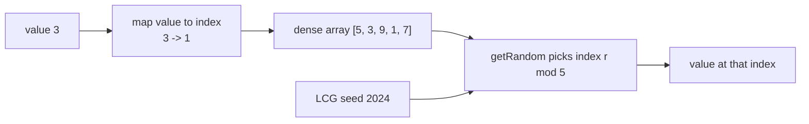
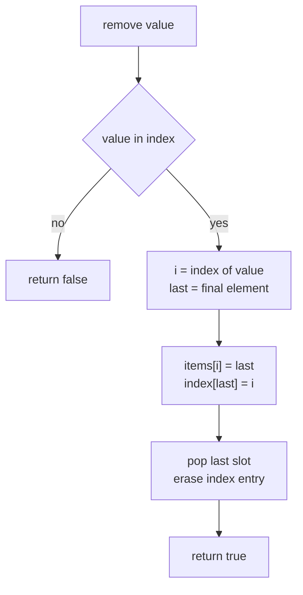
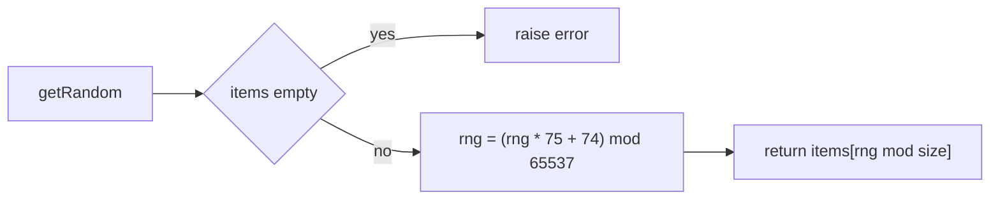
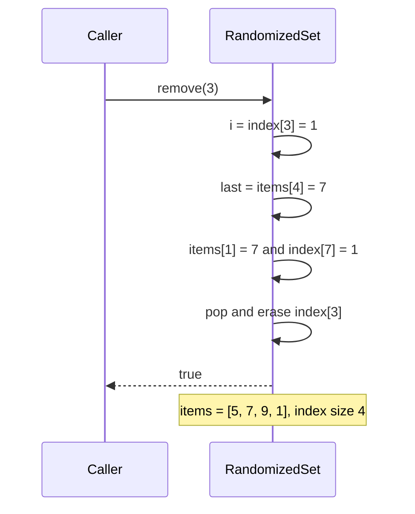

# 345 — Randomized set with insert, delete and getRandom

> **Tier:** Intermediate · **CTCI chapter:** Ch 7 — Object-Oriented Design
> **Task spec:** [345-design-a-randomized-set-with-insert-delete-getrandom.md](../../../tasks/intermediate/345-design-a-randomized-set-with-insert-delete-getrandom.md)
> **Solutions:** [Python](../../../solutions/python/intermediate/345-design-a-randomized-set-with-insert-delete-getrandom/solution.py) ·
> [Java](../../../solutions/java/intermediate/345-design-a-randomized-set-with-insert-delete-getrandom/Solution.java) ·
> [JavaScript](../../../solutions/javascript/intermediate/345-design-a-randomized-set-with-insert-delete-getrandom/solution.js) ·
> [C#](../../../solutions/csharp/intermediate/345-design-a-randomized-set-with-insert-delete-getrandom/Solution.cs)

## 1. Problem restatement

Design a container class `RandomizedSet` holding **distinct** integers, with three operations that
must each run in **O(1) expected** time:

| Operation | Signature | Result |
| --- | --- | --- |
| `insert(value)` | `bool` | `True` when the value was added, `False` when it was already present |
| `remove(value)` | `bool` | `True` when the value was deleted, `False` when it was absent |
| `getRandom()` | `int` | one of the stored values, drawn "at random" |

The spec is a single line, so the exact contract is fixed by the assertions the four solution
files ship with. All four scripts drive the same fixed operation sequence and compare against the
same literal answers:

| Step | Call | Result |
| --- | --- | --- |
| 1 | `insert(5)`, `insert(3)`, `insert(9)`, `insert(1)`, `insert(7)` | `True` each time |
| 2 | `insert(5)` again | `False` — duplicates rejected |
| 3 | `remove(3)` | `True` |
| 4 | `remove(42)` | `False` — nothing to delete |
| 5 | `insert(3)` | `True` — the value can come back |
| 6 | `toList()` | `[5, 7, 9, 1, 3]` — internal layout, asserted literally |
| 7 | eight `getRandom()` draws, seed `2024` | `[5, 1, 3, 3, 3, 1, 1, 1]` |
| 8 | `getRandom()` on an empty set | raises (`ValueError` / `IllegalStateException` / `Error` / `InvalidOperationException`) |

Three extra members exist only so the tests can inspect the structure: `size()`, `toList()` and
`validate()`. There is no ordering requirement — the array layout in row 6 is an artefact of the
removal trick, not a promise. Values are integers; no nulls, no other key types.

Because a real random source would make the expected sequence untestable, the solutions draw from
the repository's **deterministic LCG**, `seed = (seed * 75 + 74) mod 65537`, instead of a library
RNG. The docstring in every file says so explicitly: the draw sequence after the documented script
must be identical in all four languages, and it is asserted literally.

## 2. Intuition

Two requirements pull in opposite directions:

- `insert`/`remove` in O(1) push you towards a **hash map**.
- `getRandom` with a *uniform* draw pushes you towards a **dense array**, because drawing a random
  index is the only O(1) way to pick an element with equal probability.

The naive compromise — keep a set, and for `getRandom` copy it into a list and index it — pays
O(n) per draw. Keeping a list alone gives cheap draws but O(n) deletion, because removing a hole
from the middle of an array shifts everything after it.

The key insight is that **insertion order does not matter**. If you do not care which value sits
where, you can delete any element from a dense array in O(1) by overwriting it with the *last*
element and shrinking the array by one slot. Nothing is shifted, nothing is left as a hole, and
the array stays a faithful, gap-free list of the current members. One hash map is enough to keep
the value → position mapping current through that move.



So the structure is one array plus one map that mirror each other: the array supplies *random
access by position*, the map supplies *random access by value*, and every operation is a constant
number of dictionary or index touches.

## 3. Algorithm

1. Keep `items`, an array of the current values with no holes, and `index`, a map from value to its
   position in `items`. Keep an integer `rng` holding the LCG state.
2. **insert(value):** if `value` is a key of `index`, return `False`. Otherwise record
   `index[value] = length(items)`, append `value`, return `True`.
3. **remove(value):** if `value` is not a key, return `False`. Otherwise let `i = index[value]` and
   `last = items[length(items) - 1]`; write `items[i] = last`, fix `index[last] = i`, pop the final
   slot, erase `index[value]`, return `True`.
4. **getRandom():** if `items` is empty, raise the language's error type. Otherwise advance
   `rng = (rng * 75 + 74) mod 65537` and return `items[rng mod length(items)]`.
5. **validate():** `items` and `index` must have equal size, and `items[index[value]]` must equal
   `value` for every entry — this is the invariant step 3 is responsible for.

```text
procedure insert(value)
    if index contains value then
        return false
    end
    index[value] = length(items)
    append value to items
    return true
end

procedure remove(value)
    if index does not contain value then
        return false
    end
    i = index[value]
    last = items[length(items) - 1]
    items[i] = last                 # the last element fills the hole
    index[last] = i
    drop the last slot of items
    erase index[value]
    return true
end

procedure get_random()
    if items is empty then
        raise an error
    end
    rng = (rng * 75 + 74) mod 65537
    return items[rng mod length(items)]
end
```

Ordering inside `remove` matters: `index[last] = i` must be written *before* `index[value]` is
erased, and when `value` happens to be the last element then `last` and `value` are the same, so
the write is a no-op and the erase does the real work.



The `getRandom` path has a single branch, which is why it can never be more than a constant number
of steps:



## 4. Worked example

Trace the fixed script on the Python/Java/JavaScript/C# structure. Each row shows the state after
the call:

| # | Call | `insert`/`remove` result | `items` after | `index` after |
| --- | --- | --- | --- | --- |
| 1 | `insert(5)` | `True` | `[5]` | `{5: 0}` |
| 2 | `insert(3)` | `True` | `[5, 3]` | `{5: 0, 3: 1}` |
| 3 | `insert(9)` | `True` | `[5, 3, 9]` | `{5: 0, 3: 1, 9: 2}` |
| 4 | `insert(1)` | `True` | `[5, 3, 9, 1]` | `… 1: 3` |
| 5 | `insert(7)` | `True` | `[5, 3, 9, 1, 7]` | `… 7: 4` |
| 6 | `insert(5)` | `False` | unchanged | unchanged |
| 7 | `remove(3)` | `True` | `[5, 7, 9, 1]` | `{5: 0, 7: 1, 9: 2, 1: 3}` |
| 8 | `remove(42)` | `False` | unchanged | unchanged |
| 9 | `insert(3)` | `True` | `[5, 7, 9, 1, 3]` | `… 3: 4` |

Row 7 is the interesting one: `3` sat at position `1`, the last element was `7`, so `7` moved into
slot `1` and the array shrank to four slots. `validate()` passes afterwards, which is the proof
that the map was fixed up consistently.

Watch the swap in slow motion:



Now the draws. The LCG state starts at the seed `2024` and never leaves the range
`0 … 65536`. Each draw multiplies by 75, adds 74, reduces modulo 65537, then takes the remainder
modulo the current size (5 here):

| Draw | `rng` before | `rng * 75 + 74` | `rng` after | `rng mod 5` | value |
| --- | --- | --- | --- | --- | --- |
| 1 | 2024 | 151874 | 20800 | 0 | `items[0] = 5` |
| 2 | 20800 | 1560074 | 52723 | 3 | `items[3] = 1` |
| 3 | 52723 | 3954299 | 22079 | 4 | `items[4] = 3` |
| 4 | 22079 | 1655999 | 17574 | 4 | `items[4] = 3` |
| 5 | 17574 | 1318124 | 7384 | 4 | `items[4] = 3` |
| 6 | 7384 | 553874 | 29578 | 3 | `items[3] = 1` |
| 7 | 29578 | 2218424 | 55703 | 3 | `items[3] = 1` |
| 8 | 55703 | 4177799 | 48968 | 3 | `items[3] = 1` |

Hence the asserted literal `[5, 1, 3, 3, 3, 1, 1, 1]`. This trace is the reason all four files
agree: the arithmetic is integer-only and the intermediate products stay well below the 2⁵³ limit
where JavaScript numbers lose precision.

The bulk phase (insert `1 … 50`, delete the evens) leaves the 25 odd values and then makes 500
draws; the assertions require every draw to be an odd value and, in aggregate, the 500 draws to
*touch every one of the 25 odds*. A pure uniform sampler would not guarantee that; a short-period
LCG walked 500 times does, deterministically.

## 5. Complexity

Let `n` be the number of stored values.

| Measure | Bound | Why it holds |
| --- | --- | --- |
| `insert`, best/average/worst | O(1) expected | one map lookup plus one append; a resize of the array or the map is amortised |
| `remove`, best/average/worst | O(1) expected | one map lookup, two writes and one pop — no shifting |
| `getRandom` | O(1) | one multiplication, one modulo, one index |
| `size` | O(1) | the array length |
| `toList`, `validate` | O(n) | they walk the whole structure; test-only helpers |
| Space | O(n) | the array stores `n` values and the map stores `n` entries |
| Space, auxiliary | O(1) | `remove` needs two scalars (`i`, `last`) |

The alternative designs and their bounds, for comparison:

| Design | insert | remove | getRandom |
| --- | --- | --- | --- |
| Hash set only | O(1) expected | O(1) expected | O(n) — materialise a list |
| Array only, order-preserving delete | O(n) scan | O(n) shift | O(1) |
| Resizable array + value → index map (shipped) | O(1) expected | O(1) expected | O(1) |

Hash-map operations are *expected* O(1), not worst-case O(1): a pathological hash distribution
degrades a single lookup to O(n). The array operations around them are genuinely constant.

## 6. Pitfalls and edge cases

- **Duplicate insert.** Must return `False` and change nothing; the early map lookup is the only
  guard. The bulk phase asserts `insert` returns `False` for all 50 values the second time.
- **Missing remove.** `remove(42)` returns `False`; a common bug is to let a missing key create an
  entry or to throw from the map lookup.
- **`getRandom` on an empty set.** All four raise — `ValueError`, `IllegalStateException`,
  `Error`, `InvalidOperationException` — and the scripts assert that the raise happens rather than
  returning a sentinel like `-1` or `0`.
- **Removing the last element.** When `value` is the final slot, `last` equals `value`; the fixes
  must not resurrect the value. The `small` phase removes `10` (swap victim case, `30` moves into
  slot 0 giving `[30, 20]`), then `20` (the current last element, giving `[30]`), then `30`
  (emptying the array).
- **Removing the swap victim, twice.** `small.remove(10)` then `small.remove(20)` exercises both
  the "hole in the middle" and "victim is last" branches; the array must never contain a hole.
- **Map/array divergence.** Any `remove` that forgets `index[last] = i` leaves a stale position;
  `validate()` is exactly this check, and it is called after every phase.
- **Order is not part of the contract.** `toList()` returns `[5, 7, 9, 1, 3]`, which no caller
  could predict from the operation order alone. Tests may assert it because the trick is
  deterministic; user code must not.
- **RNG determinism vs. real randomness.** The LCG is a *test fixture*: it is repeatable across
  languages, but consecutive draws correlate and `rng mod n` only yields exactly uniform values
  when `n` divides 65537. Production code should use a real generator; the solution files say so
  in their docstrings.
- **Integer width.** The Java and C# fields are 64-bit integers and JavaScript uses a double; the
  LCG state stays below 65537 and the largest intermediate is under 5 million, so no language
  overflows or rounds.
- **`None`/`null` values.** The map requires hashable keys; the solutions accept plain integers
  only, and nothing in the scripts pushes a `None` or a `float` through the structure.
- **Concurrent access.** `RandomizedSet` is not thread-safe — a reader racing `remove` can observe
  the array mid-swap. See the sharded-map and versioned-store tasks in section 7.

## 7. Variants and follow-ups

- **Duplicates allowed (`insert` always succeeds, `remove` deletes one copy).** Keep a map from
  value to a *set* of positions, or store the count and keep only one position when at least one
  copy exists. The swap trick survives; the map value becomes plural.
- **Weighted random.** To draw proportionally to a weight, keep a prefix-sum array and binary
  search — O(log n) per draw, O(n) per update — or a Fenwick tree for O(log n) on both sides.
- **Uniform random from a stream.** When the members cannot be stored, reservoir sampling keeps a
  single slot and still yields a uniform draw.
- **Thread safety.** The array and map must move together, so a reader needs the same lock as a
  writer: the sharded map trick in
  [353-implement-concurrent-hashmap-simplified-sharding.md](../../../tasks/intermediate/353-implement-concurrent-hashmap-simplified-sharding.md)
  and the version-checked writes in
  [360-implement-versioned-key-value-store-basic.md](../../../tasks/intermediate/360-implement-versioned-key-value-store-basic.md)
  both show ways to pay only for the shard or record you touch.
- **Snapshot reads.** The same "read a consistent version then commit against it" pattern appears
  in [346-implement-optimistic-concurrency-control-sketch-version-numbers.md](../../../tasks/intermediate/346-implement-optimistic-concurrency-control-sketch-version-numbers.md).
- The chapter walkthrough [Object-Oriented Design](../../ctci/07-object-oriented-design.md)
  places this task next to the other "design a container with library-grade bounds" problems.

## 8. Check yourself

1. Why is deleting an element from the middle of the array O(1) rather than O(n)?

<details><summary>Show answer</summary>

Because the array carries no order. `remove` overwrites the victim's slot with the current last
element, updates that element's index, and pops the final slot. One write plus one pop, regardless
of where the victim sat, and the array stays dense so `getRandom` keeps working.

</details>

2. The `remove` procedure writes `index[last] = i` and only then erases `index[value]`. What breaks
   if the two statements are swapped?

<details><summary>Show answer</summary>

When the removed value happens to be the last element, `last` and `value` are the same key. Erasing
first and then writing `index[last] = i` re-inserts the deleted value with a stale position,
producing a map entry that points at a slot which no longer exists (or at another value). In that
order the map and array diverge and `validate()` fails.

</details>

3. Why do the four files implement a hand-rolled LCG instead of calling the standard random
   number generator?

<details><summary>Show answer</summary>

The assertion `[5, 1, 3, 3, 3, 1, 1, 1]` pins an exact draw sequence. Library RNGs differ between
languages and may be reseeded, so the expected values would not be reproducible. The LCG is pure
integer arithmetic, identical in Python, Java, JavaScript and C#, so all four produce the same
sequence — and the docstrings flag it as a test fixture rather than a quality sampler.

</details>

4. After `insert(1)` through `insert(50)` followed by removing every even value, how many values
   remain and what does the structure look like?

<details><summary>Show answer</summary>

25 values remain — the odd numbers `1, 3, 5, …, 49` — in an order produced by repeated
swap-with-last removals. The script asserts `size() == 25`, that `sorted(toList())` equals the
odds, that `validate()` holds, and that 500 draws cover all 25 of them.

</details>

5. What is the worst-case lookup cost of the map, and does that make the O(1) claim wrong?

<details><summary>Show answer</summary>

Worst case it is O(n): all keys could hash into one bucket, turning lookups into a linear chain.
The claim is therefore "O(1) **expected**", the standard wording for hash-based containers. The
array half of the structure is genuinely O(1) worst case, and the map half is what the qualification
refers to.

</details>
