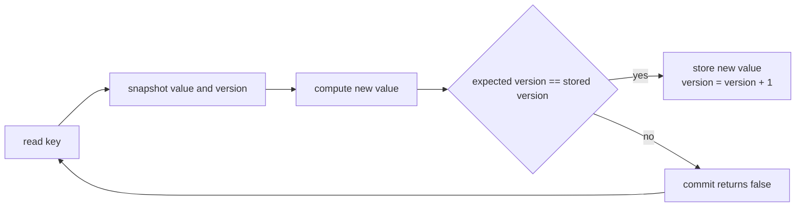
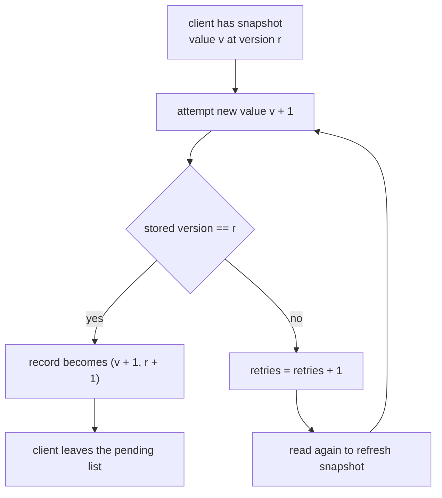
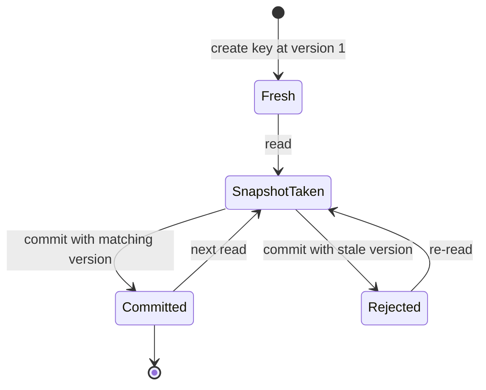
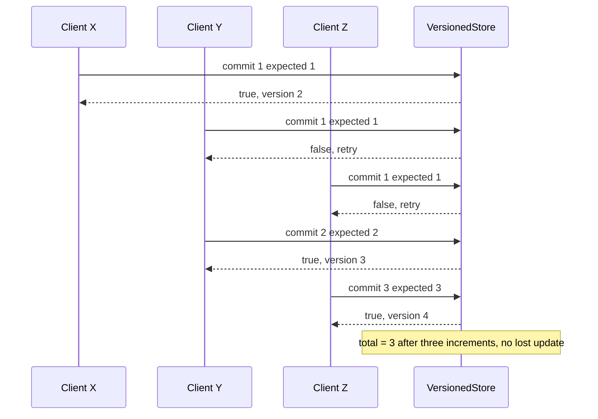

# 346 — Optimistic concurrency control sketch with version numbers

> **Tier:** Intermediate · **CTCI chapter:** Ch 7 — Object-Oriented Design (the solution headers also cite Ch 15)
> **Task spec:** [346-implement-optimistic-concurrency-control-sketch-version-numbers.md](../../../tasks/intermediate/346-implement-optimistic-concurrency-control-sketch-version-numbers.md)
> **Solutions:** [Python](../../../solutions/python/intermediate/346-implement-optimistic-concurrency-control-sketch-version-numbers/solution.py) ·
> [Java](../../../solutions/java/intermediate/346-implement-optimistic-concurrency-control-sketch-version-numbers/Solution.java) ·
> [JavaScript](../../../solutions/javascript/intermediate/346-implement-optimistic-concurrency-control-sketch-version-numbers/solution.js) ·
> [C#](../../../solutions/csharp/intermediate/346-implement-optimistic-concurrency-control-sketch-version-numbers/Solution.cs)

## 1. Problem restatement

Implement a *sketch* of optimistic concurrency control (OCC) over a tiny key/value store. Every
record is a pair `(value, version)` and every write must say **which version it was based on**:

| Operation | Signature | Result |
| --- | --- | --- |
| `create(key, value)` | — | inserts a new record at version `1`; raises if the key already exists |
| `read(key)` | `(value, version)` | the current pair; the missing-key path raises |
| `commit(key, newValue, expectedVersion)` | `bool` | `True` when the write wins, `False` when the version moved on |

A `Client` wrapper holds a read snapshot and counts retries: `read()` refreshes the snapshot,
`attempt(newValue)` calls `commit` with the snapshot's version and increments `retries` when the
commit is refused.

The algorithms are exactly what the four solution files assert:

| Step | Call | Result |
| --- | --- | --- |
| 1 | `create("counter", 10)`, then `a.read()`, `b.read()` | both snapshots are `(10, 1)` |
| 2 | `a.attempt(11)` | `True`; the record is now `(11, 2)` |
| 3 | `b.attempt(11)` | `False` and `b.retries == 1`; the record is still `(11, 2)` |
| 4 | `b.read()` then `b.attempt(12)` | `True`; the record is now `(12, 3)` |
| 5 | `commit("counter", 99, 1)` | `False` — a stale version never lands |
| 6 | `commit("missing", 1, 1)` | `False` — unknown keys never commit |
| 7 | `create("counter", 0)` again | raises (duplicate key) |
| 8 | three clients `X`, `Y`, `Z` over `"total"`, round-robin | 3 rounds, retries `[0, 1, 2]`, final `(3, 4)` |

**Documented simplification.** The docstrings state it plainly: all four files are a
*single-threaded, scripted simulation* of an interleaving rather than real concurrent clients. The
point of the exercise is the exact conflict timing — two clients read version 1, the first commit
wins, the second is rejected — and a scripted schedule makes that timing identical in every
language. The JavaScript solution adds the practical reason: Node has no shared-memory threads, so
a simulation is the only option there. Production OCC would atomically compare-and-swap the version
field (a CAS loop, or a conditional `UPDATE … WHERE version = ?`).

## 2. Intuition

A pessimistic lock serialises writers *before* they compute anything: you hold the record while you
think. Optimistic control does the opposite — read freely, compute freely, and only at the moment of
publication check whether the world still looks the way you assumed. If it does, the write is a
one-step no-conflict landing; if it does not, the attempt is thrown away and the client starts over.

The naive alternative — a global lock around every read and write — makes progress impossible to
sustain (a slow reader blocks every writer) and is unnecessary when conflicts are rare. The naive
*unsafe* alternative — last-writer-wins — silently drops the update that read first: both clients
computed `11` from `10`, and the second write destroys whatever the first one decided.

The key insight is that a **monotonic version counter turns "has anything changed?" into an integer
comparison**. Reading returns `(value, version)` as one indivisible pair, and committing is legal
only when the supplied version equals the stored one. Refusing the write is not an error — it is
information: "your snapshot is old, re-read and try again".



Because the version only ever increases, a client can never *un*wittingly clobber a change it did
not see, and the retry loop always terminates in practice: each failed attempt is caused by a
competitor that has already made progress.

## 3. Algorithm

1. Store records as `key → (value, version)`. `create` writes `(value, 1)` and raises on a duplicate
   key; `read` returns the pair — a copy in Java and C#, a fresh tuple in Python, a fresh object
   literal in JavaScript — so callers cannot mutate the store through the snapshot.
2. `commit(key, newValue, expectedVersion)`: return `False` if the key is absent; return `False` if
   the stored version differs from `expectedVersion`; otherwise overwrite the value and store
   `expectedVersion + 1`, returning `True`.
3. A client's `read()` replaces its snapshot with the pair just returned, and `attempt(newValue)`
   submits the snapshot's version; on refusal it counts a retry.
4. The retry driver re-reads after a refusal and tries again later. The scripted version uses an
   explicit round-robin: every client in the pending list attempts once per round, the losers
   re-read and stay pending, the winners leave.

```text
procedure commit(key, new_value, expected_version)
    if store has no key then
        return false
    end
    (stored_value, stored_version) = record for key
    if stored_version != expected_version then
        return false                # stale snapshot - caller must re-read
    end
    store (new_value, expected_version + 1) for key
    return true
end

procedure round_robin(clients)
    pending = copy of clients
    rounds = 0
    while pending is not empty do
        rounds = rounds + 1
        survivors = empty list
        for client in pending do
            if client.attempt(client.snapshot_value + 1) is false then
                client.read()       # refresh the snapshot, keep the retry count
                append client to survivors
            end
        end
        pending = survivors
    end
    return rounds
end
```

The control flow is a two-branch decision per attempt, with the losing branch feeding the next
round:





## 4. Worked example

The first script: one record, two clients, one deliberate race.

| Step | Actor | Action | Record after | `a.retries` / `b.retries` |
| --- | --- | --- | --- | --- |
| 0 | — | `create("counter", 10)` | `(10, 1)` | `0 / 0` |
| 1 | A | `read()` → `(10, 1)` | `(10, 1)` | `0 / 0` |
| 2 | B | `read()` → `(10, 1)` | `(10, 1)` | `0 / 0` |
| 3 | A | `attempt(11)`, expects version 1 | `(11, 2)` — **wins** | `0 / 0` |
| 4 | B | `attempt(11)`, expects version 1 | `(11, 2)` — **rejected**, nothing written | `0 / 1` |
| 5 | B | `read()` → `(11, 2)` | `(11, 2)` | `0 / 1` |
| 6 | B | `attempt(12)`, expects version 2 | `(12, 3)` — **wins** | `0 / 1` |
| 7 | — | `commit(99, 1)` | `(12, 3)` — rejected, stale | `0 / 1` |
| 8 | — | `commit("missing", 1, 1)` | unchanged — rejected, no such key | `0 / 1` |

Step 4 is the whole point: B's write is discarded *without touching the record*, so the "lost
update" of the last-writer-wins design cannot happen. Step 6 shows the recovery path, and the final
value `12` proves both increments survived: `10 + 1 + 1`.

The three-client phase is a scripted scheduler over `"total"`, starting from `(0, 1)`:

| Round | Client | Attempt | Outcome | Record after |
| --- | --- | --- | --- | --- |
| 1 | X | `1` at version 1 | wins | `(1, 2)` |
| 1 | Y | `1` at version 1 | rejected, re-read `(1, 2)`, retries 1 | `(1, 2)` |
| 1 | Z | `1` at version 1 | rejected, re-read `(1, 2)`, retries 1 | `(1, 2)` |
| 2 | Y | `2` at version 2 | wins | `(2, 3)` |
| 2 | Z | `2` at version 2 | rejected, re-read `(2, 3)`, retries 2 | `(2, 3)` |
| 3 | Z | `3` at version 3 | wins | `(3, 4)` |



Three rounds and retries `[0, 1, 2]`, exactly as asserted. The version climbs to 4 because each
successful commit — including the three increments — advances it by one.

## 5. Complexity

Let `n` be the number of records and `k` the number of clients.

| Measure | Bound | Why it holds |
| --- | --- | --- |
| `create` | O(1) expected | one map insert plus one duplicate check |
| `read` | O(1) expected | one map lookup and one pair copy |
| `commit` (success) | O(1) expected | one lookup, two field writes |
| `commit` (refusal) | O(1) expected | one lookup, one integer comparison |
| Space per record | O(1) | a value and a version; `long`/`double` sized, so no counter overflow concern at these counts |
| Round-robin driver | O(k) per round | one attempt per pending client |
| Total retries, worst case | unlucky clients re-read once per winning competitor | each refusal is caused by a competing commit, so `k` clients need at most `k - 1` retries each, `O(k²)` attempts overall; the scripted run needs 3 rounds for 3 clients |

Comparison with the pessimistic version of the same problem:

| Design | Progress under a slow holder | Cost per write | Lost-update risk |
| --- | --- | --- | --- |
| Global lock | blocked for the whole critical section | O(1) plus contention | none |
| Last-writer-wins | never blocked | O(1) | yes — silently drops updates |
| Version-checked commit (shipped) | never blocked while holding nothing | O(1) plus a retry on conflict | none, because a stale write is refused |

The versioned design buys non-blocking reads and writes with a **retry** cost that is paid only when
two clients genuinely overlap. When conflicts are frequent, the retries dominate and a lock (or a
compare-and-swap loop with backoff) becomes the better trade.

## 6. Pitfalls and edge cases

- **Stale version must be refused, not repaired.** `commit("counter", 99, 1)` after the record has
  reached version 3 returns `False` and leaves the value at 12. A "helpful" implementation that
  overwrites anyway is exactly the lost update this task exists to prevent.
- **Unknown keys never commit.** `commit("missing", 1, 1)` returns `False`; the scripts assert it
  rather than creating a record at version 1, which would let a typo invent data.
- **Duplicate create raises.** `create` on an existing key throws — `ValueError` in Python,
  `IllegalArgumentException` in Java and C#, `Error` in JavaScript. Returning `False` instead would
  hide the caller's mistake.
- **Missing read raises.** The read path is documented to raise for an absent key (the Python
  docstring says `KeyError`), so callers must create first.
- **Snapshots must be copies.** Java and C# return `record.clone()`; returning the internal array
  would let a client mutate the stored version without committing. Python returns a tuple and
  JavaScript destructures into a fresh object, which is the same guarantee by construction.
- **The counter is monotonic; the values are not.** After the first script the version is 3 and the
  value 12; after the second, version 4 and value 3. Never assume value and version agree — the
  value can jump far ahead of the version (step 7 tries 99) and the version can outrun the value.
- **Retries are bounded by competitors, not by time.** In the scripted run each refusal corresponds
  to a rival that committed first, so the loop terminates after at most `k` rounds; a real
  implementation needs a bounded retry budget or backoff for infinite contention.
- **This is a simulation, by design.** The files are single-threaded; no assertion here proves
  anything about a real data race. The docstrings say so, and Java/C# note that a production version
  would need the version check and the write to be one atomic operation.
- **Long, not int.** Java and C# store the version in a `long` so the counter can advance past 2³¹;
  Python integers are unbounded, and JavaScript numbers stay exact far beyond any realistic version
  count.
- **Round-robin fairness.** The driver's `pending` list preserves the attempt order within a round,
  which is what makes `rounds == 3` and `retries == [0, 1, 2]` reproducible instead of flaky.

## 7. Variants and follow-ups

- **Compare-and-swap instead of a version field.** If the record is small enough to fit in one word
  (or one pointer), a CAS on the pointer replaces the version comparison; the retry loop is
  identical. See the lock-free stack outline in
  [356-implement-lock-free-stack-outline-cas.md](../../../tasks/intermediate/356-implement-lock-free-stack-outline-cas.md).
- **Atomic counters and sketches.** A wait-free increment shows the other way to make a shared
  update conflict-free, in
  [354-implement-wait-free-counter-sketch-atomic-operations.md](../../../tasks/intermediate/354-implement-wait-free-counter-sketch-atomic-operations.md).
- **Versioned key/value store.** Same idea, wider API: reads at an explicit version, and version
  history instead of a single record — see
  [360-implement-versioned-key-value-store-basic.md](../../../tasks/intermediate/360-implement-versioned-key-value-store-basic.md).
- **Range conflicts.** Real OCC systems also validate a read set, not a single record; a competing
  write to a key you never touched is irrelevant, but a write to one you *did* read invalidates the
  whole transaction.
- **Writer starvation in lock-based designs.** If you replace OCC with a lock, read the writer
  preference policy in
  [347-implement-read-write-lock-basic-no-starvation.md](../../../tasks/intermediate/347-implement-read-write-lock-basic-no-starvation.md)
  and the fairness tests in
  [359-readers-writers-fairness-implementation-and-tests.md](../../../tasks/intermediate/359-readers-writers-fairness-implementation-and-tests.md).
- The chapter walkthroughs [Object-Oriented Design](../../ctci/07-object-oriented-design.md) and
  [Threads and Locks](../../ctci/15-threads-and-locks.md) put this task next to the other shared
  state problems.

## 8. Check yourself

1. Why does a version check prevent the lost update that last-writer-wins allows?

<details><summary>Show answer</summary>

Because the write carries the version it was based on. B computed its new value from version 1, but
by the time it commits the stored version is 2, so the comparison fails and the write is dropped.
With last-writer-wins, B's `11` would simply overwrite A's `11` and the update A decided from would
be gone.

</details>

2. In the two-client script, why does `b.attempt(11)` return `False` while `b.attempt(12)` returns
   `True`?

<details><summary>Show answer</summary>

Because `attempt` submits the *snapshot's* version. B's first snapshot still says version 1 while the
store is at version 2, so the attempt is refused. B then re-reads, obtaining `(11, 2)`, and the next
attempt carries version 2 — which matches, so it lands and the version becomes 3.

</details>

3. How many rounds does the three-client round-robin driver need, and why can't it be fewer?

<details><summary>Show answer</summary>

Three rounds: in round 1 only X wins (Y and Z are refused because they also expected version 1), in
round 2 only Y wins, in round 3 Z finally wins. Each round can promote at most one client, since
every winner invalidates the snapshot of everyone still pending from that round. The retry counts
come out as `[0, 1, 2]`.

</details>

4. What does `commit("missing", 1, 1)` return, and what would the wrong behaviour be?

<details><summary>Show answer</summary>

`False`. The wrong behaviour is to create the record at version 1 or to raise; the store must not
let a commit for a nonexistent key invent one. The Python script asserts both that the result is
`False` and that a later read of another key still behaves normally.

</details>

5. The four files never start a thread. Does that make the exercise pointless?

<details><summary>Show answer</summary>

No — it makes it reproducible. The interesting content of OCC is the *ordering* of read and commit
steps, and a scripted interleaving pins that ordering down exactly in all four languages, including
Node, which has no shared-memory threads. What the simulation cannot show is a real data race at the
hardware level; for that, the solution headers point at an atomic compare-and-swap, as sketched in
the lock-free stack task.

</details>
