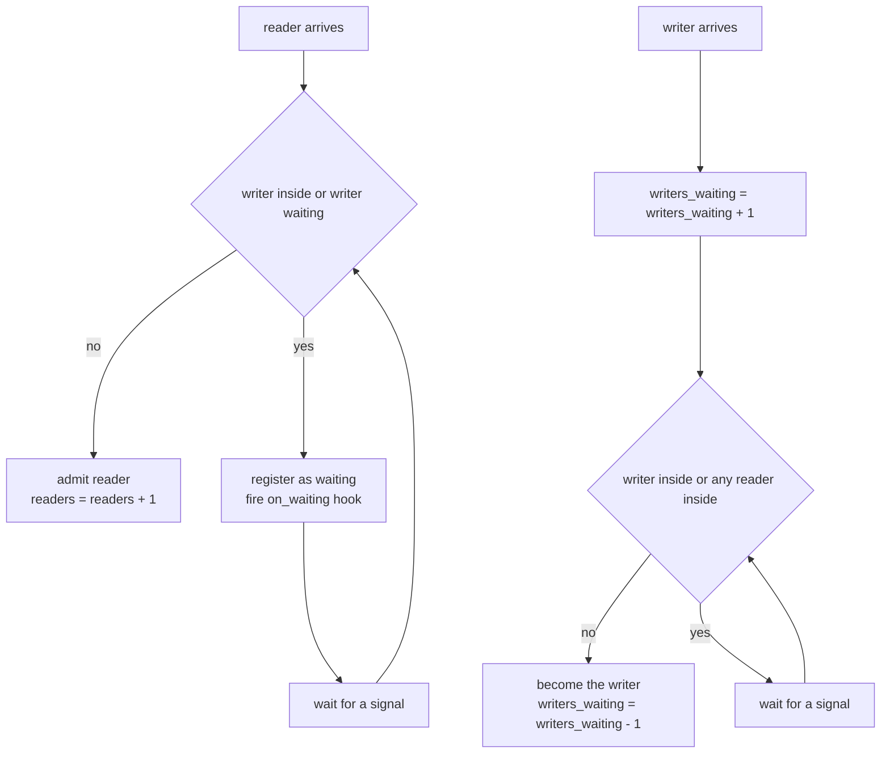
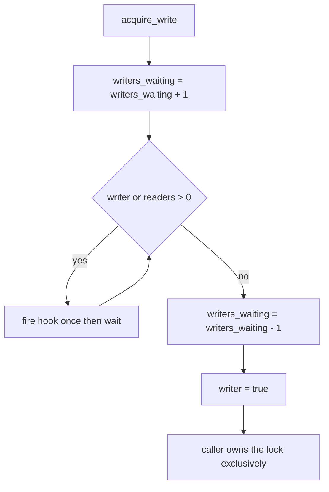
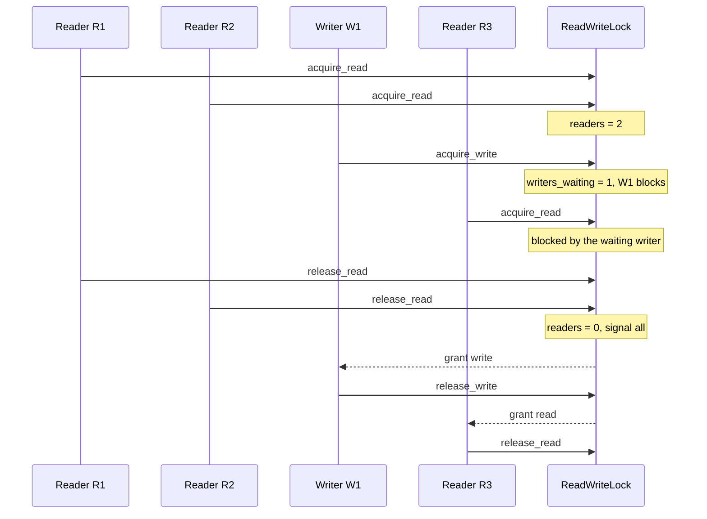

# 347 — Read-write lock with writer preference (no writer starvation)

> **Tier:** Intermediate · **CTCI chapter:** Ch 15 — Threads and Locks
> **Task spec:** [347-implement-read-write-lock-basic-no-starvation.md](../../../tasks/intermediate/347-implement-read-write-lock-basic-no-starvation.md)
> **Solutions:** [Python](../../../solutions/python/intermediate/347-implement-read-write-lock-basic-no-starvation/solution.py) ·
> [Java](../../../solutions/java/intermediate/347-implement-read-write-lock-basic-no-starvation/Solution.java) ·
> [JavaScript](../../../solutions/javascript/intermediate/347-implement-read-write-lock-basic-no-starvation/solution.js) ·
> [C#](../../../solutions/csharp/intermediate/347-implement-read-write-lock-basic-no-starvation/Solution.cs)

## 1. Problem restatement

Implement a basic **read-write lock** with a documented anti-starvation policy, plus enough
bookkeeping to prove the mutual-exclusion invariants:

| Operation | Meaning |
| --- | --- |
| `acquire_read()` | enter as a reader; several readers may hold the lock at once |
| `release_read()` | leave as a reader |
| `acquire_write()` | enter as the exclusive writer; no reader and no other writer may hold it |
| `release_write()` | leave as the writer |
| `state()` | `(readers, writer, writers_waiting)` — inspection only |

The policy the solution files implement is stated in every header: **as soon as a writer is
waiting, newly arriving readers block, and waiting writers take the lock once the current
readers/writer drain.** A never-ending stream of readers therefore cannot starve writers. This is
*writer* preference, not fairness in the FIFO sense: a reader that arrives while a writer waits
may be overtaken by later writers, but it cannot be overtaken by later *readers*.

Both `acquire_read` and `acquire_write` take an optional `on_waiting` hook that fires **once the
caller has registered as blocked, while still holding the internal lock**. That hook is what makes
the demo deterministic: a release can never slip in between registration and the actual wait, so
there are no lost wake-ups.

The scripts drive a fixed interleaving with real threads (Python `threading`, Java
`CountDownLatch`, C# `CountdownEvent`) and assert exact states:

| Phase | Action | Asserted `state()` |
| --- | --- | --- |
| 1 | `R1` enters alone, then `R2` enters | `(2, False, 0)`, `max_readers == 2` |
| 2 | `W1` attempts to write | registers as waiting: `(2, False, 1)`, still not entered |
| 3 | `R3` arrives as a reader | registers as waiting too (writer preference) |
| 4 | `R1` and `R2` release | `W1` enters: `(0, True, 0)`; `R3` still waits |
| 5 | `W1` releases | `R3` enters: `(1, False, 0)` |
| 6 | `W2` enters with no readers, `R4` arrives | `W2` holds immediately, `R4` waits |
| 7 | `W2` releases | `R4` enters; every thread terminates |

The auditor's final assertions: `violations == 0` (readers and writers never overlapped),
`max_readers == 2`, and the grant log is exactly
`["R:R1", "R:R2", "W:W1", "R:R3", "W:W2", "R:R4"]`.

**Note on the JavaScript file.** Node runs a single-threaded event loop, so its header documents
the usual repository approach: blocked callers become promise resolvers standing in for condition
variables, grants happen synchronously, and the scripted interleaving is exact.

## 2. Intuition

A plain mutex over-protects a read-mostly structure: readers do not conflict with each other, and
serialising them throws away the parallelism the workload actually has. The cheap fix — "count the
readers; a writer must wait until the count is zero" — has a fatal flaw: as long as at least one
reader is inside, and new readers keep arriving, the count never reaches zero and writers wait
forever. That is **writer starvation**.

The key insight is that the lock must track not only *who holds it* but also **who is waiting**:

- `readers` — how many readers are inside;
- `writer` — whether the exclusive writer is inside;
- `writers_waiting` — how many writers have registered but not yet been granted.

The third counter is what fixes the starvation. A reader is admitted only when there is no writer
*and nobody is waiting to write* — even if the lock is otherwise free for reading. Once a writer is
waiting, the reader queue stops draining, the active readers finish, and the writer gets in.



Because both paths re-check their condition in a `while` loop after every wake-up, a thread woken
spuriously — or woken only to find the lock taken again — simply goes back to waiting. That single
decision, *re-check under the lock*, is what makes the implementation safe without any fairness
guarantee from the platform's scheduler.

## 3. Algorithm

1. Keep one internal condition/monitor protecting three fields: `readers` (int), `writer` (bool),
   `writers_waiting` (int).
2. **`acquire_read(on_waiting)`**: take the internal lock. While `writer` or `writers_waiting > 0`:
   fire `on_waiting` once (still holding the internal lock), then wait on the condition. When the
   loop exits, increment `readers`.
3. **`release_read()`**: take the internal lock, decrement `readers`, and when `readers` reaches
   zero signal everyone.
4. **`acquire_write(on_waiting)`**: take the internal lock and increment `writers_waiting`
   *first* — this is what blocks new readers. While `writer` or `readers > 0`: fire `on_waiting`
   once, then wait. On exit, decrement `writers_waiting` and set `writer = True`.
5. **`release_write()`**: clear `writer` and signal everyone; multiple readers may now enter, or a
   single waiting writer may claim the lock.

```text
procedure acquire_read(on_waiting)
    lock internal
    notified = false
    while writer or writers_waiting > 0 do
        if on_waiting is set and notified is false then
            call on_waiting        # still holding the internal lock
            notified = true
        end
        wait on condition
    end
    readers = readers + 1
    unlock internal
end

procedure release_read()
    lock internal
    readers = readers - 1
    if readers == 0 then
        signal all waiters
    end
    unlock internal
end

procedure acquire_write(on_waiting)
    lock internal
    writers_waiting = writers_waiting + 1
    notified = false
    while writer or readers > 0 do
        if on_waiting is set and notified is false then
            call on_waiting
            notified = true
        end
        wait on condition
    end
    writers_waiting = writers_waiting - 1
    writer = true
    unlock internal
end

procedure release_write()
    lock internal
    writer = false
    signal all waiters
    unlock internal
end
```

The `writers_waiting` increment in step 4 happens **before** the wait loop and before any blocking,
which is what lets an arriving reader see "a writer is waiting" even though that writer has not
been granted anything yet. The decrement happens only on the path that actually becomes the writer.



## 4. Worked example

The scripted interleaving, step by step. "Waiters" counts callers parked on the condition:

| # | Event | `readers` | `writer` | `writers_waiting` | Notes |
| --- | --- | --- | --- | --- | --- |
| 1 | `R1` acquires read | 1 | `False` | 0 | `max_readers` becomes 1 |
| 2 | `R2` acquires read | 2 | `False` | 0 | `max_readers` becomes 2; sharing proven |
| 3 | `W1` acquires write | 2 | `False` | 1 | hook fires: W1 is registered |
| 4 | `R3` acquires read | 2 | `False` | 1 | blocked by the waiting writer |
| 5 | `R1`, then `R2`, release | 0 | `False` | 1 | signal only when the count hits zero |
| 6 | `W1` wakes | 0 | `True` | 0 | loop condition false → becomes writer |
| 7 | `W1` releases, `R3` wakes | 1 | `False` | 0 | `R3` admitted, `W2` not arrived yet |
| 8 | `R3` releases, `W2` acquires | 0 | `True` | 0 | uncontended write, immediate |
| 9 | `R4` acquires read | 0 | `True` | 0 | blocked by the active writer |
| 10 | `W2` releases, `R4` wakes | 1 | `False` | 0 | admitted, then releases |

Step 5 is the detail that a naive reader-count lock gets wrong: the signal is only sent
when the *last* reader leaves. Steps 3 and 4 are the writer-preference rule: `R3` could have been
admitted at step 4 (`readers` was 2, no writer inside) but `writers_waiting == 1` blocks it.



Every grant above was recorded by the auditor and checked at the end: `violations == 0` means no
`enter_read` ever overlapped an `enter_write`, `max_readers == 2` pins the peak concurrency, and
the grant log `["R:R1", "R:R2", "W:W1", "R:R3", "W:W2", "R:R4"]` pins the exact order.

## 5. Complexity

| Measure | Bound | Why it holds |
| --- | --- | --- |
| `acquire_read`, uncontended | O(1) | one condition-variable acquisition, one test, one increment |
| `acquire_read`, contended | O(1) plus scheduler latency | the wait is a park/unpark; the number of loop iterations is not bounded by `n` |
| `release_read` | O(1) | one decrement and, when the count hits zero, one broadcast |
| `acquire_write` / `release_write` | O(1) | counters and one broadcast |
| `state()` | O(1) | three field reads under the internal lock |
| Space | O(1) | three counters, no per-thread bookkeeping |
| Concurrency | up to `n` readers at once | readers only ever increment a shared counter |
| Starvation, readers | possible in principle | readers can be overtaken by later *writers*; that is the accepted cost of writer preference |
| Starvation, writers | prevented | a waiting writer stops new readers because `writers_waiting > 0` blocks them |

The `notify_all` on release, rather than `notify_one`, matters for the bound on *progress*, not on
instructions: with a single signal the platform might wake a reader that immediately goes back to
waiting, and the writer would never be woken. Broadcasting costs O(number of waiters) wake-ups but
guarantees that the correct class of waiter makes progress. Each waiter re-checks its predicate, so
spurious or early wake-ups are harmless — only a bounded number of them can occur before the
condition becomes true.

Comparison with the two simpler designs:

| Design | Writer progress | Reader progress | Correctness risk |
| --- | --- | --- | --- |
| Mutex around everything | fair-ish, serialised | serialised | none, but no read parallelism |
| Reader-count only (`readers == 0` gate) | starved by a steady reader stream | always admitted | writer starvation |
| Reader count plus `writers_waiting` gate (shipped) | admitted once active readers drain | blocked only while a writer waits | none observed: `violations == 0` |

## 6. Pitfalls and edge cases

- **Using `if` instead of `while`.** Every thread must re-test its predicate after waking, because a
  broadcast can wake a thread whose condition is still false.
- **Signalling too early in `release_read`.** Only the transition `readers == 0` may wake the
  waiting writer; waking on every release just creates a thundering herd that immediately goes back
  to sleep.
- **Incrementing `writers_waiting` after the wait.** If the counter rises only when a writer is
  actually granted, arriving readers never see the queued writer and starve it. The shipped code
  increments before the loop and decrements on the winning path.
- **Lost wake-up between registration and wait.** The `on_waiting` hook fires while the internal
  lock is still held, so a `release` from another thread cannot be interleaved between "I have
  registered" and "I am waiting". Without the internal lock covering both, the caller could sleep
  forever.
- **Two readers racing for an uncontended lock.** The Python script notes this explicitly: `R1` and
  `R2` are started one after the other (`R2` only once `R1` is inside), because two readers racing
  for a free lock may legitimately be granted in either order, which would make the grant-order
  assertion flaky. Both still hold the lock at the same time.
- **Releasing without acquiring, or a missing release.** The JavaScript simulation defects on a
  `releaseRead` when `readers === 0`; in Java and C# an unbalanced `release` corrupts the counters.
  Acquire and release must be paired, ideally in a `try/finally`.
- **Unbounded waits in a test, and a single-threaded platform.** Every gate wait and join is bounded
  (15 s) and the threads are daemons, so a stuck run *fails* instead of hanging the process. The
  JavaScript file, however, is an event-loop simulation with promise resolvers in place of condition
  variables — its assertions are exact because grants happen synchronously inside
  `acquire`/`release`, but it says nothing about a real multi-threaded runtime.
- **Not reentrant, and not a synchronisation point.** A thread that acquires the write lock twice
  deadlocks itself, there is no FIFO order between two waiting writers, and `state()` returns a
  snapshot that other threads may already have invalidated.

## 7. Variants and follow-ups

- **Reader preference.** Drop the `writers_waiting > 0` test from `acquire_read`; readers are then
  admitted whenever no writer is *inside*, which is simpler and can starve writers exactly as the
  classic bug does.
- **FIFO fairness.** Replace the three counters with an explicit wait queue and grant in arrival
  order; the fairness tests in
  [359-readers-writers-fairness-implementation-and-tests.md](../../../tasks/intermediate/359-readers-writers-fairness-implementation-and-tests.md)
  measure the difference. A reader that wants to become a writer must drop the read lock first
  (otherwise two upgraders deadlock), while a writer can downgrade safely.
- **Protecting a real data structure.** Any concurrent container needs exactly this discipline
  around its top-level state — see
  [353-implement-concurrent-hashmap-simplified-sharding.md](../../../tasks/intermediate/353-implement-concurrent-hashmap-simplified-sharding.md).
- **Lock-free alternative.** When a write can be reduced to one atomic commit, a version-checked
  write removes the lock entirely — see
  [346-implement-optimistic-concurrency-control-sketch-version-numbers.md](../../../tasks/intermediate/346-implement-optimistic-concurrency-control-sketch-version-numbers.md).
- **Producer/consumer with counting semaphores.** The other classic "wait, then re-check" pattern is
  in [348-producer-consumer-using-semaphore-locks-with-multiple-producers.md](../../../tasks/intermediate/348-producer-consumer-using-semaphore-locks-with-multiple-producers.md);
  see also [Threads and Locks](../../ctci/15-threads-and-locks.md).

## 8. Check yourself

1. Why does adding a `writers_waiting` counter stop writer starvation?

<details><summary>Show answer</summary>

Because a reader is admitted only when *no* writer is inside **and** no writer is waiting. Once a
writer registers, arriving readers block, so the active reader count can only decrease and must hit
zero — at which point the waiting writer is woken and takes the lock. Without the counter, a
continuous stream of readers keeps the count above zero forever.

</details>

2. Why must the wait loop be `while` rather than `if`?

<details><summary>Show answer</summary>

Because a wake-up does not mean the predicate became true — the release broadcasts to all waiters,
and another thread may have taken the lock first. Every thread must re-evaluate its condition under
the internal lock after waking; only then may it proceed to increment `readers` (or become the
writer).

</details>

3. In the scripted run, why is `R3` blocked at a moment when no writer holds the lock?

<details><summary>Show answer</summary>

Because writer preference is a *state*, not a property of the moment: `writers_waiting` is 1, so
`acquire_read`'s loop condition `writer or writers_waiting > 0` is true. `R3` waits until `W1` has
held and released the write lock; only then is `R3` granted, as the grant log shows.

</details>

4. What do the auditor's `violations == 0` and `max_readers == 2` assertions actually prove?

<details><summary>Show answer</summary>

`violations == 0` proves the mutual-exclusion invariant: no `enter_read` ever ran while a writer was
inside, and no `enter_write` while a reader or another writer was inside. `max_readers == 2` proves
readers really do share — the design would be correct but pointless if the counter never exceeded 1.

</details>

5. The JavaScript file has no threads at all. What is lost, and what is preserved?

<details><summary>Show answer</summary>

Lost: any evidence about genuine data races or memory visibility, since a single event loop cannot
produce them. Preserved: the lock's *policy* — the exact sequence of grants and blocks, because the
simulation resolves waiters synchronously inside `acquire`/`release` and the scripted interleaving
is therefore deterministic. It tests the protocol, not the platform.

</details>
