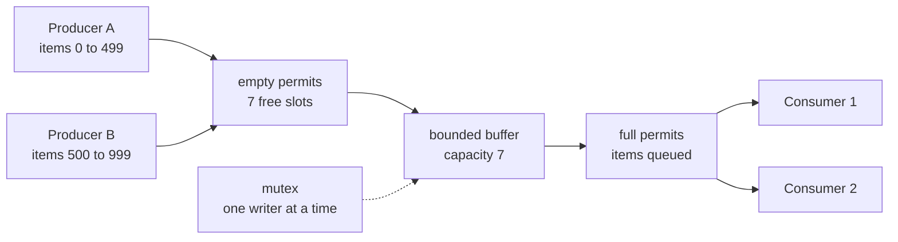
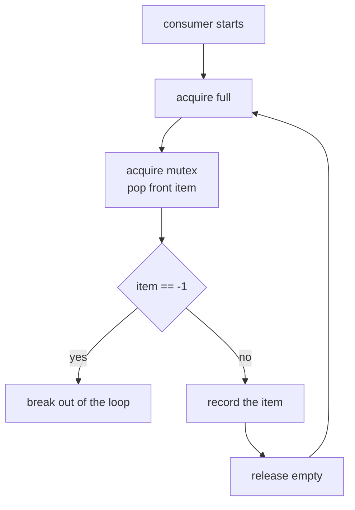
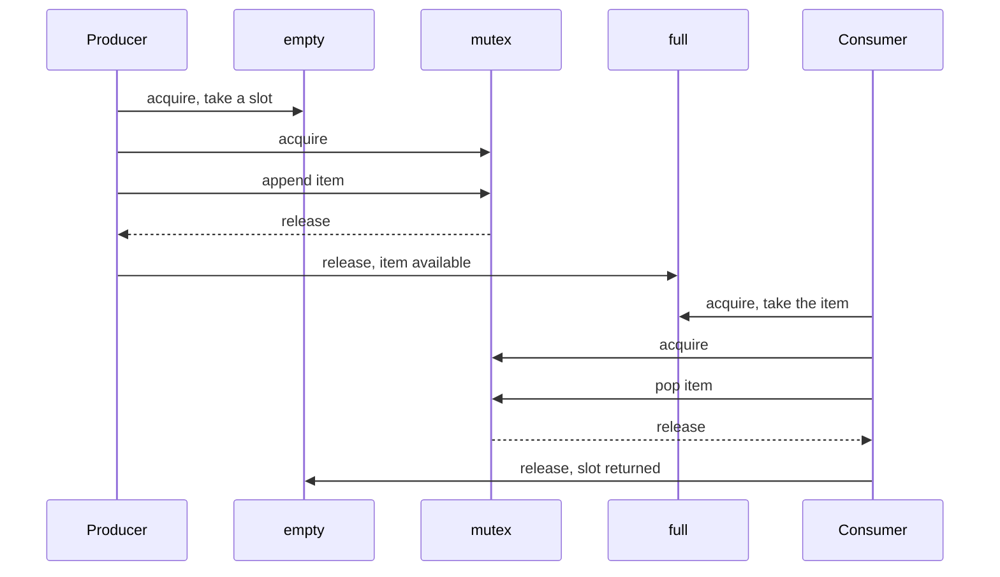
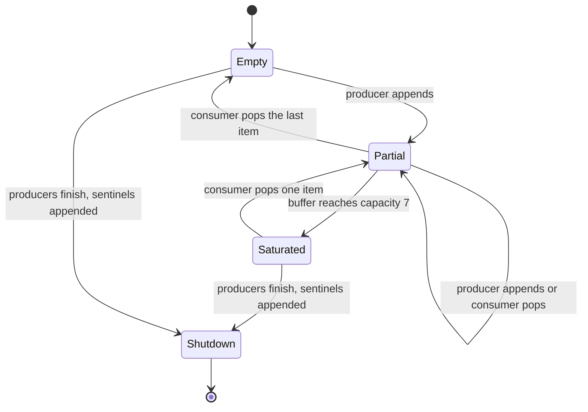

# 348 — Producer-consumer with counting semaphores and multiple producers

> **Tier:** Intermediate · **CTCI chapter:** Ch 15 — Threads and Locks
> **Task spec:** [348-producer-consumer-using-semaphore-locks-with-multiple-producers.md](../../../tasks/intermediate/348-producer-consumer-using-semaphore-locks-with-multiple-producers.md)
> **Solutions:** [Python](../../../solutions/python/intermediate/348-producer-consumer-using-semaphore-locks-with-multiple-producers/solution.py) ·
> [Java](../../../solutions/java/intermediate/348-producer-consumer-using-semaphore-locks-with-multiple-producers/Solution.java) ·
> [JavaScript](../../../solutions/javascript/intermediate/348-producer-consumer-using-semaphore-locks-with-multiple-producers/solution.js) ·
> [C#](../../../solutions/csharp/intermediate/348-producer-consumer-using-semaphore-locks-with-multiple-producers/Solution.cs)

## 1. Problem restatement

Move `1000` items through a **bounded buffer of capacity 7** with **two producers** and **two
consumers**, and prove afterwards that nothing was lost, duplicated or reordered within a producer's
own stream.

| Element | Value in the shipped scripts |
| --- | --- |
| Buffer capacity | `7` |
| Items | `0 … 999`, produced as two disjoint halves: `0 … 499` and `500 … 999` |
| Producers | 2 |
| Consumers | 2 |
| Termination marker | `-1` (one sentinel per consumer) |
| Buffer | a double-ended queue visited under a mutex |

The classic counting-semaphore formulation is used, with three semaphores:

| Semaphore | Initial value | Meaning |
| --- | --- | --- |
| `empty` | `7` (the capacity) | free slots — a producer takes one before writing |
| `full` | `0` | queued items — a consumer takes one before reading |
| `mutex` | `1` | protects the queue itself, so a producer and a consumer never mutate it at once |

Asserted at the end:

- `len(consumed) == 1000` — nothing lost or duplicated;
- `sorted(consumed) == 0 … 999` — every item consumed exactly once;
- `1 <= max_seen <= 7` — the buffer was actually used and never exceeded capacity;
- each producer's half appears in **increasing order** in the global consumption log;
- every thread terminates (daemon threads plus bounded joins, so a bug fails fast instead of hanging).

**Termination is sequenced, not timed.** Once both producers have finished, the main thread reserves
one slot permit per consumer (`empty.acquire()`), appends one `-1` sentinel per consumer under the
mutex, and releases `full` for each. A consumer that pops a sentinel breaks out of its loop and
**keeps** the slot permit it consumed, so no sentinel can be lost or double-counted.

**Note on the JavaScript file.** Node has a single-threaded event loop, so the header documents the
repository's async simulation: a counting-semaphore class stores suspended acquirers as promise
resolvers, and buffer mutations happen synchronously between `await` points, which makes `put` and
`take` atomic. The sentinel protocol is identical.

## 2. Intuition

The naive shared queue — `while queue is full: spin` or a single mutex held across the whole
produce step — has two failure modes. Busy-waiting burns a core for nothing, and a single lock held
while the buffer is full means the consumer cannot even reach the queue to empty it. You need the
two waiting conditions to be **independent**: "wait until there is room" and "wait until there is
something to take" are different questions and must not be answered by the same lock.

The key insight, due to Dijkstra, is to turn both conditions into **counters that also act as
permits**. `empty` counts free slots, `full` counts occupied ones, and a thread that cannot proceed
blocks inside `acquire` instead of spinning. Because the two counters sum to the capacity, the
invariant `empty + full == capacity` holds at every quiescent moment.

But counters alone are not enough: `empty.acquire()` followed by `buffer.append` is *not* atomic.
Two producers can both take a permit and then race on the queue's internal state. Hence the third
semaphore, used as a **mutex**, held only around the queue mutation — never around the `acquire`
calls, which would deadlock.



The lock ordering is the other half of the design: a thread always takes its *permit* first and the
*mutex* second, and always releases them in the opposite order (mutex inside the critical section,
permit after). Inverting that order — taking the mutex and then blocking on a permit — is the
textbook way to deadlock this problem.

## 3. Algorithm

Producer, for each item in its half:

1. `empty.acquire()` — wait until a slot is free.
2. `mutex.acquire()`, append the item to the buffer, update the observed maximum, `mutex.release()`.
3. `full.release()` — announce the item.

Consumer, forever:

1. `full.acquire()` — wait until an item exists.
2. `mutex.acquire()`, pop the front item, `mutex.release()`.
3. If the item is the sentinel: break, leaving the consumed permit alone.
4. Otherwise record the item, then `empty.release()` to return the slot.

Main thread: start all four threads, join both producers, then for each consumer take one `empty`
permit, append a sentinel under the mutex and release `full`; finally join the consumers and check
the assertions.

```text
procedure produce(from, to)
    for item = from to to - 1 do
        acquire empty                 # a free slot is reserved
        acquire mutex
        append item to buffer
        max_seen = maximum of max_seen and length of buffer
        release mutex
        release full                  # one more item is available
    end
end

procedure consume(sentinel)
    loop forever
        acquire full                  # an item is available
        acquire mutex
        item = remove front of buffer
        release mutex
        if item == sentinel then
            break                     # keep the slot permit: the sentinel stays counted
        end
        record (length of consumed, item)
        release empty                 # hand the slot back to the producers
    end
end

procedure shutdown(consumers)
    for each consumer do
        acquire empty                  # reserve the sentinel's own slot
        acquire mutex
        append sentinel to buffer
        release mutex
        release full
    end
end
```

The control flow of one consumer is a loop whose only exit is the sentinel:



And the four-way handshake around the buffer, showing which semaphore each step touches:



## 4. Worked example

Trace three items with capacity 7, one producer and one consumer, starting from an empty buffer
(`empty = 7`, `full = 0`, queue `[]`):

| # | Actor | Action | `empty` | `full` | Buffer after | Notes |
| --- | --- | --- | --- | --- | --- | --- |
| 1 | P | `empty.acquire()` | 6 | 0 | `[]` | slot reserved |
| 2 | P | append 0 under the mutex, then `full.release()` | 6 | 1 | `[0]` | `max_seen = 1`, item announced |
| 3 | C | `full.acquire()` | 6 | 0 | `[0]` | item claimed |
| 4 | C | pop 0 under the mutex, then `empty.release()` | 7 | 0 | `[]` | log gets `(0, 0)`, slot returned |
| 5 | P | `empty.acquire()`, append 1, `full.release()` | 6 | 1 | `[1]` | — |
| 6 | C | `full.acquire()`, pop 1, `empty.release()` | 7 | 0 | `[]` | log gets `(1, 1)`, invariant restored |

The invariant `empty + full == capacity` holds at every row boundary, and the two semaphores are
never both zero while the buffer is neither full nor empty — that would be a lost wake-up.

`max_seen` records the peak length the mutex ever observed: the assertion `max_seen <= 7` is proof
that the two producers never slipped a write past the permit accounting, and `max_seen >= 1` says
the buffer was genuinely used rather than degenerating into a pass-through. When the producers
outrun the consumers the buffer fills, `empty` reaches 0, and the producers park inside
`empty.acquire()` until a consumer pops an item and returns the slot — the invariant
`empty + full == capacity` holds throughout.



The shutdown phase is easy to get subtly wrong: the main thread joins both producers, reserves one
slot permit per consumer, appends one `-1` per consumer, and releases `full` once per sentinel. Each
consumer pops exactly one sentinel and breaks **without** returning the permit, so neither can block
and neither can spin — there is no timing guess in the shutdown path.

## 5. Complexity

Let `n` be the number of items (1000 here) and `c` the capacity (7).

| Measure | Bound | Why it holds |
| --- | --- | --- |
| Time per item, amortised | O(1) | one permit acquire, one mutex acquire/release, one buffer mutation, one permit release |
| Total time | O(n / number of active consumers + contention) | the producers and consumers run concurrently; the critical section is a single push or pop |
| Time, work counter | O(n) | exactly `n` appends and `n` pops must happen |
| Time waiting in `empty.acquire()` | O(n / c) blocking events | a producer can only block once every `c` items, since the buffer drains as fast as the consumers can run |
| Space, buffer | O(c) = O(1) | the capacity is a constant, so the buffer does not grow with `n` |
| Space, consumed log | O(n) | the script records every consumption for the assertions; production code would not |
| Space, semaphores | O(1) | three counters, independent of how many producers and consumers there are |
| Threads | O(1) | two producers and two consumers |

Contention is the practical cost: every item passes through the single `mutex`, so the achievable
throughput is bounded by how fast one thread can push and pop. Sharding the buffer — several buffers
each with their own semaphores — removes that bottleneck at the price of ordering guarantees, which
is exactly the trade-off in
[353-implement-concurrent-hashmap-simplified-sharding.md](../../../tasks/intermediate/353-implement-concurrent-hashmap-simplified-sharding.md).

Comparison with alternatives:

| Design | Producer waits how | Consumer waits how | Risk |
| --- | --- | --- | --- |
| Spin on a shared flag | busy-wait, burns CPU | busy-wait, burns CPU | priority inversion, wasted cores |
| `empty` + `full` + `mutex` (shipped) | parks inside `empty.acquire()` | parks inside `full.acquire()` | lock order must be permit-then-mutex |

## 6. Pitfalls and edge cases

- **Holding the mutex while waiting for a permit.** `mutex.acquire()` before `empty.acquire()` means
  the blocked producer keeps the mutex, so the consumer that would free a slot can never enter —
  classic deadlock. Every file takes the permit first.
- **Signalling under the wrong lock.** `full.release()` must happen *after* `mutex.release()`, so a
  consumer woken by it finds a consistent queue.
- **Releasing `empty` for the sentinel, or losing it.** The consumers break **without** returning the
  slot permit; returning it would hand out permits for slots that no longer correspond to queued
  work. Symmetrically, the main thread must reserve a slot permit (`empty.acquire()`) *before*
  appending each sentinel, otherwise a full buffer can deadlock the shutdown or drop the sentinel.
- **Sending one sentinel to multiple consumers.** One `-1` is appended per consumer. A single shared
  sentinel would wake only one of them and leave the other blocked forever.
- **Capacity accounting drift.** `max_seen` is updated *inside* the mutex; outside it the update is a
  read-modify-write race, and it could observe a torn value.
- **Order is per producer, not global.** Each producer's own half must appear in increasing order;
  the interleaving between the halves is free, so asserting a global order would test the scheduler.
- **Interrupted waits and unbounded threads.** Java and C# catch interruption on the semaphore waits
  and re-assert the interrupt flag; swallowing it would silently break the caller's cancellation.
  All worker threads are daemons/background threads and every join has a 15-second bound, so a stuck
  run fails the test instead of hanging the process.
- **Node is single-threaded.** The JavaScript solution's semaphores suspend *async tasks* with
  promise resolvers; `put`/`take` are atomic because no `await` sits between them. It reproduces the
  protocol, not real parallelism.
- **Fairness.** Counting semaphores are not required to wake waiters in FIFO order, so neither
  producer is guaranteed to run first and no assertion depends on which one gets ahead.

## 7. Variants and follow-ups

- **Multiple buffers (sharding).** Give each producer its own queue and semaphores; consumers steal
  from whichever queue is non-empty. Ordering across shards is lost, throughput scales — the same
  choice discussed in
  [353-implement-concurrent-hashmap-simplified-sharding.md](../../../tasks/intermediate/353-implement-concurrent-hashmap-simplified-sharding.md).
- **Fixed-size batch synchronisation.** Replace per-item hand-off with a barrier that flushes a whole
  batch at once — see
  [349-barrier-synchronization-primitive-simple-implementation.md](../../../tasks/intermediate/349-barrier-synchronization-primitive-simple-implementation.md).
- **A worker pool draining the queue.** The same buffer sits behind a pool's task queue in
  [351-implement-thread-pool-basic-with-worker-threads-and-task-queue.md](../../../tasks/intermediate/351-implement-thread-pool-basic-with-worker-threads-and-task-queue.md),
  where the sentinel is replaced by a shutdown flag that retires every worker.
- **Lock-free queues and reader/writer asymmetry.** A Michael-Scott queue replaces the mutex with CAS
  on head and tail, reintroducing the memory-reclamation problem of
  [355-implement-epoch-based-reclamation-idea-for-concurrent-data-struc.md](../../../tasks/intermediate/355-implement-epoch-based-reclamation-idea-for-concurrent-data-struc.md);
  if the "buffer" is read far more often than written, a read-write lock fits better — see
  [347-implement-read-write-lock-basic-no-starvation.md](../../../tasks/intermediate/347-implement-read-write-lock-basic-no-starvation.md).
- The chapter walkthrough [Threads and Locks](../../ctci/15-threads-and-locks.md) covers the
  condition-variable version of this same pattern.

## 8. Check yourself

1. Why does the buffer need a separate `mutex` when `empty` and `full` already prevent overflow and
   underflow?

<details><summary>Show answer</summary>

Because the permits are taken and released *outside* the queue mutation. Two producers can both hold
free slots and then interleave their appends, corrupting the queue's internal structure, and a
consumer can pop while a producer is halfway through appending. The mutex makes the single
append/pop atomic; the semaphores only handle *when* a thread may act, not *how* the structure is
touched.

</details>

2. What is the exact lock order in these solutions, and what happens if you invert it?

<details><summary>Show answer</summary>

Permit first, mutex second: `empty.acquire()` then `mutex.acquire()` in a producer, `full.acquire()`
then `mutex.acquire()` in a consumer, with the mutex released before the other permit is released.
Inverting it — holding the mutex while blocking on a permit — deadlocks immediately: the consumer
that would free a slot cannot acquire the mutex the blocked producer is holding.

</details>

3. Why does a consumer keep the `empty` permit when it pops a sentinel?

<details><summary>Show answer</summary>

Because a sentinel is not real work. Its slot permit was reserved by the main thread purely so the
append could not block. Returning it would let a producer take a permit for a slot that was never
freed, breaking the `empty + full == capacity` accounting. Breaking out of the loop with the permit
consumed is self-consistent: the buffer is empty afterwards, and every thread has terminated.

</details>

4. Why is one sentinel per consumer necessary rather than a single shared one?

<details><summary>Show answer</summary>

Because a pop removes the item. One sentinel would be taken by one consumer, terminating it, while
the other consumer keeps blocking in `full.acquire()` forever. Appending one `-1` per consumer — with
its own reserved slot permit and its own `full.release()` — guarantees each consumer sees exactly one
terminator.

</details>

5. The script asserts that each producer's half appears in increasing order but says nothing about
   the interleaving of the two halves. Why is that the right contract?

<details><summary>Show answer</summary>

Because the two producers run concurrently and the consumers drain in whichever order the scheduler
offers. The only ordering the algorithm is responsible for is FIFO within the single buffer: a
producer appends its own items in order, so its half emerges in order. Anything stronger would be an
assertion about timing, which the test deliberately avoids.

</details>
