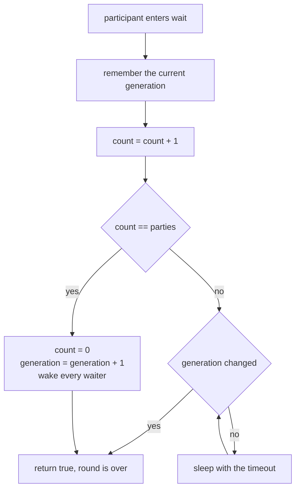
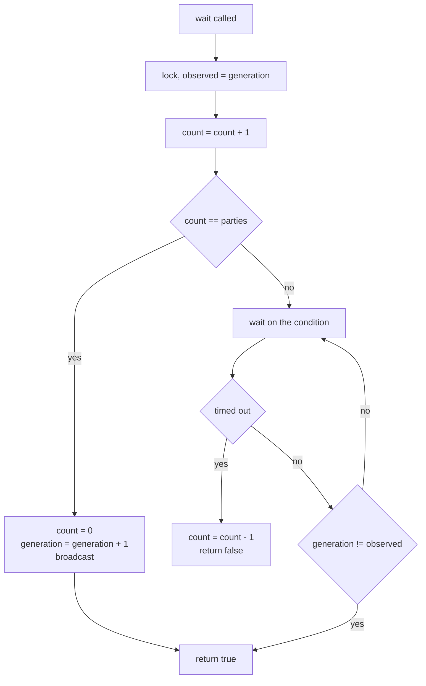
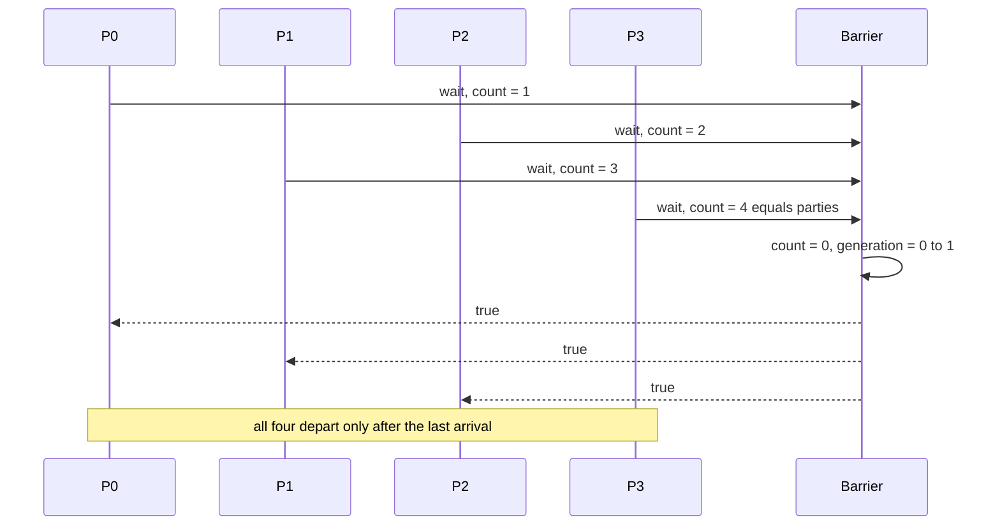
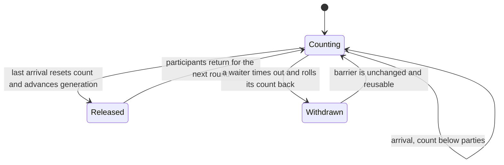

# 349 — Reusable barrier synchronization primitive

> **Tier:** Intermediate · **CTCI chapter:** Ch 15 — Threads and Locks
> **Task spec:** [349-barrier-synchronization-primitive-simple-implementation.md](../../../tasks/intermediate/349-barrier-synchronization-primitive-simple-implementation.md)
> **Solutions:** [Python](../../../solutions/python/intermediate/349-barrier-synchronization-primitive-simple-implementation/solution.py) ·
> [Java](../../../solutions/java/intermediate/349-barrier-synchronization-primitive-simple-implementation/Solution.java) ·
> [JavaScript](../../../solutions/javascript/intermediate/349-barrier-synchronization-primitive-simple-implementation/solution.js) ·
> [C#](../../../solutions/csharp/intermediate/349-barrier-synchronization-primitive-simple-implementation/Solution.cs)

## 1. Problem restatement

Implement a **generation-based, reusable barrier**:

| Member | Signature | Contract |
| --- | --- | --- |
| constructor | `Barrier(parties)` | raises when `parties <= 0` |
| `wait(timeout)` | `bool` | blocks until *all* participants have called `wait` for the current round; `True` for everyone who arrived in time, `False` for a caller that timed out and withdrew |
| `state()` | `(count, generation)` | inspection only |

The barrier must be **reusable**: the same object runs round after round without a reset call. A
barrier with one participant is a documented no-op. A timed-out caller must withdraw its own count so
the barrier stays usable for the remaining participants rather than being permanently stuck one
arrival short.

The scripts in all four files assert the following:

| Check | Value |
| --- | --- |
| Four threads `P0 … P3` run | `5` rounds |
| Total `arrive` records | `4 × 5 = 20`, and likewise `20` `depart` records |
| Per round: `max(arrival sequence) < min(departure sequence)` | nobody leaves a round before every participant arrived in it |
| Per participant: arrival rounds and departure rounds | `[0, 1, 2, 3, 4]` in order |
| Final `state()` of the arena barrier | `(0, 5)` — counter reset, generation advanced once per round |
| `Barrier(1)` used three times | each `wait` returns `True`, final state `(0, 3)` |
| `Barrier(2).wait(timeout=0.05)` alone | `False`, and `state()` is back to `(0, 0)` — the withdrawal worked |
| Two threads on `Barrier(2)` | both return `True`, final state `(0, 1)` |

**Note on the JavaScript file.** Node has no shared-memory threads, so its header documents the
repository's async simulation — suspended participants are stored as promise resolvers — and four
interleaved async tasks run the five rounds. The event log makes the assertions exact rather than
timing-based.

## 2. Intuition

The naive barrier counts arrivals and lets the last one through:

```text
arrived = arrived + 1
if arrived == parties then release everyone
```

That works exactly once. On the second round the counter is already at `parties`, so every `wait`
call finds the barrier "open" and no one ever blocks. Resetting the counter when the last participant
arrives fixes the reuse problem but creates a *new* one: a fast thread that finishes round 1 and
comes back for round 2 can reset the count before a slower thread has even been released from round
1, and the slow thread then blocks forever waiting for a round that has already been counted.

The key insight is to add a **generation number** — a round ordinal that the last arriving
participant increments exactly once. A waiter remembers the generation it saw on entry and sleeps
until that value *changes*; it does not care whether the counter is zero, one or fifteen. Because the
release condition is "my round is over" rather than "the counter reached its target", a thread that
rushes ahead to round 2 cannot corrupt round 1, and the barrier resets itself with no extra call.



Two properties fall out of this shape. First, the barrier is *instantaneously* reusable: the reset
and the release are the same event, so there is no window in which the object is half-reset. Second,
a timeout is recoverable: a waiter that gives up decrements the count it contributed, so the round it
abandoned still completes correctly for the others.

## 3. Algorithm

1. Hold `parties`, a `count` of arrivals in the current round, a `generation` ordinal, and one
   condition variable protecting them.
2. **`wait(timeout)`**: take the internal lock and copy `generation` into a local `observed`.
   Increment `count`. If `count == parties`, reset `count` to zero, increment `generation`, broadcast
   to all waiters and return `True` — this caller is the *last arriver* and needs no sleep.
3. Otherwise loop while `generation == observed`: wait on the condition. If the wait times out, roll
   the arrival back (`count = count - 1`) and return `False`; that is the withdrawal.
4. When the loop exits because `generation` moved on, return `True`.

```text
procedure wait(timeout)
    lock internal
    observed = generation
    count = count + 1
    if count == parties then
        count = 0
        generation = generation + 1
        wake all waiters
        return true
    end
    while generation == observed do
        if waiting on the condition timed out then
            count = count - 1          # withdraw so the round can still complete
            return false
        end
    end
    return true
end
```

The rollback in step 3 is the only place the count ever decreases without a release, and it is what
makes the timeout path safe: the remaining `parties - 1` participants can still reach their target.



A single-participant barrier takes the first branch of the very first test every time: `count` rises
to `1`, which equals `parties`, so the counter is reset, the generation advances and the call returns
`True` without ever sleeping. That is the documented no-op.

## 4. Worked example

Trace `Barrier(4)` through one round, then the reset. Steps are numbered in the order they happen:

| # | Participant | `count` before | `count` after | `generation` | Action |
| --- | --- | --- | --- | --- | --- |
| 1 | `P0` | 0 | 1 | 0 | remembers generation 0, sleeps |
| 2 | `P2` | 1 | 2 | 0 | remembers generation 0, sleeps |
| 3 | `P1` | 2 | 3 | 0 | remembers generation 0, sleeps |
| 4 | `P3` | 3 | 4 | 0 | last arriver: resets to 0, generation becomes 1, broadcasts |
| 5 | `P0`, `P1`, `P2` | 0 | 0 | 1 | wake, see `generation != 0`, return `True` |
| 6 | all four | 0 | 0 | 1 | depart round 0 and start round 1 |

The global event sequence recorded by the script makes the barrier's contract checkable: for round
`r`, the largest sequence number of any `arrive` record is strictly smaller than the smallest
sequence number of any `depart` record of the same round. If even one thread were released early,
that inequality would flip and `"round r released early"` would be the assertion message.



The timeout path is a second, independent flow. With `Barrier(2)` and a `0.05` second timeout:

| # | Actor | `count` | `generation` | Result |
| --- | --- | --- | --- | --- |
| 1 | single caller `wait(0.05)` | 1 | 0 | sleeps, `parties` is 2 |
| 2 | timeout fires | 1 | 0 | withdraws: `count = 0` |
| 3 | same caller | 0 | 0 | returns `False`, and `state()` is `(0, 0)` |
| 4 | thread A `wait(15)`, thread B `wait(15)` | 2 | 0 | B is the last arriver: reset, generation 1, both `True` |

Row 3 is the interesting assertion: the barrier did **not** stay one arrival short. The withdrawing
caller removed its own contribution, so the object is exactly as it was before the attempt, and the
later pair completes normally.



## 5. Complexity

Let `p` be the number of parties and `r` the number of rounds.

| Measure | Bound | Why it holds |
| --- | --- | --- |
| `wait`, last arriver | O(p) once per round | it must wake every sleeping participant, so the broadcast touches all `p - 1` waiters |
| `wait`, other participants | O(1) instructions plus the block/wake latency | one increment, one predicate test, one wait |
| Total work for `r` rounds | O(r · p) | each round releases `p` participants exactly once |
| `state()` | O(1) | two scalars read under the internal lock |
| Space | O(p) | the condition variable's waiter list holds up to `p - 1` entries; no per-round allocation |
| Timeout path | O(1) plus the timeout | one decrement and one return |
| Threads | O(1) extra | the barrier itself creates no threads |

The alternative designs and their costs:

| Design | Reusable | Risk |
| --- | --- | --- |
| Counter only, no generation | no | second round never blocks |
| Counter reset on release, no generation | yes | a fast thread's round-2 arrival can be counted before a slow thread leaves round 1, which then blocks forever |
| Generation counter (shipped) | yes | none observed; the reset and the release are one atomic event under the lock |
| Sense reversal (each waiter flips a private flag) | yes | equivalent to a generation per waiter; needs one flag per participant, O(p) extra state instead of O(1) |

Time is dominated by the *release* broadcast: with `p` participants, one round necessarily involves
`p` wake-ups, so no barrier implementation can be cheaper than O(p) per round. What the generation
design buys is a bounded, constant amount of state per barrier — two integers — rather than per
participant.

## 6. Pitfalls and edge cases

- **Resetting without a generation.** As above, this is the classic round-2 race: a thread that has
  already been released can register its next arrival in the *previous* round's counter. All four
  files compare `generation` against the value observed on entry, so the race cannot happen.
- **The last arriver must not sleep.** If it waits on the condition after broadcasting, it sleeps
  forever — nothing will signal it again until the next round, which cannot start without it. Every
  file returns `True` from the last-arriver branch.
- **Spurious wake-ups.** The wait loop re-tests `generation != observed` after every wake-up, so a
  spurious wake-up or a broadcast meant for another round cannot release a participant early.
- **Withdrawing on timeout.** On a timeout the caller decrements `count` before returning `False`.
  Without the rollback the next round would need one extra arrival, and a `parties`-sized barrier
  whose count is already at `parties - 1` would block the remaining participants forever.
- **`parties <= 0`.** All four constructors raise (`ValueError`, `IllegalArgumentException`,
  `Error`, `ArgumentException`); a zero-party barrier would either divide by zero or never release.
- **`parties == 1`.** Must be a pure no-op that still advances the generation — the script runs three
  waits on a solo barrier and asserts `state() == (0, 3)`.
- **Timeouts in the tests are liveness checks.** The waits use 15 seconds, and the participants are
  daemon threads, so a broken barrier fails the run instead of hanging the process; the only
  deliberately short timeout is `0.05` seconds, in the withdrawal test.
- **No thread may be released twice.** The per-participant assertions check that each participant's
  arrival rounds and departure rounds are exactly `[0, 1, 2, 3, 4]`, which rules out a double release
  or a skipped round.
- **Node has no shared-memory threads.** The JavaScript file implements the barrier with promise
  resolvers and interleaved async tasks; it validates the protocol and the reuse property, not
  memory visibility on a multi-core machine.
- **Fairness is not specified.** The files do not promise which participant leaves first, only the
  all-arrivals-before-any-departure property — which is exactly the inequality the script asserts.

## 7. Variants and follow-ups

- **Timeout semantics with exceptions.** Instead of returning `False`, a timed-out waiter can throw
  and rely on the caller to retry; the withdrawal step is identical, and the barrier stays reusable.
- **Barrier actions.** Some implementations run a callback once per round inside the last arriver's
  critical section, which turns the barrier into a rendezvous point for phase-to-phase reductions.
- **Half-way barriers / counting latch.** A barrier that is *not* reusable is a countdown latch: one
  or more threads wait while others count down without waiting, as in the pool shutdown path of
  [351-implement-thread-pool-basic-with-worker-threads-and-task-queue.md](../../../tasks/intermediate/351-implement-thread-pool-basic-with-worker-threads-and-task-queue.md).
- **Phase synchronisation in fork-join sums.** The recursive split in
  [352-implement-fork-join-style-parallel-sum-threads.md](../../../tasks/intermediate/352-implement-fork-join-style-parallel-sum-threads.md)
  is a join rather than a barrier, but the "wait for all subtasks of this phase" reasoning is the
  same.
- **Single-use latches in the container tasks.** The gate that releases 32 callers at once in
  [350-implement-thread-safe-singleton-double-checked-locking.md](../../../tasks/intermediate/350-implement-thread-safe-singleton-double-checked-locking.md)
  is a one-shot latch, the non-reusable cousin of this barrier.
- **Ordering built on top of a barrier.** A multi-round barrier is the natural base for a phase-ordered
  protocol such as
  [358-dining-philosophers-solution-using-ordered-locks.md](../../../tasks/intermediate/358-dining-philosophers-solution-using-ordered-locks.md),
  and the chapter walkthrough [Threads and Locks](../../ctci/15-threads-and-locks.md) puts the
  primitives side by side.

## 8. Check yourself

1. Why is the generation counter necessary when the count is already reset by the last arriver?

<details><summary>Show answer</summary>

Because a participant can return to round 2 while another participant is still being released from
round 1. Without the generation, the fast thread's new arrival increments the freshly reset counter,
the slow thread's predicate ("all parties arrived") becomes true early for the wrong round, and the
rounds can be observed out of order — or the barrier can release a round with the wrong set of
arrivals. Waiting for *my* generation to end makes each round self-contained.

</details>

2. Why must a caller that times out decrement the count?

<details><summary>Show answer</summary>

Because it already incremented it. If the count stayed high, the barrier would need one more arrival
than there are participants to release, so every later round would block forever. The withdrawal
restores the pre-attempt state exactly — the script asserts `state() == (0, 0)` after a solo timed-out
`wait(0.05)` on a two-party barrier.

</details>

3. What makes the barrier reusable across the five rounds with no explicit reset call?

<details><summary>Show answer</summary>

The reset and the release are the same atomic event. When `count` reaches `parties`, the last arriver
sets `count = 0` and increments `generation` while holding the internal lock, then broadcasts. A
participant that returns later simply observes the new generation. There is never a moment where the
object must be "re-armed" by the caller.

</details>

4. Is `wait` on a barrier with one participant really free?

<details><summary>Show answer</summary>

It costs one lock acquisition and two integer updates. `count` becomes 1, which equals `parties`, so
the fast branch resets the count, advances the generation and returns `True` without ever sleeping.
`state()` afterwards is `(0, n)` for `n` waits — the solo script asserts `(0, 3)`.

</details>

5. What exactly does the script's `max(arrivals) < min(departures)` assertion prove?

<details><summary>Show answer</summary>

That within one round every arrival was recorded before every departure. If any participant were
released early — a missing generation check, a counter reset too soon — its departure would carry a
lower sequence number than some other participant's arrival, and the inequality would fail with
`"round r released early"`. It is a direct, sequence-number-level encoding of the barrier contract.

</details>
