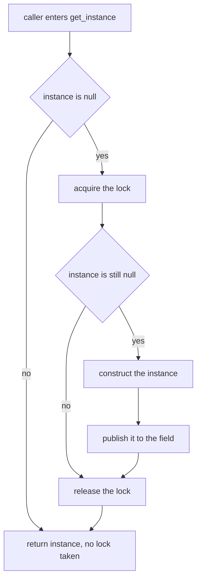
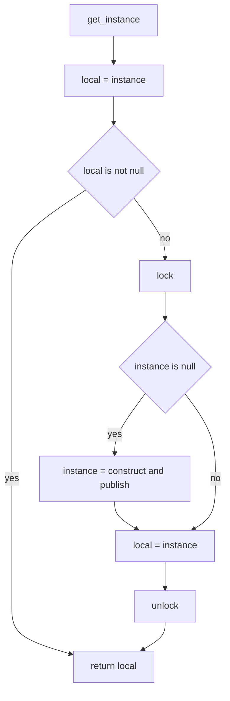
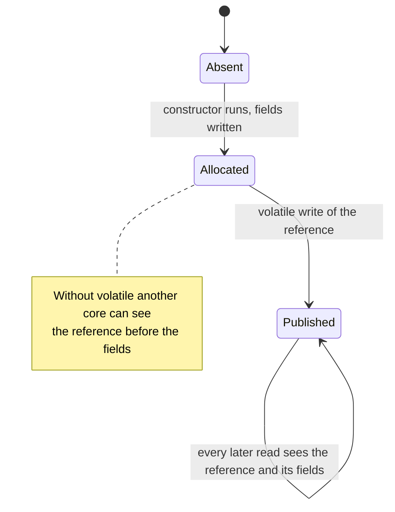
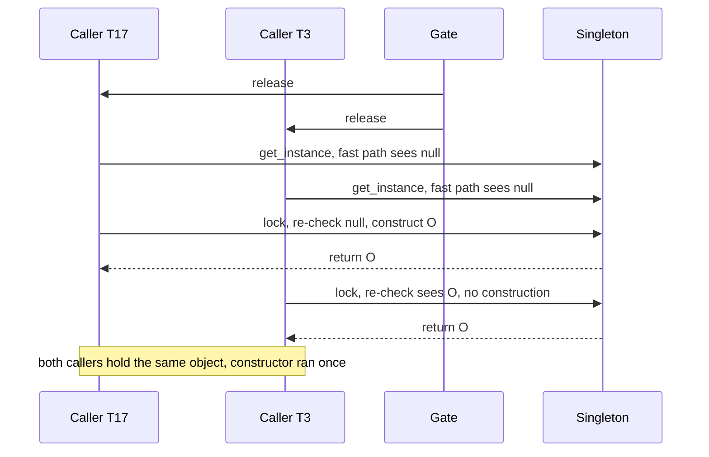

# 350 — Thread-safe singleton with double-checked locking

> **Tier:** Intermediate · **CTCI chapter:** Ch 15 — Threads and Locks
> **Task spec:** [350-implement-thread-safe-singleton-double-checked-locking.md](../../../tasks/intermediate/350-implement-thread-safe-singleton-double-checked-locking.md)
> **Solutions:** [Python](../../../solutions/python/intermediate/350-implement-thread-safe-singleton-double-checked-locking/solution.py) ·
> [Java](../../../solutions/java/intermediate/350-implement-thread-safe-singleton-double-checked-locking/Solution.java) ·
> [JavaScript](../../../solutions/javascript/intermediate/350-implement-thread-safe-singleton-double-checked-locking/solution.js) ·
> [C#](../../../solutions/csharp/intermediate/350-implement-thread-safe-singleton-double-checked-locking/Solution.cs)

## 1. Problem restatement

Implement a **lazily created, thread-safe singleton** using double-checked locking (DCL), and prove it
under a stampede:

| Member | Contract |
| --- | --- |
| `get_instance()` / `getInstance()` / `GetInstance()` | returns the one instance, constructing it on first use |
| `instantiation_count()` | how many times the private constructor has run |
| the constructor | must never be reachable twice |

The scripts assert, for **32 threads released simultaneously through one gate**:

| Check | Value |
| --- | --- |
| Instance count before any caller runs | `0` — creation is genuinely lazy |
| Every caller's result | the *same* object (`is` / identity comparison) |
| `instantiation_count()` after the stampede | exactly `1` |
| A later call to `get_instance()` | returns that same object again |

The gate is a one-shot latch: all 32 threads block on it and the main thread opens it, so the
constructor race — not a sequence of single-threaded calls — is what the test actually exercises.

**Language notes from the headers, because the same shape means different things per runtime:**

- **Python.** CPython needs no `volatile` keyword: the GIL plus the lock's release/acquire pairing
  publish the fully constructed object.
- **Java and C#.** The instance field is marked `volatile` (Java: `private static volatile Singleton
  instance`; C#: `private static volatile Singleton? instance`). Without it, another thread could
  observe a partially initialised instance under the JMM / .NET memory model.
- **JavaScript.** Node runs one thread per process, so DCL is not needed for correctness. The file
  keeps the DCL shape for comparison, notes that synchronous JavaScript runs to the next `await`
  without preemption, and also demonstrates the *real* Node idiom: the module cache, asserted by
  re-requiring the file and checking object identity. `instantiationCount` still proves the
  constructor ran exactly once.

## 2. Intuition

The naive lazy singleton is a plain `if instance is null then create`:

```text
if instance is null then
    instance = new Singleton()
end
return instance
```

Under a stampede, all 32 callers can pass the test before any of them assigns the field, and you get
32 instances — a singleton that is not one. The naive fix is to lock the whole accessor:

```text
lock
if instance is null then
    instance = new Singleton()
end
return instance
unlock
```

That is correct, but every later call pays for the lock even though the answer will never change
again. The key insight of double-checked locking is that the *first* check can be done **outside**
the lock, because the only interesting failure is a wrong answer from a non-null read — and a
non-null read is final. The field, once published, never goes back to null, so:

- **fast path:** read the field without a lock; if it is non-null, return it;
- **slow path:** take the lock, **re-check** (this is what makes it correct — a competitor may have
  won while we were queuing), and create only if still null.



The second check is doing all the work, and it is worth being precise about why: without it, the
thread that waited for the lock would construct a *second* object and overwrite the first, so the
callers that already hold the old object would disagree with the callers that arrive later. With it,
exactly one construction can happen no matter how the scheduler interleaves the 32 callers.

## 3. Algorithm

1. Keep a class-level `instance` field (initially null) and a lock. Keep a counter incremented by
   the constructor.
2. Read `instance` into a local variable on the fast path. If it is non-null, return it.
3. Otherwise acquire the lock and read the field **again**.
4. If the second read is still null, construct the object and publish it to the field (in Java and
   C# this is a volatile write, which is what orders the constructor's effects before the reference
   becomes visible).
5. Release the lock (or leave the critical section) and return the field.

```text
procedure get_instance()
    local = instance                 # fast path: no lock
    if local is not null then
        return local
    end
    lock
    if instance is null then         # re-check under the lock
        instance = construct()       # volatile write publishes it fully
    end
    local = instance
    unlock
    return local
end
```

Step 2 returning from a **local copy** rather than re-reading the field matters in Java and C#: the
local is read once from the volatile field, so the caller cannot observe a value that arrives after
its check. It also gives the fast path exactly one volatile read.



The memory-model half of the algorithm is not visible in the code shape, but it is what the
`volatile` marker guarantees:



## 4. Worked example

The stampede, with 32 callers `T0 … T31` released by a single gate. Callers are shown in the order
they matter, not the order the OS happens to run them:

| # | Caller | Fast-path read | Bookkeeping | Result |
| --- | --- | --- | --- | --- |
| 0 | — | — | `instantiation_count == 0` | lazy: nothing built yet |
| 1 | any | `null` | — | must take the lock |
| 2 | `T17` (wins the lock) | `null` | re-check is still `null` | constructs the instance, count becomes 1 |
| 3 | `T17` | — | reads the field, releases the lock | returns object `O` |
| 4 | `T3`, `T9`, `T28` (queued on the lock) | `null` before queueing | re-check now sees `O` | no construction, return `O` |
| 5 | the other 28 callers | non-null on the fast path | never take the lock | return `O` |
| 6 | later call | non-null on the fast path | — | returns `O` again |

Steps 3 and 4 are the ones a hand-written lock-free variant gets wrong: without the re-check, every
caller that queued *before* `T17` published would construct its own object, and the count would be as
high as the number of simultaneous arrivals. The assertion `instantiation_count() == 1` is a
one-number summary of the whole protocol.



The timing table below is the same scenario written as a scoreboard. "Count" is
`instantiation_count()`:

| Moment | Threads past the fast path | Threads holding the lock | Count | `instance` |
| --- | --- | --- | --- | --- |
| gate opens | 32 | 0 | 0 | none |
| first contention | 32 | 1 (one winner) | 0 | none |
| winner's re-check | 32 | 1 | 1 | `O` |
| winner leaves | 31 | 1 | 1 | `O` |
| queue drains | 0 | 0 | 1 | `O` |
| 1000th call | 0 | 0 | 1 | `O` |

## 5. Complexity

| Measure | Bound | Why it holds |
| --- | --- | --- |
| `get_instance`, fast path | O(1), **no lock** | one volatile read and a comparison |
| `get_instance`, first call | O(1) plus the lock round trip | one lock, one re-check, one construction, one publish |
| `get_instance`, callers that queued during the stampede | O(1) plus the same lock round trip | they only re-read the field under the lock; no construction |
| `instantiation_count` | O(1) | a single counter read |
| Space | O(1) | one reference plus one counter for the whole process |
| Lock acquisitions over `n` calls | at most 1 | every caller after the first sees a non-null fast path |

Comparison with the alternatives:

| Design | Correct under a stampede | Cost per call after the first | Notes |
| --- | --- | --- | --- |
| Unlocked lazy `if null then create` | no | O(1) | 32 callers can construct 32 objects |
| Locked accessor | yes | O(1) but every call takes the lock | the lock becomes a global bottleneck |
| Eager static initialisation | yes | O(1) | no laziness; construction happens even if never used |
| Double-checked locking (shipped) | yes, with a volatile field | one volatile read, no lock | the shape the task asks for |
| Module cache / class-loader initialisation | yes | O(1) | the platform does the DCL for you — the JavaScript file's real idiom |

## 6. Pitfalls and edge cases

- **Doing the work with a single check.** `lock { if instance is null then create }` is correct
  (that is the non-double variant) but pays a lock on every call; `if instance is null then lock …
  create` *without* re-checking creates one object per racing caller. The re-check is mandatory.
- **Missing `volatile` in Java or C#.** Without it, publication is not ordered with respect to the
  constructor's writes, and another thread can legally see a non-null reference to a partially
  initialised object. Both files mark the field `volatile`; the headers say why.
- **Returning a re-read of the field instead of the local.** Reading the field twice on the fast path
  risks returning a value that changed between the two reads; every file copies to a local first.
- **Python has no `volatile`, and does not need one here.** The docstring is explicit: the GIL plus
  the lock's release/acquire pairing publish the fully constructed object. Porting the Java advice
  verbatim to Python is a category error.
- **Node needs none of this.** The JavaScript header states it plainly: one thread per process means
  there is no shared-memory race to guard, synchronous code runs to the next `await` without
  preemption, and the idiomatic singleton is the `require` module cache — which the file asserts by
  re-requiring itself and comparing identity.
- **Eager construction is not laziness.** The script asserts `instantiation_count() == 0` *before*
  releasing the gate; a `static final` instance in Java, a module-level object in JavaScript or a
  class-body construction in Python would fail that first assertion.
- **Counting constructions is the real test.** Object identity alone would pass even if two objects
  were created and only one was kept; `instantiation_count() == 1` is what actually pins the
  protocol down.
- **The private constructor can still be reached by reflection or serialisation.** DCL protects
  against races, not against deliberate bypass: `Constructor.setAccessible`, readResolve hooks and
  cloning are the usual escape hatches, and none of the four files defends against them.
- **Test-only gates.** The 32 callers all block on a single one-shot latch and are released together;
  if the latch were opened before the threads started, the test would degenerate into 32 sequential
  calls and prove nothing about the race.
- **No deadlock, but a lost wake-up is possible in a bad gate.** All gate waits and joins are bounded
  (15 s) and the callers are daemon/background threads, so a broken test fails instead of hanging.
- **Static state is process-wide, not application-wide.** Two class loaders (or two worker threads in
  Node) each get their own `instance`; a singleton is only a singleton inside one loading context.

## 7. Variants and follow-ups

- **Holder idiom (Java/C#).** `static class Holder { static final Singleton INSTANCE = new …; }`
  gives laziness and thread safety with no lock at all, because class initialisation is atomic and
  happens on first use. On the JVM this is the DCL-free answer; the C# equivalent uses a static
  constructor or `Lazy<T>`.
- **Enum singleton.** A single-element enum is serialisation-safe and reflection-safe, at the cost of
  losing lazy initialisation and inheritance.
- **Meyers singleton (C++).** A function-local `static` instance has the same one-time-initialisation
  guarantee; C++11 mandates thread-safe initialisation.
- **`Lazy<T>` with `LazyThreadSafetyMode`.** The .NET library version of this exact protocol, with
  the publication semantics built in rather than spelled out by hand.
- **One-shot gates and reusable barriers.** The stampede gate is a latch; the reusable version — many
  rounds, all participants per round — is
  [349-barrier-synchronization-primitive-simple-implementation.md](../../../tasks/intermediate/349-barrier-synchronization-primitive-simple-implementation.md).
- **Shared mutable state that is not a singleton.** When the object is meant to change after
  publication, DCL is the wrong tool and a versioned record is the right one — see
  [346-implement-optimistic-concurrency-control-sketch-version-numbers.md](../../../tasks/intermediate/346-implement-optimistic-concurrency-control-sketch-version-numbers.md)
  and [360-implement-versioned-key-value-store-basic.md](../../../tasks/intermediate/360-implement-versioned-key-value-store-basic.md).
- The chapter walkthrough [Threads and Locks](../../ctci/15-threads-and-locks.md) develops the
  publication rules that make the `volatile` keyword necessary.

## 8. Check yourself

1. Which of the two checks makes double-checked locking correct, and why?

<details><summary>Show answer</summary>

The **second** check, inside the lock. The first check is only an optimisation: it lets the
overwhelming majority of calls avoid the lock, and a non-null read is final. But several callers can
pass the first check before anyone constructs anything, so the caller that wins the lock must verify
once more that the field is still null — otherwise every queued caller would construct its own
object.

</details>

2. What breaks if the field is not `volatile` in Java or C#?

<details><summary>Show answer</summary>

Without a volatile write, the publication of the reference is not ordered against the constructor's
writes to the object's fields. Another thread can therefore read a non-null reference while the
fields are still default values — a partially initialised object. Java and C# require `volatile` for
this reason; CPython's GIL plus the lock's release/acquire pairing gives Python the same guarantee
without the keyword, and Node has no shared-memory threads at all.

</details>

3. Why does the fast path copy the field into a local before testing it?

<details><summary>Show answer</summary>

To read the volatile field exactly once and to avoid a race in which the field changes between the
test and the use. In Java and C# the local also makes the fast path a single volatile read, which is
the cheapest form of the check, and returning the local guarantees the caller returns the object it
actually tested.

</details>

4. The script asserts `instantiation_count() == 0` before it opens the gate. Why is that the first
   assertion?

<details><summary>Show answer</summary>

Because it proves laziness. A design that constructed the instance at class-load time (a `static
final` field, a module-level object, a Python class-body assignment) would return the right object
and pass every other check while quietly losing the property the task is about. Enabling the gate
only afterwards also means the 32 releases genuinely race on construction.

</details>

5. Node has one thread per process, so why does the JavaScript file keep the DCL shape?

<details><summary>Show answer</summary>

For comparison and for the reader: the header says explicitly that DCL is not needed in Node because
there are no shared-memory races, and that synchronous JavaScript runs to the next `await` without
preemption. The file keeps the guarded check-then-set so it can be lined up against the Java and C#
files, and demonstrates the real Node singleton idiom — the `require` module cache, asserted by
re-requiring itself and comparing identity.

</details>
