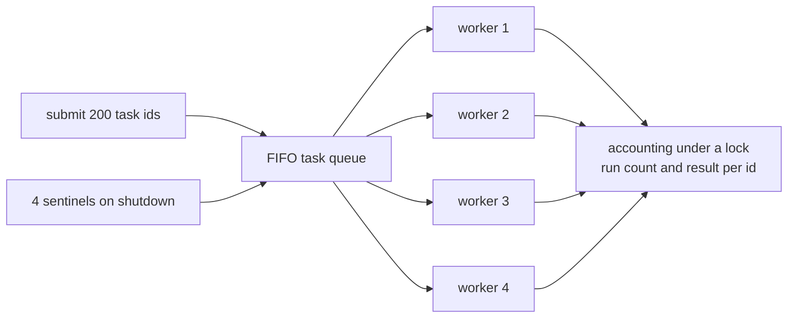
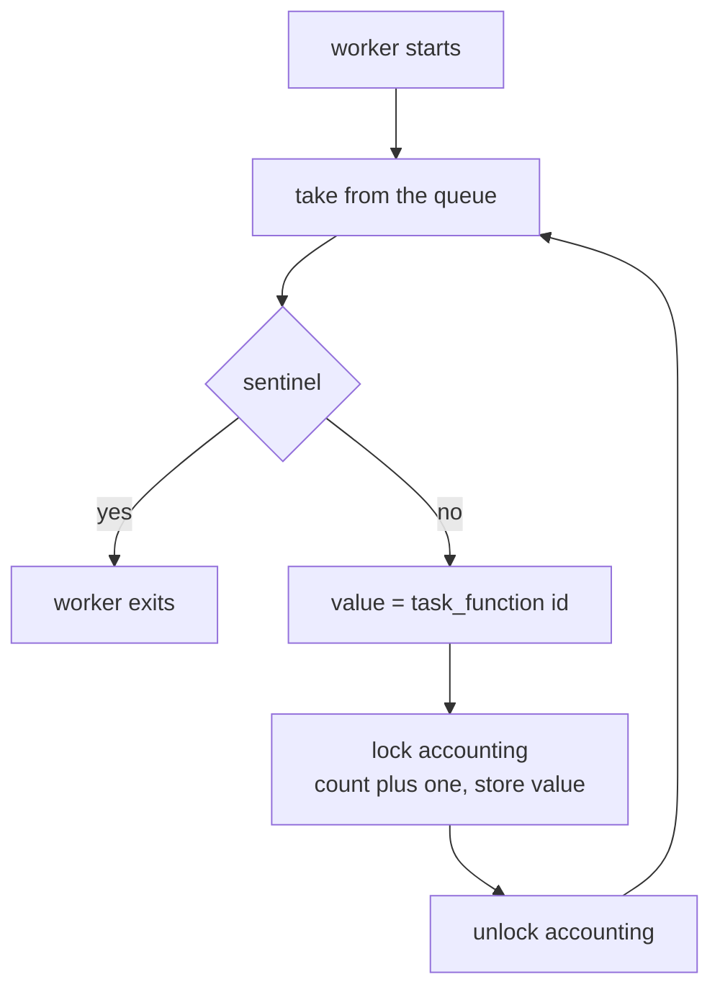
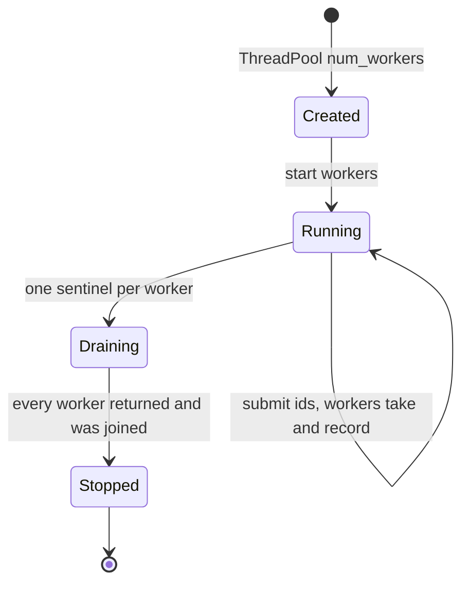
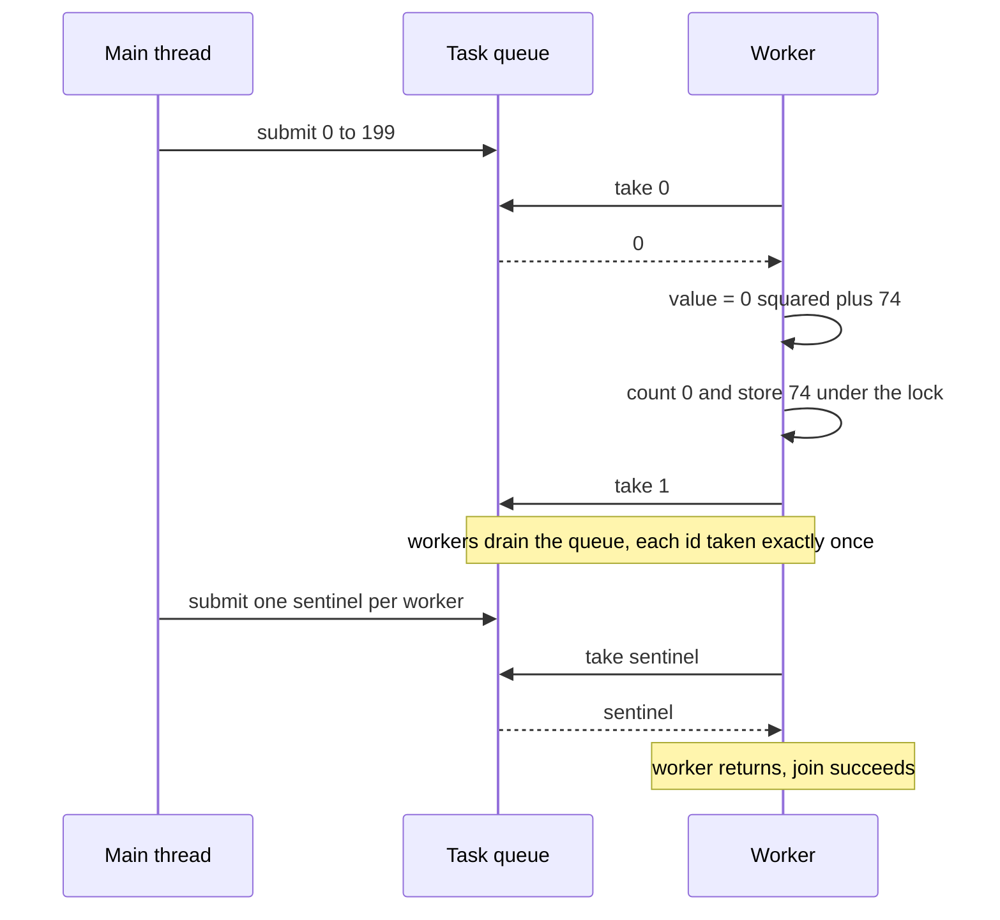

# 351 — Thread pool with worker threads and a task queue

> **Tier:** Intermediate · **CTCI chapter:** Ch 15 — Threads and Locks
> **Task spec:** [351-implement-thread-pool-basic-with-worker-threads-and-task-queue.md](../../../tasks/intermediate/351-implement-thread-pool-basic-with-worker-threads-and-task-queue.md)
> **Solutions:** [Python](../../../solutions/python/intermediate/351-implement-thread-pool-basic-with-worker-threads-and-task-queue/solution.py) ·
> [Java](../../../solutions/java/intermediate/351-implement-thread-pool-basic-with-worker-threads-and-task-queue/Solution.java) ·
> [JavaScript](../../../solutions/javascript/intermediate/351-implement-thread-pool-basic-with-worker-threads-and-task-queue/solution.js) ·
> [C#](../../../solutions/csharp/intermediate/351-implement-thread-pool-basic-with-worker-threads-and-task-queue/Solution.cs)

## 1. Problem restatement

Build a basic **thread pool**: a fixed set of persistent worker threads consuming task ids from one
shared FIFO queue, plus a graceful shutdown that retires every worker.

| Element | Value in the shipped scripts |
| --- | --- |
| Workers | `4` |
| Tasks | `200` task ids, `0 … 199` |
| Queue | FIFO; idle workers block instead of spinning |
| Sentinels | one per worker (Python/JavaScript `None`, Java `-1`, C# a queue-closing flag) |
| Task function | `task_id * task_id + ((task_id * 75 + 74) mod 65537)` |
| Join timeout | 10 s in the pool, so a broken shutdown fails instead of hanging |

Asserted after the run:

- `shutdown_and_wait()` returns `True` — every worker exited within the timeout;
- `pending() == 0` — the queue was fully drained;
- `len(results) == 200` and the sum of all run counts is exactly `200`;
- every task id ran **exactly once** and produced exactly `task_function(task_id)`;
- a second pool submits `5`, `5`, `7`: `run_counts[5] == 2`, `run_counts[7] == 1` — duplicate
  submissions are separate tasks, not deduplicated and not lost.

The payload is deliberately a pure function of the task id, so the pool can be tested for exactly-once
execution without any I/O or timing dependence.

**Language notes from the headers.** Python uses `queue.Queue` (a condition variable underneath) and
a `threading.Lock` around the accounting dictionaries. Java uses a `LinkedBlockingQueue` and a
`SHUTDOWN = -1` sentinel. C# uses a hand-written `TaskQueue` whose idle workers `Monitor.Wait`, with a
closing flag. JavaScript is a documented single-threaded async simulation: `NUM_WORKERS` virtual
workers repeatedly `await TaskQueue.take()`, whose promise waiters stand in for a blocking condition
variable, and the shutdown closes the queue so a worker exits once it has drained the backlog.

## 2. Intuition

Spawning a thread per task is the obvious implementation and the wrong one: a thread costs kernel
state, a stack, and a scheduling decision, so 200 short tasks pay 200 thread creations for a few
milliseconds of work. Worse, an unbounded task stream creates an unbounded number of threads, and the
machine spends its time context-switching rather than computing.

The classic fix decouples *work* from *workers*: keep a small number of threads alive, put tasks on a
queue, and let the queue's blocking `take` handle the waiting. A worker with nothing to do blocks
inside the queue — not on a spin flag — so an idle pool costs nothing.

The key insight is that the queue is the **only** shared state the pattern needs, and its `get`/`put`
already implement the "wait until work exists" protocol. Once the queue is the coordination point,
termination becomes the only design question: a worker cannot know the stream has ended unless the
stream says so, which is what the sentinel does.



Two properties make the design testable. First, **exactly-once** is a property of the queue, not of
the workers: a FIFO queue hands each item to exactly one `get`, so every submitted id runs once.
Second, the accounting is written under a lock, so it is safe to read it from the main thread after
the joins — the joins are what make "after" meaningful.

## 3. Algorithm

1. Create `NUM_WORKERS` worker threads that all run the same loop, plus one FIFO queue that blocks
   when empty.
2. **`submit(id)`** puts the id on the queue. This is the only entry point; it never blocks in a
   way that matters for the test, because the queue is unbounded.
3. **worker loop:** take the next id; if it is the sentinel, return; otherwise compute
   `task_function(id)` and, under the accounting lock, increment `run_counts[id]` and store
   `results[id]`.
4. **`shutdown_and_wait(timeout)`** puts one sentinel per worker on the queue, then joins every
   worker with the timeout and reports whether all of them exited.
5. **`pending()`** reports the queue length, which must be zero after the shutdown.

```text
procedure worker_loop()
    loop forever
        task_id = take next item from the queue      # blocks while the queue is empty
        if task_id is the sentinel then
            return
        end
        value = task_function(task_id)
        lock accounting
        run_counts[task_id] = run_counts[task_id] + 1
        results[task_id] = value
        unlock accounting
    end
end

procedure shutdown_and_wait(timeout)
    for each worker do
        put the sentinel on the queue
    end
    for each worker do
        join the worker with the timeout
    end
    return true when no worker is still alive
end
```

Step 4's one-sentinel-per-worker choice is what makes the shutdown *deterministic*: each sentinel
retires exactly one worker, so no worker is left waiting on a queue that will never receive another
item, and no sentinel is left over to poison a pool that is reused.



The lifecycle of the pool as a whole — created, started, fed, retired — is the other half of the
picture:



## 4. Worked example

Trace the first pool. Task ids are submitted in order, workers take them in FIFO order, and the
accounting is keyed by id, so the table shows the shared state after each event:

| # | Event | Queue length | `run_counts` after | `results` after |
| --- | --- | --- | --- | --- |
| 1 | `start()` | 0 | `{}` | `{}` |
| 2 | submit ids `0 … 199` | 200 | `{}` | `{}` |
| 3 | worker takes `0`, runs it | 199 | `{0: 1}` | `{0: 74}` (`0² + 74`) |
| 4 | worker takes `1`, runs it | 198 | `{0: 1, 1: 1}` | `{0: 74, 1: 150}` |
| 5 | … workers drain in parallel … | shrinking | one entry per completed id | one value per completed id |
| 6 | last task `199` completes | 0 | 200 entries, all `1` | 200 entries |
| 7 | `shutdown_and_wait()` puts 4 sentinels | 4 | unchanged | unchanged |
| 8 | each worker takes one sentinel and returns | 0 | unchanged | unchanged |
| 9 | all joins succeed | 0 | unchanged | unchanged |

Row 3's value is worth checking: `task_function(0) = 0 * 0 + ((0 * 75 + 74) mod 65537) = 74`. Row 4:
`1 * 1 + ((1 * 75 + 74) mod 65537) = 1 + 149 = 150`. The main thread recomputes the whole sequence
sequentially and compares every entry, so a wrong value or a missing result is caught per id, not
just in aggregate.



The duplicate-submission pool is the second script, and it pins down what "task id" means:

| # | Event | Expected accounting |
| --- | --- | --- |
| 1 | `submit(5)`, `submit(5)`, `submit(7)` into a 2-worker pool | — |
| 2 | both `5` submissions run | `run_counts[5] == 2` |
| 3 | the single `7` submission runs | `run_counts[7] == 1` |
| 4 | shutdown | `pending() == 0`, both results equal the sequential values |

The result for `5` is whatever the *last* completion wrote, which is the same value either way because
the task function is pure. That is exactly why a pure function is the right payload for a pool test.

## 5. Complexity

Let `n` be the number of submitted tasks and `w` the number of workers.

| Measure | Bound | Why it holds |
| --- | --- | --- |
| Thread creation cost | O(w) for the whole pool | workers are created once and reused for all `n` tasks, not once per task |
| `submit` | O(1) amortised | one queue insertion; the queue is unbounded so it does not block |
| Per task work | O(1) outside the critical section plus O(1) inside | the task function is constant time and the accounting section is two map writes |
| Total work | O(n) | each task runs exactly once |
| Idle worker | O(1) plus a park | blocked inside the queue's condition variable, not spinning |
| Space | O(w) threads plus O(n) accounting | the queue itself is O(n) at peak; `run_counts`/`results` keep one entry per distinct id |
| Shutdown | O(w) sentinels, O(w) joins | one sentinel retires exactly one worker |
| Ideal wall-clock speedup | up to `w` | limited by the number of runnable cores and by the accounting lock |

The accounting lock is the pool's real bottleneck: every completed task takes it for two dictionary
writes. That is fine for a test, but a throughput-critical pool would shard the counters or use a
concurrent map — the same trade-off as
[353-implement-concurrent-hashmap-simplified-sharding.md](../../../tasks/intermediate/353-implement-concurrent-hashmap-simplified-sharding.md).

Comparison with the alternatives:

| Design | Threads created | Idle cost | Shutdown |
| --- | --- | --- | --- |
| Thread per task | `n` | n/a | natural, but `n` creation costs |
| Pool with a spinning worker loop | `w` | burns a core per idle worker | flag plus polling |
| Pool with a blocking queue (shipped) | `w` | one parked thread each | one sentinel per worker |

## 6. Pitfalls and edge cases

- **One sentinel for all workers.** A single sentinel retires exactly one worker; the rest keep
  blocking on an empty queue and the joins time out. `shutdown_and_wait` puts **one per worker**,
  which is also why `pending()` is asserted to be zero afterwards.
- **Sentinels leaking into a reused pool.** A pool that is started again after a sentinel remains
  queued retires immediately; the scripts build a fresh pool for the duplicate-submission case rather
  than reusing the drained one.
- **Sentinel value collisions.** Java uses `-1` for the sentinel, which would be a legal task id in
  general; the task ids here are `0 … 199`, so the choice is documented and safe. A typed task record
  is the general fix.
- **Unsynchronised accounting.** `run_counts` and `results` are written by all four workers and read
  by the main thread, so every write goes through the accounting lock. Reading them after the joins
  without the lock would additionally need the join to establish a happens-before edge — which it
  does, but the files do not rely on that subtlety.
- **No join, no test.** Without joining before reading the maps, the assertions could run while
  workers are still writing: the "sum of run counts is 200" check would fail nondeterministically.
- **Timeouts on every join.** The joins carry 10 s (Python) or equivalent bounds and the workers are
  daemons/background threads, so a broken shutdown fails an assertion instead of hanging CI.
- **`num_workers <= 0`.** Python and Java raise up front; a pool with zero workers would silently
  queue everything and never run it.
- **Duplicate ids are not deduplicated.** `run_counts[5] == 2` is asserted deliberately: the pool
  executes what it is given, and deduplication is a scheduling or application concern.
- **`pending() == 0` is not a substitute for joining.** A queue can be empty while a worker is still
  computing; only the joins prove the pool has stopped.
- **Idle workers must block, not spin.** Python's `queue.Queue`, Java's `LinkedBlockingQueue`, C#'s
  `Monitor.Wait`, and the JavaScript promise waiters all park the consumer; a spin loop would burn
  four cores for the duration of the run.
- **Node is single-threaded.** The JavaScript pool is a deterministic async simulation — the event
  loop serialises every critical section, so the accounting needs no lock there — and the header says
  that real `worker_threads` would need a module per worker plus message passing.

## 7. Variants and follow-ups

- **Bounded queue with backpressure.** A capacity limit turns `submit` into a blocking call and gives
  the producers a natural place to slow down — the mirror image of
  [348-producer-consumer-using-semaphore-locks-with-multiple-producers.md](../../../tasks/intermediate/348-producer-consumer-using-semaphore-locks-with-multiple-producers.md).
- **Work stealing.** Each worker gets its own deque and steals from the tail of a busy worker's deque,
  which removes the single-queue contention at the cost of complex termination detection — the
  scheduling model Java's `ForkJoinPool` uses and the natural sequel to
  [352-implement-fork-join-style-parallel-sum-threads.md](../../../tasks/intermediate/352-implement-fork-join-style-parallel-sum-threads.md).
- **Future/result handles.** Let `submit` return a handle that a caller can wait on, which turns the
  pool into an asynchronous task API; the accounting maps become per-handle state.
- **Barrier-synchronised rounds.** If the tasks come in phases instead of a stream, replace the
  sentinel with a reusable barrier — see
  [349-barrier-synchronization-primitive-simple-implementation.md](../../../tasks/intermediate/349-barrier-synchronization-primitive-simple-implementation.md).
- **A concurrent id registry.** `run_counts` is a map under one lock; the sharded map in
  [353-implement-concurrent-hashmap-simplified-sharding.md](../../../tasks/intermediate/353-implement-concurrent-hashmap-simplified-sharding.md)
  and the wait-free counter in
  [354-implement-wait-free-counter-sketch-atomic-operations.md](../../../tasks/intermediate/354-implement-wait-free-counter-sketch-atomic-operations.md)
  show how to make that accounting scale.
- **Lazy initialisation of pool state.** The pool itself is built once and shared, which is the same
  publication problem as
  [350-implement-thread-safe-singleton-double-checked-locking.md](../../../tasks/intermediate/350-implement-thread-safe-singleton-double-checked-locking.md),
  and the chapter walkthrough [Threads and Locks](../../ctci/15-threads-and-locks.md) covers the
  surrounding material.

## 8. Check yourself

1. Why is a pool of `w` persistent workers cheaper than one thread per task?

<details><summary>Show answer</summary>

Because thread creation is paid `w` times instead of `n` times. A thread needs kernel bookkeeping, a
stack and a scheduling decision; with 200 short tasks, thread-per-task spends most of its time
creating and tearing down threads. A pool also bounds concurrency, so the machine is not asked to
context-switch between a thousand runnable threads.

</details>

2. Why does `shutdown_and_wait` put one sentinel per worker rather than a single shared one?

<details><summary>Show answer</summary>

Because exactly one `get` removes each sentinel, so a single sentinel retires one worker and leaves
the other three blocked on an empty queue, which then fails the joins. One sentinel per worker also
explains the `pending() == 0` assertion after the shutdown: every sentinel was consumed, by
construction.

</details>

3. What proves "every task ran exactly once", and why is that a property of the queue?

<details><summary>Show answer</summary>

`sum(run_counts.values()) == 200`, plus `run_counts[id] == 1` for each of the 200 ids. A FIFO queue
hands each item to exactly one `get`, so a submitted id cannot be executed twice or skipped; the
accounting merely records what the queue already guaranteed. The duplicate-submission pool confirms
the other direction: two `submit(5)` calls really do run twice.

</details>

4. Where is the pool's contention point, and how would you fix it if throughput mattered?

<details><summary>Show answer</summary>

The accounting lock: every completed task takes it for two dictionary writes, so the serialised
section is short but global. Fixes: shard the counters per worker and merge at the end, use a
concurrent map, or use a lock-free counter as in the wait-free counter task. The single FIFO queue is
the second bottleneck; work stealing removes it.

</details>

5. In the JavaScript file no lock protects the accounting. Why is that consistent rather than a bug?

<details><summary>Show answer</summary>

Because Node's event loop runs one thread per process and the simulation's critical sections contain
no `await`, so nothing can interleave between reading and writing a counter. The header states this
explicitly and notes that real `worker_threads` would need a separate module per worker plus message
passing — at which point the accounting would need the same lock the other three files use.

</details>
