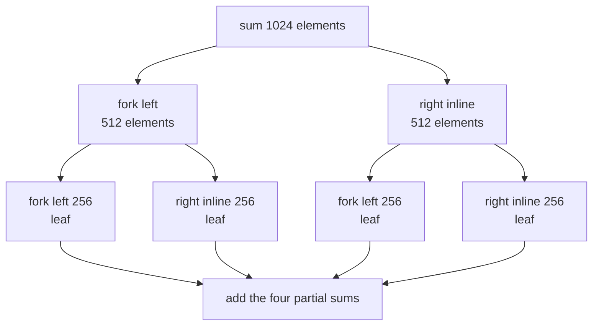
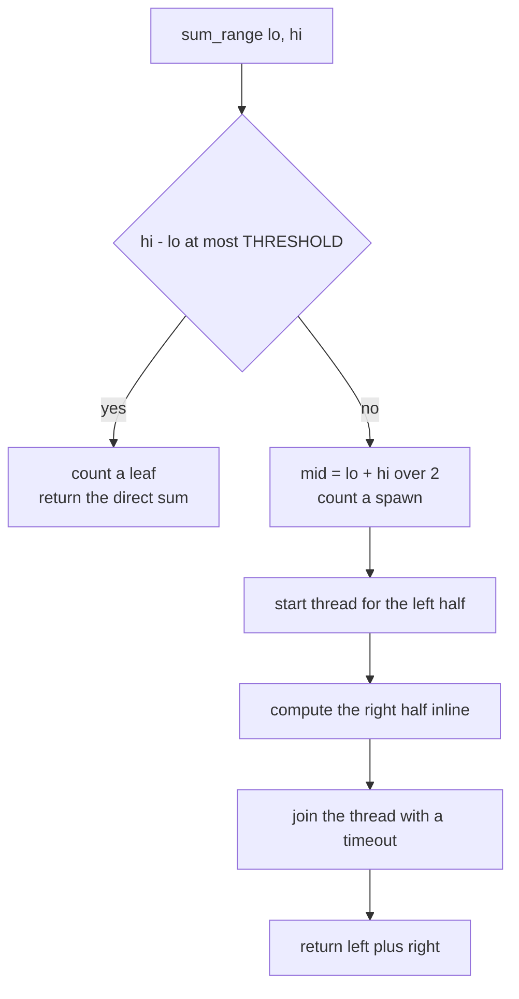
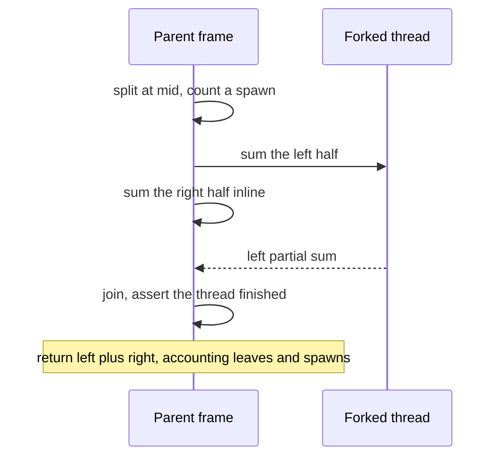
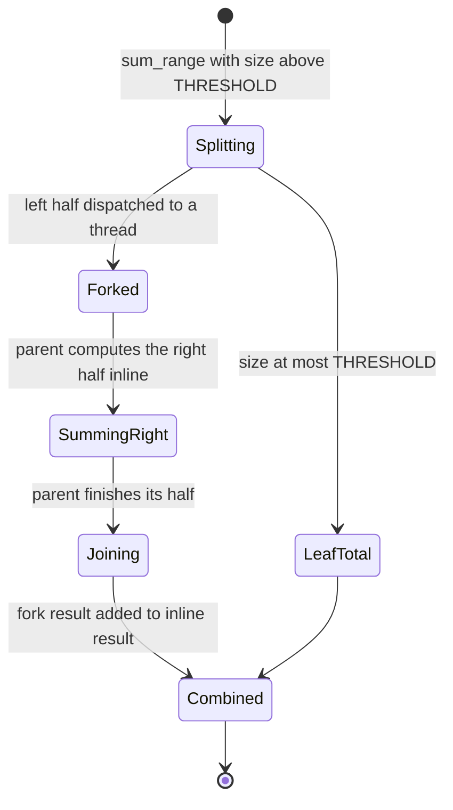

# 352 — Fork-join style parallel sum with threads

> **Tier:** Intermediate · **CTCI chapter:** Ch 15 — Threads and Locks
> **Task spec:** [352-implement-fork-join-style-parallel-sum-threads.md](../../../tasks/intermediate/352-implement-fork-join-style-parallel-sum-threads.md)
> **Solutions:** [Python](../../../solutions/python/intermediate/352-implement-fork-join-style-parallel-sum-threads/solution.py) ·
> [Java](../../../solutions/java/intermediate/352-implement-fork-join-style-parallel-sum-threads/Solution.java) ·
> [JavaScript](../../../solutions/javascript/intermediate/352-implement-fork-join-style-parallel-sum-threads/solution.js) ·
> [C#](../../../solutions/csharp/intermediate/352-implement-fork-join-style-parallel-sum-threads/Solution.cs)

## 1. Problem restatement

Implement a **fork-join style parallel sum** over an array:

| Element | Value in the shipped scripts |
| --- | --- |
| Threshold | `THRESHOLD = 256` — a range of at most 256 elements is a *leaf* and is summed directly |
| Fork policy | a larger range splits at `mid = (lo + hi) / 2`, the **left half runs on a new thread**, the **right half is computed inline**, then the thread is joined |
| Join timeout | 10 s, so a leaked worker fails an assertion instead of hanging |
| Statistics | `leaves` (leaf tasks executed) and `spawned` (threads created) |
| Input generator | `lcg_array(size, seed = 24680)`: `x = (x * 75 + 74) mod 65537` |

Asserted by the scripts:

- the parallel total equals `sequential_sum(values)` for every tested size;
- `stats["leaves"] == count_leaves(size)`, where `count_leaves` is an **independent, iterative**
  oracle that walks the same split policy with an explicit stack;
- `stats["spawned"] == stats["leaves"] - 1` — the split tree is a full binary tree, so its number of
  internal nodes (forks) is exactly one less than its number of leaves;
- for power-of-two sizes, `leaves == size / THRESHOLD` and `spawned == size / THRESHOLD - 1`;
- `8192` splits into exactly `32` leaves and `31` forks; `THRESHOLD` produces `0` forks; `THRESHOLD + 1`
  produces exactly `1`;
- the empty array sums to `0` with `{"leaves": 1, "spawned": 0}` — an empty range is a single leaf;
- the sizes list is `[1, 7, 256, 257, 512, 768, 1024, 2048, 4096, 8192]`, plus 20 further sizes drawn
  from a second LCG (`seed = 9753`, `size = seed mod 3000`), each cross-checked against the sequential
  sum and the leaf oracle.

**Language notes from the headers.** The split is pure arithmetic, so the JavaScript file follows the
documented simulation pattern: `parallelSum` forks the left half as a pending async task while
computing the right half inline, then awaits the fork — the join. Java and C# accumulate the counts
in a small synchronized/locked `Stats` object; Python counts under a `threading.Lock`.

## 2. Intuition

Summing an array is associative, which is the only reason it can be parallelised: the total does not
depend on the order in which the pieces are added, so the array can be chopped into independent
pieces and the partial sums combined afterwards. The naive parallel version splits the array into
`m` fixed chunks and starts `m` threads — but picking `m` is a guess. Too small and the machine is
idle; too large and the thread overheads dominate the addition they were hired to do.

The key insight is to make the split **adaptive**: keep halving the range until a piece is small
enough that the cost of a thread would exceed the cost of just adding the elements. That gives a
recursive "fork the left, do the right here, then join" shape, in which the recursion tree is itself
the schedule — the number of threads is determined by the data size rather than guessed.

Why fork only one half? Because a thread that forks both halves and then immediately blocks has one
core doing nothing while two are working. Keeping one half inline means every level of the recursion
does useful work while its fork runs, so the total number of threads stays `leaves - 1` rather than
exploding to `2^k` threads for a depth-`k` tree.



The threshold is the only tuning knob, and it is a cost model in miniature: below `256` elements the
loop that adds the elements is cheaper than the machinery that would parallelise it.

## 3. Algorithm

1. `sum_range(lo, hi)` decides the leaf case first: if `hi - lo <= THRESHOLD`, count a leaf, add the
   slice directly, and return.
2. Otherwise split at `mid = (lo + hi) / 2`, count a spawn, start a thread running `sum_range(lo, mid)`
   and — **while that thread runs** — call `sum_range(mid, hi)` inline.
3. Join the forked thread with the timeout, assert that it finished, and return the fork's result plus
   the inline result.
4. `parallel_sum(values)` calls `sum_range(0, length)` and returns the total together with the leaf and
   spawn counters.

```text
procedure sum_range(lo, hi)
    if hi - lo <= THRESHOLD then
        lock accounting
        leaves = leaves + 1
        unlock accounting
        return sum of values from lo to hi - 1
    end
    mid = (lo + hi) / 2            # integer division
    lock accounting
    spawned = spawned + 1
    unlock accounting
    start a thread running sum_range(lo, mid), storing its result in fork_result
    right = sum_range(mid, hi)     # computed inline while the fork runs
    join the thread with the timeout
    return fork_result + right
end
```

The accounting counters are incremented **before** the work they describe, which keeps the arithmetic
simple: after a run, `spawned == leaves - 1` because the recursion tree is binary with one fork per
internal node.



A run of the whole array is a sequence of fork/join pairs, each of which overlaps one thread's work
with the parent's:



## 4. Worked example

Trace `parallel_sum` on 1024 elements, which is a power of two:

| Range | Size | Case | Leaves | Spawns | Result |
| --- | --- | --- | --- | --- | --- |
| `[0, 1024)` | 1024 | split at 512 | — | +1 | fork `[0, 512)` |
| `[0, 512)` (forked) | 512 | split at 256 | — | +1 | fork `[0, 256)` |
| `[0, 256)` (forked) | 256 | **leaf** | +1 | — | direct sum, 256 additions |
| `[256, 512)` inline | 256 | **leaf** | +1 | — | direct sum |
| `[512, 1024)` inline | 512 | split at 768 | — | +1 | fork `[512, 768)` |
| `[512, 768)` (forked) | 256 | **leaf** | +1 | — | direct sum |
| `[768, 1024)` inline | 256 | **leaf** | +1 | — | direct sum |
| — | — | totals | **4** | **3** | `4 == 1024 / 256`, `3 == 4 - 1` |

The accounting identity holds exactly: 4 leaves, 3 forks, and `spawned == leaves - 1` because every
internal node of the split tree forks precisely once.

The threshold boundary cases are asserted directly, and they are the ones that catch off-by-one
errors in `hi - lo <= THRESHOLD`:

| Size | Leaves | Forks | Why |
| --- | --- | --- | --- |
| `256` | 1 | 0 | exactly at the threshold — no split at all |
| `257` | 2 | 1 | one split into `128 + 129`, both leaves |
| `512` | 2 | 1 | `256 + 256` |
| `768` | 4 | 3 | halves of 384 split again; `768 / 256 = 3` but the real leaf count is 4 |
| `1024` | 4 | 3 | `1024 / 256 = 4` |
| `8192` | 32 | 31 | the largest asserted size |

The `768` row is why the scripts assert `leaves == size / THRESHOLD` **only for power-of-two sizes**:
`768 / 256 = 3`, but the powers-of-two split tree produces 4 leaves, and it is the independent
`count_leaves` oracle — not the division — that is the general check.



## 5. Complexity

Let `n` be the array length, `T` the threshold, and `L(n)` the number of leaves.

| Measure | Bound | Why it holds |
| --- | --- | --- |
| Work (total additions) | Θ(n) | every element is added exactly once across all leaves |
| Depth of the recursion | Θ(log(n / T)) | each level halves the range until it is at most `T` |
| Leaves | `L(n) ≤ 2 · ceil(n / T)` for the halving policy | each leaf holds at most `T` elements and at least `T / 2` (except the last) |
| Threads spawned | `L(n) - 1` | a full binary tree has one fewer internal node than leaves; asserted on every run |
| Space, extra | O(n) for the slice copies plus O(log(n / T)) call frames per chain | the leaf step sums a copy of its slice in Python and JavaScript; the depth is logarithmic |
| Wall-clock, ideal | Θ(n / cores) | the tree exposes parallelism proportional to the leaf count |
| Wall-clock, realistic | bounded by the widest level and by thread creation cost | `L(n) - 1` thread creations are pure overhead that the threshold exists to control |

For power-of-two sizes the leaf count is exactly `n / T` and the fork count `n / T - 1`; the general
case needs the oracle because the halving does not always land on multiples of `T`.

Comparison with the alternatives:

| Design | Threads | Parallelism | Risk |
| --- | --- | --- | --- |
| Sequential `sum` | 0 | none | none, but no speedup |
| Fixed chunk per core | `cores` | static and balanced only if the data is | idle cores when the chunks mis-size |
| Fixed chunks of size `T` | `n / T` | high, but each thread is long-lived if the chunks are combined naively | thread count independent of core count |
| Recursive fork-join (shipped) | `L(n) - 1` | adaptive: small inputs never fork, large inputs fan out to the threshold | threshold is a cost-model guess; below it parallelism is skipped by design |

The threshold is what keeps the bound practical: spawning a thread is orders of magnitude more
expensive than adding 256 integers, so ranges at or below `THRESHOLD` are deliberately not split.

## 6. Pitfalls and edge cases

- **Threshold comparison direction.** The leaf case is `hi - lo <= THRESHOLD`, so a range of exactly
  256 elements is a leaf and produces **zero** forks. Using a strict `<` would fork at exactly 256 and
  break both asserted boundary rows.
- **Forking both halves.** Two threads per internal node makes the thread count `2^(depth)` instead of
  `leaves - 1`, and the parent blocks immediately, so one core idles per level. The shipped code forks
  the left half only and computes the right half inline.
- **Forgetting to join.** The forked result is only valid after the join; returning before it is a
  data race on the result holder. Every file joins, asserts the thread is no longer alive, and only
  then adds the two halves.
- **Asserting `leaves == size / THRESHOLD` in general.** It holds for power-of-two sizes only; `768`
  produces 4 leaves, not 3. The general check is the iterative `count_leaves` oracle, which walks the
  same policy independently of the recursive implementation.
- **`spawned == leaves - 1` is a real invariant, not a coincidence.** The split tree is binary with
  one fork per internal node, so the identity holds for every size — and it is the cheapest available
  check that the recursion actually ran and accounted for itself exactly once.
- **Empty array.** `sum_range(0, 0)` satisfies `0 <= THRESHOLD`, so it is a leaf with sum `0`: the
  script asserts `{"leaves": 1, "spawned": 0}` and a total of `0`. Returning *zero* leaves would be
  the natural-looking mistake.
- **Slice copying.** Python and JavaScript sum `values[lo:hi]` and `values.slice(lo, hi)`, which copy
  the leaf range; Java and C# index the shared array directly. The cost is O(n) overall either way,
  because the leaf slices are disjoint.
- **Lock discipline on the counters.** `leaves` and `spawned` are incremented by many threads, so the
  counter update must be under a lock (or `synchronized` in Java, or `lock` in C#). A plain
  `leaves++` from several threads loses counts and the identity assertion would eventually fail.
- **Unbounded thread creation on huge inputs.** Without a threshold, an `n` in the millions would try
  to create hundreds of thousands of threads; the threshold bounds the leaf count, and therefore the
  thread count, by `2 · n / T`.
- **Numbers must match exactly.** The tests compare the parallel total against the sequential total
  with `==`. Epoch integers in JavaScript stay safe here because the LCG values are below 65537 and
  the largest asserted array holds 8192 of them.
- **Node's simulation is single-threaded.** The JavaScript fork is a pending async task, so the join
  is an `await` and the tasks run sequentially; the header states that the *accounting* — fork tree,
  leaf count, spawn count — is what the simulation validates, not wall-clock speedup.
- **Thread creation inside a leaf's parent frame.** The forked thread is joined immediately, so no
  frame outlives its join; a fire-and-forget variant would need a work queue or a pool, as in
  [351-implement-thread-pool-basic-with-worker-threads-and-task-queue.md](../../../tasks/intermediate/351-implement-thread-pool-basic-with-worker-threads-and-task-queue.md).

## 7. Variants and follow-ups

- **Reduce with an associative operation.** The same tree computes products, minima, concatenations —
  anything associative; the only change is the identity element used for the empty range.
- **Scan instead of reduce.** A parallel prefix sum needs a second, upward pass over the same tree,
  which is where the fork-join model starts to pay for itself.
- **Work-stealing pool instead of a thread per fork.** Real fork-join pools submit the forked task to
  a per-thread deque and let idle workers steal it, which bounds the thread count at the core count
  instead of the leaf count; the tree shape and the `leaves`/`spawned` accounting are unchanged.
- **Reusable worker threads.** The pool in
  [351-implement-thread-pool-basic-with-worker-threads-and-task-queue.md](../../../tasks/intermediate/351-implement-thread-pool-basic-with-worker-threads-and-task-queue.md)
  removes the per-fork thread creation cost, which is exactly the overhead the threshold is trying to
  avoid.
- **Phase barriers between passes.** A multi-pass reduction needs every worker to finish a level
  before the next begins — see
  [349-barrier-synchronization-primitive-simple-implementation.md](../../../tasks/intermediate/349-barrier-synchronization-primitive-simple-implementation.md).
- **Concurrent containers for the partial results.** When the reduction writes into a shared map or
  counter instead of returning values, the accounting becomes a concurrent-data-structure problem —
  see [353-implement-concurrent-hashmap-simplified-sharding.md](../../../tasks/intermediate/353-implement-concurrent-hashmap-simplified-sharding.md)
  and [354-implement-wait-free-counter-sketch-atomic-operations.md](../../../tasks/intermediate/354-implement-wait-free-counter-sketch-atomic-operations.md).
- The chapter walkthrough [Threads and Locks](../../ctci/15-threads-and-locks.md) places this task
  next to the other synchronisation exercises.

## 8. Check yourself

1. Why does the recursion fork only the left half instead of both?

<details><summary>Show answer</summary>

Because the parent must have something to do while waiting. Forking both halves and joining
immediately means the parent blocks while two children run, so one core is wasted at every level, and
the thread count grows to `2^depth` rather than `leaves - 1`. Computing one half inline keeps the
parent busy and keeps the fork count at exactly `leaves - 1`.

</details>

2. What is the leaf count for 8192 elements with `THRESHOLD = 256`, and what is the fork count?

<details><summary>Show answer</summary>

32 leaves and 31 forks. The script asserts both directly (`spawned == 31`, `leaves == 8192 / 256`)
and also checks the general identity `spawned == leaves - 1`, which holds because each internal node
of the split tree forks exactly once.

</details>

3. Why is `leaves == size / THRESHOLD` asserted only for power-of-two sizes?

<details><summary>Show answer</summary>

Because halving does not always produce multiples of the threshold. `768` splits into `384 + 384`, and
each `384` splits again into `192 + 192`, giving 4 leaves — but `768 / 256 = 3`. For powers of two
every level stays a multiple of the threshold, so the division is exact; everywhere else the
independent `count_leaves` oracle decides.

</details>

4. What does the empty array produce, and why is one leaf the right answer?

<details><summary>Show answer</summary>

`{"leaves": 1, "spawned": 0}` with a total of `0`. The range `[0, 0)` has size `0`, which is at most
the threshold, so it takes the leaf branch: it counts itself once and returns the sum of nothing. The
task tree therefore has one node — no fork is ever needed, and the identity `spawned == leaves - 1`
still holds.

</details>

5. The sum of 1000 elements is associative, so why is a threshold needed at all?

<details><summary>Show answer</summary>

Because thread creation is not free. Without a threshold, an array of a million elements would spawn
a thread per internal node — hundreds of thousands of threads — and the machine would spend its time
in the scheduler rather than adding numbers. The threshold encodes the cost model: below 256
elements, a direct loop is cheaper than the fork/join machinery, so the recursion stops there and the
thread count stays proportional to `n / T`.

</details>
