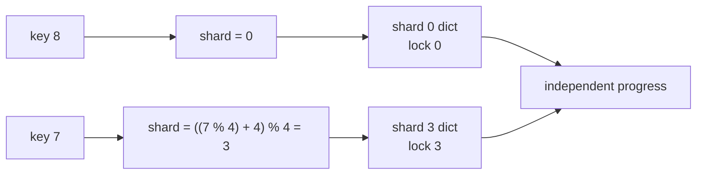
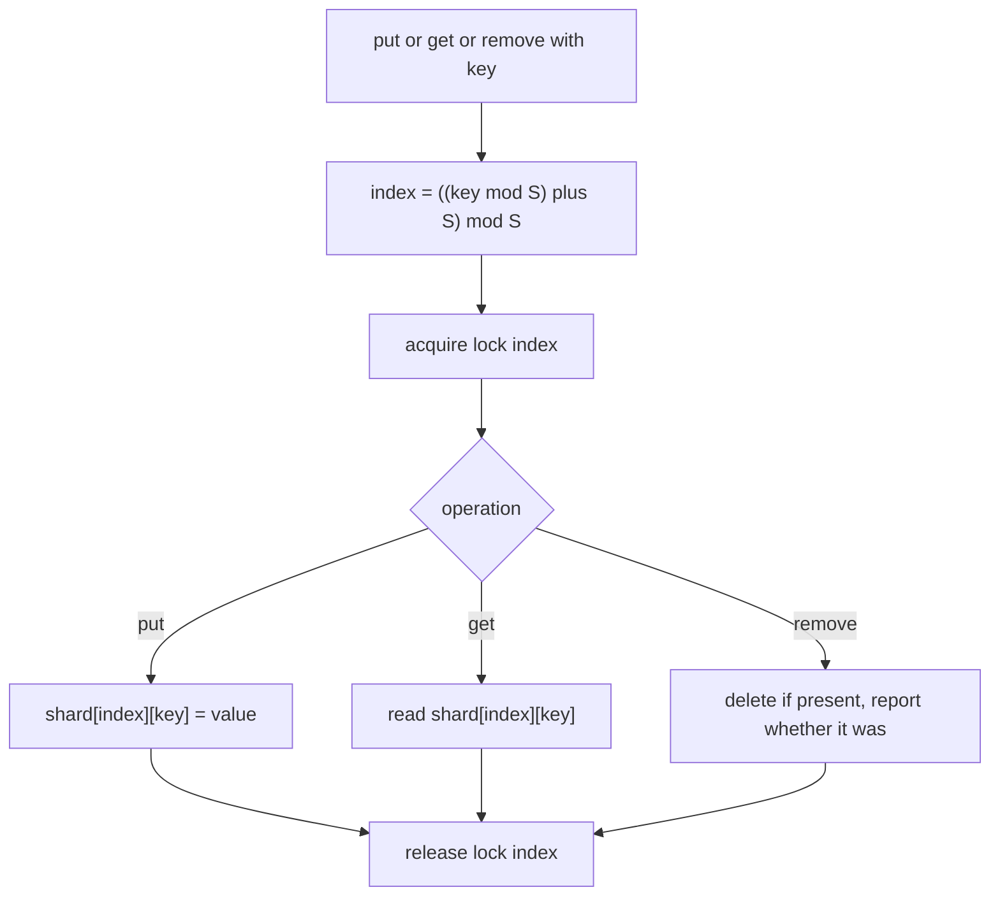
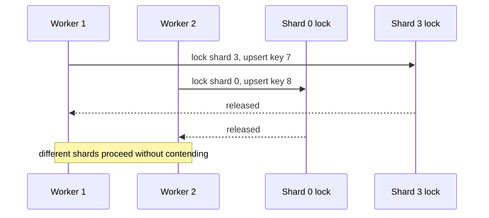
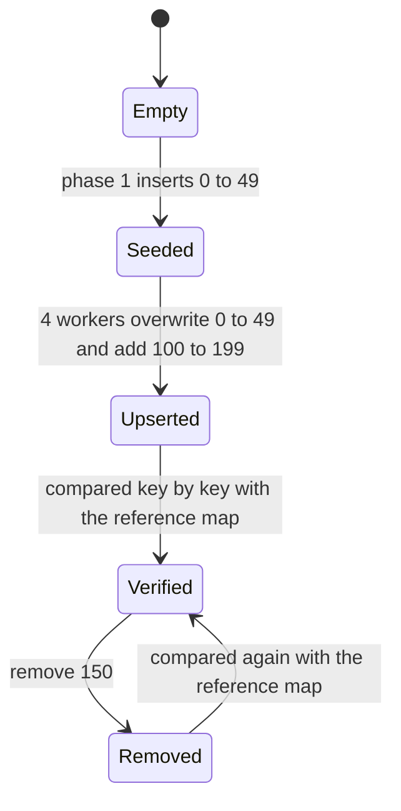

# 353 — Concurrent hashmap (simplified sharding)

> **Tier:** Intermediate · **CTCI chapter:** Ch 15 — Threads and Locks
> **Task spec:** [353-implement-concurrent-hashmap-simplified-sharding.md](../../../tasks/intermediate/353-implement-concurrent-hashmap-simplified-sharding.md)
> **Solutions:** [Python](../../../solutions/python/intermediate/353-implement-concurrent-hashmap-simplified-sharding/solution.py) ·
> [Java](../../../solutions/java/intermediate/353-implement-concurrent-hashmap-simplified-sharding/Solution.java) ·
> [JavaScript](../../../solutions/javascript/intermediate/353-implement-concurrent-hashmap-simplified-sharding/solution.js) ·
> [C#](../../../solutions/csharp/intermediate/353-implement-concurrent-hashmap-simplified-sharding/Solution.cs)

## 1. Problem restatement

Implement a **sharded concurrent map**: a fixed number of independent dictionaries, each behind its
own lock, with a documented routing policy.

| Element | Value in the shipped scripts |
| --- | --- |
| Shards | `SHARDS = 4` |
| Workers in the concurrent phase | `THREADS = 4` |
| Shared keys | `0 … 49` |
| Disjoint key ranges | `100 + 25·t … 124 + 25·t` for thread `t` |
| Routing policy | `shard(key) = ((key % S) + S) % S`, identical in all four languages |

`put`, `get` and `remove` route to one shard and take only that shard's lock; `size` and `keys` walk
all shards, locking each in turn.

Asserted by the scripts:

- phase 1 (single-threaded) inserts `0 … 49`: the shard sizes are exactly `[13, 13, 12, 12]`, and each
  key is found in **exactly** its policy shard (`shards_containing(key) == [shard_index(key)]`);
- negative keys follow the documented normalisation: `shard_index(-1) == 3` and `shard_index(-4) == 0`;
  `-1` round-trips, is removed, and a second removal returns `False`;
- phase 2 (concurrent) has all four threads upsert `0 … 49` with the *same* value per key
  (`key * 3 + 1000`, so any interleaving ends in the same state) and add their disjoint ranges;
- afterwards `size() == 150`, every overlapping key reads back its agreed value, every disjoint key
  reads `key + 1`, and every key is still in exactly its policy shard;
- the map is then compared **key by key** with a single-threaded reference map built from the same
  logical operations, over the whole range `-10 … 259`;
- `remove(150)` returns `True`, the key then reads as missing, a second `remove(150)` returns `False`,
  and the full comparison against the reference is repeated afterwards.

**Language notes from the headers.** Python uses one `threading.Lock` per shard. Java uses
`ReentrantLock`. C# uses `lock` on a per-shard object. JavaScript runs single-threaded, so its header
documents the repository's async simulation: each shard owns an `AsyncMutex` whose promise waiters
stand in for a blocking lock, four virtual "thread" coroutines interleave at every `await`, and the
per-shard lock acquisitions are counted and compared with an independent count derived from the
operation log.

## 2. Intuition

The simplest thread-safe map is a dictionary plus one lock. It is correct and it is a bottleneck: with
four threads, three of them are always queued behind the fourth, and the critical section covers the
whole map even though the operations touch different keys.

The key insight is that a hash map is already a collection of independent buckets, and the user's keys
already partition the key space. If the *shard* is chosen by the key alone — not by which thread is
calling — then two operations on keys in different shards share no state at all and can proceed
genuinely in parallel. Only collisions within one shard are serialised, and with four shards over 50
keys that is a quarter of the map at a time.



The routing function has to be **total and stable** — every key must map to exactly one shard, in
every language, or the tests could not assert `shards_containing(key) == [shard_index(key)]`. That is
why the policy is written as `((key % S) + S) % S` rather than the bare `key % S`: in languages where
`%` keeps the sign of the operand (Java, C#, Python), a negative key would otherwise produce a
negative index — or, as in Python, a *different* shard than the same key mod 4 would suggest
elsewhere. The extra `+ S) % S` normalises `-1` to shard 3 and `-4` to shard 0 in all four files.

## 3. Algorithm

1. Create `S` empty dictionaries and `S` locks. Reject `num_shards <= 0`.
2. **`shard_index(key)`** returns `((key % S) + S) % S`.
3. **`put(key, value)`** computes the shard, takes that shard's lock, and writes the key.
4. **`get(key)`** computes the shard, takes that shard's lock, and reads the key.
5. **`remove(key)`** takes the shard's lock, deletes the key if present, and returns whether it was
   there.
6. **`size()` and `keys()`** take the shards' locks one at a time and combine the results — never all
   at once, which is what keeps a global operation from blocking every shard simultaneously.

```text
procedure shard_index(key)
    count = number of shards
    return ((key mod count) + count) mod count
end

procedure put(key, value)
    index = shard_index(key)
    lock the lock of shard index
    shards[index][key] = value
    unlock
end

procedure get(key)
    index = shard_index(key)
    lock the lock of shard index
    value = shards[index][key] if present
    unlock
    return value
end

procedure remove(key)
    index = shard_index(key)
    lock the lock of shard index
    if shards[index] has key then
        delete shards[index][key]
        result = true
    else
        result = false
    end
    unlock
    return result
end
```

Every operation touches exactly one lock, so the parallelism is real rather than decorative: two
workers on different shards never wait for each other, and the only serialisation is between keys that
share a shard.



The whole-map operations take one lock at a time, which is what makes them usable while workers are
running:



## 4. Worked example

Phase 1 places 50 keys. Let us count shard sizes by hand to check the asserted `[13, 13, 12, 12]`:

| Shard | Keys from `0 … 49` | Count |
| --- | --- | --- |
| 0 | `0, 4, 8, …, 48` | 13 |
| 1 | `1, 5, 9, …, 49` | 13 |
| 2 | `2, 6, 10, …, 42` | 12 |
| 3 | `3, 7, 11, …, 47` | 12 |

The negative-key normalisation is the other hand-checked rule:

| Key | `key % 4` (sign-preserving) | `((key % 4) + 4) % 4` | Shard |
| --- | --- | --- | --- |
| `-1` | `-1` | `3` | 3 |
| `-4` | `0` | `0` | 0 |
| `-5` | `-1` | `3` | 3 |

Phase 2 then runs four workers that all write the *same* value for keys `0 … 49`
(`key * 3 + 1000`) and disjoint values for their own ranges:

| Thread | Overlapping writes | Disjoint writes | Final value for the disjoint keys |
| --- | --- | --- | --- |
| 0 | keys `0 … 49` → `key*3 + 1000` | `100 … 124` | `key + 1` |
| 1 | same | `125 … 149` | `key + 1` |
| 2 | same | `150 … 174` | `key + 1` |
| 3 | same | `175 … 199` | `key + 1` |

Because every thread writes the *same* value for the shared keys, the final state does not depend on
the interleaving — which is what allows the test to assert exact values after a genuinely concurrent
phase. The final count is `50` shared keys plus `100` disjoint keys, i.e. `size() == 150`.



The reference comparison is the strongest check in the script: a single-threaded map is built by
applying the same logical operations in order, and then every key in `-10 … 259` is compared. Any
lost update, stray duplicate or mis-routed key shows up as a mismatch at a specific key.

## 5. Complexity

Let `n` be the number of entries and `S` the number of shards.

| Measure | Bound | Why it holds |
| --- | --- | --- |
| `put` / `get` / `remove` | O(1) expected plus one lock acquisition | one shard lookup, one dictionary operation, one lock |
| `shard_index` | O(1) | two integer operations |
| `size()` | O(S) lock acquisitions, O(S) length reads | the shard lengths must be summed; the entries are not counted individually |
| `keys()` | O(n) | every key is collected, then sorted in the script's helper |
| Contention | at most `1 / S` of the map per operation | only operations that hash to the same shard serialise |
| Space | O(n) plus O(S) locks | each key is stored exactly once |
| Sharding quality | `ceil(n / S)` vs `floor(n / S)` | with 50 keys over 4 shards the sizes are `13, 13, 12, 12` |

Comparison with the alternatives:

| Design | Concurrency | Cost per operation | Notes |
| --- | --- | --- | --- |
| One lock for the whole map | none | one lock, all operations serialised | correct and simple |
| Sharded map (shipped) | up to `S` operations | one shard lock | simple, predictable, and the usual production baseline |
| Lock-free / CAS map | full | CAS retry loop | far harder: needs atomic resize and safe reclamation, see the epoch task |
| Copy-on-write map | readers never block | O(n) per write | only sensible for read-mostly maps |

The load factor is the practical caveat: a bad key distribution can put every hot key in one shard and
recreate the original bottleneck, which is why production maps combine sharding with resizeable
buckets inside each shard.

## 6. Pitfalls and edge cases

- **Negative keys.** A bare `key % S` yields a negative index in Java, C# and Python; the policy is
  `((key % S) + S) % S` in all four files, and the script hand-checks `-1 → 3` and `-4 → 0`.
- **Inconsistent routing between operations.** `put`, `get` and `remove` must all call the same
  `shard_index`; a `get` that hashes differently silently reports every key as missing.
- **Holding two shard locks at once.** `size()` and `keys()` deliberately lock one shard at a time.
  Acquiring them in different orders from two threads is the classic sharded-map deadlock.
- **A global lock for the whole-map operations is still a shared point.** `size()` is not atomic with
  respect to concurrent writers — it is a point-in-time sum of independent shard lengths, and the
  scripts only call it after the joins.
- **`shards_containing` is single-threaded only.** The helper inspects the raw dictionaries without
  locks, and the docstring says so; calling it while workers run would be a data race.
- **Upserts must be order-independent for the test to be deterministic.** The shared phase writes the
  same value per key from every thread precisely so that any interleaving produces the same final map;
  a test that wrote thread-specific values would be asserting on the scheduler.
- **`num_shards <= 0`.** The constructor raises in Python and Java; a zero-shard map would divide by
  zero in `shard_index`.
- **Remove semantics.** `remove` returns whether the key was present, and a second removal returns
  `False` — both asserted. Treating a missing key as an error would break the documented contract.
- **Empty shards are normal.** Any key maps to a shard even when the map is empty, so `get` must
  return a missing value rather than raising.
- **Lock acquisition counts.** The JavaScript simulation counts per-shard acquisitions and compares
  them with an independent count derived from the operation log — a cheap way to prove that each
  operation really did take exactly one shard lock rather than a global one.
- **Node is single-threaded.** The JavaScript `AsyncMutex` is an event-loop stand-in for a blocking
  lock; the interleaving at each `await` is what makes the simulation meaningful, but it says nothing
  about hardware reordering or memory visibility.

## 7. Variants and follow-ups

- **Resizeable shards.** Let each shard own a bucket array that can grow; the top-level routing stays
  the same, and the per-shard resize happens under the shard lock only.
- **Striped counters instead of a whole-map size.** Replace `size()` with a sharded counter so it
  scales — the same pattern as
  [354-implement-wait-free-counter-sketch-atomic-operations.md](../../../tasks/intermediate/354-implement-wait-free-counter-sketch-atomic-operations.md).
- **Lock-free buckets.** A CAS-based bucket list removes the shard lock entirely, at the cost of the
  reclamation problem in
  [355-implement-epoch-based-reclamation-idea-for-concurrent-data-struc.md](../../../tasks/intermediate/355-implement-epoch-based-reclamation-idea-for-concurrent-data-struc.md)
  and the retry-loop discipline of
  [356-implement-lock-free-stack-outline-cas.md](../../../tasks/intermediate/356-implement-lock-free-stack-outline-cas.md).
- **Range scans.** A sharded map cannot iterate in key order; a concurrent skip list or B-tree is the
  structure when ordered traversal matters.
- **Versioned reads and writes.** If readers need a consistent snapshot rather than point reads, layer
  the version checks of
  [346-implement-optimistic-concurrency-control-sketch-version-numbers.md](../../../tasks/intermediate/346-implement-optimistic-concurrency-control-sketch-version-numbers.md)
  or the store of
  [360-implement-versioned-key-value-store-basic.md](../../../tasks/intermediate/360-implement-versioned-key-value-store-basic.md)
  over the shards.
- **Shard selection by thread instead of key.** Choosing the shard from the *calling thread* gives
  allocation-free per-thread maps, but then `get` cannot know where a key lives without a lookup
  table — a different trade-off, and the reason the policy here is key-based.
- The chapter walkthrough [Threads and Locks](../../ctci/15-threads-and-locks.md) puts sharding next
  to the other contention-reduction techniques.

## 8. Check yourself

1. Why does sharding reduce contention even though every operation still takes a lock?

<details><summary>Show answer</summary>

Because the lock is chosen by the *key*, not shared by all operations. Two operations on keys in
different shards take different locks and never wait for each other, so with `S` shards the worst-case
amount of the map that is serialised at any time is one shard. The improvement is proportional to how
evenly the keys spread.

</details>

2. Why is the routing policy written as `((key % S) + S) % S` rather than `key % S`?

<details><summary>Show answer</summary>

Because `%` keeps the sign of its left operand in Java, C# and Python, so `-1 % 4` is `-1`, which is
not a valid shard index. Adding `S` and taking the remainder again normalises every key into
`0 … S - 1`, so `-1 → 3` and `-4 → 0` identically in all four languages. The scripts assert those two
cases by hand.

</details>

3. Why do all four workers in the concurrent phase write the same value for the shared keys?

<details><summary>Show answer</summary>

So the expected final state does not depend on the interleaving. If each worker wrote its own value,
the last writer would win and the test could not assert an exact value — it would be testing the
scheduler. Writing an identical value makes every interleaving produce the same map, so the exact
assertions (`key * 3 + 1000`) stay valid while the operations remain genuinely concurrent.

</details>

4. What exactly does the key-by-key comparison with the reference map catch that `size()` does not?

<details><summary>Show answer</summary>

Everything except the count. A lost update, a duplicated key, a mis-routed key or a stale value all
leave the size unchanged while changing a value for one key. The loop over `-10 … 259` compares every
key against the single-threaded reference, before and after a removal, which is why the script asserts
`mapping.keys() == sorted(reference.keys())` as well.

</details>

5. Why is `shards_containing` documented as single-threaded only?

<details><summary>Show answer</summary>

Because it inspects the raw per-shard dictionaries without taking their locks. During the concurrent
phase another thread could be mutating them, so the check would be a data race and could report a key
in zero or two shards regardless of the implementation's correctness. The scripts only call it in the
single-threaded phase and after the joins.

</details>
