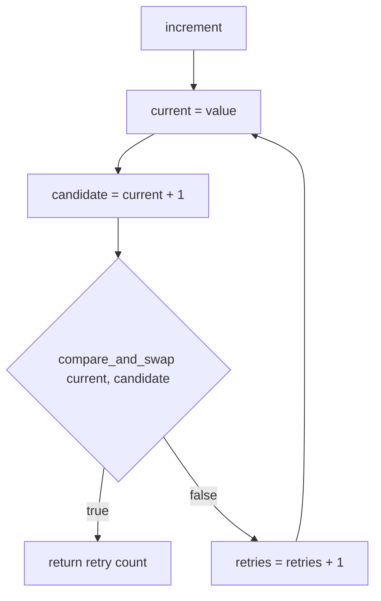
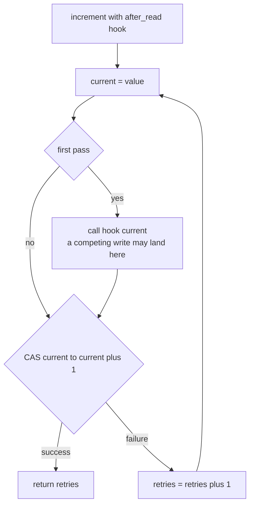
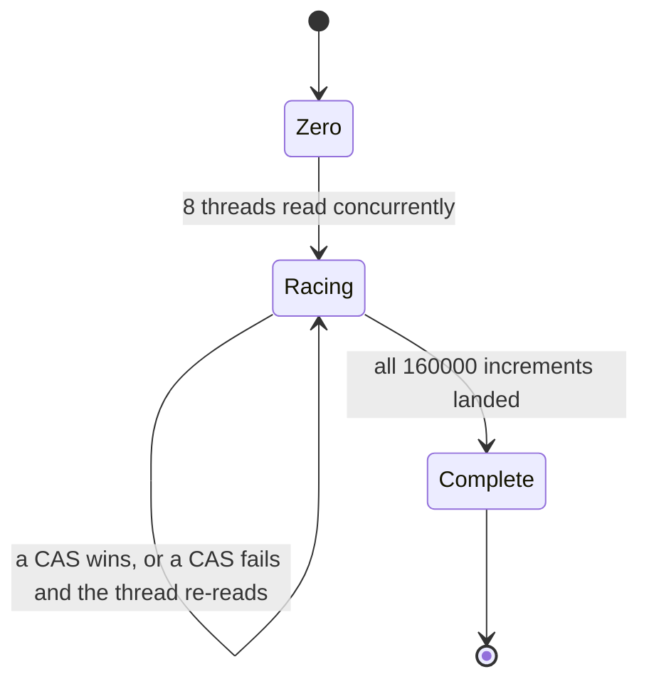
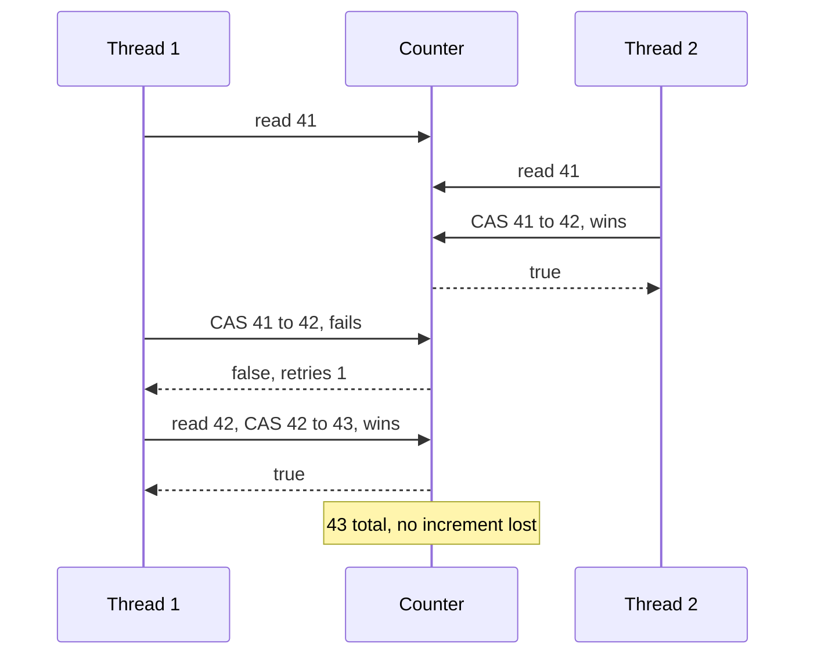

# 354 — Wait-free counter sketch with atomic operations

> **Tier:** Intermediate · **CTCI chapter:** Ch 15 — Threads and Locks
> **Task spec:** [354-implement-wait-free-counter-sketch-atomic-operations.md](../../../tasks/intermediate/354-implement-wait-free-counter-sketch-atomic-operations.md)
> **Solutions:** [Python](../../../solutions/python/intermediate/354-implement-wait-free-counter-sketch-atomic-operations/solution.py) ·
> [Java](../../../solutions/java/intermediate/354-implement-wait-free-counter-sketch-atomic-operations/Solution.java) ·
> [JavaScript](../../../solutions/javascript/intermediate/354-implement-wait-free-counter-sketch-atomic-operations/solution.js) ·
> [C#](../../../solutions/csharp/intermediate/354-implement-wait-free-counter-sketch-atomic-operations/Solution.cs)

## 1. Problem restatement

Implement a counter whose increment is an **explicit compare-and-swap retry loop** instead of `+=`,
and prove that no increment is lost under concurrency.

| Element | Value in the shipped scripts |
| --- | --- |
| Threads | `THREADS = 8` |
| Increments per thread | `INCREMENTS = 20000` |
| Expected total | `160000` |
| Primitive | `compare_and_swap(expected, new_value)` — one indivisible compare+swap |
| Retry loop | `increment()` re-reads and retries while its CAS finds the value stolen |
| Optional hook | `after_read(current)` runs once between the read and the CAS |

Asserted by the scripts:

- a single-threaded baseline of 100 increments returns `0` retries each time, ends at `100`, and
  records `100` CAS attempts with `0` failures;
- the deterministic retry demonstration: an `after_read` hook performs a competing CAS, so the outer
  `increment()` sees its value stolen and returns exactly `1` retry, with the counter ending at `2` —
  one write from the "thief" and one from the retried increment;
- after 8 threads × 20000 increments, `get() == 160000` — **no increment lost**;
- every per-thread retry counter is `>= 0`, and the files note that it is legitimately `0` when the
  runtime hides every race;
- the CAS bookkeeping is exact: `sum(retries) == cas_failures` and
  `cas_attempts == THREADS * INCREMENTS + cas_failures`.

**Honest naming, stated in every header.** A CAS retry loop is **lock-free, not wait-free**: one thread
can be overtaken repeatedly while the others make progress. The wait-free primitive behind "wait-free
counters" is fetch-and-add — `getAndAdd` on Java's `AtomicLong`, `Interlocked.Add` in .NET. The files
implement the CAS sketch as the task asks and say so explicitly.

**Language notes from the headers.** Java builds the loop over `AtomicLong`; C# over
`Interlocked.CompareExchange`; Python takes a tiny lock around only the compare+swap pair to stand in
for the hardware instruction; JavaScript runs one thread, so its `compareAndSwap` is a plain compare
plus store on a holder object, trivially atomic with respect to the event loop.

## 2. Intuition

`counter += 1` compiles to three steps: read the value, add one, write it back. Two threads that
interleave between the read and the write both compute the same sum and both store it, so one
increment disappears. Wrapping the whole statement in a lock fixes it and serialises every increment
behind one mutex — fine for a test, painful for a hot counter that many threads touch constantly.

The key insight is that the *unit of atomicity* does not have to be the whole increment. It only has
to be the pair "compare, and if unchanged swap". With that one indivisible instruction, the increment
becomes a **retry loop**:

1. read the current value;
2. compute the candidate;
3. CAS: install the candidate only if the value is still the one you read;
4. if the CAS reports the value was stolen, go back to step 1.

No thread ever blocks: a lost race costs a re-read and a re-computation, not a sleep. That is what
makes the pattern "lock-free" — the system as a whole always makes progress, even though an individual
thread may retry.



The template is worth remembering beyond counters: replace `current + 1` with any pure function of the
current value (the new head of a stack, the new tail of a queue) and the same loop works, as long as
the CAS covers *the whole state you read*.

## 3. Algorithm

1. Keep the value in a field, plus a tiny lock that stands in for the single hardware CAS instruction
   (Java and C# use the platform's atomic type directly, so no lock is needed there).
2. **`compare_and_swap(expected, new_value)`** records an attempt; if the current value equals
   `expected`, store `new_value` and return `True`; otherwise record a failure and return `False`.
   Only this compare+swap pair is atomic — never the surrounding increment.
3. **`increment(after_read)`** loops: read the value, optionally fire the `after_read` hook once, then
   CAS `current → current + 1`. On success return the number of retries; on failure increment the
   retry counter and loop.
4. `get()` reads the value.

```text
procedure compare_and_swap(expected, new_value)
    lock cas
    attempts = attempts + 1
    if value == expected then
        value = new_value
        unlock cas
        return true
    end
    failures = failures + 1
    unlock cas
    return false
end

procedure increment(after_read)
    retries = 0
    hook = after_read
    loop forever
        current = value
        if hook is set then
            call hook with current      # used only by the self-test
            hook = unset
        end
        if compare_and_swap(current, current + 1) then
            return retries
        end
        retries = retries + 1
    end
end
```

The hook fires exactly once per `increment`, *after* the value was read and *before* the CAS, which is
precisely the window a real competing writer would exploit. That single line turns a probabilistic race
into a deterministic one.



The counter's lifecycle under 8 threads is a race between reads and CAS wins, with the total holding
regardless of who wins:



## 4. Worked example

The deterministic retry demonstration is the clearest trace. `after_read` performs the competing CAS
itself, so the loss is guaranteed rather than lucky:

| # | Step | `value` | CAS attempts | CAS failures | `increment` retries |
| --- | --- | --- | --- | --- | --- |
| 1 | `increment(after_read = thief)` reads `0` | 0 | 0 | 0 | 0 |
| 2 | hook fires: `CAS(0, 1)` | 1 | 1 | 0 | 0 |
| 3 | outer `CAS(0, 1)` — expected value is stale | 1 | 2 | 1 | — |
| 4 | retry: read `1` | 1 | 2 | 1 | 1 |
| 5 | outer `CAS(1, 2)` succeeds | 2 | 3 | 1 | 1 |
| 6 | `increment` returns `1` | 2 | 3 | 1 | 1 |

Row 3 is the failure the hook exists to force; row 5 is the recovery. The final value is `2` because
both the thief and the retried increment are counted, and the returned retry count is exactly `1`.

The single-threaded baseline shows the other extreme:

| # | Step | `value` | Attempts | Failures | Retries returned |
| --- | --- | --- | --- | --- | --- |
| 1 | first `increment()` | 1 | 1 | 0 | 0 |
| 2 | … 100 calls in total … | 100 | 100 | 0 | 0 |
| 3 | assertions | 100 | 100 | 0 | `0` each |

The concurrent phase then interleaves 8 × 20000 increments, and the accounting identities tie the
retries to the failures exactly:

| Quantity | Relationship asserted |
| --- | --- |
| `value` | `160000` — one increment per call, none lost |
| `sum(retries_per_thread)` | `== cas_failures` — every retry is one failed CAS |
| `cas_attempts` | `== 160000 + cas_failures` — one attempt per successful operation plus the failures |
| each `retries_per_thread` | `>= 0`, and legitimately `0` when the runtime hides the race |



## 5. Complexity

| Measure | Bound | Why it holds |
| --- | --- | --- |
| `compare_and_swap` | O(1) | one comparison and one store, atomically |
| `increment`, uncontended | O(1), one attempt | the first CAS always succeeds |
| `increment`, contended | O(1) expected attempts, unbounded worst case | each failure means another thread committed, so progress is system-wide |
| Total attempts | `THREADS * INCREMENTS + failures` | one successful attempt per increment, plus every retry |
| `get` | O(1) | a single read |
| Space | O(1) | one value plus two counters |
| Progress guarantee | lock-free | at least one thread completes in a bounded number of steps; any individual thread may be overtaken indefinitely |

Comparison with the alternatives:

| Design | Guarantee | Retry cost | Notes |
| --- | --- | --- | --- |
| `value += 1` | none | none | loses updates under interleaving |
| Mutex around the increment | blocking | none, but waiters queue | serialises all threads |
| CAS retry loop (shipped) | lock-free | one re-read per lost race | never blocks; the retries are counted and asserted |
| Fetch-and-add (`getAndAdd`, `Interlocked.Add`) | wait-free | none | each thread completes in a bounded number of its own steps |

The distinction in the last two rows is the one the headers insist on: a CAS loop is *lock-free*
because the system progresses, but not *wait-free* because an individual thread can starve. Under
heavy contention the retry count grows, and that growth is exactly what the failure accounting in the
tests measures.

## 6. Pitfalls and edge cases

- **Calling it wait-free.** The headers say plainly that a CAS retry loop is lock-free, not wait-free,
  and point at fetch-and-add as the wait-free primitive. Repeating the task title as a claim about the
  algorithm would be wrong.
- **Non-atomic read-modify-write inside the CAS emulation.** In Java and C# the atomic type handles it;
  in the Python and JavaScript sketches only the compare+swap pair is protected. Wrapping the whole
  increment in that lock would hide every race and make the retry counters trivially zero.
- **Retries may legitimately be zero.** Under CPython's GIL, or when the scheduler never interleaves a
  read and its CAS, no race is observable. The scripts assert `>= 0` — and reach the retry path
  deterministically through the `after_read` hook instead of hoping for contention.
- **The hook must fire exactly once.** If it fired on every pass, the retry demonstration could loop
  forever or report an inflated retry count; the shipped code clears it after the first call.
- **Stale `expected` after a failed CAS.** The loop re-reads the value at the top of every iteration;
  retrying the CAS with the *old* expected value would fail forever.
- **Exact accounting.** `sum(retries) == cas_failures` and
  `attempts == 160000 + failures` are asserted, so an extra attempt (for example a "peek" that
  increments the attempt counter) would fail the test even though the total was right.
- **Integer width.** Java and C# use 64-bit atomics; the totals here are small, but a 32-bit counter
  would wrap at 2³¹ while the test still expected `160000`.
- **Timeouts and daemons.** Workers join with a 10 s bound and are daemon/background threads, so a
  livelocked loop fails an assertion instead of hanging CI.
- **Node has no preemption inside a synchronous block.** The JavaScript retry counter is documented to
  be `0` there, because a virtual coroutine cannot be interrupted between the read and the CAS; only
  the forced hook exercises the retry path.
- **This is a sketch.** A production counter would use the platform's atomic or fetch-and-add rather
  than a hand-rolled CAS loop whose retry behaviour depends on contention.

## 7. Variants and follow-ups

- **Fetch-and-add.** `value += 1` becomes `getAndAdd(1)` / `Interlocked.Add` — one indivisible
  instruction, no retry loop, and genuinely wait-free. The natural first improvement over this sketch.
- **LongAdder / striped counters.** For high contention, count into per-thread cells and sum on read;
  this is the same sharding idea as
  [353-implement-concurrent-hashmap-simplified-sharding.md](../../../tasks/intermediate/353-implement-concurrent-hashmap-simplified-sharding.md)
  applied to a single integer.
- **CAS on a structure instead of a number.** The identical retry loop swaps a head pointer in
  [356-implement-lock-free-stack-outline-cas.md](../../../tasks/intermediate/356-implement-lock-free-stack-outline-cas.md);
  the ABA hazard appears there because pointers can be recycled, which cannot happen to an integer.
- **Safe reclamation after CAS removal.** A CAS that unlinks a node leaves the question of *when* the
  node can be freed — the epoch scheme in
  [355-implement-epoch-based-reclamation-idea-for-concurrent-data-struc.md](../../../tasks/intermediate/355-implement-epoch-based-reclamation-idea-for-concurrent-data-struc.md).
- **Optimistic transactions instead of CAS.** When several fields must change together, a version check
  is easier to read than nested CAS loops — see
  [346-implement-optimistic-concurrency-control-sketch-version-numbers.md](../../../tasks/intermediate/346-implement-optimistic-concurrency-control-sketch-version-numbers.md).
- **Counters inside a lock-free queue or pool.** Retry accounting shows up again in the task queue of
  [351-implement-thread-pool-basic-with-worker-threads-and-task-queue.md](../../../tasks/intermediate/351-implement-thread-pool-basic-with-worker-threads-and-task-queue.md)
  and in the parallel reduction of
  [352-implement-fork-join-style-parallel-sum-threads.md](../../../tasks/intermediate/352-implement-fork-join-style-parallel-sum-threads.md).
- The chapter walkthrough [Threads and Locks](../../ctci/15-threads-and-locks.md) places atomic
  primitives next to the lock-based tools.

## 8. Check yourself

1. Why is `compare_and_swap` enough to make the increment safe, even though the increment is not
   atomic?

<details><summary>Show answer</summary>

Because the CAS fails whenever the value changed since it was read. A thread that lost the race is told
"your assumption is stale", discards its computed candidate, re-reads and recomputes. Only one thread
can succeed in swapping a given expected value, so no update is ever silently overwritten — the
atomicity of the compare+swap pair is what the whole increment borrows.

</details>

2. Why does the retry counter legitimately read `0` in some runs?

<details><summary>Show answer</summary>

Because a retry only happens when another thread writes between this thread's read and its CAS. Under
CPython's GIL, or with a scheduler that never interleaves that window, the first CAS always succeeds
and the count stays zero. That is why the scripts assert `>= 0` and use the deterministic `after_read`
hook to exercise the retry path with an exactly known answer of `1`.

</details>

3. In the forced-retry example the counter ends at `2`, not `1`. Why?

<details><summary>Show answer</summary>

Because two writes really happened: the hook's competing CAS installed `1`, and the retried outer
increment then installed `2`. The demonstration is not "undo the thief"; it is "notice the theft,
re-read, and add your own increment on top". Both contributions are counted, which is exactly the
no-lost-update property.

</details>

4. What does `cas_attempts == 160000 + cas_failures` prove?

<details><summary>Show answer</summary>

That every successful increment cost exactly one CAS attempt and every retry cost exactly one more.
It ties the instrumented counters to the operation count, so a stray extra attempt — a peek that counts
as an attempt, or a retry that does not — shows up as a mismatch even when the final total is correct.

</details>

5. The task title says "wait-free". What is the accuracy of that label?

<details><summary>Show answer</summary>

It is the sketch's informal name, and the solution headers correct it: a CAS retry loop is
**lock-free** — the system always progresses, but an individual thread can be overtaken indefinitely.
The wait-free way to increment is fetch-and-add (`AtomicLong.getAndAdd`, `Interlocked.Add`), where each
thread completes in a bounded number of its own steps with no retry loop at all.

</details>
