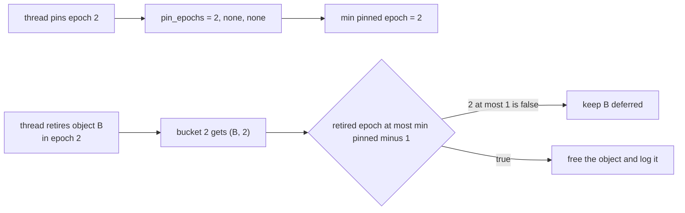
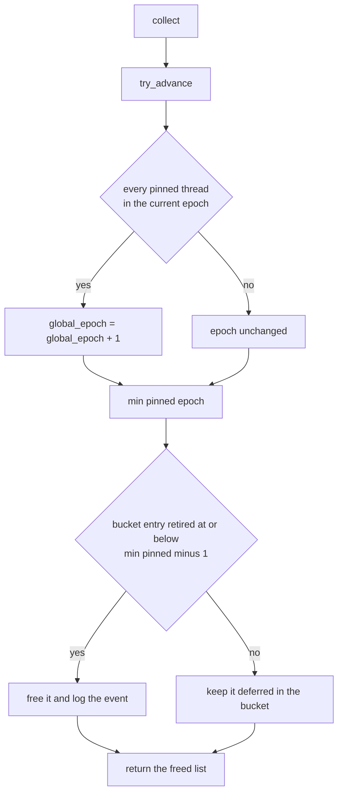
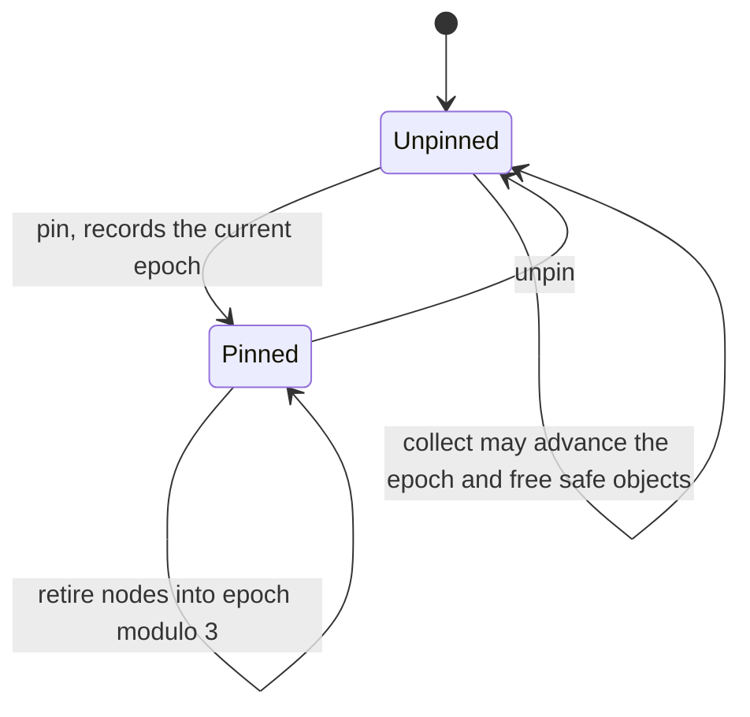
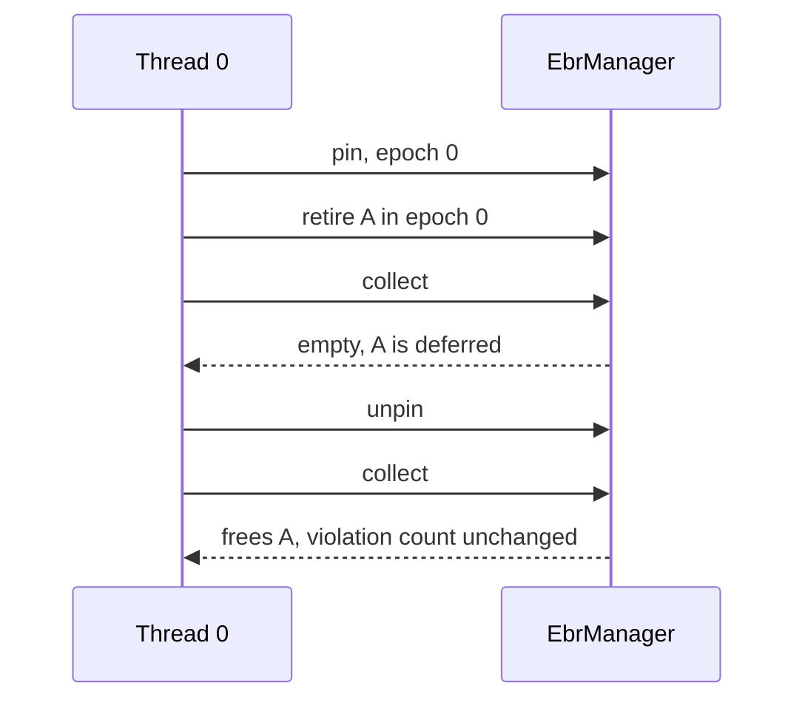

# 355 — Epoch-based reclamation for safe deletes in a concurrent structure

> **Tier:** Intermediate · **CTCI chapter:** Ch 15 — Threads and Locks
> **Task spec:** [355-implement-epoch-based-reclamation-idea-for-concurrent-data-struc.md](../../../tasks/intermediate/355-implement-epoch-based-reclamation-idea-for-concurrent-data-struc.md)
> **Solutions:** [Python](../../../solutions/python/intermediate/355-implement-epoch-based-reclamation-idea-for-concurrent-data-struc/solution.py) ·
> [Java](../../../solutions/java/intermediate/355-implement-epoch-based-reclamation-idea-for-concurrent-data-struc/Solution.java) ·
> [JavaScript](../../../solutions/javascript/intermediate/355-implement-epoch-based-reclamation-idea-for-concurrent-data-struc/solution.js) ·
> [C#](../../../solutions/csharp/intermediate/355-implement-epoch-based-reclamation-idea-for-concurrent-data-struc/Solution.cs)

## 1. Problem restatement

Sketch **epoch-based reclamation (EBR)**: how a lock-free structure can delete a node it has just
unlinked, without freeing memory that another thread is still reading.

| Element | Value in the shipped scripts |
| --- | --- |
| Epochs (retirement buckets) | `EPOCHS = 3` |
| Threads tracked | parameter to the constructor (3 in the self-test) |
| Global counter | monotonically increasing `global_epoch` |
| Per-thread state | `pin(thread)` records the current epoch; `unpin(thread)` clears it |
| Retirement | `retire(thread, object_id)` puts `(object_id, global_epoch)` into bucket `global_epoch % 3` |
| Reclamation | `collect()` first tries to advance the epoch, then frees every retired object the safe rule allows |
| Scripted run | 120 LCG-driven steps over 3 threads, then quiescence |

The **documented free rule** from the docstring: an object retired in epoch `r` may be freed only when
no thread is pinned in an epoch `<= r` — that is, only when `r <= min_pinned_epoch - 1`. With no
pinned threads at all, every retired object is safe. Real EBR frees the bucket from two epochs back;
this conservative rule is strictly safer, and the file says so.

Asserted by the scripts:

| Phase | Assertion |
| --- | --- |
| 1 | `A`, retired in epoch 0, is **not** freed while thread 0 pins epoch 0 — even after an advance |
| 1 | an old pin in epoch 0 keeps `A` deferred after thread 1 pins the current epoch 1 |
| 1 | once thread 0 unpins, `collect()` frees exactly `["A"]` |
| 2 | `B`, retired in epoch 2, stays deferred while another thread still pins epoch 1, and while thread 0 pins its own retirement epoch 2 |
| 2 | `B` frees only at quiescence; `violations == 0` throughout |
| 3 | across 120 LCG-driven steps with pin / unpin / retire / collect, `violations == 0` at every step |
| 3 | the interleaving retires at least 10 objects and **does defer** some (`deferred_entries > 0`) |
| 3 | after unpinning everything, every bucket drains, every retired object is freed exactly once, and `advances >= 1` |

## 2. Intuition

In a lock-free stack, `pop` unlinks a node with a CAS and then wants to free it. It cannot. Another
thread may have read the node's `next` pointer a moment before the unlink and still be traversing it,
so freeing immediately is a use-after-free. Reclamation is the half of lock-free programming that is
easy to forget and impossible to paper over.

Reference counting fails here because the reader does not know, at the moment it reads a pointer,
whether it should have incremented a counter first — the check and the increment are not atomic with
the traversal. Hazard pointers solve it by publishing the specific pointers a thread is about to
dereference; that costs one announcement per read.

Epoch reclamation takes the opposite trade: instead of tracking *what* a thread reads, it tracks
*when* it is active. A reader **pins** itself, performs its traversal, and unpins. A deleter does not
free immediately — it retires the node into a bucket tagged with the current epoch. A node is safe to
free once every thread that was active when the node was retired has finished; in the flat-epoch
formulation that means no thread is pinned in an epoch at or below the retirement epoch.



The epoch counter is what makes this cheap. Advancing it is only allowed when **every** pinned thread
already sits in the current epoch — otherwise a thread stuck in an old epoch could still be traversing
old nodes. Once all threads have moved on, the old epoch's retirees are provably unobservable, and the
whole bucket can be released in one go.

## 3. Algorithm

1. Keep `global_epoch`, an array `pin_epochs` (one slot per thread, `None` when unpinned), three
   retirement buckets keyed by `epoch % 3`, a free log, and a counter of recorded violations.
2. **`pin(thread)`** asserts the thread is not already pinned and stores the current global epoch.
   **`unpin(thread)`** asserts the reverse and clears the slot.
3. **`retire(thread, object_id)`** requires a pinned thread and appends `(object_id, global_epoch)` to
   bucket `global_epoch % 3`.
4. **`try_advance()`** increments `global_epoch` only if every pinned thread is already in the current
   epoch; otherwise it leaves the epoch alone.
5. **`collect()`** calls `try_advance()`, computes `min_pinned_epoch`, then drains every bucket entry
   with `retired_epoch <= min_pinned_epoch - 1` (or all of them when nobody is pinned), keeping the
   rest, and counts the kept entries.
6. Every free is recorded through a helper that re-checks the safety invariant against all pinned
   threads and bumps `violations` if a thread is pinned at or below the retirement epoch.

```text
procedure collect()
    try_advance()                       # allowed only when everyone is in the current epoch
    min_pinned = smallest pinned epoch, or none
    if min_pinned is none then
        safe_epoch = none               # nothing is pinned: everything may go
    else
        safe_epoch = min_pinned - 1
    end
    freed = empty list
    for each bucket do
        kept = empty list
        for each (object_id, retired_epoch) in bucket do
            if safe_epoch is none or retired_epoch <= safe_epoch then
                record a free of object_id with its retirement epoch
                append object_id to freed
            else
                append (object_id, retired_epoch) to kept
            end
        end
        replace the bucket contents with kept
    end
    return freed
end
```

The invariant check inside the free is the difference between a sketch that looks right and one that is
demonstrably right: every single reclamation is validated against the current pin set, and the tests
assert `violations == 0` after every phase and on every step of the scripted run.



A thread's own lifecycle is a simple pin/work/unpin triple, and everything interesting happens in
`collect()`:



## 4. Worked example

Phase 1 and phase 2 are hand-scripted so the blocking conditions are exact. Start with `global_epoch = 0`
and no pins:

| # | Event | `global_epoch` | `pin_epochs` | Buckets after | `collect()` result |
| --- | --- | --- | --- | --- | --- |
| 1 | `pin(0)` | 0 | `[0, None, None]` | empty | — |
| 2 | `retire(0, A)` | 0 | `[0, None, None]` | bucket 0 holds `(A, 0)` | — |
| 3 | `collect()` | 0 | `[0, None, None]` | bucket 0 unchanged | `[]` — thread 0 pins epoch 0 |
| 4 | `pin(1)` | 1 | `[0, 1, None]` | bucket 0 unchanged | — |
| 5 | `collect()` | 1 | `[0, 1, None]` | bucket 0 unchanged | `[]` — the old pin still blocks |
| 6 | `unpin(0)` | 1 | `[None, 1, None]` | bucket 0 **emptied** | `["A"]` — `0 <= 1 - 1` |
| 7 | `pin(0)` | 2 | `[2, 1, None]` | empty | — |
| 8 | `retire(0, B)` | 2 | `[2, 1, None]` | bucket 2 holds `(B, 2)` | — |
| 9 | `collect()` | 2 | `[2, 1, None]` | unchanged | `[]` — thread 1 still pins epoch 1 |
| 10 | `unpin(1)` | 2 | `[2, None, None]` | unchanged | `[]` — thread 0 pins its own epoch 2 |
| 11 | `unpin(0)` | 2 | `[None, None, None]` | bucket 2 **emptied** | `["B"]` — quiescence |

Row 6 is the payoff: the free happens the instant the *last* old pin disappears, and the check inside
`_record_free` confirms that no thread was pinned at or below the retirement epoch at that moment.
Row 10 shows the conservative edge of the rule — a thread pinned in the *same* epoch as the retirement
still blocks the free, which is stricter than real EBR's two-epoch delay and therefore safer.



Phase 3 is the stress script: 120 steps, each drawing a thread index and an action from the repository
LCG (`seed = (seed * 75 + 74) mod 65537`, starting at `4242`), performing pin / unpin / retire / then
always `collect()`, and asserting `violations == 0` at every step. Afterwards:

| Check | Assertion |
| --- | --- |
| Objects retired | `>= 10` |
| Deferrals actually happened | `deferred_entries > 0` — old pins blocked some frees |
| Epoch movement | `advances >= 1` |
| Quiescence | after unpinning everything, every bucket is empty |
| No losses, no duplicates | freed ids sorted equal the retired ids, with no repeats |
| Safety | `violations == 0` for the whole run |

## 5. Complexity

Let `n` be the number of threads and `m` the total number of retired objects in the buckets.

| Measure | Bound | Why it holds |
| --- | --- | --- |
| `pin` / `unpin` | O(1) | one slot read or write |
| `retire` | O(1) | one append into bucket `epoch % 3` |
| `min_pinned_epoch` | O(n) | it scans the pin array, one entry per thread |
| `try_advance` | O(n) | it checks that every pinned thread sits in the current epoch |
| `collect` | O(n + m) | the pin scan plus one pass over every deferred entry |
| Space | O(n + m) | the pin array plus the retirement buckets |
| Reclamation latency | at least one epoch after retirement | an object survives until every thread has left the retired-in epoch |
| Threads | O(1) extra | nobody blocks, nobody sleeps; a pin is a plain write |

The cost that matters is not instruction count but **deferral**: a pinned thread keeps an entire
epoch's retirees alive. That is the space-for-simplicity trade EBR makes — hazard pointers used
O(hazards) memory per thread with per-read announcements, whereas EBR uses O(epochs) buckets and a
single unconditional pin per critical section.

Comparison with the alternatives:

| Reclamation scheme | Reader cost | Memory bound | Notes |
| --- | --- | --- | --- |
| Free immediately | none | O(1) | use-after-free |
| Reference counting | atomic increment per pointer read | O(live references) | the check and increment are not atomic with the traversal |
| Hazard pointers | one published hazard per dereference | O(hazards · threads) | bounded memory, more per-read work |
| Epoch reclamation (shipped sketch) | one pin per critical section | O(epochs) buckets, unbounded if a thread never advances | cheap reads, deferred memory |
| Two-epoch EBR (real form) | same | bucket from two epochs back | frees earlier than the conservative rule used here |

## 6. Pitfalls and edge cases

- **Freeing while a thread pins the retirement epoch.** The rule is `retired_epoch <= min_pinned - 1`,
  so a thread pinned in the *same* epoch as the retirement does block the free. The header notes this
  is stricter than real EBR's two-epoch delay, and phase 2 exists to assert exactly that case.
- **Advancing the epoch with an old pin outstanding.** `try_advance` refuses unless every pinned thread
  is in the current epoch. Advancing anyway would let a stuck thread's traversals be freed.
- **Retiring without pinning.** `retire` asserts that the calling thread is pinned; an unpinned
  retire has no epoch guarantee at all.
- **Double pin or unbalanced unpin.** `pin` asserts the slot is empty and `unpin` asserts it is not, so
  a missing unpin shows up immediately rather than silently holding the whole structure.
- **Counting deferrals.** `deferred_entries` counts what each `collect` had to keep; the script asserts
  it is positive, which proves the old pins really did defer something instead of the test passing
  vacuously.
- **Vacuous success.** A script that never retires anything, or with no overlapping pins, would pass
  every safety assertion. Hence the three extra assertions: at least 10 objects retired, some entry
  deferred, and at least one epoch advance.
- **Draining at quiescence.** With no pins, `safe_epoch` is unset and *every* deferred object is freed;
  the script unpins everything and then asserts all buckets are empty and the freed ids equal the
  retired ids exactly once each.
- **Freeing twice.** The freed-id comparison (`sorted(free_log ids) == sorted(retired)`) with a
  duplicate check catches a double free, which a safety-only test would miss.
- **The violation counter is a diagnostic, not a lock.** `_record_free` counts a violation for each
  pinned thread at or below the retirement epoch; the tests assert it is zero after every phase and
  after every step of the scripted run.
- **This is a deterministic simulation, not a threaded program.** The scripted phases and the LCG
  interleaving pin the timing exactly; no assertion depends on the OS scheduler. What is validated is
  the *rule*, not the memory model.
- **Long-running pinned threads.** A thread that pins and never unpins stalls reclamation forever;
  real EBR implementations bound this with a "stalled thread" fallback, which this sketch does not
  model.

## 7. Variants and follow-ups

- **Two-epoch reclamation.** Free the bucket from `epoch - 2` instead of waiting for `min_pinned - 1`;
  correct when every thread advances within a bounded time, and it frees earlier at the cost of the
  safety proof.
- **Hazard pointers.** Announce the exact pointers being dereferenced; more per-read work, but memory
  is bounded even if a thread stalls.
- **Quiescent-state-based reclamation (QSBR).** The cheapest variant when threads already pass through
  a known idle point: no pins, only "I am outside the critical section" announcements.
- **Using EBR under the lock-free stack.** The pop that unlinks a node must retire it rather than free
  it — see [356-implement-lock-free-stack-outline-cas.md](../../../tasks/intermediate/356-implement-lock-free-stack-outline-cas.md),
  whose header names the ABA hazard that reclamation is the other half of.
- **Atomic bookkeeping.** The retry-loop discipline behind the CAS operations in
  [354-implement-wait-free-counter-sketch-atomic-operations.md](../../../tasks/intermediate/354-implement-wait-free-counter-sketch-atomic-operations.md)
  is what makes an unlink safe to attempt at all.
- **Sharded structures.** Sharding reduces contention but multiplies the number of structures that
  each need reclamation discipline — see
  [353-implement-concurrent-hashmap-simplified-sharding.md](../../../tasks/intermediate/353-implement-concurrent-hashmap-simplified-sharding.md).
- The chapter walkthrough [Threads and Locks](../../ctci/15-threads-and-locks.md) covers the
  synchronisation basics this sketch builds on.

## 8. Check yourself

1. Why can a node not simply be freed right after it is unlinked?

<details><summary>Show answer</summary>

Because another thread may have read the node (or its `next` pointer) a moment before the unlink and
may still be traversing it. Freeing it would be a use-after-free. The unlink and the traversal are not
ordered by any lock, so the structure needs a rule that says "no reader could still hold this" — which
is what an epoch gives you.

</details>

2. What exactly makes an epoch advance legal, and why is that the right condition?

<details><summary>Show answer</summary>

`try_advance` requires every pinned thread to sit in the *current* epoch (unpinned threads do not
matter). Once that holds, no thread can still be looking at nodes retired in an older epoch, so those
retirees can never be observed again. Advancing while a thread is stuck in an old epoch would break
exactly that argument.

</details>

3. Why does the free rule use `min_pinned_epoch - 1` rather than `min_pinned_epoch`?

<details><summary>Show answer</summary>

Because a thread pinned in epoch `r` may be reading objects that were retired in epoch `r` itself. The
conservative rule therefore refuses to free anything retired at or after the smallest pinned epoch,
i.e. it frees only entries with `retired_epoch <= min_pinned - 1`. Real EBR relaxes this to a
two-epoch delay; the file's rule is stricter and therefore safer.

</details>

4. What do `deferred_entries > 0` and `advances >= 1` add to the safety assertions?

<details><summary>Show answer</summary>

They stop the test from passing vacuously. A run with no overlapping pins and no epoch movement would
never have a reason to defer anything, so `violations == 0` would be trivially true. Asserting that
some objects were deferred and that the epoch advanced proves the safety rule was actually exercised
under pressure.

</details>

5. The script never starts a thread. Why is that acceptable for a reclamation sketch?

<details><summary>Show answer</summary>

Because the content of EBR is a *rule about epochs and pins*, and the interesting cases are orderings —
retire before pin, pin before advance, unpin during collect. A scripted interleaving pins those
orderings down exactly, in every language, and the violation counter checks the invariant at each
free. What the simulation cannot show is real memory reuse timing; that would need the hardware CAS and
a real allocator, which the headers flag as the production step.

</details>
