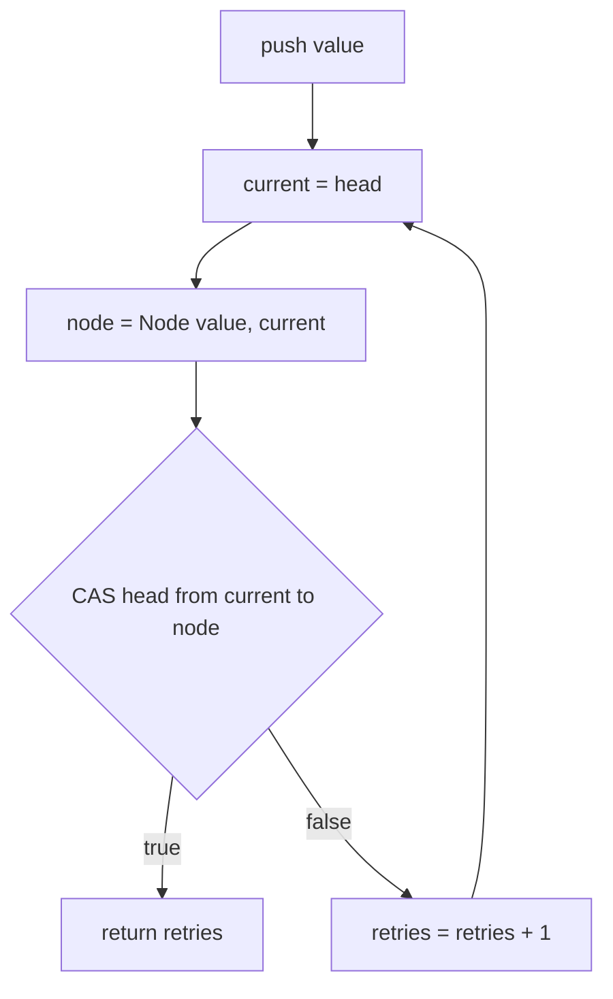
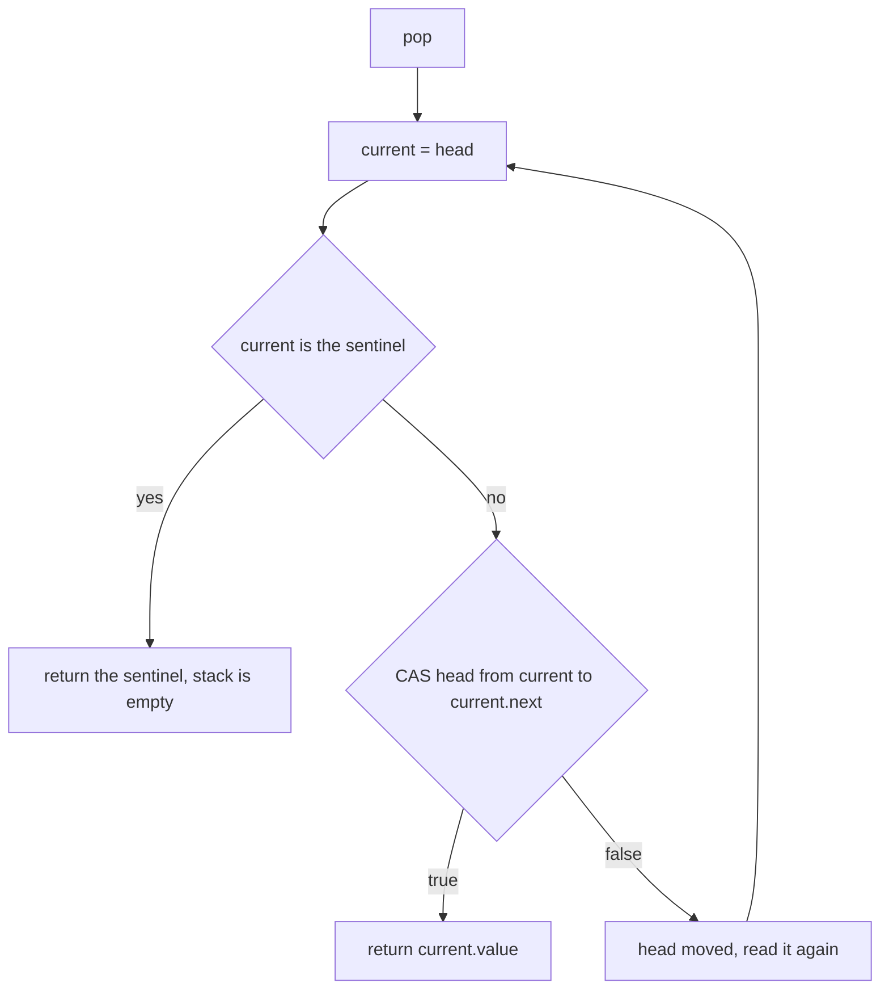
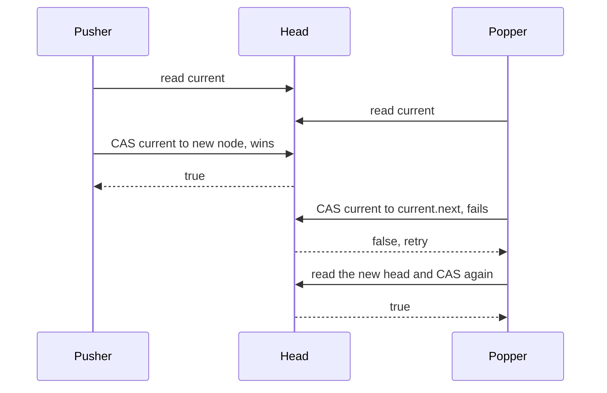
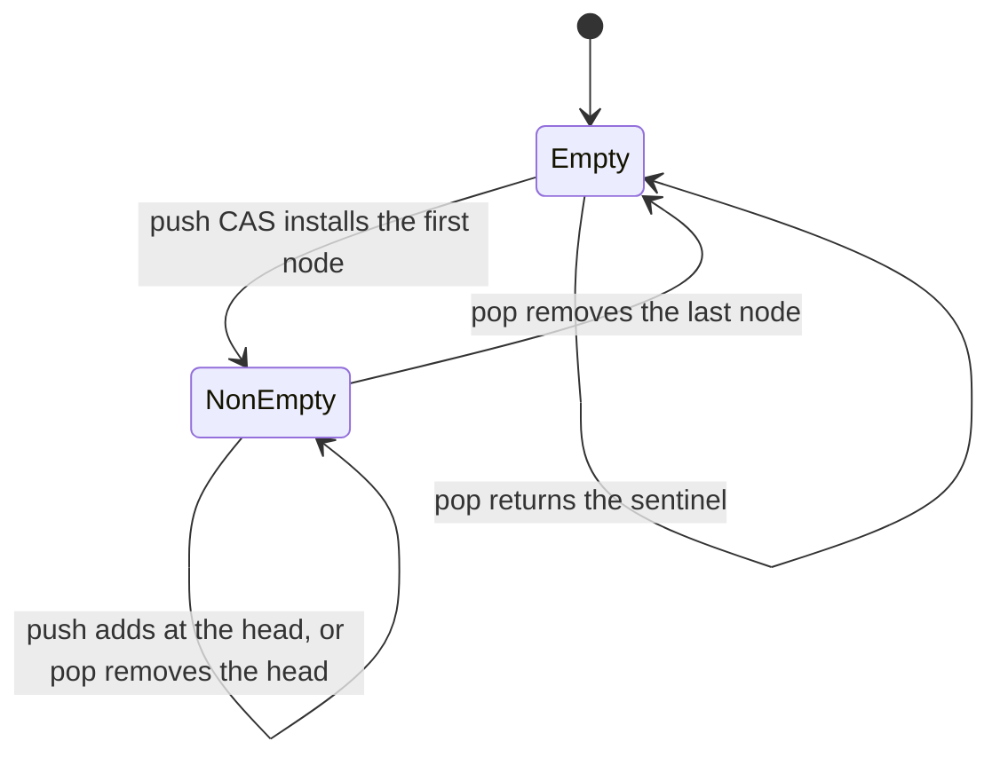

# 356 — Lock-free stack outline (CAS)

> **Tier:** Intermediate · **CTCI chapter:** Ch 15 — Threads and Locks
> **Task spec:** [356-implement-lock-free-stack-outline-cas.md](../../../tasks/intermediate/356-implement-lock-free-stack-outline-cas.md)
> **Solutions:** [Python](../../../solutions/python/intermediate/356-implement-lock-free-stack-outline-cas/solution.py) ·
> [Java](../../../solutions/java/intermediate/356-implement-lock-free-stack-outline-cas/Solution.java) ·
> [JavaScript](../../../solutions/javascript/intermediate/356-implement-lock-free-stack-outline-cas/solution.js) ·
> [C#](../../../solutions/csharp/intermediate/356-implement-lock-free-stack-outline-cas/Solution.cs)

## 1. Problem restatement

Implement a **Michael-Scott style lock-free stack**: `push` and `pop` are CAS retry loops on a single
head pointer, with no lock anywhere.

| Element | Value in the shipped scripts |
| --- | --- |
| Node | a value plus a `next` pointer |
| Shared state | one `head` reference |
| Primitive | `compare_and_swap_head(expected, new_head)` — one indivisible compare+swap |
| Empty sentinel | `None` / `null`; pushed values are integers and can never be the sentinel |
| Pushers | 4 threads × 250 pushes = `1000` nodes |
| Poppers | 4 threads draining until the sentinel |
| Join timeout | 10 s, so a leaked worker fails an assertion instead of hanging |

Asserted by the scripts:

- single-threaded: `pop` on an empty stack returns the sentinel; pushing `1 … 5` and popping five times
  yields `[5, 4, 3, 2, 1]` — LIFO order; the stack is empty again afterwards; and `cas_failures == 0`,
  because a single-threaded script never loses a CAS;
- concurrent pushes: the snapshot holds exactly `1000` values and `sorted(values) == 0 … 999` — no node
  lost, no value duplicated;
- concurrent pops: the union of everything popped holds exactly `1000` values, again sorted `0 … 999`;
  the stack is then empty and `is_empty()` holds;
- CAS accounting: `cas_failures >= 0` (they may legitimately be `0`) and
  `cas_attempts == 2 * total + cas_failures` — one successful attempt per push and per pop, plus every
  retry. The two poppers that stopped on the sentinel made no CAS attempt at all.

**ABA, documented in the header.** Pointer CAS suffers from the ABA hazard — a value that changes away
and back looks unchanged to the CAS. It cannot occur in this test: nodes are never recycled during a
run, and any lost CAS simply retries with a freshly read head. Real deployments pair the stack with a
reclamation scheme such as epoch-based reclamation, which is the previous task in this tier.

**Language notes from the headers.** Java uses `AtomicReference<Node>`; C# uses its own CAS helper over
a class-typed field; Python wraps only the compare+swap pair in a tiny lock to stand in for the
hardware instruction; JavaScript runs one thread, so its `compareAndSwap` is a plain compare plus store
on a holder object — the same indivisible-instruction abstraction, and its four virtual coroutines
interleave at every `await`.

## 2. Intuition

A mutex-protected stack is correct, but every push and pop waits behind the same lock, and the critical
section is tiny — a pointer read and a pointer write. The lock costs far more than the work it
protects.

The key insight is that both operations can be expressed as **"replace the head if it is still what I
read"**, which is exactly what a CAS does:

- `push(value)`: read the head, build `node = Node(value, head)`, then CAS the head from `head` to
  `node`. If the head moved, retry.
- `pop()`: read the head, then CAS the head from `head` to `head.next`. If the head moved, retry; if the
  head is the sentinel, report the stack as empty.

No thread ever blocks. A thread that loses a race does not wait for a lock; it re-reads and tries again,
and because each successful CAS is a linearisation point, the stack is always in a consistent state.



The subtlety that makes `pop` harder than it looks is the empty case: the read of the head and the test
for empty must be followed by the CAS, and the CAS can fail, in which case the *empty test must be
repeated* with the new head. Reading the sentinel is not enough — the value may have been pushed in
between.

## 3. Algorithm

1. Keep one `head` reference, initialised to the empty sentinel, plus a tiny lock around the
   compare+swap pair (only for the languages that lack a native atomic reference) and two counters.
2. **`compare_and_swap_head(expected, new_head)`** records an attempt; if `head is expected`, store
   `new_head` and return `True`; otherwise record a failure and return `False`.
3. **`push(value)`** loops: read `current = head`, build `node = Node(value, current)`, CAS the head
   from `current` to `node`, and return the retry count on success.
4. **`pop()`** loops: read `current = head`; if it is the sentinel, return the sentinel (empty); CAS the
   head from `current` to `current.next`; on success return `current.value`, on failure loop.

```text
procedure push(value)
    retries = 0
    loop forever
        current = head
        node = new Node with value and next = current
        if compare_and_swap_head(current, node) then
            return retries
        end
        retries = retries + 1
    end
end

procedure pop()
    loop forever
        current = head
        if current is the empty sentinel then
            return the empty sentinel
        end
        if compare_and_swap_head(current, current.next) then
            return current.value
        end
    end
end
```

Note that `pop` does not count retries in its return value — it returns the popped value — but every
failed CAS is still recorded, which is why the accounting identity
`attempts == successful operations + failures` holds for both operations together.



A push and a pop racing on the head always resolve in one of two linear orders, and the loser simply
retries with the value it observes:



## 4. Worked example

The single-threaded script first, which pins the LIFO order and the empty sentinel:

| # | Operation | `head` chain before | Result | `head` chain after | CAS failures |
| --- | --- | --- | --- | --- | --- |
| 1 | `pop()` on an empty stack | sentinel | sentinel | sentinel | 0 |
| 2 | `push(1)` | sentinel | — | `1 → sentinel` | 0 |
| 3 | `push(2)` | `1` | — | `2 → 1 → sentinel` | 0 |
| 4 | `push(3)`, `push(4)`, `push(5)` | `2 → 1` | — | `5 → 4 → 3 → 2 → 1` | 0 |
| 5 | `pop()` | `5 → 4 → …` | `5` | `4 → 3 → 2 → 1` | 0 |
| 6 | four more `pop()` calls | shrinking | `4, 3, 2, 1` | sentinel | 0 |
| 7 | `pop()` again | sentinel | sentinel | sentinel | 0 |

Row 5 is the CAS in action: the head went from `5` to `5.next`, which is `4`. The value returned is the
node that was *replaced*, not the new head.

The concurrent phase is where the retry path lives. Four pushers each push 250 distinct values
(`thread_index * 250 + offset`), so any interleaving must end with all 1000 values present:

| Thread | Values pushed | Count |
| --- | --- | --- |
| 0 | `0 … 249` | 250 |
| 1 | `250 … 499` | 250 |
| 2 | `500 … 749` | 250 |
| 3 | `750 … 999` | 250 |

| Check after the pushers join | Expected |
| --- | --- |
| `len(snapshot_values())` | `1000` |
| `sorted(snapshot_values())` | `0 … 999`, each exactly once |
| `cas_attempts` | `1000 + failures` from the push phase alone |

Then four poppers drain the stack until each of them observes the sentinel:

| Check after the poppers join | Expected |
| --- | --- |
| Total values popped | `1000` |
| `sorted(all_popped)` | `0 … 999`, each exactly once |
| `is_empty()` | `True` |
| `cas_attempts` | `2 * 1000 + cas_failures` over both phases |
| `cas_failures` | `>= 0` — may legitimately be `0` when no CAS ever loses |

The last row is the honest part: with a fast machine the threads may never interleave a read and its
CAS, so the failures can be zero. The *counting identity* still holds, and it is what proves that every
retry corresponds to exactly one recorded failure. Because a popper that sees the sentinel returns
without attempting a CAS, the two-and-a-half rounds of "attempts == successes + failures" is exact
rather than approximate.



## 5. Complexity

Let `n` be the number of nodes and `t` the number of threads.

| Measure | Bound | Why it holds |
| --- | --- | --- |
| `push`, uncontended | O(1), one CAS | the first attempt always succeeds |
| `pop`, uncontended | O(1), one CAS | same |
| `push` / `pop`, contended | O(1) expected attempts, unbounded worst case | each failure means another thread committed, so the system progresses |
| Total attempts | `pushes + pops + failures` | asserted exactly by the tests |
| Space per node | O(1) | a value and a pointer |
| Space, auxiliary | O(1) | one head pointer and two counters |
| Progress | lock-free | some thread completes in a bounded number of steps; an individual thread can be overtaken |
| ABA exposure | none in this test | nodes are never recycled during a run, and every retry re-reads the head |

Comparison with the alternatives:

| Design | Contention behaviour | Risk |
| --- | --- | --- |
| Mutex-protected stack | every operation queues on one lock | none, but no concurrency |
| CAS retry loop (shipped) | losers re-read and retry | ABA if nodes are recycled; retries grow under contention |
| Lock-free stack plus hazard pointers or EBR | same, with safe reclamation | the reclamation cost, see [355](../../../tasks/intermediate/355-implement-epoch-based-reclamation-idea-for-concurrent-data-struc.md) |
| Chase-Lev work-stealing deque | per-thread ends, minimal contention | the deque algorithm is much more delicate |

The retry loop's cost is invisible on a lightly loaded machine and dominant on a heavily loaded one:
with `t` threads pushing at once, the expected number of retries per successful operation grows with
`t`, which is why production stacks are usually combined with per-thread pools or reclamation-aware
backoff.

## 6. Pitfalls and edge cases

- **Treating the sentinel as a value.** `None` is both the initial head and the "empty" answer, so
  pushed values must never be the sentinel. The docstring states the invariant: pushed values are
  integers.
- **Testing for empty before the CAS and not re-testing.** After a failed CAS the head may have become
  the sentinel (another thread popped the last node), so the loop must re-read and re-test, exactly as
  the pseudocode does.
- **Returning the new head instead of the popped node.** `pop` returns `current.value`, where `current`
  is the node that *was* the head; `current.next` is the new head.
- **ABA.** If a node could be freed and a new node allocated at the same address, the head could return
  to the value a CAS expects while the stack is logically different. Here nodes are never recycled
  during a run — and the header notes that a real implementation needs reclamation discipline, not just
  a CAS.
- **Freeing the popped node immediately.** The moment `pop` succeeds, another thread may still hold the
  old head pointer; freeing it is a use-after-free. That is exactly the problem of the previous task in
  this tier.
- **Unsynchronised traversal.** `snapshot_values()` walks the chain without CAS. It is only called after
  the pushers have been joined, when the stack is quiescent; calling it concurrently would race on `next`.
- **A lock around the whole push or pop.** The Python and JavaScript sketches wrap only the *compare
  plus swap* pair. Wrapping the whole operation would hide every race, make the failure counters zero
  by construction, and stop testing the retry loop.
- **Retry counters that may legitimately be zero.** The tests assert `cas_failures >= 0`; a fast
  machine with no interleaving can lose no CAS at all, so an equality assertion on "some failure
  happened" would be flaky.
- **Exact accounting.** `cas_attempts == 2 * total + cas_failures` catches an extra attempt (a peek
  that counts, a retry that does not) even when the values and the final emptiness are all correct.
- **Sentinel-terminated drain.** The poppers stop as soon as one of them sees the sentinel, so several may
  exit while another is still popping; the union of everything collected is compared against `0 … 999`.
- **Threads are bounded.** Every join has a 10 s timeout and the threads are daemons, so a live-locked
  loop fails an assertion rather than hanging the process.
- **Identity, not equality.** The Python CAS compares *identity* (`head is expected`), which is the
  correct pointer semantics; comparing values would let two equal values defeat the CAS.

## 7. Variants and follow-ups

- **Lock-free queue.** The Michael-Scott queue is the same idea with two pointers, head and tail, and a
  helper "advance the tail" step that the stack does not need; the retry discipline is identical.
- **Hazard pointers or EBR.** The necessary partner for any structure whose nodes are freed — see
  [355-implement-epoch-based-reclamation-idea-for-concurrent-data-struc.md](../../../tasks/intermediate/355-implement-epoch-based-reclamation-idea-for-concurrent-data-struc.md).
- **Tagged pointers.** Attach a version or reference-count tag to the head to detect ABA cheaply; the
  CAS then covers pointer and tag together.
- **The atomic counter loop.** `push` and `pop` are CAS loops over a pointer; the counter task is the
  same loop over an integer, and it is the simplest place to see the retry accounting — see
  [354-implement-wait-free-counter-sketch-atomic-operations.md](../../../tasks/intermediate/354-implement-wait-free-counter-sketch-atomic-operations.md).
- **Stacks as work queues.** A lock-free stack is a LIFO work source; a thread pool usually wants FIFO,
  which is why the pool in
  [351-implement-thread-pool-basic-with-worker-threads-and-task-queue.md](../../../tasks/intermediate/351-implement-thread-pool-basic-with-worker-threads-and-task-queue.md)
  uses a queue rather than a stack.
- **Fork-join deques.** Work stealing needs both ends of the deque, i.e. push and pop at opposite ends —
  the closest practical relative of this outline, used by the pool behind
  [352-implement-fork-join-style-parallel-sum-threads.md](../../../tasks/intermediate/352-implement-fork-join-style-parallel-sum-threads.md).
- The chapter walkthrough [Threads and Locks](../../ctci/15-threads-and-locks.md) puts the primitive
  next to the lock-based alternatives.

## 8. Check yourself

1. Why is a CAS retry loop enough to make `push` safe without any lock?

<details><summary>Show answer</summary>

Because the CAS installs the new head only if the head is still the node that was read. If another
thread got there first, the CAS reports the change and the pusher discards its (now stale) node link and
retries with the head it just read. Only one push can succeed per expected head, so the chain never
loses or duplicates a node — the compare+swap pair is the linearisation point.

</details>

2. Why must `pop` re-test for empty after a failed CAS?

<details><summary>Show answer</summary>

Because the head it tested has been replaced. Another thread may have popped the last node in the
meantime, so the fresh head is the sentinel and this `pop` must return empty rather than dereference a
node that is no longer there. The loop re-reads the head and re-tests every iteration, which is why the
empty check sits inside the retry loop.

</details>

3. What is ABA, and why can it not occur in this test?

<details><summary>Show answer</summary>

ABA is a CAS succeeding because the pointer returned to a previous value even though the structure
changed in between — for example if a popped node is freed and a new node is allocated at the same
address. Here nodes are never recycled during a run and are not freed at all, so a head value that
matches means the same node; and any lost CAS retries with a freshly read head. The header documents
both facts and points at reclamation discipline for the real case.

</details>

4. What does `cas_attempts == 2 * total + cas_failures` pin down?

<details><summary>Show answer</summary>

That each of the `2 * total` successful operations cost exactly one CAS attempt, and each retry cost
exactly one more. It also confirms that the poppers which observed the sentinel made no attempt at all.
Without that identity, a mismatched counter could hide a retry that never re-read the head, even though
the values and the final emptiness looked right.

</details>

5. Why do the Python and JavaScript files wrap the compare+swap pair in a lock, and why is wrapping the
   whole operation wrong?

<details><summary>Show answer</summary>

Because they have no native atomic reference: the tiny lock *is* the stand-in for one indivisible
hardware instruction, so only the compare and the swap are atomic — exactly like a real CAS. Wrapping
the entire push or pop would make the operation mutual-exclusive instead of lock-free, hide every race,
and drive the failure counters to zero by construction, so the retry loop would never be exercised.

</details>
