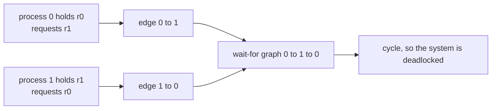
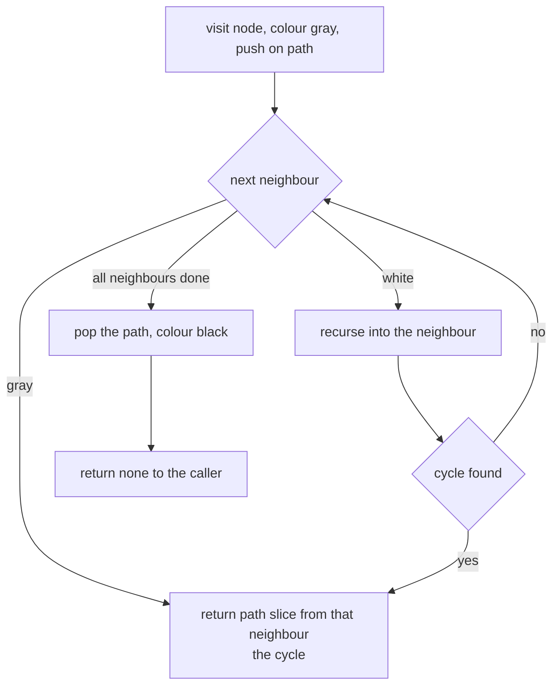
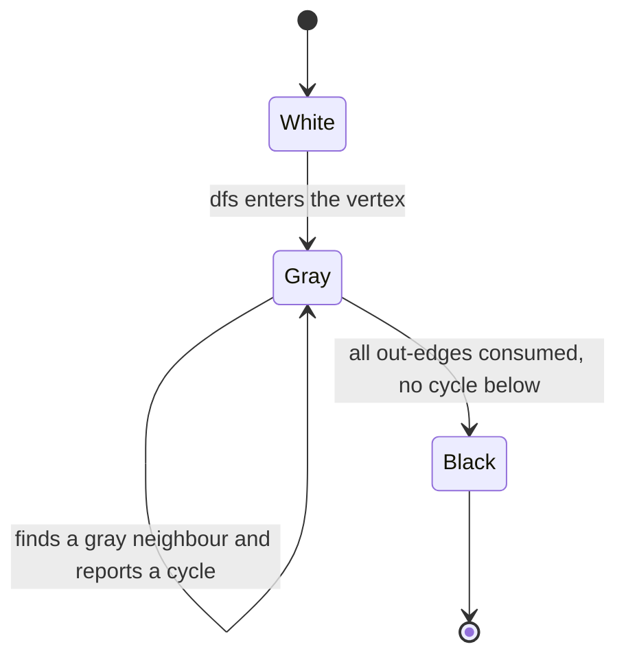
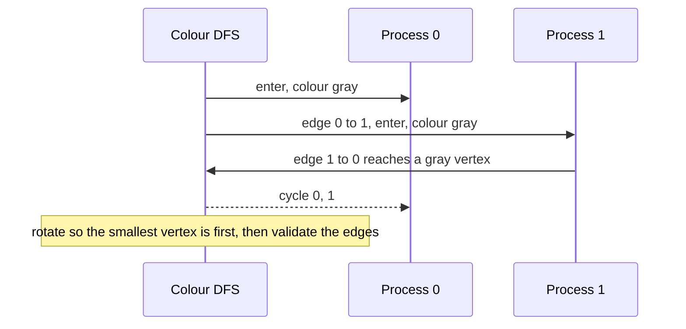

# 357 — Deadlock detection for a resource allocation graph

> **Tier:** Intermediate · **CTCI chapter:** Ch 15 — Threads and Locks
> **Task spec:** [357-deadlock-detection-for-resource-allocation-graph-algorithm.md](../../../tasks/intermediate/357-deadlock-detection-for-resource-allocation-graph-algorithm.md)
> **Solutions:** [Python](../../../solutions/python/intermediate/357-deadlock-detection-for-resource-allocation-graph-algorithm/solution.py) ·
> [Java](../../../solutions/java/intermediate/357-deadlock-detection-for-resource-allocation-graph-algorithm/Solution.java) ·
> [JavaScript](../../../solutions/javascript/intermediate/357-deadlock-detection-for-resource-allocation-graph-algorithm/solution.js) ·
> [C#](../../../solutions/csharp/intermediate/357-deadlock-detection-for-resource-allocation-graph-algorithm/Solution.cs)

## 1. Problem restatement

Given a resource allocation graph — processes that **hold** resources and **request** resources, with
the documented rule that a resource has **at most one holder** — decide whether the system is
deadlocked, and return the offending cycle when it is.

| Input | Meaning |
| --- | --- |
| `processes` | number of process vertices, ids `0 … processes - 1` |
| `resources` | number of resource vertices, ids `0 … resources - 1` |
| `holds` | list of `(process, resource)` pairs |
| `requests` | list of `(process, resource)` pairs |

| Output | Meaning |
| --- | --- |
| `build_wait_for(...)` | adjacency list of the collapsed **wait-for graph**; raises `ValueError` if a resource has two holders |
| `find_cycle(...)` | a canonical cycle (smallest vertex first) or "no cycle" |
| `has_cycle_via_scc(...)` | an independent cycle test used to cross-check the DFS |

The collapse rule the files implement: a request `(p, r)` where `r` is held by `q` becomes the edge
`p → q`; a request for a **free** resource contributes no edge, because waiting for something nobody
holds cannot block forever.

Asserted by the scripts, first by hand-built graphs:

| Case | Wait-for adjacency | `find_cycle` |
| --- | --- | --- |
| two processes waiting for each other | `[[1], [0]]` | `[0, 1]` |
| one waits for an idle process | `[[1], []]` | none |
| a process requests a resource it already holds | `[[0]]` | `[0]` (self-loop) |
| three-process cycle | `[[1], [2], [0]]` | `[0, 1, 2]` |
| a request for a free resource | `[[], []]` | none |
| all processes idle | `[[], [], []]` | none |
| a two-cycle plus an idle process | edges `0 ↔ 1` only | `[0, 1]` || a resource held by two processes | — | `ValueError` |

Then on **300 LCG-generated** resource allocation graphs (`seed = 13579`, `processes = 2 + seed mod 6`,
`resources = 1 + seed mod 6`, one holder per resource with probability `2/3`, `0 … 2` requests per
process), every verdict is cross-checked against an independent Kosaraju SCC computation, every
returned cycle is validated edge by edge, and at least 20 of the graphs must actually contain a cycle.

## 2. Intuition

A wait-for relation is the natural way to think about deadlock: process `p` waits for process `q` if
`p` requested a resource that `q` holds. The naive method walks that relation and asks "can I get back
to where I started?", which is the definition of a cycle — a closed chain of processes each waiting for
the next, so nobody can ever release anything.

The first insight is that **requests for free resources are not waits**. A process blocked on a free
resource will be unblocked as soon as the scheduler grants it, so it is not part of any deadlock. The
collapse therefore only emits an edge when the requested resource has a holder.

The second insight is that detecting a cycle does not require traversing all simple paths — that is
exponential. A **colour DFS** finds one in linear time: mark a vertex *gray* while it is on the current
recursion path, *black* once its subtree is finished, and *white* before it is visited. Reaching a gray
vertex means the edge just followed closes a loop, and the current path from that vertex onward *is*
the cycle.



The collapse is what makes the resource graph tractable: with one holder per resource, every request
becomes a single process-to-process edge and the mixed process/resource graph disappears.

## 3. Algorithm

1. **Collapse.** Build `holder[resource] = process` from the `holds` list, raising if a resource is
   claimed twice, then for every request `(p, r)` with `holder[r] != -1` append `holder[r]` to
   `adjacency[p]`.
2. **Colour DFS.** Initialise every vertex white (0). Visit each unvisited vertex with `dfs`:
   colour it gray (1), push it on the path, and for each out-neighbour, if it is gray return the
   path slice starting at that neighbour, if it is white recurse. On exit, pop the path and colour the
   vertex black (2).
3. **Canonicalise.** Rotate the returned cycle so its smallest vertex comes first, so equal cycles
   found from different start vertices compare equal.
4. **Independent check.** Run Kosaraju: DFS the graph recording finish order, DFS the reversed graph in
   reverse finish order to get the SCCs, and report a cycle exactly when some SCC has more than one
   vertex or some vertex has a self-loop.
5. **Validate.** For any returned cycle, assert it is canonical, its vertices are distinct, and every
   consecutive pair is a real edge (including the wrap-around edge).

```text
procedure build_wait_for(processes, resources, holds, requests)
    holder = array of resources entries all set to none
    for each (process, resource) in holds do
        if holder[resource] is set and differs from process then
            raise an error                  # a resource has at most one holder
        end
        holder[resource] = process
    end
    adjacency = empty list per process
    for each (process, resource) in requests do
        current_holder = holder[resource]
        if current_holder is set then
            append current_holder to adjacency[process]
        end
    end
    return adjacency
end

procedure find_cycle(processes, adjacency)
    colour = all white
    path = empty list
    procedure dfs(node)
        colour[node] = gray
        append node to path
        for each next_node in adjacency[node] do
            if colour[next_node] is gray then
                return path from the first occurrence of next_node onward
            end
            if colour[next_node] is white then
                found = dfs(next_node)
                if found is not empty then
                    return found
                end
            end
        end
        drop the last element of path
        colour[node] = black
        return empty
    end
    for start from 0 to processes - 1 do
        if colour[start] is white then
            found = dfs(start)
            if found is not empty then
                return canonical rotation of found
            end
        end
    end
    return none
end
```

The three colours encode exactly the two facts the DFS needs: gray means "on the current path" (so
reaching it closes a cycle), black means "fully explored" (so reaching it can never close a cycle).
Without black, a diamond-shaped graph would be re-explored exponentially often.





## 4. Worked example

Take the classic two-process deadlock. Process 0 holds resource `r0` and requests `r1`; process 1 holds
`r1` and requests `r0`:

| Step | Action | State |
| --- | --- | --- |
| 1 | `holder = [-1, -1]` | nothing held |
| 2 | `holds = [(0, r0), (1, r1)]` | `holder = [0, 1]` |
| 3 | request `(0, r1)` | `holder[1] = 1`, so append edge `0 → 1` |
| 4 | request `(1, r0)` | `holder[0] = 0`, so append edge `1 → 0` |
| 5 | adjacency | `[[1], [0]]` |
| 6 | `dfs(0)`: colour 0 gray, path `[0]`; neighbour 1 is white → `dfs(1)` | path `[0, 1]` |
| 7 | `dfs(1)`: colour 1 gray; neighbour 0 is **gray** | cycle found: path slice from 0 = `[0, 1]` |
| 8 | canonicalise `[0, 1]` | smallest vertex 0 is already first → `[0, 1]` |
| 9 | validate | edges `0 → 1` and `1 → 0` both exist |

A single-process case shows the self-loop branch: process 0 holds `r0` and requests `r0`, so the
collapse emits `0 → 0`, the DFS immediately meets a gray neighbour (itself), and the path slice
starting at `0` is `[0]`.

The acyclic case is equally short: with `holds = [(0, r0), (1, r1)]` and only the request `(0, r1)`,
the adjacency is `[[1], []]`. `dfs(0)` recurses into the white vertex 1, which has no out-edges and
becomes black; vertex 0 then becomes black and the search returns "no cycle" — process 0 waits, process
1 does not, so nothing is permanently blocked.



The randomised cross-check is what gives the hand-built cases their weight:

| Element | Value |
| --- | --- |
| Trials | 300 |
| Processes / resources per trial | `2 + seed mod 6` processes, `1 + seed mod 6` resources |
| Holder assignment | each resource is held by `seed mod processes` unless `seed mod 3 == 0`, so roughly one third stay free |
| Requests per process | `0 … 2`, each to `seed mod resources` |
| Per-trial assertions | the `find_cycle` verdict equals the Kosaraju SCC verdict, and any returned cycle passes the edge-by-edge validation |
| Global assertion | at least 20 of the 300 graphs contain a cycle |

The two independent algorithms — colour DFS and Kosaraju SCC — disagree only if one of them is wrong,
which is why the cross-check is stronger than either test alone.

## 5. Complexity

Let `p` be the number of processes, `r` the number of resources, `h` the number of holds and `q` the
number of requests.

| Measure | Bound | Why it holds |
| --- | --- | --- |
| `build_wait_for` | O(r + h + q) | one pass over the holds, one over the requests |
| `find_cycle` | O(p + e) where `e ≤ q` | each vertex is coloured once and each edge inspected once |
| Canonicalisation | O(length of the cycle) | one scan for the minimum, one rotation |
| `has_cycle_via_scc` | O(p + e) twice | a forward DFS and a reverse DFS, plus a component labelling pass |
| Validation of a returned cycle | O(length of the cycle) | distinctness plus one edge check per consecutive pair |
| Space | O(p + e + r) | the adjacency lists, the reverse adjacency, the colour array, the path |
| Total for the 300-trial cross-check | O(300 · (p + e)) | each trial builds and analyses one small graph |

Comparison with the alternatives for detecting a wait cycle:

| Method | Time | Notes |
| --- | --- | --- |
| Enumerate simple paths | exponential | correct but unusable beyond toy graphs |
| Colour DFS (shipped) | O(p + e) | returns an actual cycle, which is what a diagnosis needs |
| Kosaraju / Tarjan SCC | O(p + e) | answers yes/no and identifies all cycles at once; used here as the independent oracle |

The DFS is the practical choice because deadlock reports are far more useful when they name the cycle
than when they merely say "blocked".
## 6. Pitfalls and edge cases

- **Edges from requests to free resources.** A request for an unheld resource creates no edge; adding
  one would report a deadlock for a process merely queued behind the scheduler.
- **A resource with two holders.** `build_wait_for` raises: with several holders a request would have to
  become a wait-for-any hyperedge, which is a harder problem than the one specified.
- **Self-loops.** A process that requests a resource it already holds yields `p → p`, and the DFS must
  report `[p]` rather than skipping the edge; the hand-built test covers this case explicitly.
- **Distinguishing cycles from re-visits.** Reaching a *black* vertex is not a cycle — that subtree is
  finished — so the DFS must test gray for the back edge and white for the recursion.
- **Canonical rotation.** `find_cycle` rotates the cycle so the smallest vertex is first; without it the
  same cycle found from a different start vertex would compare unequal, and the tests assert the form.
- **Distinct vertices.** A DFS path has no repeats, and the validation asserts it
  (`len(set(cycle)) == len(cycle)`), ruling out a spurious "cycle" that walks a path twice.
- **Cycle detection is not cycle enumeration.** Returning the *first* cycle is enough for a deadlock
  report; finding all cycles (or the shortest one) is a different task, and the SCC oracle answers only
  existence.- **Idle processes and empty graphs.** A process that holds nothing and requests nothing contributes an
  isolated vertex and must not affect the verdict — the script checks a two-cycle with an idle third
  process — and a graph with no requests at all yields "no cycle" immediately, since the recursion never
  runs.
- **Recursion depth.** The DFS is recursive, so a very long wait chain could exhaust the stack; the
  randomised graphs are small (`p ≤ 7`), and an iterative colour DFS is the production form.
- **The oracle must be independent.** Kosaraju uses the reversed graph and component sizes, not a colour
  DFS, so agreement between the two is real evidence; reusing one implementation twice would not be.
- **Determinism.** The graphs come from the repository LCG (`seed = (seed * 75 + 74) mod 65537`), so the
  trial set is identical in all four languages and the "at least 20 cycles" assertion never depends on luck.

## 7. Variants and follow-ups

- **Multiple holders per resource.** Model a request as a wait-for-any set of edges, or keep the
  bipartite graph and look for cycles in the process-resource graph directly.
- **Deadlock avoidance instead of detection.** The banker's algorithm checks whether granting a request
  leaves a safe state, i.e. it simulates rather than analyses — the classic complement to detection.
- **Cycle-aware recovery.** Once the cycle is known, a victim can be chosen (fewest resources, lowest
  priority) and rolled back; the returned cycle list is the input that decision needs.
- **Prevention by ordering.** Rather than detecting cycles, remove them by construction: define a
  global order over resources and acquire in that order, as in
  [358-dining-philosophers-solution-using-ordered-locks.md](../../../tasks/intermediate/358-dining-philosophers-solution-using-ordered-locks.md).
- **Writer starvation as a liveness analogue.** A deadlock is a permanent wait among peers; a starved
  writer is a permanent wait against a stream of competitors — see
  [359-readers-writers-fairness-implementation-and-tests.md](../../../tasks/intermediate/359-readers-writers-fairness-implementation-and-tests.md).
- **Cycle detection in a versioned store's chains.** The same DFS reasoning applies when following
  references from one version to the next in
  [360-implement-versioned-key-value-store-basic.md](../../../tasks/intermediate/360-implement-versioned-key-value-store-basic.md).
- The chapter walkthrough [Threads and Locks](../../ctci/15-threads-and-locks.md) covers the
  four Coffman conditions this task's cycle is the concrete form of.

## 8. Check yourself

1. Why does a request for a free resource produce no edge in the wait-for graph?

<details><summary>Show answer</summary>

Because nobody holds it, so nobody has to release it for the request to be satisfied. The process is
merely waiting for the allocator, not for another process, so it cannot be part of a cycle of mutual
waiting. Only requests to *held* resources create edges.

</details>

2. Why does the DFS use three colours rather than a simple visited set?

<details><summary>Show answer</summary>

Because the two questions are different: "is this vertex on my current path?" decides whether an edge
closes a cycle, and "have I finished exploring this vertex?" decides whether the subtree can be skipped.
One bit cannot express both — without black, the diamond case would be re-explored exponentially.

</details>

3. A process requests a resource it is already holding. What does `find_cycle` return, and why?

<details><summary>Show answer</summary>

`[p]` — a self-loop. The collapse emits the edge `p → p`, and the DFS meets a gray neighbour (itself)
immediately, so the path slice starting at `p` is exactly `[p]`. It is the smallest possible deadlock
and the hand-built test asserts it.

</details>

4. What makes the Kosaraju cross-check meaningful rather than repetitive?

<details><summary>Show answer</summary>

It is a genuinely different algorithm: it uses the reversed graph and the finish order to compute
strongly connected components and reports a cycle when a component has more than one vertex or when a
self-loop exists. Agreement with the colour DFS on 300 graphs therefore tests the cycle *verdict*
independently, rather than re-running the same logic.

</details>

5. What does the validation of a returned cycle actually check?

<details><summary>Show answer</summary>

Three things: the cycle is in canonical rotation (smallest vertex first), its vertices are all
distinct, and every consecutive pair — including the wrap-around pair from the last vertex back to the
first — is a real edge. A DFS bug that returned a repeated vertex or a missing edge would be caught even
when the verdict was right.

</details>
