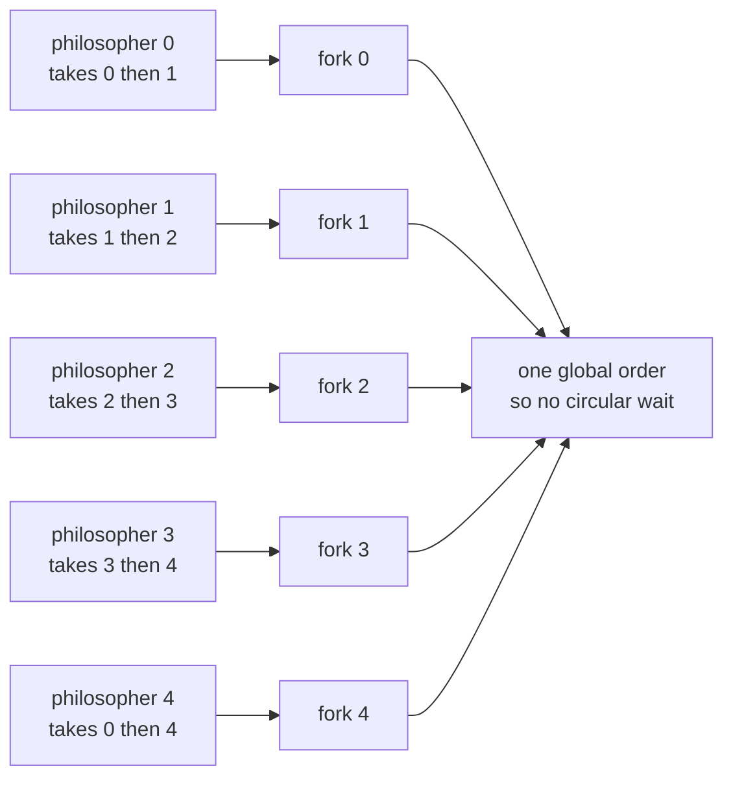
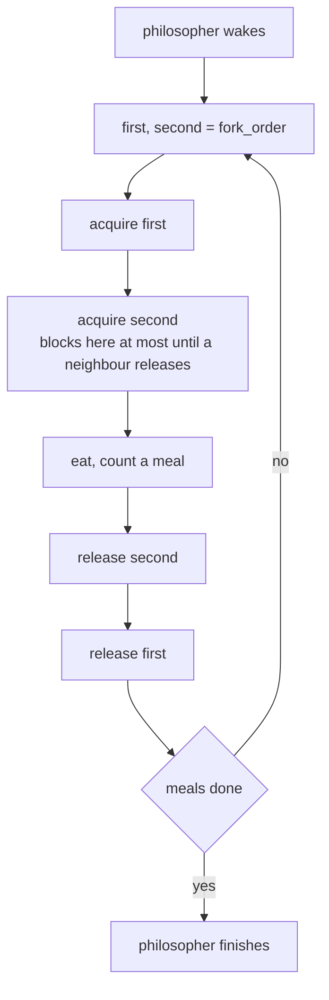
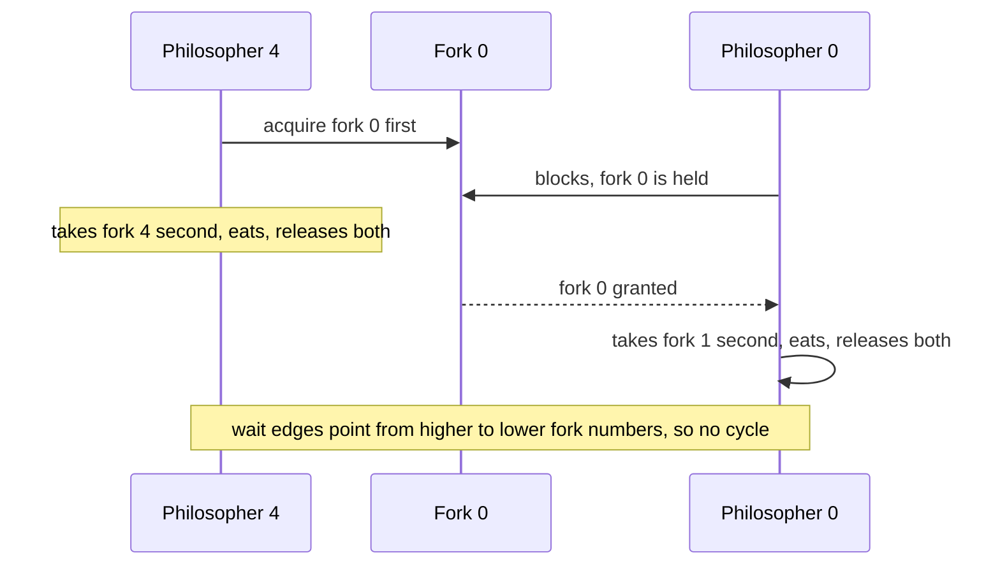
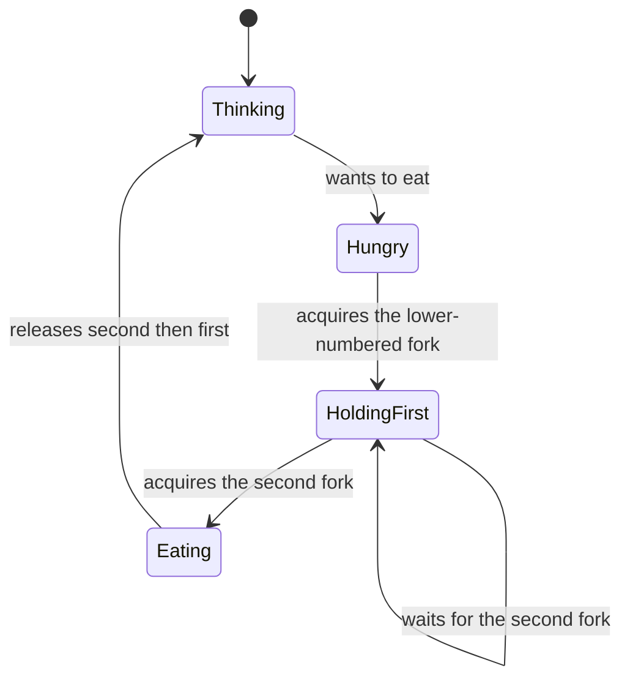

# 358 — Dining philosophers with ordered locks

> **Tier:** Intermediate · **CTCI chapter:** Ch 15 — Threads and Locks
> **Task spec:** [358-dining-philosophers-solution-using-ordered-locks.md](../../../tasks/intermediate/358-dining-philosophers-solution-using-ordered-locks.md)
> **Solutions:** [Python](../../../solutions/python/intermediate/358-dining-philosophers-solution-using-ordered-locks/solution.py) ·
> [Java](../../../solutions/java/intermediate/358-dining-philosophers-solution-using-ordered-locks/Solution.java) ·
> [JavaScript](../../../solutions/javascript/intermediate/358-dining-philosophers-solution-using-ordered-locks/solution.js) ·
> [C#](../../../solutions/csharp/intermediate/358-dining-philosophers-solution-using-ordered-locks/Solution.cs)

## 1. Problem restatement

Five philosophers sit around a table with five forks. Philosopher `i` needs the two forks `i` and
`(i + 1) mod 5` to eat, and each fork may be held by only one philosopher at a time. Solve it with
**resource ordering**: every philosopher acquires its two forks in a single global order.

| Element | Value in the shipped scripts |
| --- | --- |
| Philosophers / forks | `5` |
| Meals per philosopher | `40` |
| Total meals | `200` |
| Acquisition order | the lower-numbered fork always first, so the pairs are `(0,1), (1,2), (2,3), (3,4), (0,4)` |
| Join timeout | 10 s — a deadlock or livelock fails the run instead of hanging |

The documented invariant is that **every philosopher acquires its two forks in the same global order**:
because the pairs are ordered, no circular wait can form, and no philosopher can hold one fork while
waiting forever for the other. Only philosopher 4 wraps around: it takes fork 0 before fork 4.

Asserted after the run:

| Check | Expected |
| --- | --- |
| `fork_order` table | exactly `[(0,1), (1,2), (2,3), (3,4), (0,4)]` |
| Total meals | `5 × 40 = 200` |
| Per-philosopher meals | `40` each |
| Per-fork acquisitions | `2 × 40 = 80` each — one per meal by each of its two neighbours |
| `max_holders` per fork | `1` — the single-holder invariant held throughout |
| `violations` | `0` — no fork was ever observed with two owners |
| Final state | every `owners[fork]` is clear and every `holders[fork]` is `0` |

**Note on the JavaScript file.** Node is single-threaded, so its header documents the async simulation:
a `Fork` is an async mutex whose promise waiters form a **FIFO handoff queue**, and on release the
longest-waiting philosopher is woken with ownership already transferred — which rules out the unfair
reacquisition starvation a free-for-all scheduler could cause. Each philosopher awaits a yield while
"eating" between courses, so the five loops genuinely interleave. The file also demonstrates the naive
grab order reaching the classic circular wait under a scripted interleaving, as a contrast.

## 2. Intuition

Every philosopher picks up its left fork and then its right fork. With five of them doing that at once,
each can end up holding exactly one fork while waiting for the one its neighbour holds: the resource
allocation graph contains a five-cycle, and nobody eats. That is the textbook deadlock, and it is not
cured by retrying, yielding or sleeping — the cycle is in the *protocol*, not in the timing.

The key insight is the same one that solved the wait-for cycle in the previous task, applied
prospectively rather than diagnostically: **break the cycle by construction**. If every philosopher
takes its two forks in increasing-number order, then the last philosopher in the ring (`4`) reaches for
fork `0` before fork `4`, which reverses the direction of the resource chain. Every holder now waits
only "upward" in a total order, so the wait-for relation can only ever point from a higher-numbered
fork to a lower-numbered one, and a cycle would require it to point both ways.



The ordering is *not* a fairness policy — it says nothing about who eats next — it is a structural
guarantee of liveness: some philosopher always makes progress, and the system as a whole cannot stop.
The scripts turn that guarantee into numbers: 200 meals, one holder per fork at a time, zero violations.

## 3. Algorithm

1. Create one lock (or monitor) per fork, plus one short-lived accounting lock and the bookkeeping
   arrays: `owners`, `holders`, `max_holders`, `acquisitions`, `meals`, `violations`.
2. **`fork_order(philosopher, fork_count)`** returns `(min(left, right), max(left, right))` where
   `left = philosopher` and `right = (philosopher + 1) mod fork_count`. This is the whole solution.
3. **`acquire(philosopher, fork)`** takes the fork's lock and then records, under the accounting lock,
   the new owner, the holder count (tracking the maximum) and the acquisition count — a violation is
   counted if the fork already had an owner.
4. **`release(philosopher, fork)`** records the release *under the accounting lock before unlocking the
   fork*, so the bookkeeping is updated while the invariant still holds, then unlocks.
5. **`dine(philosopher)`** repeats `MEALS` times: acquire the first fork, acquire the second, count a
   meal, release the second, release the first.

```text
procedure fork_order(philosopher, fork_count)
    left = philosopher
    right = (philosopher + 1) mod fork_count
    return (smaller of left and right, larger of left and right)
end

procedure dine(philosopher, table, meals)
    (first, second) = fork_order(philosopher, number of forks)
    repeat meals times
        acquire fork first for philosopher
        acquire fork second for philosopher
        count a meal for philosopher
        release fork second for philosopher
        release fork first for philosopher
    end
end
```

The release order is the mirror image of the acquisition order. It is not required for correctness — the
cyclic-wait argument only constrains acquisition — but it keeps the invariant easy to state: a
philosopher that is holding anything holds `first` and possibly `second`, never the other way round.



The wait edges that *would* have formed a cycle now all point the same way:



## 4. Worked example

The ordering table is asserted directly, and it is worth checking by hand:

| Philosopher | Left fork | Right fork | `fork_order` | Note |
| --- | --- | --- | --- | --- |
| 0 | 0 | 1 | `(0, 1)` | already increasing |
| 1 | 1 | 2 | `(1, 2)` | already increasing |
| 2 | 2 | 3 | `(2, 3)` | already increasing |
| 3 | 3 | 4 | `(3, 4)` | already increasing |
| 4 | 4 | 0 | `(0, 4)` | the wrap-around: fork 0 first |

Now trace one meal of philosopher 4 alongside philosophers 0 and 3, the ones that share its forks:

| # | Actor | Action | Fork 0 owner | Fork 4 owner | Meals so far |
| --- | --- | --- | --- | --- | --- |
| 1 | P4 | `acquire(4, 0)` | 4 | — | — |
| 2 | P0 | tries `acquire(0, 0)` | blocks behind 4 | — | — |
| 3 | P4 | `acquire(4, 4)` | 4 | 4 | — |
| 4 | P4 | eats, `count_meal(4)` | 4 | 4 | P4 +1 |
| 5 | P4 | `release(4, 4)` | 4 | clear | — |
| 6 | P4 | `release(4, 0)` | clear | clear | — |
| 7 | P0 | `acquire(0, 0)` succeeds | 0 | clear | — |
| 8 | P3 | tries `acquire(3, 4)` | 0 | blocks behind P4's earlier hold in this trace | — |
| 9 | P0 | `acquire(0, 1)`, eats, releases both | clear | clear | P0 +1 |

Step 2 and step 3 are the interesting pairing: because P4 grabbed fork 0 *before* fork 4, P0's block
happens while P4 is still making progress toward its second fork. In the naive left-then-right order,
P4 would hold fork 4 and wait for fork 0 while P0 held fork 0 and waited for fork 1 — the ring closes.

The bookkeeping assertions then read like a conserved quantity:

| Quantity | Value for `MEALS = 40` | Why |
| --- | --- | --- |
| Meals per philosopher | `40` | the loop count |
| Total meals | `200` | `5 × 40` |
| Acquisitions per fork | `80` | each meal takes both of its philosopher's forks; each fork serves two philosophers |
| `max_holders` per fork | `1` | the lock is exclusive, and the accounting lock is held while the count is read |
| Violations | `0` | no acquisition ever found an existing owner |
| Residual holders at the end | `0` | releases are balanced with acquisitions |



## 5. Complexity

Let `n` be the number of philosophers (equal to the number of forks) and `m` the meals per philosopher.

| Measure | Bound | Why it holds |
| --- | --- | --- |
| Critical section per meal | O(1) fork operations | two lock acquisitions, one meal count, two releases |
| Work per philosopher | O(m) | each meal is a constant number of operations |
| Total work | O(n · m) = 200 meals | asserted as `5 × 40` |
| Lock acquisitions | O(n · m) | two per meal, `80` per fork |
| Space | O(n) | one lock and one bookkeeping slot per fork |
| Deadlock | impossible by construction | all acquisitions follow one global order, so the wait-for relation is acyclic |
| Starvation | possible in principle | ordering prevents cycles, not unfairness — a philosopher may repeatedly lose the race for a fork; the JavaScript file's FIFO handoff queue is one mitigation |
| Progress | at least one philosopher can always eat | the holder of the lowest-numbered fork in any waiting chain can complete its meal |

Comparison with the other classical solutions:

| Solution | Idea | Cost |
| --- | --- | --- |
| Naive left-then-right | none | deadlocks on the five-cycle |
| Ordered locks (shipped) | global acquisition order | O(1) extra, no cycle possible; not fair |
| Waiter (arbitrator) | a fifth "waiter" grants at most four forks at once | extra shared state and a serialisation point |
| Semaphore limit of four diners | at most four philosophers at the table | one extra semaphore; still starvation-prone |
| Try-lock and back off | give back the first fork if the second is busy | livelock risk, and it wastes work |
| Chandy–Misra / clean-up | pass the fork along a directed graph | each fork is dirty/clean; more bookkeeping, and provably starvation-free if requests follow the order |

## 6. Pitfalls and edge cases

- **Only philosopher 4 wraps around.** The ordering matters precisely for the pair `(4, 0)`; the other
  four philosophers already take their forks in increasing order, so the fix is a one-line change in
  `fork_order` — which is why the table is asserted rather than assumed.
- **Acquiring both forks without an order.** Two philosophers can each hold one fork of a pair and wait
  for the other; that is the classic deadlock the whole task exists to avoid.
- **Releasing in the wrong order.** Harmless for the cyclic-wait argument, but it breaks the stated
  invariant "a philosopher holds `first` and possibly `second`", and it makes the accounting harder to
  reason about.
- **Recording ownership after unlocking.** `release` updates the bookkeeping while the fork lock is
  still held, so the observed state always satisfies the single-holder invariant; recording after the
  unlock would leave a window in which another philosopher has the fork while `owners[fork]` is stale.
- **Unsynchronised bookkeeping.** `owners`, `holders`, `max_holders`, `acquisitions` and `meals` are
  written by all five threads, so every update is taken under one short-lived accounting lock.
- **`max_holders == 1` is the point.** A fork "used by at most one philosopher at a time" is exactly
  what `max_holders[fork] == 1` asserts; a value of `2` would mean two philosophers ate with the same
  fork.
- **Acquisition counts are a conservation law.** Each fork serves two philosophers, so with 40 meals
  each it must be acquired `2 × 40 = 80` times; a leak (a missed release) shows up here even when the
  meals all complete.
- **Residual state.** After the joins, every `owners` entry must be clear and every `holders` entry
  zero — a philosopher that exits while holding a fork would leave the table permanently short.
- **Timeouts are the deadlock detector in the test.** The joins carry 10 s and the threads are daemons,
  so a deadlocked protocol fails an assertion (`"philosopher did not finish in time (deadlock?)"`)
  instead of hanging the process.
- **Fairness is not provided by ordering.** The files do not claim it: a philosopher can repeatedly
  lose the race for a fork. The JavaScript simulation's FIFO handoff queue shows one way to add
  fairness on top of the ordering.
- **Node's simulation has a handoff queue, not a lock.** Ownership is transferred to the
  longest-waiting philosopher on release, which is what makes the interleaving deterministic; the file
  also scripts the naive grab order to show the circular wait explicitly.
- **Scale is not the point.** Five philosophers is the textbook size; the argument is structural, so it
  holds for any `n` that acquires its two forks in an order derived from a total order on forks.

## 7. Variants and follow-ups

- **Waiter solution.** A sixth role holds a permission and grants at most four forks at once; it
  removes the cycle without changing the philosophers' own code, at the cost of a central arbiter.
- **Try-lock with backoff.** If the second fork is busy, release the first and start over — simple, but
  it can livelock and it does work that is thrown away.
- **Chandy–Misra / clean-up forks.** Forks are passed along a directed graph and marked dirty or clean;
  more state, but starvation-free when requests respect the ordering.
- **Reader-writer variants.** The same "no cycle, no starvation" reasoning underlies the readers-writers
  policies in
  [359-readers-writers-fairness-implementation-and-tests.md](../../../tasks/intermediate/359-readers-writers-fairness-implementation-and-tests.md)
  and the writer preference in
  [347-implement-read-write-lock-basic-no-starvation.md](../../../tasks/intermediate/347-implement-read-write-lock-basic-no-starvation.md).
- **Detection instead of prevention.** If the ordering cannot be imposed (resources acquired by a
  library, for instance), detect the cycle as in
  [357-deadlock-detection-for-resource-allocation-graph-algorithm.md](../../../tasks/intermediate/357-deadlock-detection-for-resource-allocation-graph-algorithm.md).
- **Fair queues.** Replacing the fork locks with FIFO handoff queues — the JavaScript file's approach —
  turns the ordering plus luck into ordering plus fairness.
- **Producer-consumer with signed forks.** A table where each philosopher needs one fork only is the
  bounded buffer of
  [348-producer-consumer-using-semaphore-locks-with-multiple-producers.md](../../../tasks/intermediate/348-producer-consumer-using-semaphore-locks-with-multiple-producers.md)
  with the sign flipped.
- The chapter walkthrough [Threads and Locks](../../ctci/15-threads-and-locks.md) covers the
  Coffman conditions that the ordering removes one of.

## 8. Check yourself

1. Why does taking the lower-numbered fork first prevent the five-cycle?

<details><summary>Show answer</summary>

Because every philosopher then waits "upward" in one global order. A cycle would need a chain of wait
edges returning to its start, and each edge would have to point from a higher-numbered fork's holder to
a lower-numbered one — a contradiction in a total order. Only philosopher 4 changes behaviour
(`(0, 4)` instead of `(4, 0)`) and that single reversal is what breaks the ring.

</details>

2. What does `max_holders[fork] == 1` prove that the meal counts do not?

<details><summary>Show answer</summary>

It proves mutual exclusion on the fork. The meal totals show that every philosopher eventually ate, but
they would also be satisfied by a broken implementation that let two neighbours hold the same fork and
merely hid the interference. `max_holders == 1`, checked under the accounting lock, is the direct
statement of the single-holder invariant.

</details>

3. Why does `release` record the bookkeeping before unlocking the fork?

<details><summary>Show answer</summary>

So that the recorded owner is never stale while the fork is free and never unrecorded while the fork is
held. Taking the accounting lock while still holding the fork makes the transition visible as an atomic
step to any observer, which is what keeps `owners` and `holders` consistent with the actual lock state.

</details>

4. The table acquires 80 times per fork over the run. Why is that the expected value, and what would a
   different number mean?

<details><summary>Show answer</summary>

Each fork is shared by exactly two philosophers, and each of them takes it once per meal, so with 40
meals per philosopher the total is `2 × 40 = 80`. A higher number means an extra acquisition without a
matching meal (or a double-acquire), and a lower number means a meal happened without both forks — both
would be bugs that the meal total alone could hide.

</details>

5. Ordering prevents deadlock. Does it also prevent starvation?

<details><summary>Show answer</summary>

No. Ordering removes cycles, so the system always makes progress, but an unlucky philosopher can lose
the race for a fork repeatedly and go hungry while others eat. That is a fairness problem, not a
liveness one, and it needs an extra mechanism — a FIFO handoff queue on the fork, as in the JavaScript
simulation, or a ticket-based lock.

</details>
