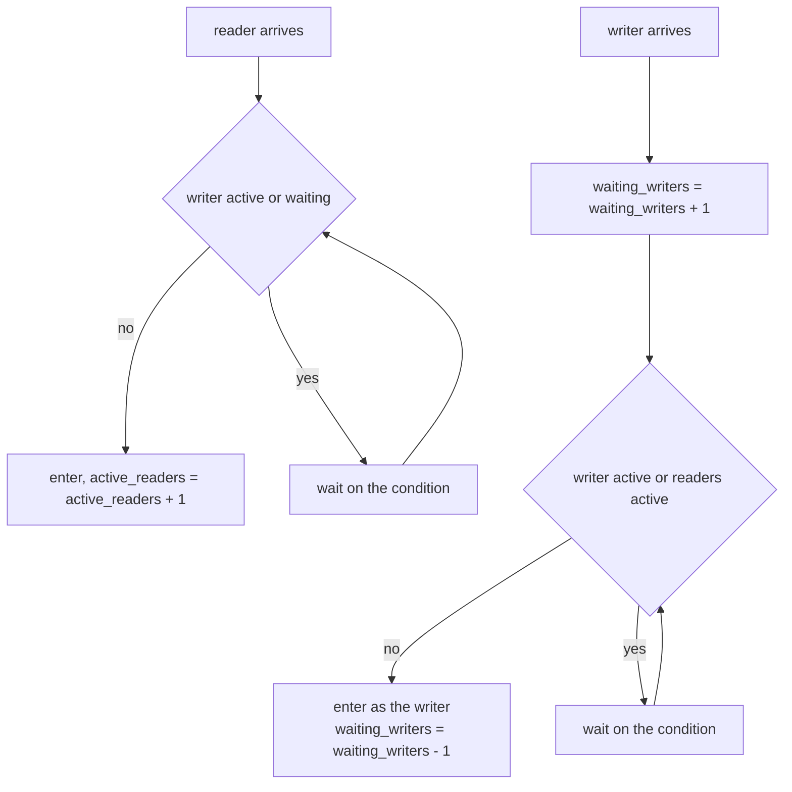
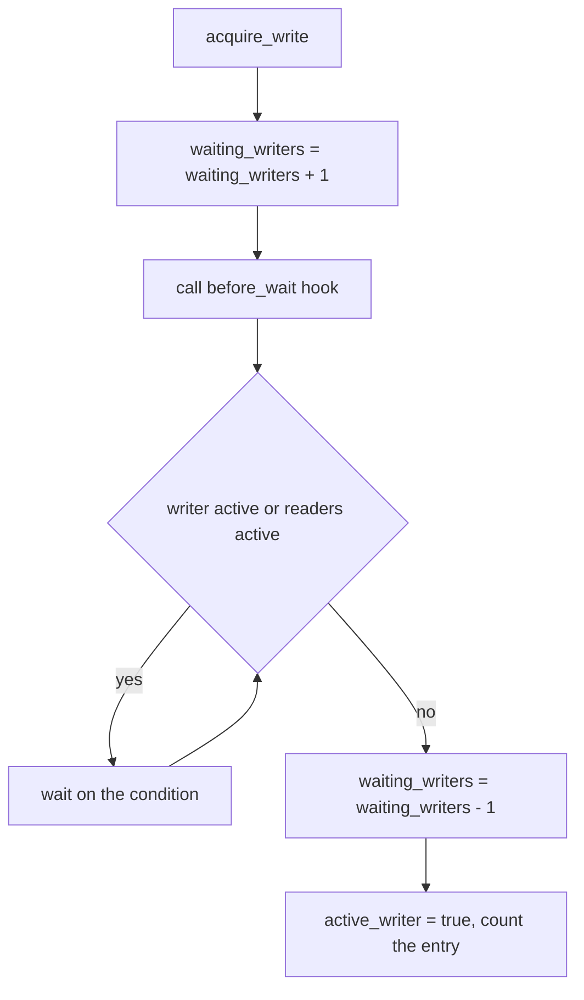
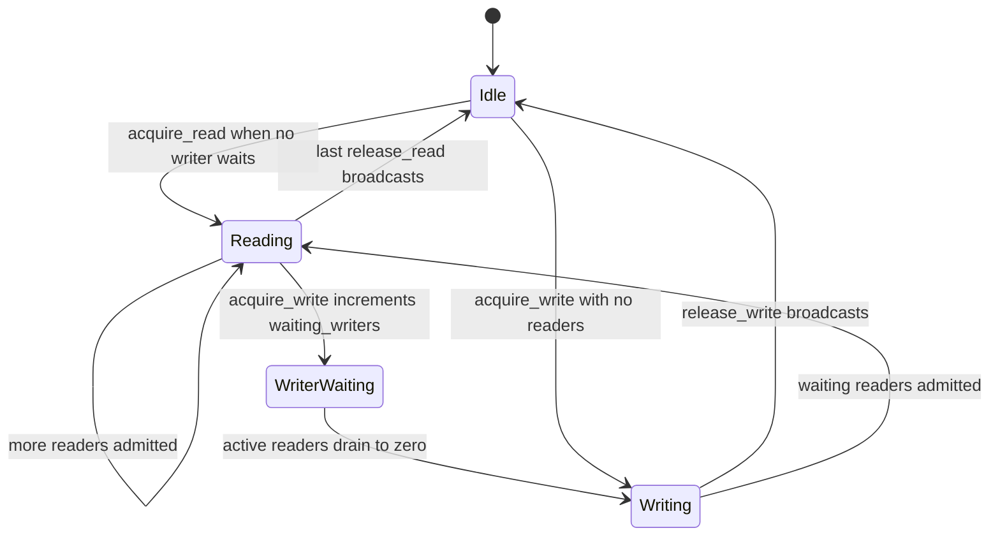
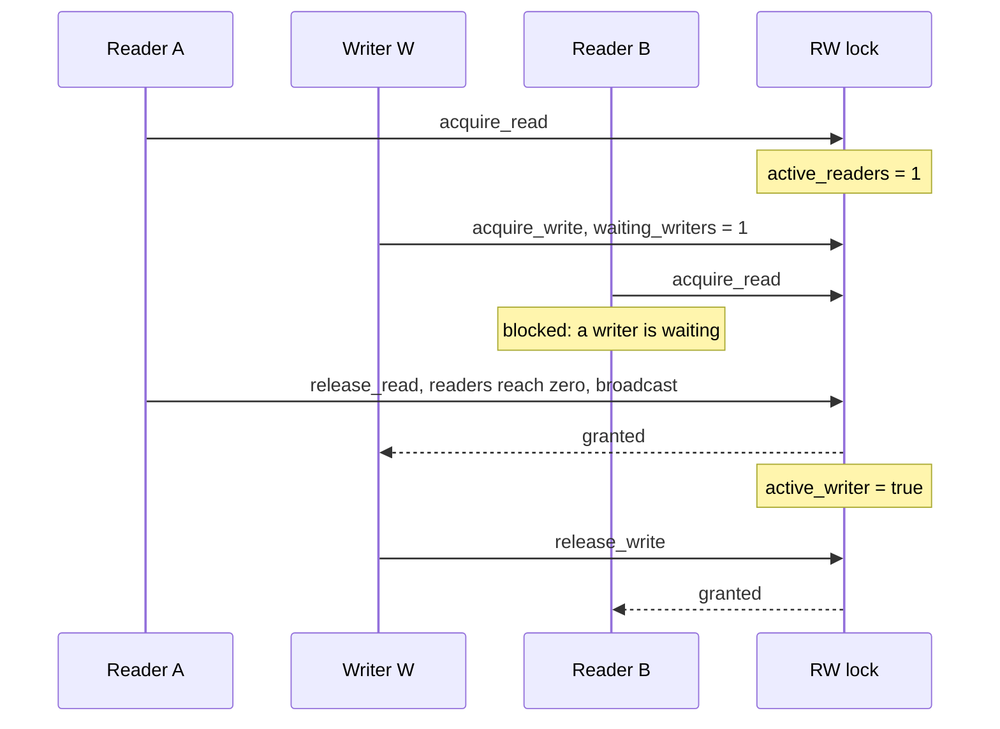

# 359 — Readers-writers fairness: implementation and tests

> **Tier:** Intermediate · **CTCI chapter:** Ch 15 — Threads and Locks
> **Task spec:** [359-readers-writers-fairness-implementation-and-tests.md](../../../tasks/intermediate/359-readers-writers-fairness-implementation-and-tests.md)
> **Solutions:** [Python](../../../solutions/python/intermediate/359-readers-writers-fairness-implementation-and-tests/solution.py) ·
> [Java](../../../solutions/java/intermediate/359-readers-writers-fairness-implementation-and-tests/Solution.java) ·
> [JavaScript](../../../solutions/javascript/intermediate/359-readers-writers-fairness-implementation-and-tests/solution.js) ·
> [C#](../../../solutions/csharp/intermediate/359-readers-writers-fairness-implementation-and-tests/Solution.cs)

## 1. Problem restatement

Implement a readers-writers lock with a **documented fairness policy** and a test suite that makes the
policy checkable rather than merely claimed.

| Element | Value in the shipped scripts |
| --- | --- |
| Policy | **writer preference** — a reader enters only when no writer is active **and** no writer is waiting; a writer enters when no writer is active and all active readers have left |
| Scripted scenario | reader `A` holds → writer `W` registers → reader `B` arrives |
| Workload | 4 readers × 50 iterations, 3 writers × 50 iterations |
| Counters | `reader_entries`, `writer_entries`, `max_active_readers`, `violations` |
| Join timeout | 10 s — a stuck run fails an assertion instead of hanging |

Asserted by the scripts, in three parts:

| Part | Assertion |
| --- | --- |
| 1. Scripted ordering | after `A` leaves, `W` enters **before** `B`; the event log is exactly `["readA", "writeW", "readB"]`; `writer_entries == 1`, `reader_entries == 2`, `violations == 0` |
| 2. Mutual exclusion | readers never enter beside a writer; a writer never releases while readers are active; every entry/exit keeps `violations == 0` |
| 3. Fairness under load | writer entries `== 150 == WRITERS × ITERATIONS` (every writer request served), reader entries `== 200 == READERS × ITERATIONS`, the guarded counter ends at `150`, and the lock is clean at the end (`active_readers == 0`, no active writer) |

The scripted part is the heart of it: a policy that is only "documented" cannot be verified by a
concurrent run, because any outcome is consistent with *some* interleaving. Pinning the interleaving
with events is what turns "writer preference" into an assertion.

**Note on the JavaScript file.** Node is single-threaded, so its header documents the usual async
simulation: waiters are promise resolvers standing in for a condition variable. It repeats the scripted
ordering scenario and runs the 4×50 / 3×50 workload as virtual coroutines.

## 2. Intuition

A readers-writers lock must answer two questions: who may hold the lock together (readers), and what
does a writer need (nothing else at all). The subtle part is not mutual exclusion but **liveness**: if
readers are admitted whenever no writer is *active*, a steady stream of arrivals can keep the reader
count above zero forever and a writer may wait arbitrarily long. That is writer starvation, and it is a
policy failure, not a timing accident.

The key insight is that the lock must track the **intent** of waiting writers, not just their presence.
One extra counter — how many writers have announced a request — changes the admission rule for readers
from "no writer is active" to "no writer is active **and nobody is waiting to write**". A waiting
writer's mere existence closes the door behind the current readers, so they drain and the writer gets in.



The same counter makes the scripted test possible: the writer announces its request through a
`before_wait` hook that runs while the internal lock is still held, so the test can observe *exactly*
when the intent becomes visible — the moment that must block reader `B`.

## 3. Algorithm

1. Keep a condition variable protecting `active_readers`, `active_writer` and `waiting_writers`, plus the
   counters for the test (`reader_entries`, `writer_entries`, `max_active_readers`, `violations`).
2. **`acquire_read()`** loops while `active_writer or waiting_writers > 0`, waiting on the condition;
   then increments `active_readers`, updates the observed maximum and counts the entry.
3. **`release_read()`** decrements `active_readers`; when it reaches zero it broadcasts, which is what
   lets a waiting writer proceed.
4. **`acquire_write(before_wait)`** increments `waiting_writers` **first**, optionally calls the
   `before_wait` hook (used by the test to record the request), then loops while
   `active_writer or active_readers > 0`. On exit it decrements `waiting_writers`, sets
   `active_writer`, and counts the entry.
5. **`release_write()`** clears `active_writer` and broadcasts, which releases all waiting readers and
   lets one waiting writer claim the lock.

```text
procedure acquire_read()
    lock internal
    while active_writer or waiting_writers > 0 do
        wait on the condition
    end
    active_readers = active_readers + 1
    update max_active_readers
    reader_entries = reader_entries + 1
    unlock internal
end

procedure release_read()
    lock internal
    if active_readers is zero or active_writer then
        violations = violations + 1
    end
    active_readers = active_readers - 1
    if active_readers == 0 then
        wake all waiters
    end
    unlock internal
end

procedure acquire_write(before_wait)
    lock internal
    waiting_writers = waiting_writers + 1
    if before_wait is set then
        call before_wait               # the request is now visible
    end
    while active_writer or active_readers > 0 do
        wait on the condition
    end
    waiting_writers = waiting_writers - 1
    active_writer = true
    writer_entries = writer_entries + 1
    unlock internal
end
```

The increments and decrements are deliberately placed around the *wait*, not around the grant: a writer
counts as waiting from the moment it announces its intent until it actually holds the lock. That is the
window in which reader admission must be blocked.





## 4. Worked example

Part 1 is the scripted scenario. Reader `A` is inside before anything else starts:

| # | Event | `active_readers` | `active_writer` | `waiting_writers` | Log so far |
| --- | --- | --- | --- | --- | --- |
| 1 | `A` calls `acquire_read()` | 1 | `False` | 0 | `["readA"]` |
| 2 | `W` calls `acquire_write()` | 1 | `False` | 1 | — (hook fired) |
| 3 | `B` calls `acquire_read()` | 1 | `False` | 1 | — **B must block** |
| 4 | `A` calls `release_read()` | 0 | `False` | 1 | broadcast |
| 5 | `W` wakes, enters | 0 | `True` | 0 | `["readA", "writeW"]` |
| 6 | `W` calls `release_write()` | 0 | `False` | 0 | broadcast |
| 7 | `B` wakes, enters | 1 | `False` | 0 | `["readA", "writeW", "readB"]` |
| 8 | `B` calls `release_read()` | 0 | `False` | 0 | — |

Steps 3 and 5 are the proof of writer preference: at step 3 the lock had no active writer, so a
reader-count-only implementation would have admitted `B` immediately; the `waiting_writers == 1`
condition is the only reason it did not. At step 5 the woken writer sees `active_readers == 0` and takes
the lock before `B` is even considered.



Parts 2 and 3 then run the workload. The guarded value starts at `0` and only writers change it:

| Thread class | Count | Iterations | What it does | Expected entries |
| --- | --- | --- | --- | --- |
| Readers | 4 | 50 | `acquire_read`, append the current value to `observations`, `release_read` | `200` |
| Writers | 3 | 50 | `acquire_write`, `value += 1`, `release_write` | `150` |

| Check after the joins | Expected | What it rules out |
| --- | --- | --- |
| Total writer completions | `150` | a writer that never got in |
| `writer_entries` | `150` | starvation — every request was served |
| `reader_entries` | `200` | a reader that never got in |
| Final `value` | `150` | a lost increment |
| `observations` length and range | `200` values, each in `0 … 150` | a read of a half-applied write |
| `violations` | `0` | any overlap of readers and writers |
| `max_active_readers` | `>= 1` | a "readers-writers lock" that never let two readers share |
| Clean end state | `active_readers == 0`, no active writer | a leak that would block everything after |

The equality `writer_entries == writer_requests` **is** the fairness assertion: with pure reader
preference it could be less, because writers would keep losing to arriving readers.

## 5. Complexity

Let `r` be the number of readers, `w` the number of writers, and `n` the total number of entries.

| Measure | Bound | Why it holds |
| --- | --- | --- |
| `acquire_read`, admitted | O(1) | one predicate test and one counter increment under the internal lock |
| `acquire_read`, blocked | O(1) plus scheduler latency | it parks on the condition; the number of loop iterations is not proportional to `n` |
| `release_read` | O(1) | one decrement, plus a broadcast when the count hits zero |
| `acquire_write` | O(1) plus the wait, then O(number of waiters) wake-ups on release | the broadcast wakes every waiter, and each re-checks its predicate |
| Space | O(1) | three scalars and one condition variable, independent of `r` and `w` |
| Reader concurrency | up to `r` at once | readers only ever increment a shared counter |
| Writer entries over the run | `w × iterations` | guaranteed by the policy, asserted as `150` |
| Reader entries over the run | `r × iterations` | asserted as `200` |
| Starvation of readers | possible in principle | reader admission is refused while a writer waits, so a continuous stream of writers can hold readers off |
| Starvation of writers | impossible | `waiting_writers > 0` stops new readers, so active readers drain and the writer gets in |

Comparison with the alternatives:

| Policy | Writer progress | Reader progress | Failure mode |
| --- | --- | --- | --- |
| Reader preference (no `waiting_writers` test) | may starve | immediate when no writer is active | writers starve |
| Writer preference (shipped) | guaranteed | blocked while a writer waits | readers can be delayed by a stream of writers |
| FIFO / phase-fair | guaranteed | guaranteed | more bookkeeping: a queue of waiters, or reader/writer phases |
| Ticket lock | strictly ordered | strictly ordered | no reader concurrency at all |

## 6. Pitfalls and edge cases

- **Testing only the flag, not the queue.** Admitting readers on `not active_writer` alone is the
  classic starvation bug; the `waiting_writers > 0` test is what the whole policy rests on.
- **Incrementing `waiting_writers` after the wait.** The counter must rise *before* the loop, so new
  readers see the intent. The shipped code increments first and decrements on the granting path.
- **Forgetting the broadcast when the last reader leaves.** A single signal can wake a reader that
  immediately re-blocks because a writer is waiting, leaving the writer asleep. `release_read`
  broadcasts when `active_readers` reaches zero, and `release_write` broadcasts unconditionally.
- **`if` instead of `while`.** Waiters must re-check their predicate after waking, since a broadcast is
  not a grant — the writer case has to survive a writer that got in first, and the reader case a
  waiting writer that arrived meanwhile.
- **Recording the request too late for the test.** The `before_wait` hook fires while the internal lock
  is held and after `waiting_writers` was incremented, so "W has registered" is observable at exactly
  the right moment; moving it after the wait would make the scripted test hang or pass vacuously.
- **Violation counters are diagnostics, not enforcement.** `violations` are incremented in places the
  authors describe as unreachable (`if self.active_writer` after the loop, releasing without holders);
  they exist so that a broken policy fails loudly rather than silently.
- **A reader that never releases.** `active_readers` would never reach zero, so no writer would ever
  enter; the scripted phase's event gates make each thread's progress explicit and the joins bound the
  damage.
- **Reader observations may be stale, but never torn.** The readers append `state["value"]` under the
  read lock, so each observed value is a committed one; the assertions check the range `0 … 150`, not a
  monotone sequence, because readers may run before or after any given writer.
- **Fairness assertions must be structural, not statistical.** `writer_entries == 150` is exact; a
  "writers got in often enough" test would be flaky and would not detect starvation.
- **Timeouts and daemons.** Every event wait and join is bounded (10 s) and threads are daemons, so a
  policy bug fails the run instead of hanging CI.
- **Node's simulation is single-threaded.** The JavaScript waiters are promise resolvers, so the
  scripted ordering is exact; it validates the policy, not memory visibility on a real machine.

## 7. Variants and follow-ups

- **FIFO fairness.** Maintain an explicit waiter queue and grant in arrival order; readers may share
  the lock only with readers that were admitted in the same batch. This removes reader starvation at the
  cost of a queue.
- **Phase-fair locks.** Alternate reader and writer phases so both classes are guaranteed progress
  within a bounded number of phases.
- **Reader preference.** Drop the `waiting_writers` test to prefer throughput of readers; then the
  starvation test would have to be inverted.
- **Writer preference in the sibling task.** The same policy, with a scripted gate-based proof, appears
  in [347-implement-read-write-lock-basic-no-starvation.md](../../../tasks/intermediate/347-implement-read-write-lock-basic-no-starvation.md).
- **Optimistic reads instead of shared locks.** When reads are much more common, a version-checked read
  removes the lock entirely — see
  [346-implement-optimistic-concurrency-control-sketch-version-numbers.md](../../../tasks/intermediate/346-implement-optimistic-concurrency-control-sketch-version-numbers.md).
- **Sharded locks.** For map-like data, per-shard locks reduce contention further than one
  readers-writers lock — see
  [353-implement-concurrent-hashmap-simplified-sharding.md](../../../tasks/intermediate/353-implement-concurrent-hashmap-simplified-sharding.md).
- **Ordered acquisition in a multi-resource protocol.** The dining philosophers' prevention argument in
  [358-dining-philosophers-solution-using-ordered-locks.md](../../../tasks/intermediate/358-dining-philosophers-solution-using-ordered-locks.md)
  is the companion technique for the case where a thread needs more than one lock.
- The chapter walkthrough [Threads and Locks](../../ctci/15-threads-and-locks.md) covers the primitives
  these policies are built from.

## 8. Check yourself

1. What exactly does the `waiting_writers` counter buy, and why is the active-writer flag not enough?

<details><summary>Show answer</summary>

It makes the *intent* to write visible before the writer holds anything. With only the active-writer
flag, readers are admitted whenever no writer is currently inside, so a steady stream of readers keeps
the reader count above zero and the waiting writer never sees zero. Blocking readers while
`waiting_writers > 0` lets the current readers drain, which is precisely what unblocks the writer.

</details>

2. In the scripted scenario, why must reader `B` block even though no writer is active at that moment?

<details><summary>Show answer</summary>

Because writer `W` has already registered (`waiting_writers == 1`). Writer preference is a state, not a
momentary property: `acquire_read`'s loop condition is `active_writer or waiting_writers > 0`, so `B`
waits until `W` has taken and released the lock. That is why the log ends up `["readA", "writeW",
"readB"]` rather than `["readA", "readB", "writeW"]`.

</details>

3. Why is the release a broadcast rather than a single signal?

<details><summary>Show answer</summary>

Because the woken thread may not be the one that can proceed. After a write release, both waiting
readers and a waiting writer compete; with a single signal the platform could wake a reader that
immediately re-blocks behind the waiting writer, leaving the writer asleep. Broadcasting lets every
waiter re-evaluate its predicate under the lock, and exactly the eligible ones proceed.

</details>

4. What would `writer_entries` show if the policy were reader preference, and why is that the fairness
   assertion?

<details><summary>Show answer</summary>

It could be less than the 150 requests, and in a hot loop it could be much less, because arriving
readers would be admitted immediately and the reader count would rarely reach zero. The test asserts
`writer_entries == WRITERS × ITERATIONS == 150`, i.e. every writer request was ultimately served —
which is exactly what "no starvation" means for writers.

</details>

5. Why does the scripted, event-driven part exist when the workload already exercises the lock?

<details><summary>Show answer</summary>

Because a concurrent run cannot distinguish policies: any interleaving it produces is consistent with
some policy, including a reader-preferring one that got lucky. The event gates force one specific
interleaving — A holds, W registers, B arrives — and the assertion on the event log is then an exact
statement about the policy rather than a statistical observation.

</details>
