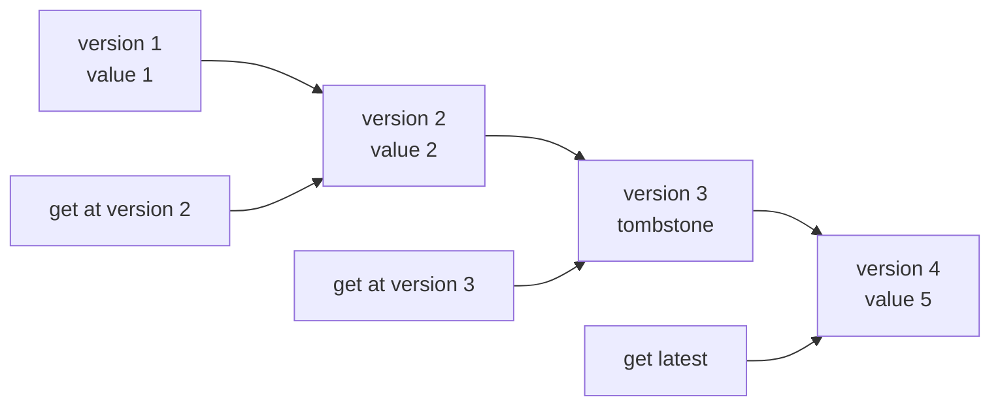
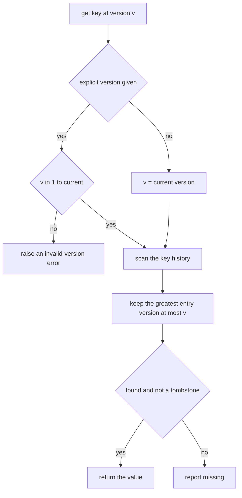
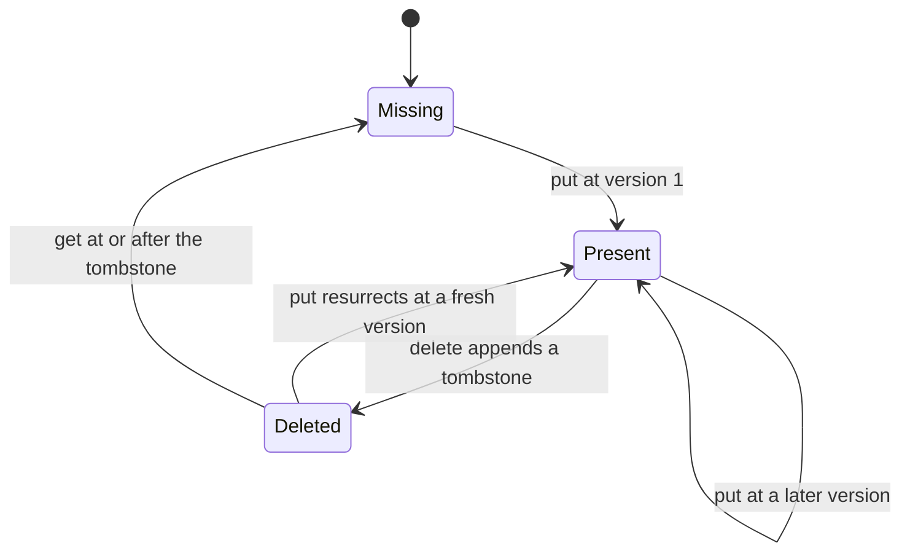
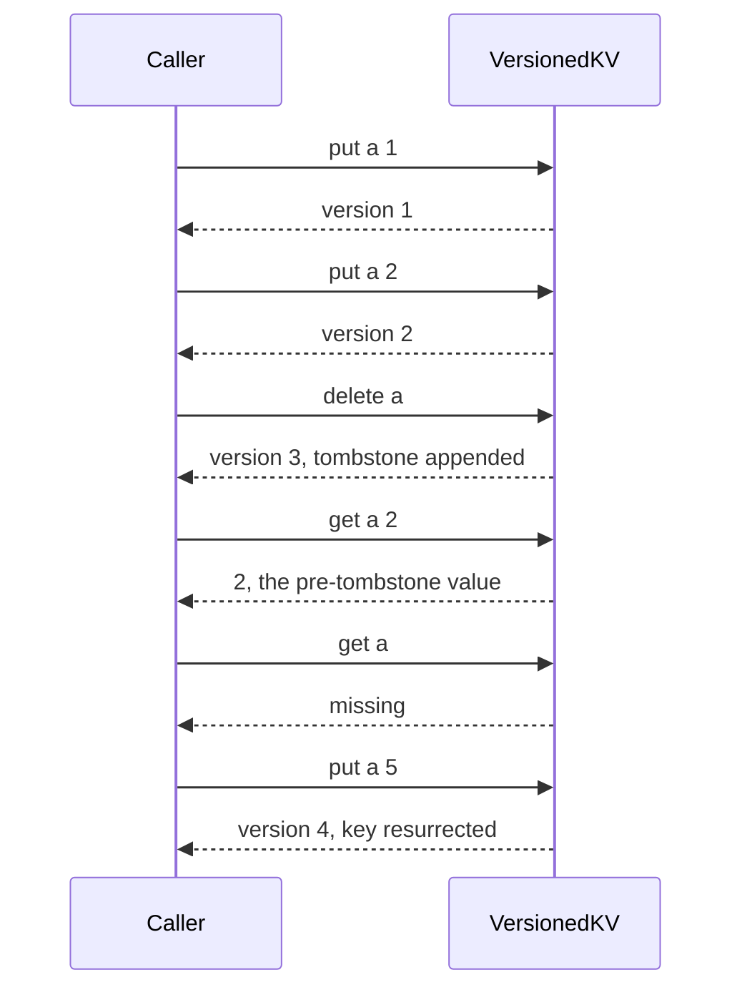

# 360 — Versioned key-value store (basic)

> **Tier:** Intermediate · **CTCI chapter:** Ch 14 — Databases
> **Task spec:** [360-implement-versioned-key-value-store-basic.md](../../../tasks/intermediate/360-implement-versioned-key-value-store-basic.md)
> **Solutions:** [Python](../../../solutions/python/intermediate/360-implement-versioned-key-value-store-basic/solution.py) ·
> [Java](../../../solutions/java/intermediate/360-implement-versioned-key-value-store-basic/Solution.java) ·
> [JavaScript](../../../solutions/javascript/intermediate/360-implement-versioned-key-value-store-basic/solution.js) ·
> [C#](../../../solutions/csharp/intermediate/360-implement-versioned-key-value-store-basic/Solution.cs)

## 1. Problem restatement

Implement a key-value store in which every write consumes a **monotonically increasing version** and
reads can time-travel.

| Operation | Result |
| --- | --- |
| `put(key, value)` | stores the value and returns the version it consumed |
| `delete(key)` | appends a **tombstone** at a fresh version and returns it |
| `get(key)` | the value as of the latest version, or missing |
| `get(key, version)` | the value as of that version, or missing when the greatest version at or below it is a tombstone |
| `latest_version()` | the current version counter |

Documented rules the files implement:

- versions start at `1` and increase by exactly one per **write** — reads never consume one, so reads are
  idempotent;
- history is never erased: `delete` appends a tombstone rather than removing entries, so a value written
  before a delete is still visible through `get(key, v)` for `v` before the delete;
- a later `put` **resurrects** the key at a fresh version, without disturbing the older history;
- an explicit version must lie in `1 … current`, otherwise the read raises (`ValueError` in Python and
  Java, `RangeError` in JavaScript, `ArgumentException` in C#);
- the automatic latest read is allowed on an empty store and reports missing.

The canonical script asserted by all four files:

| Step | Call | Result |
| --- | --- | --- |
| 1 | `get("a")` on an empty store | missing |
| 2 | `put("a", 1)` | version `1` |
| 3 | `put("a", 2)` | version `2` |
| 4 | `get("a", 1)` / `get("a", 2)` / `get("a")` | `1` / `2` / `2` |
| 5 | `delete("a")` | version `3` |
| 6 | `get("a")` / `get("a", 2)` / `get("a", 3)` | missing / `2` / missing |
| 7 | `put("a", 5)` | version `4` |
| 8 | `get("a")` / `get("a", 3)` / `get("a", 1)` | `5` / missing / `1` |
| 9 | `get("missing")` and `get("missing", 2)` | missing |

Then: 100 repeated reads prove idempotence (the version counter is unchanged at `4`), invalid versions
`0`, `-1` and `5` each raise, and a **200-operation LCG script** over an 8-key keyspace is cross-checked
against a naive per-version snapshot list — `snapshots[v - 1]` being the whole map state after the `v`-th
write.

## 2. Intuition

The naive way to support "what did this key look like earlier?" is to keep one value per key and to
overwrite it, which destroys the answer. The opposite extreme is to copy the entire map on every write,
which costs O(n) per write and O(n · writes) space.

The key insight is that a key's history is **append-only** and totally ordered by version: each write to a
key appends `(version, value)`, and a read at version `v` is served by the *greatest* entry whose version
is at most `v`. So the store is a map from key to a sorted list of versions, and time-travel is a single
scan (or binary search) inside one key's list — no copying, and no per-key snapshot.

Deletion needs one extra idea: if `delete` removed the key's list, earlier versions would become
unreadable, which contradicts the contract. Instead `delete` appends a **tombstone** — a distinguished
marker — at a fresh version. Reads treat a tombstone exactly like "missing", while the entries before it
stay in the list, and a later `put` simply appends a real value again.



Because a tombstone is a *value* in the history rather than an absence, the same lookup rule answers
every question: latest reads find the last entry (a tombstone means missing), historical reads find the
entry at that version, and resurrection is just another append.

## 3. Algorithm

1. Keep a global `version` counter starting at `0` and a map `key → list of (version, value)` pairs where
   the "value" may be the tombstones marker. Each key's list is sorted by construction, because versions
   only ever increase.
2. **`put(key, value)`** increments the counter, appends `(version, value)` to the key's list, and
   returns the version.
3. **`delete(key)`** increments the counter, appends `(version, tombstone)`, and returns the version.
4. **`get(key, version=None)`**: when no version is given, use the latest; otherwise validate that it lies
   in `1 … current` and raise otherwise. Then scan the key's list for the greatest `entry_version`
   `<= version`, stopping at the first entry beyond it (the list is sorted). Return missing if no entry
   qualifies or if the qualifying value is the tombstone.

```text
procedure get(key, version)
    if version is not given then
        version = current_version
    else if version < 1 or version > current_version then
        raise an error
    end
    if version < 1 then
        return missing
    end
    found = false
    latest_entry = missing
    for each (entry_version, value) in history of key, in increasing version order do
        if entry_version <= version then
            latest_entry = value
            found = true
        else
            break                     # the list is sorted, so nothing later can qualify
        end
    end
    if found is false or latest_entry is the tombstone then
        return missing
    end
    return latest_entry
end

procedure put(key, value)
    current_version = current_version + 1
    append (current_version, value) to history of key
    return current_version
end

procedure delete(key)
    current_version = current_version + 1
    append (current_version, tombstone) to history of key
    return current_version
end
```

Note the symmetry: `put` and `delete` differ only in what they append, and `get` never mutates anything,
which is why reads are idempotent and why the version counter after 100 reads is still `4`.



The lifecycle of one key shows why only an append is ever needed:



## 4. Worked example

The canonical script, key `"a"`, with the history list after each write:

| Version | Operation | History for `"a"` | `get("a")` | `get("a", v)` |
| --- | --- | --- | --- | --- |
| 0 | — | empty | missing | — |
| 1 | `put("a", 1)` | `[(1, 1)]` | `1` | `get("a", 1) = 1` |
| 2 | `put("a", 2)` | `[(1, 1), (2, 2)]` | `2` | `get("a", 2) = 2` |
| 3 | `delete("a")` | `[(1, 1), (2, 2), (3, tombstone)]` | missing | `get("a", 3) = missing` |
| 4 | `put("a", 5)` | `[(1, 1), (2, 2), (3, tombstone), (4, 5)]` | `5` | `get("a", 3) = missing`, `get("a", 1) = 1` |

Two rows deserve attention. At version 3 the latest read reports missing, yet `get("a", 2)` still
returns `2` — the tombstone hides the *current* value without erasing history. At version 4 the key is
back, and the range below the tombstone still reads exactly as before.

The lookup scan for `get("a", 2)` visits entries in order and stops at the first version above the
requested one:

| Entry version | `<= 2`? | Action |
| --- | --- | --- |
| 1 | yes | candidate becomes `1` |
| 2 | yes | candidate becomes `2` |
| 3 and 4 | no | break — the list is sorted, nothing later can qualify |

Result: `2`. For `get("a", 3)` the same scan admits the tombstone as the candidate, and the final test
converts the tombstone into "missing".



The randomised script is the exhaustive check. It runs 200 operations over the keyspace `k0 … k7` with
the repository LCG (`seed = 20260`, `seed = (seed * 75 + 74) mod 65537`), a delete whenever
`seed mod 4 == 0` and a put otherwise, and after every operation records the whole map in a snapshot
list used as the oracle:

| Assertion | Meaning |
| --- | --- |
| `version == step + 1` | exactly one version per write, with no gaps |
| `snapshots.append(dict(reference))` | the naive oracle records the whole map state after write `v` |
| after all 200 operations | `latest_version() == 200` |
| for every key ever touched, plus an absent key | `store.get(key) == reference.get(key)` |
| for every key and every `v` in `1 … 200` | `store.get(key, v) == snapshots[v - 1].get(key)` |
| after the mass of reads | `latest_version()` unchanged |

That last pair of loops is 8 keys × 200 versions of comparisons — a full reconstruction of the store's
history from the oracle, key by key and version by version.

## 5. Complexity

Let `n` be the number of writes and `w(k)` the number of writes to key `k`, so `Σ w(k) = n`.

| Measure | Bound | Why it holds |
| --- | --- | --- |
| `put` | O(1) | one counter increment and one append |
| `delete` | O(1) | the same, with a tombstone instead of a value |
| `get(key)` (latest) | O(w(k)) in the shipped scan, O(log w(k)) with binary search | the entry is the last one in the key's list |
| `get(key, version)` | O(w(k)) scanned, O(log w(k)) with binary search | find the greatest entry version at or below the request |
| `latest_version` | O(1) | the counter |
| Space | O(n) total, O(w(k)) per key | every write appends one entry; nothing is ever removed |
| Space versus full snapshots | O(n) instead of O(n · keys) | only the touched key grows, not the whole map |
| `get` idempotence | reads never mutate | so the version counter, and therefore every future answer, is unchanged |

Comparison with the alternatives:

| Design | `put` cost | Time-travel reads | Space |
| --- | --- | --- | --- |
| Single value per key | O(1) | impossible | O(keys) |
| Full snapshot per write | O(keys) | O(1) lookup in the snapshot map | O(n · keys) — the oracle used by the test |
| Per-key version history (shipped) | O(1) | O(w(k)) scanned, O(log w(k)) binary | O(n) |
| Copy-on-write persistent tree | O(log keys) | O(log keys) | O(n · log keys) shared structure |

The oracle's `O(n · keys)` snapshots are exactly what the store avoids, which is the point of the
version-per-key design: with 200 writes and 8 keys the naive approach stores roughly 200 × 8 entries,
while the store stores 200.
## 6. Pitfalls and edge cases

- **Erasing instead of tombstoning, and tombstones leaking out.** A `delete` that removed the key's
  history would break `get(key, v)` for every `v` before the delete; conversely a tombstone is an internal
  marker, so `get` must translate it into "missing" for the latest read and at its own version.
- **Version validation and read idempotence.** An explicit version outside `1 … current` raises — `0`,
  `-1` and `current + 1` are all asserted — while the *automatic* latest read is exempt, so it works on an
  empty store. Reads never consume a version: the canonical script performs 100 reads and asserts
  `latest_version()` is still `4`, and the randomised loop re-checks it after roughly 1600 reads.
- **Gaps in the version sequence.** A design that consumed two versions per delete, or skipped a version
  when a key did not exist, would break the oracle comparison because `snapshots[v - 1]` would no longer
  line up with write `v`. The script asserts `version == step + 1` on every step.
- **Scanning past the requested version.** The list is sorted, so the scan stops at the first entry
  greater than the request; ignoring the stop condition still works, but scans the whole history.
- **Missing keys and missing versions.** `get("missing")` and `get("missing", 2)` both report missing
  rather than raising; nothing distinguishes "never written" from "not yet written".
- **Resurrection must not rewrite history.** After `put("a", 5)`, `get("a", 3)` still reports missing and
  `get("a", 1)` still reports `1`; reusing the tombstone's version would corrupt the timeline.
- **Key types and tombstone representation.** Python uses a private sentinel object, Java and C# a pair
  or wrapper with a flag, JavaScript a distinguished constant — each must be impossible to confuse with a
  legitimate stored value. The scripts store small integers.
- **Unbounded history.** Nothing compacts old versions, so a long-lived key grows forever — the trade-off
  of the time-travel contract, and why production stores add garbage collection with a retention window.
- **Concurrency is out of scope.** This is a single-threaded store; safe concurrent writes are the
  version-checked commit problem of
  [346-implement-optimistic-concurrency-control-sketch-version-numbers.md](../../../tasks/intermediate/346-implement-optimistic-concurrency-control-sketch-version-numbers.md).
- **The oracle must be independent.** `snapshots[v - 1]` is a plain dictionary copied by the *test* after
  each write, not by the store — otherwise the comparison would only re-test one implementation.

## 7. Variants and follow-ups

- **Binary search and retention windows.** Replace the linear scan with a binary search over the key's
  version list for O(log w(k)) reads (the append-only invariant keeps it sorted), and drop entries older
  than a horizon to bound space at the cost of answering very old reads.
- **Optimistic concurrent writes.** Combine the version field with a compare-and-swap commit so two
  writers cannot both land on the same version — see
  [346-implement-optimistic-concurrency-control-sketch-version-numbers.md](../../../tasks/intermediate/346-implement-optimistic-concurrency-control-sketch-version-numbers.md).
- **MVCC reads in a real database.** The same "greatest version at or below the reader's timestamp"
  rule is how multi-version concurrency control serves consistent reads without blocking writers — see
  [359-readers-writers-fairness-implementation-and-tests.md](../../../tasks/intermediate/359-readers-writers-fairness-implementation-and-tests.md)
  for the locking alternative it replaces.
- The chapter walkthrough [Databases](../../ctci/14-databases.md) covers transactions, isolation and
  versioning.

## 8. Check yourself

1. Why does `delete` append a tombstone instead of removing the key?

<details><summary>Show answer</summary>

Because the contract promises that `get(key, v)` for any `v` in `1 … current` reconstructs the state at
that version, and removing the history would make every pre-delete read unreachable. The tombstone marks
"deleted at this version" while leaving the earlier entries in place, so `get("a", 2)` still returns `2`.

</details>

2. How does `get(key, v)` choose which entry to return?

<details><summary>Show answer</summary>

It returns the value of the greatest entry version at or below `v`. Because a key's entries are appended
in increasing version order, a single scan (or binary search) finds it; a tombstone at that position
means "missing", and no entry at or below `v` means the key did not exist yet.

</details>

3. Why is `latest_version()` still `4` after 100 reads in the canonical script?

<details><summary>Show answer</summary>

Because reads never consume a version — only `put` and `delete` do. Idempotence follows: repeating the
same read any number of times returns the same value and leaves the timeline unchanged, which is exactly
what the assertion `store.latest_version() == before == 4` checks.

</details>

4. What does the per-version snapshot oracle check that a latest-value comparison cannot?

<details><summary>Show answer</summary>

The full history. Comparing only the latest view would miss a corrupted or missing middle entry, an
entry inserted at the wrong version, or a tombstone at the wrong position. `snapshots[v - 1]` records the
whole map state after write `v`, and the test compares `get(key, v)` against it for every key and every
version, which is a complete reconstruction of the timeline.

</details>

5. Why does the version sequence have to be gap-free, and what breaks if it is not?

<details><summary>Show answer</summary>

Because the oracle indexes by write ordinal (`snapshots[v - 1]` is the state after the `v`-th write) and
readers address history by version. A skipped or doubled version would shift every historical read, which
is why `version == step + 1` is asserted on every step.

</details>
