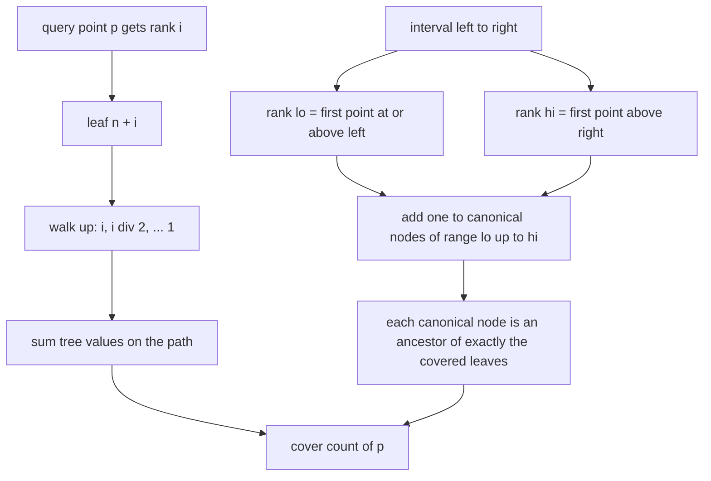
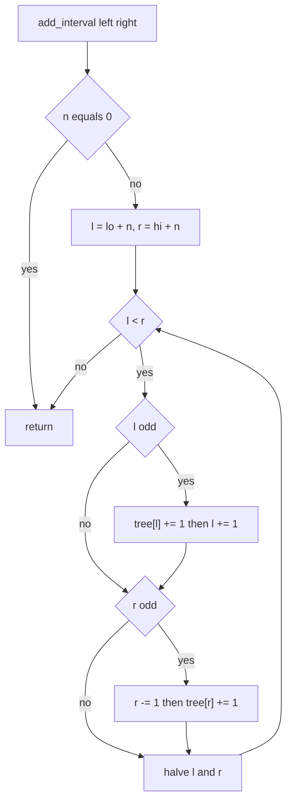
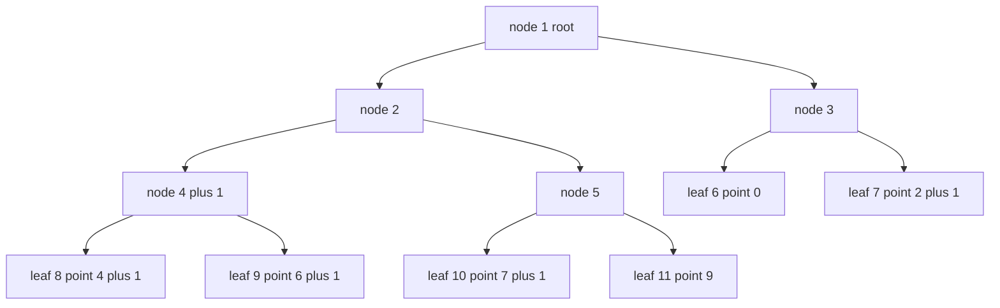

# 361 — Implement interval stabbing queries with segment tree.

> **Tier:** Intermediate · **CTCI chapter:** Ch 4 — Trees and Graphs
> **Task spec:** [361-implement-interval-stabbing-queries-with-segment-tree.md](../../../tasks/intermediate/361-implement-interval-stabbing-queries-with-segment-tree.md)
> **Solutions:** [Python](../../../solutions/python/intermediate/361-implement-interval-stabbing-queries-with-segment-tree/solution.py) ·
> [Java](../../../solutions/java/intermediate/361-implement-interval-stabbing-queries-with-segment-tree/Solution.java) ·
> [JavaScript](../../../solutions/javascript/intermediate/361-implement-interval-stabbing-queries-with-segment-tree/solution.js) ·
> [C#](../../../solutions/csharp/intermediate/361-implement-interval-stabbing-queries-with-segment-tree/Solution.cs)

## 1. Problem restatement

A *stabbing query* asks "how many intervals cover this point?". The four solutions build one
structure, `StabbingSegmentTree`, and drive it through three operations:

| Operation | Meaning |
| --- | --- |
| `StabbingSegmentTree(points)` | register the complete set of query points the structure will ever be asked about |
| `add_interval(left, right)` | add the **closed** integer interval `[left, right]` (both endpoints inclusive) |
| `cover_count(point)` | number of intervals added so far that contain `point` |

**Input:** a list of query points up front, then `k` inclusive intervals `[left, right]` with
integer endpoints, then one `cover_count` call per registered point.

**Output:** for every registered point `p`, the count of added intervals with
`left ≤ p ≤ right`. Points that were never registered are a programming error, not a query:
Python asserts `point was not registered`, and Java, JavaScript and C# throw.

The assertions shipped with the four solutions pin the contract down:

| Scenario | Registered points | Intervals added | Result |
| --- | --- | --- | --- |
| hand-built example | `0, 2, 4, 6, 7, 9` | `[1,4]`, `[3,6]`, `[5,8]` | `0, 1, 2, 2, 1, 0` |
| same intervals added twice | `0, 2, 4, 6, 7, 9` | each interval two times | `0, 2, 4, 4, 2, 0` |
| duplicate query points | `3, 3, 5, 3` → collapses to `3, 5` | `[1,4]` | `cover_count(3) = 1`, `cover_count(5) = 0` |
| single registered point | `7` | `[7,7]` then `[8,9]` | `cover_count(7) = 1` |
| no registered point | `[]` | `[-3, 12]` | no-op, must not fail |

Beyond the hand-built cases every solution cross-checks against a naive
`naive_cover_count(intervals, point)` loop on 25 deterministic LCG trials
(`seed = (seed * 75 + 74) % 65537`, `count = 1 + seed % 40` intervals, `left = seed % 30`,
`width = 1 + seed % 10`, `right = left + width`) probed at all 48 integer points from `-2` to
`45`.

## 2. Intuition

The obvious implementation keeps the intervals in a list and answers each query by scanning:

```text
procedure naive_cover_count(intervals, point)
    total ← 0
    for each interval [left, right] in intervals do
        if left ≤ point and point ≤ right then
            total ← total + 1
        end
    end
    return total
end
```

That is `O(k)` per query and `O(k · q)` for `q` queries, and it throws away the one piece of
information the API hands us for free: **every query point is known before the first interval
arrives**. Knowing the query set up front is what allows *coordinate compression* — replace the
arbitrary integer coordinates with their ranks, `0 … n - 1`, where `n` is the number of distinct
registered points.

Once coordinates are ranks, "which registered points does `[left, right]` contain?" becomes a
contiguous index range: from the first rank `≥ left` to the last rank `≤ right`. The problem is
now *range add, point query*:

- `add_interval` performs one **range add** of `+1` on a rank range;
- `cover_count` performs one **point query** on a rank.

The key insight is that these two operations are duals, so a single lazy-free segment tree
suffices. Instead of pushing an increment all the way down to the leaves, `add_interval` stores
`+1` on the `O(log n)` *canonical* nodes that exactly tile the range, and `cover_count` walks
from the target leaf up to the root summing whatever it finds on the way. Every canonical node
of the range lies on the leaf-to-root path exactly when the leaf is inside the range, so the sum
is exactly the number of covering intervals.



The two arrows that reach `cover count of p` are the whole trick: the range decomposition
guarantees each covered interval contributes exactly one stored `+1` to the path, and each
uncovered interval contributes none.

## 3. Algorithm

The four solutions use the same iterative segment tree over `2n` slots (indices `1 … 2n-1`,
leaves at `n … 2n-1`).

1. **Build:** sort the raw query points, drop duplicates, keep `n` distinct values in `points`.
   Allocate `tree` with `2 · max(n, 1)` zero slots — the `max` keeps the array non-empty so that
   an empty point set is harmless.
2. **Range add:** binary-search the rank range `[lo, hi)` where `lo` is the first rank with
   `points[rank] ≥ left` and `hi` is the first rank with `points[rank] > right`. Then run the
   standard bottom-up decomposition of `[lo + n, hi + n)`.
3. **Point query:** binary-search the rank of `point`, reject an unregistered point, then sum
   `tree[i]` for `i = rank + n, rank + n >> 1, … , 1`.
4. **Return** the accumulated sum.

```text
procedure build(points)
    sorted_points ← distinct values of points in increasing order
    n ← length of sorted_points
    tree ← array of 2 * max(n, 1) zeroes
end

procedure add_interval(left, right)
    if n = 0 then
        return
    end
    lo ← first rank r with sorted_points[r] ≥ left
    hi ← first rank r with sorted_points[r] > right
    l ← lo + n
    r ← hi + n
    while l < r do
        if l is odd then
            tree[l] ← tree[l] + 1
            l ← l + 1
        end
        if r is odd then
            r ← r - 1
            tree[r] ← tree[r] + 1
        end
        l ← l div 2
        r ← r div 2
    end
end

procedure cover_count(point)
    rank ← first rank r with sorted_points[r] ≥ point
    assert rank < n and sorted_points[rank] = point
    total ← 0
    i ← rank + n
    while i ≥ 1 do
        total ← total + tree[i]
        i ← i div 2
    end
    return total
end
```

`hi` is an *exclusive* rank, which is why the interval stays closed: `upper_bound` skips every
point `≤ right`, so the last rank included is the last one that is `≤ right`. Python gets both
ranks from `bisect_left` / `bisect_right`; the other three languages implement `lowerBound` and
`upperBound` by hand over the sorted array.



Every iteration moves `l` and `r` one level up the tree, so the loop runs at most `log2 n + 1`
times, and each iteration stores at most one increment per side.

## 4. Worked example

Take the hand-built case from the task: registered points `0, 2, 4, 6, 7, 9` (so `n = 6`, leaves
`6 … 11`) and intervals `[1,4]`, `[3,6]`, `[5,8]`.

| Step | Call | `lo` | `hi` | Decomposition | `tree` slots touched |
| --- | --- | --- | --- | --- | --- |
| 1 | `add_interval(1, 4)` | 1 (`2`) | 3 (`6`) | `[7, 9)` → leaves 7, 8 | `tree[7] = 1`, `tree[8] = 1` |
| 2 | `add_interval(3, 6)` | 2 (`4`) | 4 (`7`) | `[8, 10)` → node 4 | `tree[4] = 1` |
| 3 | `add_interval(5, 8)` | 3 (`6`) | 5 (`9`) | `[9, 11)` → leaves 9, 10 | `tree[9] = 1`, `tree[10] = 1` |

Step 2 is the interesting one: `[8, 10)` never stores at leaf level, because node 4 already
covers exactly leaves 8 and 9 — ranks 2 and 3, points `4` and `6`. That single slot now stands
for two points, which is the whole point of keeping increments high in the tree.

Reading back each point means summing its leaf-to-root path:

| Point | rank | Path | Sum | Expected |
| --- | --- | --- | --- | --- |
| `0` | 0 | `6 → 3 → 1` = `0, 0, 0` | 0 | 0 |
| `2` | 1 | `7 → 3 → 1` = `1, 0, 0` | 1 | 1 |
| `4` | 2 | `8 → 4 → 2 → 1` = `1, 1, 0, 0` | 2 | 2 |
| `6` | 3 | `9 → 4 → 2 → 1` = `1, 1, 0, 0` | 2 | 2 |
| `7` | 4 | `10 → 5 → 2 → 1` = `1, 0, 0, 0` | 1 | 1 |
| `9` | 5 | `11 → 5 → 2 → 1` = `0, 0, 0, 0` | 0 | 0 |

Point `4` is covered by `[1,4]` (stored at its own leaf 8) *and* by `[3,6]` (stored at the shared
ancestor 4), so the sum is 2 — and the same two increments are what make point `6` return 2 as
well.



Adding the same three intervals a second time adds `+1` to exactly the same five slots, so every
path sum doubles and the counts become `0, 2, 4, 4, 2, 0` — which is the second assertion in all
four solution files.

## 5. Complexity

Let `n` be the number of **distinct** registered points, `k` the number of intervals added, and
`q` the number of queries answered. All four solutions pay the same bounds.

| Measure | Bound | Why it holds |
| --- | --- | --- |
| Build | O(n log n) | sorting the raw point list dominates; dedup (a sort plus a linear scan, or a set) is linear afterwards |
| `add_interval` | O(log n) | two binary searches over `points`, then the decomposition loop performs at most `log2 n + 1` halvings and stores at most one increment per side per level |
| `cover_count` | O(log n) | one binary search, then the path `rank + n → … → 1` has `floor(log2 n) + 1` nodes |
| Total for `k` intervals and `q` queries | O(n log n + (k + q) log n) | build once, then one logarithmic operation per call |
| Extra space | O(n) | `points` holds `n` values and `tree` holds `2 · max(n, 1)` counters, regardless of `k` |
| Naive per query | O(k) | the scan touches every interval |
| Naive total | O(k · q) | no compression, no reuse |

The naive comparator is worth keeping even after the segment tree is written: the four solutions
all assert `cover_count(p) == naive_cover_count(intervals, p)` on the hand-built intervals and on
25 LCG trials, at the cost of one extra `O(k)` scan per probe point only inside the tests. Because
`k` can be up to 40 and the probe is 48 points wide in those trials, this cross-check is cheap
and still catches decomposition mistakes. A Fenwick tree with a range-add trick has the same
asymptotics and a smaller constant, but the segment tree keeps the "canonical nodes on the path"
picture visible, which is what the task is teaching.

## 6. Pitfalls and edge cases

- **Unregistered point.** `cover_count` on a point that was not in the constructor argument is
  rejected (`assert` in Python, `IllegalArgumentException` in Java, `Error` in JavaScript,
  `Exception` in C#). Compression makes such a query unanswerable, since its rank does not exist.
- **Empty point set.** `n = 0` and no leaf can ever be reached. Every solution guards
  `add_interval` with an early return and allocates `2 · max(n, 1)` slots; the file asserts that
  `StabbingSegmentTree([]).add_interval(-3, 12)` does not fail.
- **Duplicate query points collapse.** `[3, 3, 5, 3]` becomes `points = [3, 5]`; `[1,4]` then
  reports `1` at `3` and `0` at `5`. A count per *raw* input would be a different structure.
- **Single registered point.** `n = 1`: leaves live at index 1, which is also the root, so
  `add_interval` and `cover_count` both touch exactly one slot. `[7,7]` yields `1` and `[8,9]`
  yields nothing.
- **Closed intervals.** The endpoints are inclusive, so the upper rank must be computed with an
  exclusive `upper_bound` on `right`. Using `bisect_left` on both ends silently drops the last
  rank whenever `right` itself is registered.
- **Empty rank range.** An interval that contains no registered point (starts after every point,
  or ends before every point) leaves `l ≥ r` immediately and changes nothing — this is how
  `[8, 9]` stays invisible to the probe set above.
- **Adding the same interval twice is legal and must count twice.** This is not deduplication of
  intervals; a *multiset* of intervals is being counted, and the doubling assertion pins it down.
- **Negative coordinates.** The probe points run from `-2`, so `left` may be negative while every
  rank stays non-negative. No index arithmetic depends on the sign of the coordinates.
- **Integers only.** Endpoints are integer and the query points are integer; a fractional point
  would have no rank and would have to be handled by a different (non-compressed) formulation.
- **`2 · n` sizing.** The iterative layout needs index `2n - 1` at the worst, so the array must be
  `2n` long — `2n - 1` or `n` slots produce an out-of-range write for `n ≥ 2`.

## 7. Variants and follow-ups

- **Two dimensions.** The same "add on canonical nodes, read the path" idea lifts to a 2D grid;
  [362-implement-2d-segment-tree-for-range-sum-conceptual.md](../../../tasks/intermediate/362-implement-2d-segment-tree-for-range-sum-conceptual.md)
  is the rectangular version of this structure.
- **Sweep instead of stab.** If the intervals are axis-aligned rectangles and the question is
  their union area rather than a point count, the range add becomes an "active height" counter and
  the queries are answered between events —
  [370-line-sweep-for-rectangle-area-union.md](../../../tasks/intermediate/370-line-sweep-for-rectangle-area-union.md)
  uses exactly that range-add/measure pattern.
- **Spatial neighbours instead of stabbing.** When the data are points in the plane and the query
  is "what is closest?", compression on one axis stops being enough:
  [363-implement-kd-tree-for-2d-nearest-neighbor-basic.md](../../../tasks/intermediate/363-implement-kd-tree-for-2d-nearest-neighbor-basic.md)
  and
  [369-closest-pair-of-points-divide-conquer.md](../../../tasks/intermediate/369-closest-pair-of-points-divide-conquer.md)
  trade the compressed axis for recursive splitting.
- **Fenwick tree with prefix adds.** A range add `[lo, hi)` is two prefix adds, and a point query
  is one prefix sum; the Fenwick version is shorter but loses the node-tiling intuition.
- **Dynamic query set.** If points can be discovered after the tree is built, compression must be
  redone — the usual fix is a balanced tree with subtree counters instead of a compressed array.

## 8. Check yourself

1. Why do the solutions need all query points *before* the intervals arrive?

<details><summary>Show answer</summary>

Because they answer queries against ranks, not coordinates. Compression needs the full point set
to assign ranks, and the segment tree's leaves are those ranks. `cover_count` on a point outside
the registered set is rejected rather than answered, precisely because it has no rank.

</details>

2. How can `tree[4]` alone account for both point `4` and point `6` in the worked example?

<details><summary>Show answer</summary>

Node 4 in the `n = 6` layout is the parent of leaves 8 and 9, i.e. ranks 2 and 3, i.e. points `4`
and `6`, and of nothing else. The interval `[3,6]` covers exactly those two points, so the
decomposition of `[8, 10)` chooses node 4 and stores one `+1` there. Both leaves see it because
both have node 4 on their leaf-to-root path.

</details>

3. Why is no push-down (lazy propagation) needed, unlike in a range-sum tree?

<details><summary>Show answer</summary>

Because the tree is never asked for a *subrange* aggregate. `cover_count` is a point query, and a
point query only needs the sum along one path. An increment stored at an ancestor is visible to
every leaf below it, which is exactly the semantics being counted, so increments never have to be
distributed downwards.

</details>

4. What breaks if the upper rank is computed with `bisect_left` instead of `bisect_right`?

<details><summary>Show answer</summary>

`hi` would become the rank of the first point equal to `right` rather than the first rank after
it, so the range would be exclusive of `right`. A registered point exactly at `right` would lose
one increment, and the hand-built example would report `1` instead of `2` at point `4`.

</details>

5. Give an interval that executes zero iterations of the decomposition loop and say why.

<details><summary>Show answer</summary>

`[8, 8]` against the points `0, 2, 4, 6, 7, 9`: `lo` is the first rank `≥ 8`, namely 5 (point
`9`), and `hi` is the first rank `> 8`, also 5, because `9` is the first point above `8`. With
`l = r = 11` the loop exits before its first iteration, which is the general condition for an
interval that contains no registered point. The solutions assert the same behaviour with
`points = [7]` and `add_interval(8, 9)`: `cover_count(7)` stays 1.

</details>
