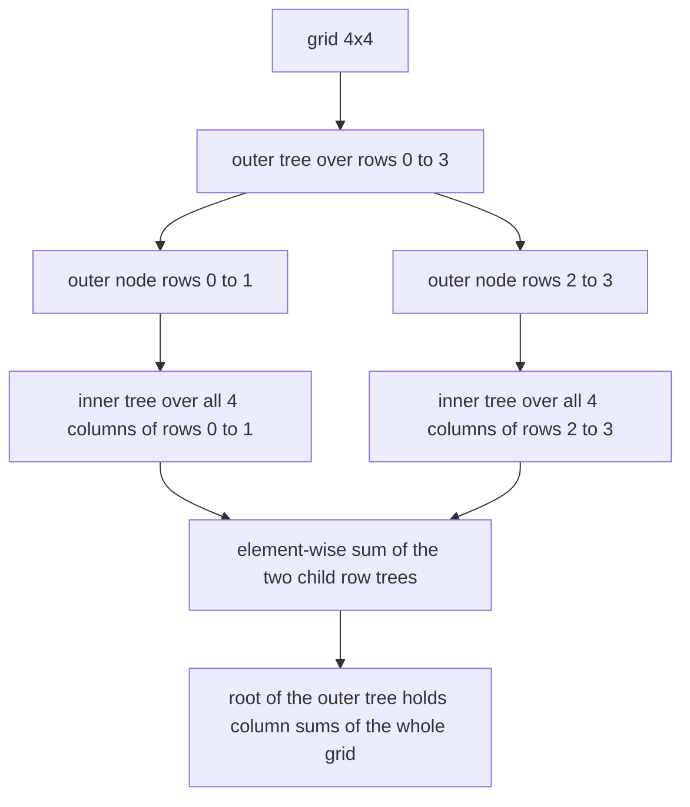
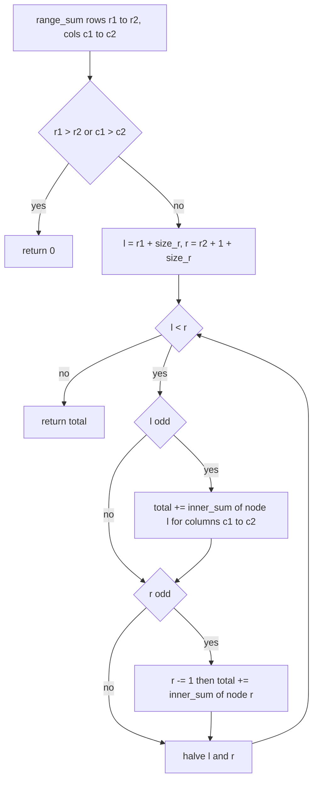
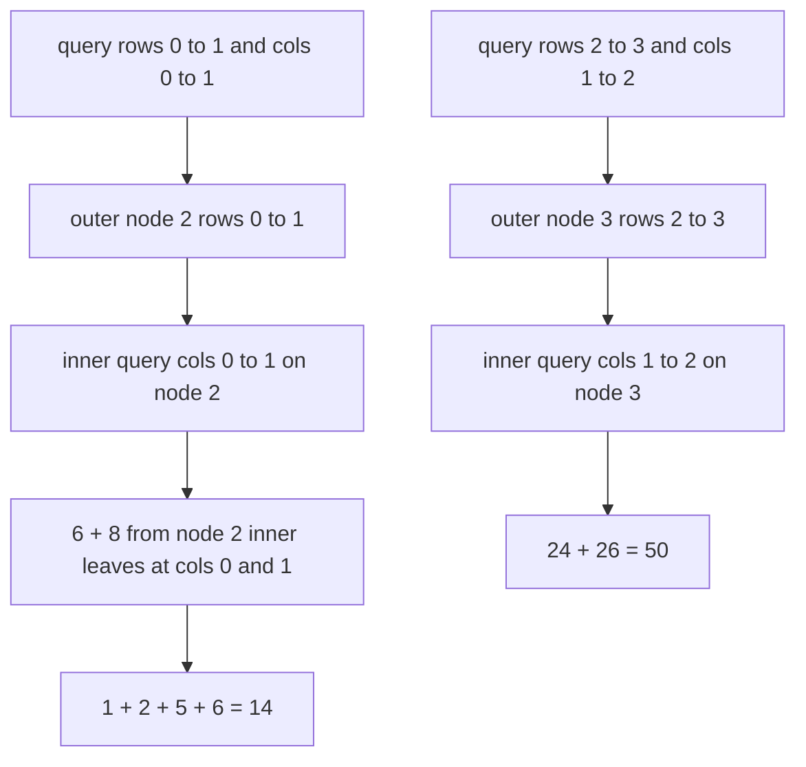

# 362 — Implement 2D segment tree for range sum (conceptual).

> **Tier:** Intermediate · **CTCI chapter:** Ch 4 — Trees and Graphs
> **Task spec:** [362-implement-2d-segment-tree-for-range-sum-conceptual.md](../../../tasks/intermediate/362-implement-2d-segment-tree-for-range-sum-conceptual.md)
> **Solutions:** [Python](../../../solutions/python/intermediate/362-implement-2d-segment-tree-for-range-sum-conceptual/solution.py) ·
> [Java](../../../solutions/java/intermediate/362-implement-2d-segment-tree-for-range-sum-conceptual/Solution.java) ·
> [JavaScript](../../../solutions/javascript/intermediate/362-implement-2d-segment-tree-for-range-sum-conceptual/solution.js) ·
> [C#](../../../solutions/csharp/intermediate/362-implement-2d-segment-tree-for-range-sum-conceptual/Solution.cs)

## 1. Problem restatement

**Input:** a fixed integer grid `grid` with `rows` rows and `cols` columns, then rectangle queries
`(row_lo, row_hi, col_lo, col_hi)` with inclusive bounds.

**Output:** the sum of every cell inside the queried rectangle,
`sum(grid[r][c] for r in row_lo..row_hi, c in col_lo..col_hi)`.

One class, `SegmentTree2D`, is built once per grid and then answers any number of queries:

| Call | Result | Why |
| --- | --- | --- |
| `range_sum(0, 3, 0, 3)` on the 4×4 grid `1…16` | `136` | the whole grid, `1 + 2 + … + 16` |
| `range_sum(0, 1, 0, 1)` | `14` | `1 + 2 + 5 + 6` |
| `range_sum(2, 3, 1, 2)` | `50` | `10 + 11 + 14 + 15` |
| `range_sum(1, 1, 0, 3)` | `26` | a single row, `5 + 6 + 7 + 8` |
| `range_sum(0, 3, 0, 0)` | `28` | a single column, `1 + 5 + 9 + 13` |
| `range_sum(2, 2, 3, 3)` | `12` | a single cell |
| `range_sum(3, 0, 0, 3)` | `0` | empty row range by convention |
| `range_sum(0, 3, 3, 2)` | `0` | empty column range by convention |

The four solutions also pin down the degenerate shapes — `[[7]]` answers `7`; a `1 × 5` grid
`[[1, -2, 3, 4, 5]]` answers `11` for the full row and `5` for columns `1…3`; a `5 × 1` column
grid answers `15` in full and `12` for rows `2…4` — and cross-check six deterministic 8×8 LCG
grids (`seed = (seed * 75 + 74) % 65537`, cell values `seed % 20 - 5`, so both signs occur) plus
the non-power-of-two shapes `3 × 5`, `5 × 3` and `7 × 1` against a naive double loop. The
docstring calls the task *conceptual* because the nested structure materialises every inner tree,
which is why the checked grids stay small.

## 2. Intuition

The naive query walks the rectangle and adds each cell: correct, `O(rows · cols)` per query, and
it repeats work for overlapping rectangles. A 1D segment tree fixes the 1D version; the natural
2D generalisation is to take that tree and hang a second tree off every node.

The key insight is the **merge rule for sums**: an outer node covering rows `r1..r2` can store a
whole 1D segment tree over columns, and an internal outer node must simply be the *element-wise
sum* of its two children — because the rows under it are exactly the union of the rows under its
children, with no overlap. Column-wise sums therefore add up along the outer tree with no
interaction, so the merge is a plain vector addition over `2 · size_c` slots.

That gives a two-level query: decompose the row range into `O(log rows)` canonical outer nodes,
and ask each of them its own `O(log cols)` inner query. The rectangle is not sliced into cells;
it is sliced into `O(log rows)` row blocks, and each block is sliced into `O(log cols)` column
blocks.



Both trees are the flat `2n` iterative layout used in task 361: `size_r` and `size_c` are the
next powers of two above `rows` and `cols`, leaves of the outer tree sit at `size_r + r`, and each
outer node owns an array of `2 · size_c` column sums whose leaves are at `size_c + c`.

## 3. Algorithm

1. **Pad:** `size_r` = smallest power of two `≥ rows`, `size_c` = smallest power of two `≥ cols`.
2. **Leaves:** for each row `r`, write `grid[r][c]` into slot `size_c + c` of the outer array
   `size_r + r`, then build that inner tree bottom-up as `tree[node] = tree[2·node] + tree[2·node+1]`
   for `node = size_c - 1 … 1`.
3. **Merge:** for every internal outer node `node = size_r - 1 … 1`, set
   `tree[node][j] = left[j] + right[j]` for all `j` in `1 … 2·size_c - 1`. The slots below
   `size_c` are inner internal nodes and the slots at or above `size_c` are column leaves; adding
   both ranges keeps the whole inner tree consistent.
4. **Query:** if `row_lo > row_hi` or `col_lo > col_hi`, return `0`. Otherwise run the iterative
   decomposition of the row range `[row_lo + size_r, row_hi + 1 + size_r)`; for every canonical
   outer node found, add its inner result for the half-open column range
   `[col_lo + size_c, col_hi + 1 + size_c)`.
5. **Return** the accumulated total.

```text
procedure build(grid)
    size_r ← smallest power of two ≥ rows
    size_c ← smallest power of two ≥ cols
    trees ← 2 * size_r arrays of 2 * size_c zeroes
    for r ← 0 to rows - 1 do
        write grid[r][0 .. cols - 1] into trees[size_r + r][size_c .. size_c + cols - 1]
        build_inner(trees[size_r + r])
    end
    for node ← size_r - 1 down to 1 do
        for j ← 1 to 2 * size_c - 1 do
            trees[node][j] ← trees[2 * node][j] + trees[2 * node + 1][j]
        end
    end
end

procedure build_inner(tree)
    for node ← size_c - 1 down to 1 do
        tree[node] ← tree[2 * node] + tree[2 * node + 1]
    end
end

function inner_sum(tree, col_lo, col_hi)
    total ← 0
    l ← col_lo + size_c
    r ← col_hi + size_c
    while l < r do
        if l is odd then
            total ← total + tree[l]
            l ← l + 1
        end
        if r is odd then
            r ← r - 1
            total ← total + tree[r]
        end
        l ← l div 2
        r ← r div 2
    end
    return total
end

function range_sum(row_lo, row_hi, col_lo, col_hi)
    if row_lo > row_hi or col_lo > col_hi then
        return 0
    end
    total ← 0
    l ← row_lo + size_r
    r ← row_hi + 1 + size_r
    while l < r do
        if l is odd then
            total ← total + inner_sum(trees[l], col_lo, col_hi + 1)
            l ← l + 1
        end
        if r is odd then
            r ← r - 1
            total ← total + inner_sum(trees[r], col_lo, col_hi + 1)
        end
        l ← l div 2
        r ← r div 2
    end
    return total
end
```

Step 3 is the only place where the 2D structure is more than "a tree per node": because the
build copies whole `2 · size_c` slot ranges, an outer node is a consistent inner tree at *every*
index, not only at the leaves.



Each outer iteration costs one `O(log cols)` inner query, and the loop has `O(log rows)`
iterations, so one rectangle is answered in `O(log rows · log cols)` regardless of the rectangle
size.

## 4. Worked example

Use the hand-checked 4×4 grid

|  | col 0 | col 1 | col 2 | col 3 |
| --- | --- | --- | --- | --- |
| row 0 | 1 | 2 | 3 | 4 |
| row 1 | 5 | 6 | 7 | 8 |
| row 2 | 9 | 10 | 11 | 12 |
| row 3 | 13 | 14 | 15 | 16 |

`rows = cols = 4`, so `size_r = size_c = 4` and there is no padding. Trace
`range_sum(2, 3, 1, 2)`, the expected `50`:

The outer loop starts from the half-open row range `[row_lo + size_r, row_hi + 1 + size_r)`, here
`[6, 8)` — the two leaves for rows 2 and 3 — but it does not stop at the leaves: it keeps halving
until `l` and `r` meet, which lets it answer a *pair* of leaves with their shared parent.

| Iteration | `l` | `r` | `l` odd | `r` odd | Action | `total` |
| --- | --- | --- | --- | --- | --- | --- |
| 1 | 6 | 8 | no | no | halve → `l = 3`, `r = 4` | 0 |
| 2 | 3 | 4 | yes: `inner_sum(node 3, cols [1, 3))`, `l = 4` | no | halve → `l = 2`, `r = 2` | 50 |
| 3 | 2 | 2 | — | — | `l < r` is false, stop | 50 |

The interesting moment is iteration 1: rows 2 and 3 started as leaves 6 and 7, yet the loop moved
up to node 3, their common parent, and answered both rows with a single inner query. Node 3's
inner tree holds the column sums of rows 2 and 3, so its inner leaves are `9 + 13 = 22` at column
0, `10 + 14 = 24` at column 1, `11 + 15 = 26` at column 2 and `12 + 16 = 28` at column 3. The
column range `1…2` therefore collects `24 + 26 = 50` from two inner leaves — the answer for both
rows at once. The complete accounting:

| Query | Canonical outer nodes | Inner result | Total |
| --- | --- | --- | --- |
| `range_sum(0, 3, 0, 3)` | node 1 | `1 + 2 + … + 16` | 136 |
| `range_sum(0, 1, 0, 1)` | node 2 (leaves 4, 5 climb to node 2) | `6 + 8` = `(1 + 5) + (2 + 6)` | 14 |
| `range_sum(2, 3, 1, 2)` | node 3 | `24 + 26` | 50 |
| `range_sum(1, 1, 0, 3)` | leaf 5 | `5 + 6 + 7 + 8` | 26 |
| `range_sum(0, 3, 0, 0)` | node 1 | `1 + 5 + 9 + 13` | 28 |
| `range_sum(2, 2, 3, 3)` | leaf 6 | `12` | 12 |

Rows `0…1` collapse to the single outer node 2, which is exactly the point of the merge rule: the
row block `0…1` is one node, so the query pays for one inner query instead of two.



## 5. Complexity

Let `R` and `C` be the real grid dimensions, and `size_r`, `size_c` the padded powers of two
(`R ≤ size_r < 2R`, `C ≤ size_c < 2C`).

| Measure | Bound | Why it holds |
| --- | --- | --- |
| Build | O(size_r · size_c) | the leaves cost `R · C` writes, the inner builds cost `O(size_c)` per row, and the merge walks `2 · size_c` slots for each of the `size_r - 1` internal outer nodes |
| Query | O(log R · log C) | `O(log size_r)` canonical outer nodes from the row decomposition, each answered in `O(log size_c)` |
| Space | O(size_r · size_c) | `2 · size_r` inner arrays of `2 · size_c` slots — at most four times the raw grid, since padding at most doubles each dimension and the flat layout doubles it again |
| Naive per query | O(R · C) | the double loop touches every cell of the rectangle, up to the whole grid |
| Naive for `q` queries | O(q · R · C) | no work is shared between overlapping rectangles |

The shipped grids are tiny (`4 × 4` hand-checked, `8 × 8` LCG, `3 × 5`, `5 × 3`, `7 × 1`), and the
exhaustive cross-check visits every one of the `36 × 36 = 1296` rectangles of each 8×8 grid per
trial, six trials plus three odd shapes. That is deliberate: the structure is
`O(size_r · size_c)` in memory, so the interesting behaviour (padding, merge rule, empty
ranges) is much cheaper to verify on small inputs than to benchmark on large ones.

## 6. Pitfalls and edge cases

- **Padding must be zero-filled.** `size_r` and `size_c` are powers of two, so a `3 × 5` grid
  leaves unused leaves in both trees. They are initialised to `0`, which keeps the additive merge
  correct; a `null`/`undefined` gap would poison every ancestor.
- **Non-power-of-two shapes are the normal case, not the exception.** The solutions explicitly
  check `3 × 5`, `5 × 3` and `7 × 1` exhaustively against the naive double loop.
- **Empty ranges return 0 by convention.** `row_lo > row_hi` or `col_lo > col_hi` short-circuits;
  the files assert `range_sum(3, 0, 0, 3) == 0` and `range_sum(0, 3, 3, 2) == 0`.
- **Closed upper bounds.** The public API is inclusive, but both inner and outer decompositions
  use half-open ranges: the caller's `row_hi` and `col_hi` are turned into `row_hi + 1` and
  `col_hi + 1` exactly once, at the entry points `range_sum` and `_inner_sum`.
- **Negative values are supported.** The LCG grid spans `seed % 20 - 5`, i.e. `-5 … 14`, so sums
  may be negative; nothing in the structure assumes positivity (unlike, say, a bit-count tree).
- **Degenerate shapes.** A single cell `[[7]]` has `size_r = size_c = 1`, leaves at index 1, and
  answers `7`; a single row and a single column both work, and the row case has `size_r = 1` so
  the outer decomposition is a single iteration.
- **No updates.** The structure is *static*: there is no point-update operation, because an
  update would have to touch `O(log rows · log cols)` inner trees. Rebuilding is the only
  documented way to change a cell, and the docstring's "conceptual" framing matches that
  simplification.
- **Build order matters.** Inner trees must be complete before the outer merge runs, and the
  outer merge must iterate `node = size_r - 1 … 1` so that both children are final when a parent
  is written.
- **Integer overflow is not exercised.** Cell values and grid sizes are small; the four solutions
  use native integer types without overflow guards, which is fine for the sizes they assert.

## 7. Variants and follow-ups

- **One dimension less.** The whole structure degenerates to the interval stabbing tree of
  [361-implement-interval-stabbing-queries-with-segment-tree.md](../../../tasks/intermediate/361-implement-interval-stabbing-queries-with-segment-tree.md)
  once `size_r = 1`; the inner query loop and the outer query loop are literally the same code.
- **Rectangle unions instead of rectangle sums.** When the rectangles are added rather than
  summed, the sweep line plus range-add tree of
  [370-line-sweep-for-rectangle-area-union.md](../../../tasks/intermediate/370-line-sweep-for-rectangle-area-union.md)
  answers in `O(n log n)`, which beats nesting a tree per node.
- **Region queries on sparse points.** If the grid is empty except for a few points, a quad tree
  ([364-implement-quad-tree-for-2d-region-queries.md](../../../tasks/intermediate/364-implement-quad-tree-for-2d-region-queries.md))
  adapts to the data instead of allocating a padded dense array.
- **Nearest-neighbour instead of sum.** For proximity queries the axis-wise structure is a kd-tree
  ([363-implement-kd-tree-for-2d-nearest-neighbor-basic.md](../../../tasks/intermediate/363-implement-kd-tree-for-2d-nearest-neighbor-basic.md)),
  which prunes with bounding boxes rather than with canonical nodes.
- **Fenwick tree of Fenwick trees.** A 2D BIT with `O(size_r · size_c)` similar memory but half
  the constant is the usual production answer when updates are also required.

## 8. Check yourself

1. Why is the inner tree of an internal outer node the element-wise sum of its children, rather
   than a structure that has to be rebuilt from the grid?

<details><summary>Show answer</summary>

Because the row ranges of the two children partition the parent's row range exactly. Summing two
column ranges is independent per column, so the column sums of the parent are the sum of the
children's column sums at every index of the inner tree. One pass of vector addition over
`2 · size_c` slots produces a fully consistent inner tree.

</details>

2. How many inner queries does `range_sum(0, 3, 0, 3)` need on the 4×4 grid, and how many does
   `range_sum(1, 1, 0, 3)` need?

<details><summary>Show answer</summary>

One each. Rows `0…3` decompose to the root (outer node 1) and row `1` decomposes to the single
leaf 5, so both queries pay exactly one `O(log cols)` inner query. The number of inner queries is
governed by the row range only, never by the width of the column range.

</details>

3. What would break if `size_r`/`size_c` were rounded *down* to the nearest power of two?

<details><summary>Show answer</summary>

Any grid dimension that is not a power of two would lose its last rows or columns: leaves live at
`size + index`, so `rows > size_r` would write past the end of the outer array, and even without a
crash the trailing grid cells would never contribute to any sum. Padding must round up.

</details>

4. Why do the solutions keep the asserted grids so small?

<details><summary>Show answer</summary>

Because the structure stores `2 · size_r` inner arrays of `2 · size_c` slots, i.e. `O(size_r · size_c)`
memory with a constant of about four over the raw grid. Small grids let the files compare *every*
rectangle against the naive double loop (1296 rectangles per 8×8 grid) instead of sampling, which
tests the padding and empty-range paths far more thoroughly than a large benchmark would.

</details>

5. What changes in the code if point updates must be supported?

<details><summary>Show answer</summary>

A point update at `(r, c)` must rewrite the leaf `size_c + c` of outer node `size_r + r` and then
recompute every ancestor: the inner path through `O(log cols)` nodes of that leaf's own tree, and
for each outer ancestor the merged value at the corresponding inner positions — `O(log rows · log cols)`
writes in total. The static build cannot stay `O(size_r · size_c)` once updates arrive, since the
merge would have to be redone incrementally.

</details>
