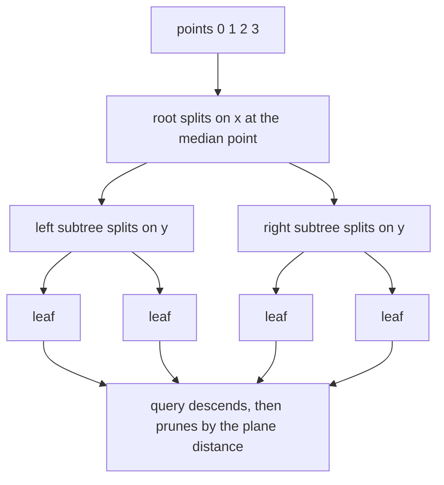
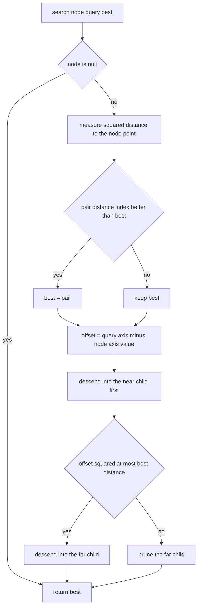
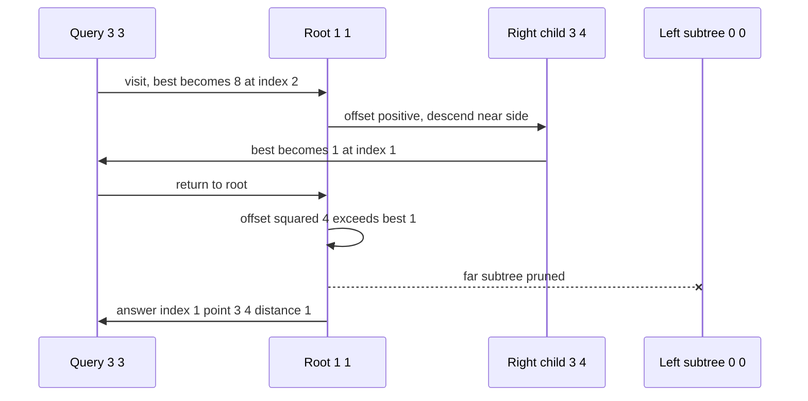

# 363 — Implement kd-tree for 2D nearest neighbor (basic).

> **Tier:** Intermediate · **CTCI chapter:** Ch 4 — Trees and Graphs
> **Task spec:** [363-implement-kd-tree-for-2d-nearest-neighbor-basic.md](../../../tasks/intermediate/363-implement-kd-tree-for-2d-nearest-neighbor-basic.md)
> **Solutions:** [Python](../../../solutions/python/intermediate/363-implement-kd-tree-for-2d-nearest-neighbor-basic/solution.py) ·
> [Java](../../../solutions/java/intermediate/363-implement-kd-tree-for-2d-nearest-neighbor-basic/Solution.java) ·
> [JavaScript](../../../solutions/javascript/intermediate/363-implement-kd-tree-for-2d-nearest-neighbor-basic/solution.js) ·
> [C#](../../../solutions/csharp/intermediate/363-implement-kd-tree-for-2d-nearest-neighbor-basic/Solution.cs)

## 1. Problem restatement

**Input:** a list of 2D integer points `(x, y)` given once, then any number of query points.

**Output:** for a query `q`, the stored point closest to `q`, reported as a triple
`(input index, point, squared distance)`. Distances are compared in *squared* form, so no square
root is ever taken.

Ties are resolved by the **smallest input index**, and that rule is part of the contract: it makes
the kd-tree answer exactly equal to a brute-force scan, which is what the four solutions assert.

| Call on `[(0,0), (3,4), (1,1), (-5,-5)]` | Result | Why |
| --- | --- | --- |
| `nearest((3, 3))` | `(1, (3, 4), 1)` | `1 + 1 = 2` beats `(1,1)` at `4 + 4 = 8` |
| `nearest((1, 1))` | `(2, (1, 1), 0)` | the query is itself a stored point |
| `nearest((0, 0))` | `(0, (0, 0), 0)` | exact hit at index 0 |
| `nearest((-4, -6))` | `(3, (-5, -5), 2)` | `1 + 1 = 2` |
| `nearest((7, 7))` | `(1, (3, 4), 25)` | `16 + 9` is the smallest of the four |

Further pinned cases:

| Scenario | Input | Result |
| --- | --- | --- |
| four-way tie | `[(0,0), (2,0), (0,2), (2,2)]`, query `(1,1)` | `(0, (0,0), 2)` — all four are at squared distance 2 |
| duplicate points | `[(5,5), (5,5), (1,1)]`, query `(4,4)` | `(0, (5,5), 2)` — the earlier duplicate wins |
| duplicate points | same set, query `(1,1)` | `(2, (1,1), 0)` |
| single point | `[(-2, 7)]`, query `(0,0)` | `(0, (-2,7), 53)` because `4 + 49 = 53` |
| empty tree | `nearest` on `[]` | rejected: assert in Python, `IllegalStateException` in Java |

Every language then cross-checks against an independent brute-force oracle on 40 LCG point sets
(`seed = (seed * 75 + 74) % 65537`, `size = 1 + seed % 40`, coordinates `seed % 101 - 50`), each
queried at all of its own points plus 12 random queries with coordinates `seed % 121 - 60`, and on
10 duplicate-heavy sets of size `2 + seed % 30` whose coordinates come from a 4×4 window.

## 2. Intuition

The naive answer compares the query with every stored point: `O(n)` per query, and it ignores the
fact that most points can be dismissed without measuring them. A kd-tree instead stores the
points in a **binary search tree that alternates axes**: the root splits on `x`, its children on
`y`, the next level on `x` again, and so on with depth.

Splitting at the *median* of the current points on the splitting axis is what makes the shape
deterministic and balanced: exactly half the points go left, half go right, no matter how the
input is ordered. Sorting by `(coordinate on the axis, input index)` removes every remaining
degree of freedom, so two runs on the same input build byte-identical trees — and, more
importantly for this task, so do the four language ports.

The key insight for the query is the **splitting-plane bound**. When the tree descends into the
near child (the side the query lies on), the other child can only contain a closer point if the
query is within the current best distance of the splitting plane. So the far subtree can be
skipped whenever `offset² > best`, where `offset` is the signed distance from the query to the
splitting coordinate of the node. This is a *pruning* rule, not an approximation: the algorithm
still examines every point that could possibly win.



Ties need one extra rule to stay exact: the comparison is on the pair `(squared distance, index)`,
and the far side is explored when `offset² ≤ best` rather than `<`. The `≤` costs one extra
subtree visit on exact ties and in return lets an equal-distance point with a smaller input index
replace the current best.

## 3. Algorithm

1. **Build** an index list `0 … n-1` and recurse: at depth `d` the axis is `d mod 2`; sort the
   indices by `(point[axis], index)`; take the middle index as the node; recurse on the two halves
   with depth `d + 1`. An empty index list yields a null child.
2. **Search** from the root with `best = null`:
   - compute `dx, dy` and `distance = dx² + dy²` for the node's point;
   - replace `best` when `(distance, node.index) < best` in lexicographic order;
   - set `offset = query[axis] - node.point[axis]`, descend into the left child when
     `offset ≤ 0` and the right child otherwise, and call that the *near* side;
   - descend into the *far* side too, but only when `offset² ≤ best.distance`.
3. **Report** `(best.index, points[best.index], best.distance)`.

```text
function build(ids, depth)
    if ids is empty then
        return null
    end
    axis ← depth mod 2
    sort ids by (points[id][axis], id)
    mid ← length(ids) div 2
    winner ← ids[mid]
    return node(points[winner], winner, axis,
                build(ids[0 .. mid - 1], depth + 1),
                build(ids[mid + 1 ..], depth + 1))
end

function search(node, query, best)
    if node is null then
        return best
    end
    dx ← query[0] - node.point[0]
    dy ← query[1] - node.point[1]
    distance ← dx * dx + dy * dy
    if best is null or (distance, node.index) < best then
        best ← (distance, node.index)
    end
    offset ← query[node.axis] - node.point[node.axis]
    if offset ≤ 0 then
        near ← node.left
        far ← node.right
    else
        near ← node.right
        far ← node.left
    end
    best ← search(near, query, best)
    if offset * offset ≤ best.distance then
        best ← search(far, query, best)
    end
    return best
end
```

The public `nearest` is a thin wrapper: it rejects an empty tree and converts the internal
`(distance, index)` pair into the triple by looking the point up in the original array.



Because `best` is a pair, `best.distance` in the pruning test is the *current* best after the near
side has been explored — the far side is judged against the best candidate found so far, not
against the node's own distance.

## 4. Worked example

Take `points = [(0,0), (3,4), (1,1), (-5,-5)]`. Building with `axis = depth mod 2`:

| Node | Ids handled | Depth | Axis | Sorted by coordinate then index | Chosen (median) |
| --- | --- | --- | --- | --- | --- |
| root | `[0, 1, 2, 3]` | 0 | `x` | `3 (-5)`, `0 (0)`, `2 (1)`, `1 (3)` | `2 = (1,1)` |
| left | `[3, 0]` | 1 | `y` | `3 (-5)`, `0 (0)` | `0 = (0,0)` |
| left-left | `[3]` | 2 | `x` | `3` | `3 = (-5,-5)` |
| right | `[1]` | 1 | `y` | `1` | `1 = (3,4)` |

So the root is the point `(1,1)` — the median `x` — not the first input point. Tracing
`nearest((-4, -6))`:

| Step | Node | Distance² | `best` | `offset` | Descend near | Far side |
| --- | --- | --- | --- | --- | --- | --- |
| 1 | `(1,1)` axis `x` | `5² + 7² = 74` | `(74, 2)` | `-5` | left → `(0,0)` | checked after near |
| 2 | `(0,0)` axis `y` | `4² + 6² = 52` | `(52, 0)` | `-6` | left → `(-5,-5)` | none, node is a leaf |
| 3 | `(-5,-5)` axis `x` | `1² + 1² = 2` | `(2, 3)` | `+1` | none, node is a leaf | none |
| 4 | back at `(0,0)` | — | `(2, 3)` | `-6` | — | `36 ≤ 2` false → pruned |
| 5 | back at `(1,1)` | — | `(2, 3)` | `-5` | — | `25 ≤ 2` false → pruned |

Two of the four points are never examined in step 1's right subtree: the whole `(3,4)` branch is
discarded because the query is `5` units away horizontally from the root's splitting plane while
the best candidate is already at distance² `2`.

The same walk on `nearest((3, 3))` prunes differently — there the near side is the *right* child:

| Step | Node | Distance² | `best` | `offset` | Near | Pruned? |
| --- | --- | --- | --- | --- | --- | --- |
| 1 | `(1,1)` axis `x` | `2² + 2² = 8` | `(8, 2)` | `+2` | right `(3,4)` | — |
| 2 | `(3,4)` axis `y` | `0² + 1² = 1` | `(1, 1)` | `-1` | null | — |
| 3 | back at `(1,1)` | — | `(1, 1)` | `+2` | — | `4 ≤ 1` false, left subtree skipped |



The tie case behaves the same way, except that the far side is *not* pruned: for
`[(0,0), (2,0), (0,2), (2,2)]` queried at `(1,1)`, all four points are at distance² `2`, the
comparison `(2, index) < best` keeps index 0, and the `≤` in the pruning test guarantees the
branch containing index 0 is still visited even when the best distance already equals the plane
distance.

## 5. Complexity

Let `n` be the number of stored points.

| Measure | Bound | Why it holds |
| --- | --- | --- |
| Build | O(n log² n) | each of the `O(log n)` levels sorts the ids of its own subtrees; the total size per level is `n`, and each sort costs up to `O(m log m)` |
| Build, with a selection-based median | O(n log n) | replacing each sort by a linear-time median selection removes the extra log factor — the shipped code keeps the sort because it also fixes the deterministic order |
| Query, worst case | O(n) | the pruning rule may fail to discard anything (for instance on a query far outside a diagonal arrangement) and every node is then visited |
| Query, typical | O(log n) | with balanced splits on well-spread data the visited region stays near the query, as the worked example shows |
| Space | O(n) | one node per point, each holding a point, an index, an axis and two child references |
| Brute force per query | O(n) | the oracle in the solution files scans every point and keeps the lexicographic minimum |

The distance is squared everywhere, which keeps the comparison exact in integer arithmetic: the
Java and C# versions use `long` accumulators for `dx * dx + dy * dy` so that a coordinate
difference of `10^5` cannot overflow a 32-bit `int`.

## 6. Pitfalls and edge cases

- **Empty tree.** `nearest` on zero points is rejected, not answered: Python asserts
  `empty kd-tree`, Java throws `IllegalStateException`, C# throws `Exception`, and JavaScript
  throws an `Error` with the same message.
- **Single point.** `[(-2, 7)]` gives the root as a leaf with no children, and the query `(0,0)`
  returns `(0, (-2,7), 53)` — `4 + 49`. The pruning test never runs because both children are
  null.
- **Exact ties.** `(1,1)` against the four corner points is the canonical case: all four sit at
  distance² `2` and the answer is index `0`. Without the `(distance, index)` pair comparison, or
  without `≤` in the pruning test, a different index could be reported and the brute-force
  cross-check would fail.
- **Duplicate points.** `[(5,5), (5,5), (1,1)]` queried at `(4,4)` returns index `0`, not index
  `1`. Duplicates are all kept — no deduplication happens — and the median split plus the
  index-aware sort decide which of them ends up where.
- **Query is a stored point.** Distance² `0` cannot be beaten, and the tie-break then selects the
  smallest index among duplicates; the LCG cross-check deliberately includes every stored point
  as a query for exactly this reason.
- **Sign of `offset` and the near side.** `offset ≤ 0` sends the query left, `offset > 0` sends it
  right. Using `<` instead of `≤` still finds an answer but changes which subtree is called near,
  which changes the traversal order and, on ties, the reported index — the oracle would catch it.
- **Negative coordinates and equal coordinates on the split axis.** The LCG sets span `-50 … 50`,
  and the duplicate-heavy sets use a 4×4 window, so both occur. Equal coordinates are ordered by
  input index, which is what keeps the build deterministic when several points share an axis
  value.
- **Overflow.** Squared distances grow quadratically; Java and C# widen to `long`, Python has
  arbitrary integers, and JavaScript numbers stay exact far beyond the coordinates the tests use.
- **Static structure.** There is no insert or delete; adding a point would either unbalance or
  require a rebuild. The docstring calls the structure "static" for that reason.
- **No bounds / bounding boxes.** This "basic" version prunes with the splitting plane only. It
  does not store per-subtree bounding boxes, so it is correct but less aggressive than a
  production kd-tree.

## 7. Variants and follow-ups

- **More dimensions.** The axis rule `depth mod k` generalises directly; the pruning bound becomes
  the distance to a hyperplane, and its usefulness decays as `k` grows.
- **Region counting instead of nearest.** The quad tree of
  [364-implement-quad-tree-for-2d-region-queries.md](../../../tasks/intermediate/364-implement-quad-tree-for-2d-region-queries.md)
  answers rectangle counts with contained/disjoint/partial classification, the same
  prune-or-descend decision seen from the other side.
- **Closest pair of *all* points.** When no query is given, the divide-and-conquer strip method of
  [369-closest-pair-of-points-divide-conquer.md](../../../tasks/intermediate/369-closest-pair-of-points-divide-conquer.md)
  computes the global minimum with the same "distance to the splitting line" reasoning.
- **Range sums on a grid.** If the data live on a dense grid and the query is a sum rather than a
  neighbour, [362-implement-2d-segment-tree-for-range-sum-conceptual.md](../../../tasks/intermediate/362-implement-2d-segment-tree-for-range-sum-conceptual.md)
  trades the geometry for nested segment trees.
- **Static build with quickselect.** Replacing the per-level sort with a median-of-medians or
  quickselect selection turns the build into `O(n log n)` while keeping the same tree shape
  semantics, at the cost of the deterministic ordering the current tests rely on.

## 8. Check yourself

1. Why does the build sort by `(coordinate, input index)` instead of just the coordinate?

<details><summary>Show answer</summary>

The tie-break makes the tree shape a function of the input list alone. Without it, several points
sharing a coordinate could be ordered arbitrarily by the sort, so two ports (or two runs) could
produce different trees, and the reported index on ties could differ from the brute-force answer.
With the tie-break, the median is deterministic and duplicates are placed consistently.

</details>

2. In the pruning test `offset * offset <= best.distance`, what does the `≤` buy?

<details><summary>Show answer</summary>

Correctness on exact ties. If the far subtree's plane distance equals the current best distance,
that subtree can still contain a point at the *same* distance but with a smaller input index,
which would win the lexicographic comparison. Using `<` would prune it and could return a larger
index, disagreeing with the brute-force oracle.

</details>

3. How many of the four points in `[(0,0), (3,4), (1,1), (-5,-5)]` are measured for the query
   `(-4, -6)`, and which one is skipped?

<details><summary>Show answer</summary>

Three: `(1,1)`, `(0,0)` and `(-5,-5)` are measured. The point `(3,4)` and its whole branch are
pruned at the root, because the query is `5` units from the root's `x` splitting plane while the
best distance² is already `2`.

</details>

4. What is the tree shape when every point has the same `x` but distinct `y`?

<details><summary>Show answer</summary>

The root splits on `x`, so all points have equal `x` and the index tie-break orders them by input
index; the median index becomes the root, with the lower half sorted by `y` on one side and the
upper half by `y` on the other. Each subsequent level splits on `y` and then on `x` again, where
the constant `x` makes the index tie-break decide the whole level, so the tree stays balanced and
each half is sorted by the alternating axis.

</details>

5. Why can the answer be reported with a squared distance instead of a real one?

<details><summary>Show answer</summary>

Squaring is monotone on non-negative values, so `a < b` in distance is equivalent to
`a² < b²`, and it makes every comparison exact integer arithmetic with no floating-point error.
The pruning test only needs to compare `offset²`, the squared horizontal or vertical separation,
against the best *squared* distance, which is why the two never need a square root.

</details>
