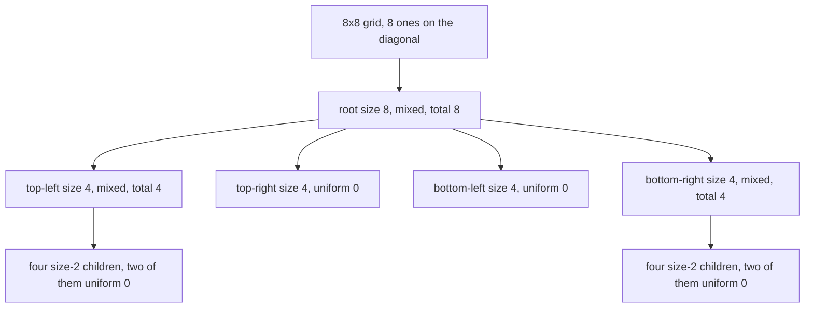
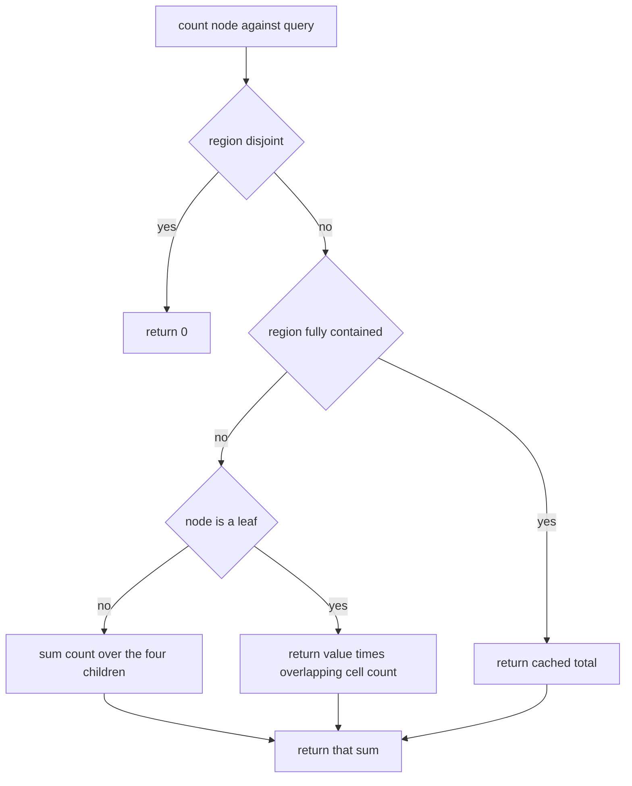
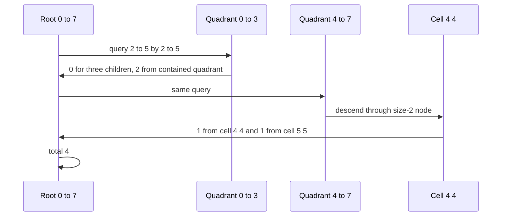

# 364 — Implement quad-tree for 2D region queries.

> **Tier:** Intermediate · **CTCI chapter:** Ch 4 — Trees and Graphs
> **Task spec:** [364-implement-quad-tree-for-2d-region-queries.md](../../../tasks/intermediate/364-implement-quad-tree-for-2d-region-queries.md)
> **Solutions:** [Python](../../../solutions/python/intermediate/364-implement-quad-tree-for-2d-region-queries/solution.py) ·
> [Java](../../../solutions/java/intermediate/364-implement-quad-tree-for-2d-region-queries/Solution.java) ·
> [JavaScript](../../../solutions/javascript/intermediate/364-implement-quad-tree-for-2d-region-queries/solution.js) ·
> [C#](../../../solutions/csharp/intermediate/364-implement-quad-tree-for-2d-region-queries/Solution.cs)

## 1. Problem restatement

**Input:** a square binary grid (every cell is `0` or `1`) whose side is a power of two, then
rectangle queries `(row_lo, row_hi, col_lo, col_hi)` with inclusive bounds.

**Output:** the number of ones inside the queried rectangle.

Preconditions are enforced, not assumed: a side that is not a power of two is rejected
(`assert` in Python, `IllegalArgumentException` in Java, `Error` in JavaScript, `Exception` in
C#, all with the message `grid side must be a power of two`), and a non-square row is rejected with
`grid must be square`.

The hand-checked grid is the 8×8 **diagonal** grid — ones only at `(r, r)`:

| Call | Result | Why |
| --- | --- | --- |
| `count_rect(0, 7, 0, 7)` | `8` | the whole grid holds the eight diagonal ones |
| `count_rect(0, 3, 0, 3)` | `4` | top-left quadrant: `(0,0), (1,1), (2,2), (3,3)` |
| `count_rect(2, 5, 2, 5)` | `4` | middle 4×4 crossing all four quadrants |
| `count_rect(1, 6, 0, 7)` | `6` | full rows 1…6 |
| `count_rect(0, 7, 7, 7)` | `1` | last column contains only `(7,7)` |
| `count_rect(0, 0, 1, 7)` | `0` | row 0 has its single one at column 0 |
| `count_rect(3, 4, 3, 4)` | `2` | `(3,3)` and `(4,4)` |
| `count_rect(2, 2, 0, 1)` | `0` | row 2's one sits at column 2 |

Uniform grids are asserted too: an all-ones 8×8 answers `64` in full and `9` on `(2…4, 1…3)`, an
all-zeros 8×8 answers `0`, and the 1×1 grid `[[1]]` answers `1`. Finally the solutions check
**every** rectangle of eight 8×8 LCG grids (`seed = (seed * 75 + 74) % 65537`, cells `seed % 2`) —
`36 × 36 = 1296` rectangles per grid — and 60 random rectangles each on three 16×16 LCG grids,
which exercise deeper splits.

## 2. Intuition

Counting ones in a rectangle by walking its cells costs `O(area)`, and it re-counts the same cells
for every query. The observation that fixes this is that a binary grid is full of *structure*: on
the diagonal grid, the four 4×4 quadrants contain one mixed quadrant and three quadrants that are
entirely zeros, and those three never need to be looked at again.

A quad tree turns that into a rule. A node owns a square region `[row, row + size) × [col, col + size)`
and becomes a **leaf** as soon as the region is *uniform* (all cells equal) or has `size = 1`;
otherwise it splits into four equal quadrants of side `size / 2`. Every node also caches the total
number of ones in its region, which is what makes a fully covered region answerable in `O(1)`.



The key insight for the query is that a region falls into exactly one of three cases, and only the
third needs work:

1. **disjoint** from the query → contributes `0`;
2. **fully contained** in the query → contributes its cached total;
3. **partially overlapping** → descend; if it is a leaf and still partially overlapping, its
   cells are all equal, so the contribution is that value times the number of cells inside the
   query.

That third branch is the detail that a naive "leaf means all-or-nothing" implementation gets
wrong: a uniform leaf is not automatically either fully in or fully out of an arbitrary rectangle.

## 3. Algorithm

1. **Build** `(row, col, size)`. Scan the region's cells once, accumulating `total` and checking
   whether every cell equals the first one.
2. If the region is uniform (`value` is that cell) or `size = 1`, store a leaf
   `(row, col, size, total, value, no children)`.
3. Otherwise store an internal node `(row, col, size, total, no value, four children)` where the
   children are the quadrants `(row, col)`, `(row, col + half)`, `(row + half, col)` and
   `(row + half, col + half)` with `half = size / 2`.
4. **Query** `(row_lo, row_hi, col_lo, col_hi)` from the root:
   - disjoint → `0`;
   - fully contained → the cached `total`;
   - a leaf with partial overlap → `value × overlap_rows × overlap_cols`;
   - otherwise → the sum of the same query on the four children.
5. **Return** the total.

```text
function build(row, col, size)
    first ← grid[row][col]
    total ← 0
    uniform ← true
    for r ← row to row + size - 1 do
        for c ← col to col + size - 1 do
            total ← total + grid[r][c]
            if grid[r][c] ≠ first then
                uniform ← false
            end
        end
    end
    if uniform or size = 1 then
        return leaf(row, col, size, total, first)
    end
    half ← size div 2
    return node(row, col, size, total,
                build(row, col, half),
                build(row, col + half, half),
                build(row + half, col, half),
                build(row + half, col + half, half))
end

function count(node, row_lo, row_hi, col_lo, col_hi)
    if node.row > row_hi or node.row + node.size - 1 < row_lo then
        return 0
    end
    if node.col > col_hi or node.col + node.size - 1 < col_lo then
        return 0
    end
    if row_lo ≤ node.row and node.row + node.size - 1 ≤ row_hi and
       col_lo ≤ node.col and node.col + node.size - 1 ≤ col_hi then
        return node.total
    end
    if node.children is empty then
        overlap_rows ← min(node.row + node.size - 1, row_hi) - max(node.row, row_lo) + 1
        overlap_cols ← min(node.col + node.size - 1, col_hi) - max(node.col, col_lo) + 1
        return node.value * overlap_rows * overlap_cols
    end
    return count(node.children[0], row_lo, row_hi, col_lo, col_hi)
         + count(node.children[1], row_lo, row_hi, col_lo, col_hi)
         + count(node.children[2], row_lo, row_hi, col_lo, col_hi)
         + count(node.children[3], row_lo, row_hi, col_lo, col_hi)
end
```

The leaf test comes last on purpose: a node that is neither disjoint nor contained is answered
either by the multiplication (uniform leaf) or by summing the four children (internal node), so a
mixed node never takes the multiplication path and a uniform leaf never recurses.



Only the leaf case has two possible exits, which is exactly why the leaf carries both a `total` and
a uniform `value`: `total` answers "fully contained", `value` answers "partially overlapping".

## 4. Worked example

On the diagonal 8×8 grid the build produces:

| Node | Region | Cells seen | Outcome |
| --- | --- | --- | --- |
| root | rows `0…7`, cols `0…7` | mixed | internal, `total = 8` |
| TL | rows `0…3`, cols `0…3` | mixed | internal, `total = 4` |
| TL.TL | rows `0…1`, cols `0…1` | mixed | internal, `total = 2` |
| TL.TR | rows `0…1`, cols `2…3` | all `0` | **leaf**, `total = 0`, `value = 0` |
| TL.BL | rows `2…3`, cols `0…1` | all `0` | **leaf**, `total = 0`, `value = 0` |
| TL.BR | rows `2…3`, cols `2…3` | mixed | internal, `total = 2` |
| TR | rows `0…3`, cols `4…7` | all `0` | **leaf**, `total = 0`, `value = 0` |
| BL | rows `4…7`, cols `0…3` | all `0` | **leaf**, `total = 0`, `value = 0` |
| BR | rows `4…7`, cols `4…7` | mixed | internal, `total = 4` |

Now trace `count_rect(2, 5, 2, 5)`:

| Step | Node | Classification | Contribution |
| --- | --- | --- | --- |
| 1 | root `0…7 × 0…7` | partial | descend |
| 2 | TL `0…3 × 0…3` | partial (rows `2…3`, cols `2…3`) | descend |
| 3 | TL.TL `0…1 × 0…1` | disjoint (rows `2…5` exclude `0…1`) | 0 |
| 4 | TL.TR `0…1 × 2…3` | disjoint | 0 |
| 5 | TL.BL `2…3 × 0…1` | disjoint (cols `2…5` exclude `0…1`) | 0 |
| 6 | TL.BR `2…3 × 2…3` | fully contained | `total = 2` |
| 7 | TR `0…3 × 4…7` | partial leaf: overlap rows `1` × cols `2` = `2` cells | `0 × 2 = 0` |
| 8 | BL `4…7 × 0…3` | partial leaf: overlap rows `1` × cols `2` | `0 × 2 = 0` |
| 9 | BR `4…7 × 4…7` | partial | descend |
| 10 | BR.TL `4…5 × 4…5` | partial | descend to four 1×1 leaves |
| 11 | BR.TL cells `(4,4), (4,5), (5,4), (5,5)` | contained / contained / contained / contained | `1 + 0 + 0 + 1 = 2` |
| 12 | BR.TR `4…5 × 6…7`, BR.BL `6…7 × 4…5`, BR.BR `6…7 × 6…7` | disjoint | 0 |

Steps 7 and 8 are the leaf-with-partial-overlap rule in action: the uniform quadrants contribute
`value × cells_inside`, which happens to be `0` here, but the same path returns a positive number
for an all-ones leaf — the all-ones 8×8 grid answers `9` on `(2…4, 1…3)` through exactly that
multiplication, `1 × 3 rows × 3 cols`. The final answer is `2 + 0 + 0 + 2 = 4`, matching the
assertion.



## 5. Complexity

Let `s` be the grid side (a power of two) and `N = s²` the number of cells.

| Measure | Bound | Why it holds |
| --- | --- | --- |
| Build, worst case | O(N log s) | every node scans all of its cells to decide uniformity; each of the `log s + 1` levels scans at most `N` cells in total |
| Build, best case | O(N) | a uniform grid is decided by the root scan alone, with no children built |
| Space | O(number of nodes) ≤ O(N) | a leaf exists only for a uniform region or a single cell, and the node count is bounded by the cell count |
| Query, aligned region | O(1) | a quadrant that is fully inside the query returns its cached `total` immediately |
| Query, worst case | O(s) | a thin rectangle such as a single row cannot be covered by large nodes, so `O(s)` nodes are visited — `O(sqrt(N))`, independent of the rectangle's area |
| Naive per query | O(area) | the double loop touches every cell of the rectangle, up to `N` |

The pruning is what makes the query cheap: a fully contained node stops the recursion even if it
holds millions of ones, and a disjoint node stops it even if the query lies just outside. On the
asserted sizes (`8 × 8` exhaustively, `16 × 16` on 60 rectangles per grid) the naive comparator is
still fast enough to run for every query, which is why the tests use an exhaustive oracle rather
than sampling.

## 6. Pitfalls and edge cases

- **Power-of-two side is mandatory.** The four-way split assumes `size / 2` is exact, so a side
  like `6` or `10` is rejected up front. A non-power-of-two grid must be padded to the next power
  of two before it can be stored.
- **Non-square input is rejected** by a separate check with the message `grid must be square`.
- **A uniform leaf is not "all or nothing".** A query can cut through a uniform leaf; the answer
  is `value × overlap_rows × overlap_cols`, with each overlap clamped by `min`/`max` against the
  node's bounds. The all-ones grid's `9` at `(2…4, 1…3)` is that formula with `3 × 3` cells.
- **Disjointness must be tested before containment.** The two conditions are written as separate
  early exits; a node that is fully outside still satisfies no containment test, but a *contained*
  node trivially satisfies no disjoint test only because the bounds are checked correctly. The
  tests include both extremes (`(0,0,1,7)` → `0`, whole grid → `8`).
- **Single-cell grid.** `[[1]]` has `size = 1` and is a leaf by the size rule even though it is
  also uniform; the query `(0,0,0,0)` returns `1`.
- **All-zeros grid.** The root is uniform with `value = 0`, so every query returns `0` through the
  same multiplication path.
- **One-cell queries.** `count_rect(2, 2, 0, 1)` and `count_rect(0, 7, 7, 7)` show that a query
  narrower than any stored leaf still terminates, because each descent step either classifies the
  node or halves the region until `size = 1`.
- **Values are treated as counts.** The implementation sums cells as integers, so the structure
  really counts "ones"; a grid with values other than `0`/`1` would behave like a weighted region
  sum, and the `value × area` shortcut would still hold only because a leaf is uniform.
- **The grid is captured by reference in Python and by array reference elsewhere.** Every solution
  treats the grid as immutable after construction; mutating it later would invalidate both the
  cached totals and the uniformity flags.
- **No updates.** There is no insert or point-update operation; changing one cell requires
  rebuilding the path from the root, which the shipped static structure does not offer.

## 7. Variants and follow-ups

- **Weighted regions instead of a binary grid.** Replacing `value × overlap` by a sum over the
  overlapping cells turns the structure into a sparse 2D range-sum index; the dense alternative is
  [362-implement-2d-segment-tree-for-range-sum-conceptual.md](../../../tasks/intermediate/362-implement-2d-segment-tree-for-range-sum-conceptual.md).
- **Point sets instead of grids.** If the data are a few points in a large plane, splitting only at
  the median of the point set adapts the shape to the data —
  [363-implement-kd-tree-for-2d-nearest-neighbor-basic.md](../../../tasks/intermediate/363-implement-kd-tree-for-2d-nearest-neighbor-basic.md).
- **Rectangle *union* area.** Counting ones is replaced by measuring active height between events
  in [370-line-sweep-for-rectangle-area-union.md](../../../tasks/intermediate/370-line-sweep-for-rectangle-area-union.md),
  which avoids the power-of-two constraint entirely.
- **Coverage counting.** For "how many stored rectangles cover this point", the compressed segment
  tree of [361-implement-interval-stabbing-queries-with-segment-tree.md](../../../tasks/intermediate/361-implement-interval-stabbing-queries-with-segment-tree.md)
  is the 1D analogue of the contained/disjoint/partial decision.
- **Loose vs tight bounds.** Storing a bounding box per node lets a quad tree answer nearest
  queries as well, at the cost of extra bookkeeping the current `basic` grid version does not need.

## 8. Check yourself

1. Why does every node store both `total` and `value` when only internal nodes really need
   `total`?

<details><summary>Show answer</summary>

Because a leaf can be answered in two different ways. When the query fully contains the leaf,
`total` is the answer; when the query only partly covers it, the answer is
`value × overlap_rows × overlap_cols`. An internal node never needs `value`, and a leaf never needs
a recursion, so the two fields together cover all four combinations of "leaf/internal" and
"contained/partial".

</details>

2. On the diagonal 8×8 grid, how many of the four 4×4 quadrants are leaves, and why?

<details><summary>Show answer</summary>

Two of the four: the top-right quadrant (rows `0…3`, cols `4…7`) and the bottom-left quadrant
(rows `4…7`, cols `0…3`) contain no diagonal cell and are entirely zeros, so the build stops there
even though their `size` is 4. The top-left and bottom-right quadrants contain four diagonal ones
each and split further, and inside them the off-diagonal size-2 quadrants (rows `0…1` cols `2…3`
and rows `2…3` cols `0…1`) become uniform leaves the same way.

</details>

3. Give a query on the 8×8 diagonal grid that visits the most nodes, and explain why it cannot be
   answered with cached totals.

<details><summary>Show answer</summary>

Any thin rectangle, for example `count_rect(0, 0, 0, 7)` (the first row). It cuts across all four
quadrants, so no large node is fully contained: the quadrants are partially covered and the
recursion must descend until it reaches leaves or fully contained sub-quadrants. The answer is
still `1`, but the number of visited nodes is `O(s)` rather than `O(1)`.

</details>

4. What happens if the grid side is `6`?

<details><summary>Show answer</summary>

Construction is rejected before any tree is built: the side must be a power of two so that
`size / 2` stays an integer all the way down to `1`. Python asserts, Java throws
`IllegalArgumentException`, JavaScript throws an `Error`, and C# throws an `Exception` with the
message `grid side must be a power of two`. To handle a `6 × 6` grid it would have to be padded to
`8 × 8` with zeros, which changes the queried rectangle bounds accordingly.

</details>

5. Why can the query skip a fully contained node without checking its cells, given that the node
   may be a mix of zeros and ones?

<details><summary>Show answer</summary>

Because `total` is the count of ones in the node's whole region and it is computed during the
build by scanning exactly those cells. A node that is fully inside the query therefore contributes
its complete count, no matter how mixed it is; the mixture only decides whether the node had to
split into children.

</details>
