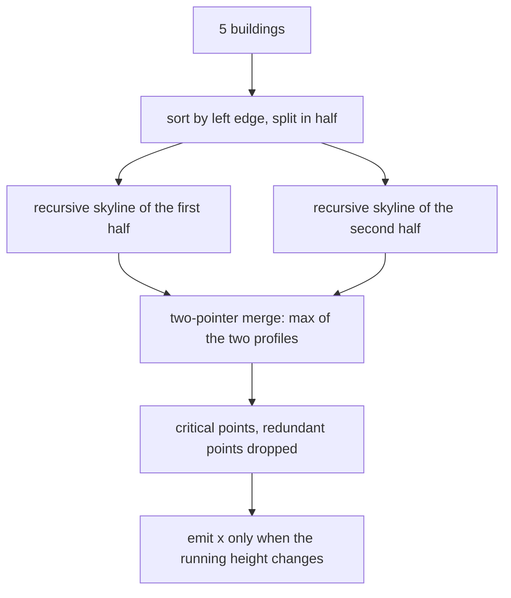
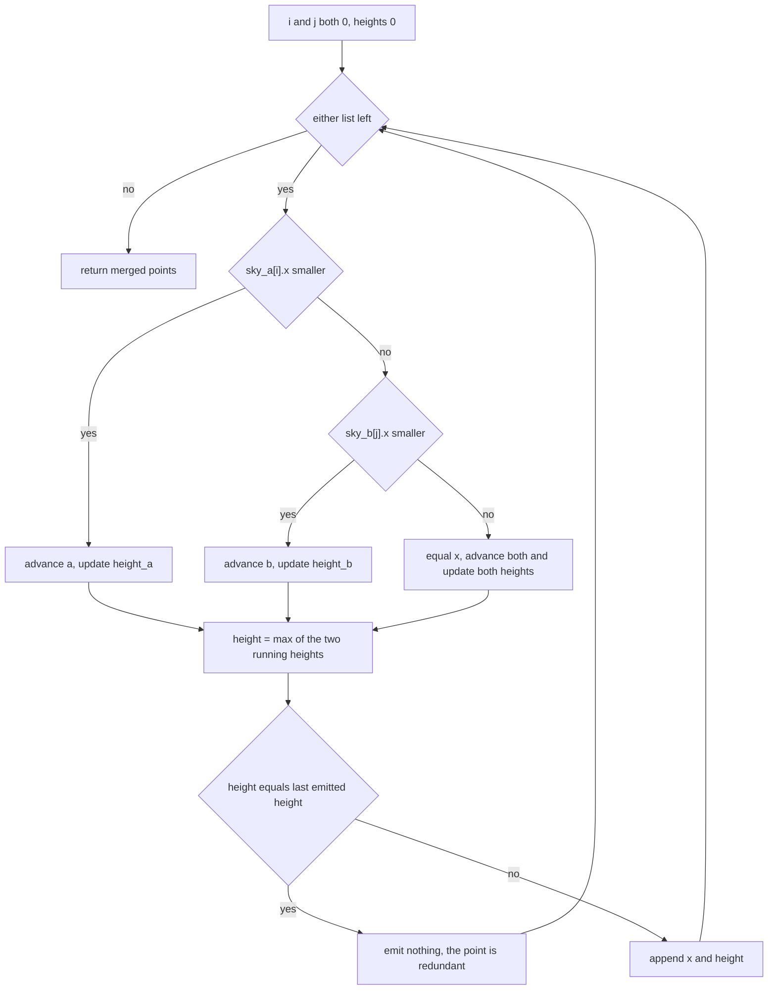
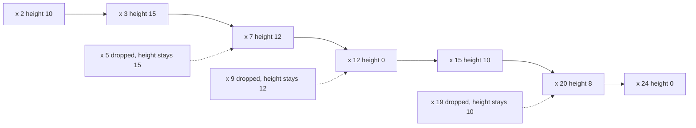

# 365 — Implement skyline of buildings via divide & conquer (detailed).

> **Tier:** Intermediate · **CTCI chapter:** Beyond — Graphics, Geometry & Robotics
> **Task spec:** [365-implement-skyline-of-buildings-via-divide-conquer-detailed.md](../../../tasks/intermediate/365-implement-skyline-of-buildings-via-divide-conquer-detailed.md)
> **Solutions:** [Python](../../../solutions/python/intermediate/365-implement-skyline-of-buildings-via-divide-conquer-detailed/solution.py) ·
> [Java](../../../solutions/java/intermediate/365-implement-skyline-of-buildings-via-divide-conquer-detailed/Solution.java) ·
> [JavaScript](../../../solutions/javascript/intermediate/365-implement-skyline-of-buildings-via-divide-conquer-detailed/solution.js) ·
> [C#](../../../solutions/csharp/intermediate/365-implement-skyline-of-buildings-via-divide-conquer-detailed/Solution.cs)

## 1. Problem restatement

**Input:** `n` buildings, each `[left, right, height]` with **positive width and height**.

**Output:** the skyline as a list of critical points `[x, height]` with strictly increasing `x`,
where `height` is the maximum building height just to the right of `x`. Every height change is
recorded, and the final height is always `0`.

A building covers the half-open span `[left, right)`: its right edge does not contribute its own
height, which is what makes `x = 9` in the canonical example invisible (the 12-high building is
still standing there).

| Input | Skyline | Why |
| --- | --- | --- |
| `[[2,9,10], [3,7,15], [5,12,12], [15,20,10], [19,24,8]]` | `[[2,10], [3,15], [7,12], [12,0], [15,10], [20,8], [24,0]]` | canonical example |
| `[[0,2,5], [2,4,7]]` | `[[0,5], [2,7], [4,0]]` | touching buildings, second is taller |
| `[[0,2,5], [5,8,3]]` | `[[0,5], [2,0], [5,3], [8,0]]` | a gap of width zero still drops to `0` |
| `[[0,10,5], [2,4,3]]` | `[[0,5], [10,0]]` | the short building is completely hidden |
| `[[0,10,5], [2,4,9]]` | `[[0,5], [2,9], [4,5], [10,0]]` | a taller building pokes out of a shorter one |
| `[[0,4,3], [0,4,5]]` | `[[0,5], [4,0]]` | the lower of two identical spans disappears |
| `[[0,4,5], [0,4,5], [1,2,1]]` | `[[0,5], [4,0]]` | duplicates and a hidden building |
| `[[3,3,9]]`, `[[0,5,0]]` | `[]` | zero width or zero height is ignored |
| `[[0,5,4], [2,2,9]]` | `[[0,4], [5,0]]` | a degenerate building inside a real one |

The four solutions assert all of these and then cross-check 400 deterministic LCG building sets
(`seed = (seed * 75 + 74) % 65537`, `count = 1 + seed % 10`, `left = seed % 50`,
`width = 1 + seed % 12`, `height = 1 + seed % 15`) against an independent event-sweep oracle.

## 2. Intuition

The obvious approach is a sweep: collect every left and right edge as an event, and at each event
recompute the maximum active height. That is correct — the solution files ship it as the oracle —
but it needs a container of active heights and a maximum query per event, which is where its
`O(n log n)` bookkeeping comes from.

The divide-and-conquer idea instead uses a fact about skylines that has no analogue for arbitrary
functions: **the skyline of a union of buildings is the pointwise maximum of the skylines of any
partition of the buildings**. Split the building list in half, compute each half's skyline, then
merge the two skylines with a single left-to-right two-pointer walk. Neither half ever needs to
know about the other's internal structure — only the two height profiles.

The key insight that makes the merge linear is the invariant `height_a` / `height_b`: at any `x`,
`height_a` is the height of A's skyline at that `x` and `height_b` the height of B's. Advancing
whichever pointer has the smaller `x` updates exactly one of them, and the merged height at that
`x` is simply their maximum. A point is emitted only when that maximum differs from the **last
emitted** height, which drops the redundant points automatically.



Because the split is by building count, not by coordinate, the halves can interleave in `x`. That
is why the merge needs both profiles at once rather than a simple concatenation.

## 3. Algorithm

1. **Clean:** drop every building with `right ≤ left` or `height ≤ 0`.
2. **Sort** the survivors by `(left, right, height)`.
3. **Recurse:** an empty list yields `[]`; a single building yields `[[left, height], [right, 0]]`;
   otherwise split at `mid` and merge the two recursive results.
4. **Merge:** walk both critical-point lists with `i`, `j`; maintain `height_a` and `height_b`.
   Move the pointer with the smaller `x` and update its height; on equal `x`, advance both and
   update both heights. Compute `height = max(height_a, height_b)` and append `[x, height]` unless
   the last emitted height is already equal to it.
5. **Return** the merged critical points.

```text
function skyline_divide_conquer(buildings)
    ordered ← sorted list of buildings with right > left and height > 0
    return solve(ordered)
end

function solve(ordered)
    if ordered is empty then
        return empty list
    end
    if length(ordered) = 1 then
        return [ [ordered[0].left, ordered[0].height], [ordered[0].right, 0] ]
    end
    mid ← length(ordered) div 2
    return merge(solve(ordered[0 .. mid - 1]), solve(ordered[mid ..]))
end

function merge(sky_a, sky_b)
    merged ← empty list
    i ← 0
    j ← 0
    height_a ← 0
    height_b ← 0
    while i < length(sky_a) or j < length(sky_b) do
        if j ≥ length(sky_b) or (i < length(sky_a) and sky_a[i][0] < sky_b[j][0]) then
            x ← sky_a[i][0]
            height_a ← sky_a[i][1]
            i ← i + 1
        else if i ≥ length(sky_a) or sky_b[j][0] < sky_a[i][0] then
            x ← sky_b[j][0]
            height_b ← sky_b[j][1]
            j ← j + 1
        else
            x ← sky_a[i][0]
            height_a ← sky_a[i][1]
            height_b ← sky_b[j][1]
            i ← i + 1
            j ← j + 1
        end
        height ← greater of height_a and height_b
        if merged is empty or merged[last][1] ≠ height then
            append [x, height] to merged
        end
    end
    return merged
end
```

The two-pointer walk means each critical point of either half is consumed exactly once, so a merge
of profiles with `p` and `q` points costs `O(p + q)`.



Note that a *decrease* in the maximum is emitted just as promptly as an increase: dropping to a
lower plateau is a height change, and dropping to nothing emits `[x, 0]`.

## 4. Worked example

Trace the canonical input `[[2,9,10], [3,7,15], [5,12,12], [15,20,10], [19,24,8]]`, already sorted
by left edge and split into the first two and the last three buildings.

Left half `[[2,9,10], [3,7,15]]`:

| Level | Result | Note |
| --- | --- | --- |
| `[2,9,10]` | `[[2,10], [9,0]]` | one building is a flat plateau |
| `[3,7,15]` | `[[3,15], [7,0]]` | taller, narrower |
| merged | `[[2,10], [3,15], [7,10], [9,0]]` | at `x = 7` the 10-block is still standing, so the drop is to `10`, not `0` |

Right half `[[5,12,12], [15,20,10], [19,24,8]]`:

| Level | Result | Note |
| --- | --- | --- |
| `[5,12,12]` | `[[5,12], [12,0]]` | plateau |
| `[15,20,10], [19,24,8]` | `[[15,10], [19,10], [20,8], [24,0]]` | the 8-block is hidden inside the 10-block until `x = 20`, and `x = 19` is dropped because the height does not change |
| merged | `[[5,12], [12,0], [15,10], [20,8], [24,0]]` | `x = 19` never becomes a critical point |

Top-level merge of `[[2,10], [3,15], [7,10], [9,0]]` with `[[5,12], [12,0], [15,10], [20,8], [24,0]]`,
walking `x` in increasing order across both lists:

| `x` | Source | `height_a` | `height_b` | `max` | Last emitted | Action |
| --- | --- | --- | --- | --- | --- | --- |
| 2 | a | 10 | 0 | 10 | — | emit `[2,10]` |
| 3 | a | 15 | 0 | 15 | 10 | emit `[3,15]` |
| 5 | b | 15 | 12 | 15 | 15 | drop: height unchanged |
| 7 | a | 10 | 12 | 12 | 15 | emit `[7,12]` |
| 9 | a | 0 | 12 | 12 | 12 | drop: height unchanged |
| 12 | b | 0 | 0 | 0 | 12 | emit `[12,0]` |
| 15 | b | 0 | 10 | 10 | 0 | emit `[15,10]` |
| 20 | b | 0 | 8 | 8 | 10 | emit `[20,8]` |
| 24 | b | 0 | 0 | 0 | 8 | emit `[24,0]` |

The result is exactly `CANONICAL_SKYLINE`. Only nine rows appear even though the two halves hold
nine critical points between them, because `x = 5`, `x = 9` and the already-dropped `x = 19` add
nothing: at `x = 5` the 12-block sits beneath the still-standing 15-block, and at `x = 9` the
12-block survives the end of the 10-block. The two dropped rows are the file's own explanation of
why the canonical skyline has no point at either coordinate.



## 5. Complexity

Let `n` be the number of buildings after the degenerate filter.

| Measure | Bound | Why it holds |
| --- | --- | --- |
| Time | O(n log n) | the sort dominates; the recursion satisfies `T(n) = 2·T(n/2) + O(p + q)` with `p + q = O(n)` per merge, so the recursion tree contributes `O(n log n)` |
| Time, merge only | O(p + q) | the two-pointer walk consumes each critical point once; no point is revisited |
| Space | O(n) | the recursion is `log n` deep and each merge allocates a list of at most `p + q` points, so the live profiles total `O(n)` |
| Skyline size | ≤ 2n | a single building emits at most two critical points and the merge never increases the total |
| Sweep oracle | O(n log n) | sorting the events plus one maximum over the active height counts per event |
| Naive cell-by-cell drawing | O(span · max height) | the x-axis has to be discretised, which is exactly what critical points avoid |

The "detailed" in the task title refers to this specific contract — sorted input, half-open spans,
one two-pointer merge, redundant points dropped — rather than to a different divide-and-conquer
scheme. The oracle in the same files deliberately uses the other approach (event sweep with a
height-count table) so that a mistake in the merge cannot hide behind a shared bug.

## 6. Pitfalls and edge cases

- **Half-open spans.** A building covers `[left, right)`, so its own right edge does not support
  its height. `[[0,2,5], [5,8,3]]` therefore emits `[2,0]` before `[5,3]`: the two buildings touch
  without overlapping. Choosing closed spans would merge them into one plateau and change the
  answer.
- **Zero-width and zero-height buildings are filtered out**, not processed: `[[3,3,9]]` and
  `[[0,5,0]]` both produce `[]`, and `[[0,5,4], [2,2,9]]` produces the skyline of the real
  building only. The filter runs before the sort, so the recursion never sees a degenerate input.
- **Empty input.** `[]` produces `[]` — not `[[0, 0]]` and not a null. The recursion's base case
  covers it; the merge is never called with two empty lists.
- **Single building.** `[[1,3,4]]` produces `[[1,4], [3,0]]`, two points, because the skyline must
  end at height `0`.
- **Fully hidden buildings disappear silently.** `[[0,10,5], [2,4,3]]` gives `[[0,5], [10,0]]`: the
  inner building is absorbed by the outer one's plateau. `[[0,4,5], [0,4,5], [1,2,1]]` shows the
  same for duplicates plus a small building.
- **Equal `x` in both halves must advance both pointers.** The third branch of the merge does that
  and reads both heights; taking only one side would leave the other half's height stale and emit
  a wrong plateau.
- **Redundant points are dropped by comparing with the *last emitted* height**, not with the
  previous input point. This is the only place where duplicates can be introduced.
- **A height that returns to a lower nonzero plateau still emits a point.** `[[0,10,5], [2,4,9]]`
  emits `[4,5]` — the drop from `9` back to `5` is a visible step.
- **Sorting must be total.** The solutions sort the full `[left, right, height]` triples, so equal
  left edges are ordered deterministically and the split point is reproducible across languages.
- **Arbitrary coordinates.** Heights and coordinates may be negative (only the width and height
  must be positive); nothing in the merge depends on their magnitude.
- **No zero-height entries in the output.** The sweep oracle computes `max(..., default=0)`, and
  the merge starts both running heights at `0`, so the profile is defined everywhere, including
  before the first building and after the last.

## 7. Variants and follow-ups

- **Sweep instead of divide and conquer.** The oracle in these same files is the classic
  event-sweep; the same active-set machinery appears in
  [370-line-sweep-for-rectangle-area-union.md](../../../tasks/intermediate/370-line-sweep-for-rectangle-area-union.md)
  and, in outline form, in
  [371-detect-line-segment-intersection-bentley-ottmann-outline.md](../../../tasks/intermediate/371-detect-line-segment-intersection-bentley-ottmann-outline.md).
- **Hidden buildings and visibility.** Deciding *which* building is visible at each critical point
  is a refinement of this merge; the maximum is computed here exactly because the skyline keeps
  only the top profile.
- **Skylines in 2D.** The 2D analogue of "maximum of the two halves" is the union boundary used by
  [364-implement-quad-tree-for-2d-region-queries.md](../../../tasks/intermediate/364-implement-quad-tree-for-2d-region-queries.md)
  when regions are counted instead of measured.
- **Convex hulls.** A different "upper envelope" problem with a similar divide-and-conquer shape is
  [366-compute-convex-hull-graham-scan.md](../../../tasks/intermediate/366-compute-convex-hull-graham-scan.md).
- **Intervals with weights.** Replacing the maximum by a sum turns the merge into the range-add tree
  of [361-implement-interval-stabbing-queries-with-segment-tree.md](../../../tasks/intermediate/361-implement-interval-stabbing-queries-with-segment-tree.md).

## 8. Check yourself

1. Why is the merge able to ignore everything about a half other than its list of critical points?

<details><summary>Show answer</summary>

The skyline of a union is the pointwise maximum of the two skylines, and the pointwise maximum at
any `x` depends only on the two height profiles at that `x`. The critical points are a complete
description of a profile (constant between consecutive points), so the merge never needs the
original buildings.

</details>

2. In the canonical example, `x = 9` is the right edge of a 10-high building but produces no
   critical point. Why?

<details><summary>Show answer</summary>

Because the 12-high building spans `[5, 12)` and is still standing at `x = 9`. The merged height is
`max(0, 12) = 12`, which equals the last emitted height, so the point is dropped as redundant.
The file documents this case explicitly.

</details>

3. What would change if buildings were treated as closed spans `[left, right]`?

<details><summary>Show answer</summary>

Touching buildings would join instead of producing a drop to `0` between them:
`[[0,2,5], [5,8,3]]` would emit `[[0,5], [8,0]]` rather than `[[0,5], [2,0], [5,3], [8,0]]`. The
chosen half-open convention is what the whole family of interval tasks in this repository uses, and
the assertions pin it.

</details>

4. How many critical points can the skyline of `n` buildings have, and what is the resulting merge
   cost?

<details><summary>Show answer</summary>

At most `2n`: one building contributes two points (`[left, height]` and `[right, 0]`), and the
merge emits at most one point per consumed input point. Merging two profiles of `p` and `q` points
is therefore `O(p + q)`, and the whole recursion adds up to `O(n log n)` on top of the sort.

</details>

5. Why do the solution files ship a second algorithm at all?

<details><summary>Show answer</summary>

The event-sweep `skyline_sweep` is an independent oracle. It uses a different representation (a
height-count table plus a maximum query per event) instead of a recursive merge, so agreement on
400 LCG inputs is meaningful evidence; two implementations that shared the merge logic could agree
while both being wrong.

</details>
