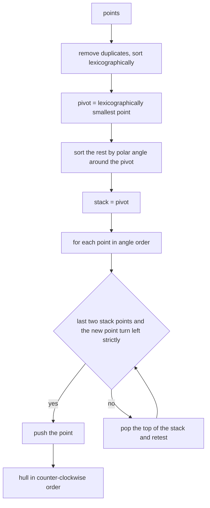
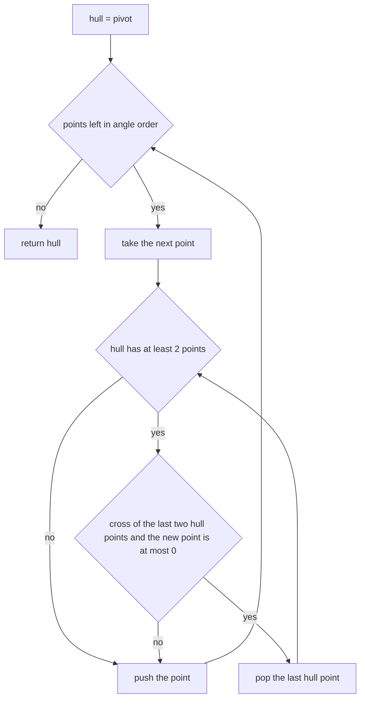
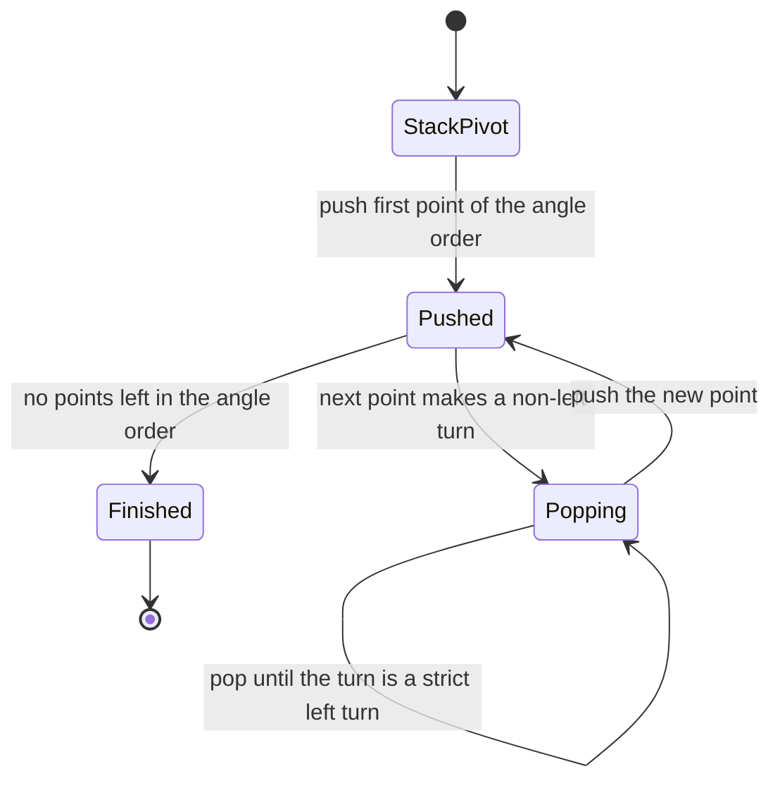

# 366 — Compute convex hull (Graham scan).

> **Tier:** Intermediate · **CTCI chapter:** Beyond — Graphics, Geometry & Robotics
> **Task spec:** [366-compute-convex-hull-graham-scan.md](../../../tasks/intermediate/366-compute-convex-hull-graham-scan.md)
> **Solutions:** [Python](../../../solutions/python/intermediate/366-compute-convex-hull-graham-scan/solution.py) ·
> [Java](../../../solutions/java/intermediate/366-compute-convex-hull-graham-scan/Solution.java) ·
> [JavaScript](../../../solutions/javascript/intermediate/366-compute-convex-hull-graham-scan/solution.js) ·
> [C#](../../../solutions/csharp/intermediate/366-compute-convex-hull-graham-scan/Solution.cs)

## 1. Problem restatement

**Input:** `n` integer points in the plane.

**Output:** the convex hull, listed **counter-clockwise**, starting at the lexicographically
smallest point (minimum `x`, then minimum `y`). The first point is not repeated at the end.

Conventions fixed by the assertions:

| Input | Hull | Note |
| --- | --- | --- |
| `[(0,0), (2,0), (2,2), (0,2)]` | `[[0,0], [2,0], [2,2], [0,2]]` | a square is its own hull |
| `[(0,0), (2,0), (2,2), (0,2), (1,1)]` | same as above | the interior point is excluded |
| `[(0,0), (1,0), (2,0), (3,0)]` | `[[0,0], [3,0]]` | a collinear run keeps only its two endpoints |
| `[(0,0), (1,1), (2,2), (3,3), (0,3)]` | `[[0,0], [3,3], [0,3]]` | the diagonal run collapses |
| `[(0,0), (0,0), (2,0), (2,0), (2,2), (0,2), (2,2)]` | `[[0,0], [2,0], [2,2], [0,2]]` | duplicates cannot enlarge the hull |
| `[(0,0), (4,0), (2,3)]` | `[[0,0], [4,0], [2,3]]` | a triangle |
| `[(5,7)]` | `[[5,7]]` | one point |
| `[(0,0), (1,1)]` | `[[0,0], [1,1]]` | two points |
| `[]` | `[]` | no points |

Duplicate points are removed before anything else, and all arithmetic is exact integer
computation — no angle is ever taken, and no floating-point comparison is ever made. The four
solutions then cross-check 60 deterministic LCG point sets (`seed = (seed * 75 + 74) % 65537`,
`count = 1 + seed % 40`, coordinates `seed % modulus` with `modulus = 6 + seed % 20`, deliberately
small so that collinear triples are frequent) against a Jarvis march oracle, comparing the hull
size, the doubled area, and the exact point list.

## 2. Intuition

Gift wrapping (the Jarvis march) produces the hull by repeatedly asking "which point is next in
clockwise order from here?", which costs `O(n)` per hull edge. Graham scan inverts the loop:
**sort everything once by polar angle around one known hull point, then sweep the sorted order with
a stack.**

The pivot must be on the hull, and the lexicographically smallest point always is — nothing can lie
below-left of it. Sorting the remaining points by angle around the pivot gives an order in which
the hull is a *subsequence*: walking that order, the hull turns consistently left, and every point
that would create a right turn or a straight line is not on the hull.

The key insight is the incremental test. Keeping a stack of the points chosen so far, a new point
`p` is acceptable exactly when the last two stack entries and `p` make a **strict left turn**:
`cross(hull[-2], hull[-1], p) > 0`. If the turn is right or straight, the point on top of the stack
is inside the hull spanned by its neighbours and is popped. Because the sorted order is
counter-clockwise, one pass with this pop rule leaves exactly the hull.



Two decisions in that picture differ from the textbook version, and both are visible in the code:
equal angles are broken by **nearest first**, and the pop condition uses `≤ 0` rather than `< 0`.
Together they guarantee that a run of collinear points contributes only its two extreme endpoints,
which is exactly what the `[(0,0), (1,0), (2,0), (3,0)]` assertion demands.

## 3. Algorithm

1. **Deduplicate and sort** the points lexicographically; if two or fewer remain, return them as
   the hull.
2. **Pivot** at the first point; call it `p0`.
3. **Sort the rest by polar angle** around `p0` using an exact comparator: `a` comes before `b`
   when `cross(p0, a, b) > 0`, and when the cross product is `0` (equal angle) the point **nearer**
   to `p0` comes first.
4. **Fold** the sorted list into a stack: push the pivot, then for each point, while the stack has
   at least two entries and `cross(stack[-2], stack[-1], point) ≤ 0`, pop; then push the point.
5. **Return** the stack, which is the hull in counter-clockwise order starting at `p0`.

```text
function cross(o, a, b)
    return (a.x - o.x) * (b.y - o.y) - (a.y - o.y) * (b.x - o.x)
end

function graham_scan(points)
    unique ← sorted distinct points lexicographically
    if length(unique) ≤ 2 then
        return unique
    end
    pivot ← unique[0]
    rest ← unique[1 ..]
    sort rest with comparator: a before b when
        cross(pivot, a, b) > 0, or
        cross(pivot, a, b) = 0 and distance2(pivot, a) < distance2(pivot, b)
    hull ← [pivot]
    for each point in rest do
        while length(hull) ≥ 2 and cross(hull[-2], hull[-1], point) ≤ 0 do
            remove the last element of hull
        end
        append point to hull
    end
    return hull
end
```

The comparator is a *strict weak ordering* built from integer cross products, so the sort is exact
and reproducible; `cmp_to_key` in Python, a lambda comparator in Java and JavaScript, and a
`Comparison` delegate in C# all express the same three cases.



Each point is pushed once, and each pop removes a point for good, so the whole fold is linear in
the number of sorted points.

## 4. Worked example

**Square.** `points = [(0,0), (2,0), (2,2), (0,2)]`, pivot `(0,0)`, angular order
`(2,0), (2,2), (0,2)`:

| Point | Stack before | `cross(hull[-2], hull[-1], point)` | Action | Stack after |
| --- | --- | --- | --- | --- |
| `(2,0)` | `[(0,0)]` | — (fewer than two entries) | push | `[(0,0), (2,0)]` |
| `(2,2)` | `[(0,0), (2,0)]` | `2·2 - 0·2 = 4 > 0` | push | `[(0,0), (2,0), (2,2)]` |
| `(0,2)` | `[(0,0), (2,0), (2,2)]` | `(2-2)·(2-0) - (2-0)·(0-2) = 4 > 0` | push | `[(0,0), (2,0), (2,2), (0,2)]` |

Adding the interior point `(1,1)` does not change the outcome: it sits at exactly the same angle as
the corner `(2,2)` — and nearer to the pivot, so the tie-break puts it first — it is pushed, and the
arrival of `(2,2)` produces a right turn that pops it again. That is why
`[(0,0), (2,0), (2,2), (0,2), (1,1)]` yields the same four-point hull.

**Collinear run.** `points = [(0,0), (1,0), (2,0), (3,0)]`, pivot `(0,0)`, and all three remaining
points share the angle `0`, so the nearest-first tie-break orders them `(1,0), (2,0), (3,0)`:

| Point | Stack before | Cross product | Action | Stack after |
| --- | --- | --- | --- | --- |
| `(1,0)` | `[(0,0)]` | — | push | `[(0,0), (1,0)]` |
| `(2,0)` | `[(0,0), (1,0)]` | `0` | pop `(1,0)`, then push | `[(0,0), (2,0)]` |
| `(3,0)` | `[(0,0), (2,0)]` | `0` | pop `(2,0)`, then push | `[(0,0), (3,0)]` |

The result `[[0,0], [3,0]]` keeps the two extreme endpoints and discards the interior collinear
point — the behaviour the docstring calls "only the extreme endpoints of collinear runs are kept".



The fold is a single left-to-right pass; the only backwards movement is inside the pop loop, and
it never retests a point that has already been discarded.

## 5. Complexity

Let `n` be the number of distinct input points and `h` the hull size.

| Measure | Bound | Why it holds |
| --- | --- | --- |
| Time | O(n log n) | deduplication plus the lexicographic sort plus the angular sort; each comparator call is a constant number of integer multiplications |
| Time, fold | O(n) | every point is pushed at most once and popped at most once, so the total number of stack operations is `≤ 2n` |
| Space | O(n) | the distinct-point array and the stack |
| Jarvis march oracle | O(n · h) | each of the `h` hull edges scans all `n` points to pick the next one, so `O(n²)` in the worst case |
| Doubled area of the hull | O(h) | the shoelace sum used in the cross-check walks the hull once |

The cross products are computed in exact integer arithmetic; Java and C# widen to `long` for
`(a.x - o.x) * (b.y - o.y) - (a.y - o.y) * (b.x - o.x)`, because the product of two coordinate
differences overflows a 32-bit `int` well before the coordinates themselves do. Python integers
are unbounded, and JavaScript numbers stay exact for the asserted coordinate ranges.

## 6. Pitfalls and edge cases

- **Zero, one and two points.** `[]` gives `[]`, `[(5,7)]` gives `[[5,7]]`, and two points give
  both of them in lexicographic order. There is no hull edge to turn; the early return handles it
  before the pivot logic runs.
- **Duplicate points.** `set`-style deduplication happens first (`sorted(set(map(tuple, points)))`
  in Python, an explicit unique pass in C#), so `[(0,0), (0,0), (2,0), (2,0), (2,2), (0,2), (2,2)]`
  yields the four-corner hull. Without dedup the angular comparator would see two points at angle
  `0` with distance `0`, which a strict weak ordering cannot order.
- **Collinear points on an edge must be dropped.** The pop uses `cross ≤ 0`, not `cross < 0`. A
  strict `< 0` test would leave `(1,0)` and `(2,0)` on the hull of the collinear run, and the
  Jarvis oracle — which keeps only the farthest collinear point — would disagree.
- **Nearest-first tie-break for equal angles.** With nearest-first, the pop rule removes the
  intermediate collinear points as they arrive. With farthest-first, the same points would be
  popped and re-pushed in the wrong order, and the hull could end up with a spur.
- **All points collinear.** The hull is the segment between the two extreme points, as the
  `[(0,0), (1,0), (2,0), (3,0)]` case shows. The doubled area of such a hull is `0`, which is why
  the LCG assertions guard the convexity check with `len(scan) <= 2`.
- **Interior points are excluded naturally.** No explicit inside test is needed: an interior point
  always creates a non-left turn and is popped.
- **Counter-clockwise output.** `hull_area2` returns twice the signed area of the shoelace sum and
  is positive exactly for counter-clockwise order; the square's hull is asserted to give `8`, i.e.
  area `4`.
- **The pivot is unrepeatable at the end.** The output does not append a copy of the starting point
  to close the polygon. Code that expects a closed ring must add `hull[0]` itself.
- **Strict convexity in the tests.** For hulls with more than two points the files assert
  `cross(hull[i-1], hull[i], hull[i+1]) > 0` for every `i`, which fails immediately if a collinear
  point slipped through.
- **Degenerate coordinates.** Points may repeat coordinates partially (same `x`, different `y`),
  which is exactly why the pivot is chosen lexicographically rather than by `x` alone.

## 7. Variants and follow-ups

- **Monotone chain.** The alternative that avoids polar-angle sorting entirely, sorting once
  lexicographically and building the lower and upper hull separately, is
  [367-compute-convex-hull-andrew-monotone-chain.md](../../../tasks/intermediate/367-compute-convex-hull-andrew-monotone-chain.md).
- **Diameter of the finished hull.** Once the hull exists, the farthest pair of points can be found
  in linear time with rotating calipers —
  [373-implement-rotating-calipers-for-diameter-of-convex-polygon.md](../../../tasks/intermediate/373-implement-rotating-calipers-for-diameter-of-convex-polygon.md).
- **Inside/outside tests against a polygon.** The cross-product orientation that drives the scan is
  the same primitive used by
  [368-point-in-polygon-test-ray-casting.md](../../../tasks/intermediate/368-point-in-polygon-test-ray-casting.md)
  for boundary cases and by
  [372-implement-polygon-area-shoelace-formula.md](../../../tasks/intermediate/372-implement-polygon-area-shoelace-formula.md)
  for the signed area.
- **Closest pair instead of the outermost ring.** Where the hull asks for the extreme points, the
  strip method of
  [369-closest-pair-of-points-divide-conquer.md](../../../tasks/intermediate/369-closest-pair-of-points-divide-conquer.md)
  asks for the innermost ones.
- **Incremental construction.** Inserting points one at a time and repairing the hull locally is
  the online alternative; it costs `O(n log n)` overall with a balanced structure but loses the
  single-sweep simplicity.

## 8. Check yourself

1. Why is the lexicographically smallest point guaranteed to be on the hull?

<details><summary>Show answer</summary>

No point has a smaller `x`, and among points with that same `x` none has a smaller `y`. So every
other point lies in the closed half-plane to the right of the vertical line through the pivot, and
the pivot is an extreme point of the set, hence a hull vertex.

</details>

2. Why does the pop condition use `cross <= 0` instead of `cross < 0`?

<details><summary>Show answer</summary>

Because a straight angle (`cross == 0`) means the three points are collinear, and the task's
contract keeps only the extreme endpoints of a collinear run. Using `< 0` would keep the middle
points of a collinear edge on the hull, disagreeing with the Jarvis oracle and with the assertion
`graham_scan([(0,0), (1,0), (2,0), (3,0)]) == [[0,0], [3,0]]`.

</details>

3. What would break if equal polar angles were ordered farthest-from-pivot first?

<details><summary>Show answer</summary>

The nearest-first order is what lets the pop rule discard intermediate collinear points as they
arrive. With farthest-first, a nearer collinear point would be pushed after the farther one, so the
final hull could contain a point lying strictly inside the segment between two others, and the
strict-left-turn assertion (`cross > 0` for every consecutive triple) would fail.

</details>

4. How many stack operations does the fold perform in the worst case?

<details><summary>Show answer</summary>

At most `2n`: each of the `n` points is pushed exactly once, and each pop removes a distinct point
permanently, so the total number of pops across the whole scan cannot exceed `n`. That is what
makes the fold linear even though the inner loop is unbounded at any single step.

</details>

5. Why do the solutions compare hull size *and* doubled area *and* the exact point list against the
   oracle?

<details><summary>Show answer</summary>

Each check catches a different class of error: the size catches extra or missing vertices, the area
catches a hull that is closed differently or wound inconsistently (a clockwise ring would give a
negative doubled area), and the exact list catches vertices emitted in the wrong order. Together
they pin the output down to the single representation the contract specifies.

</details>
