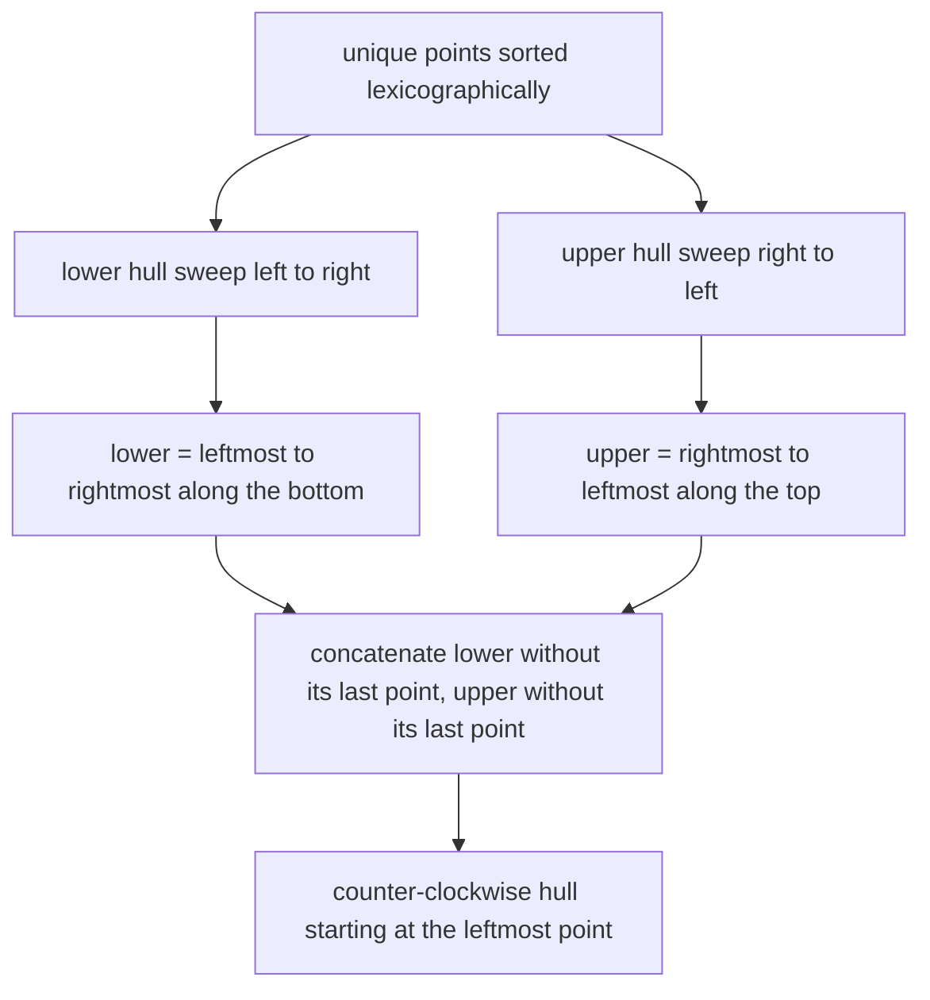
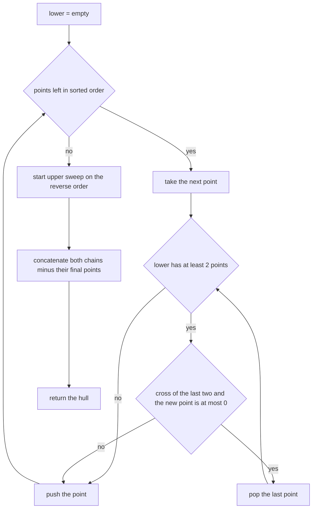
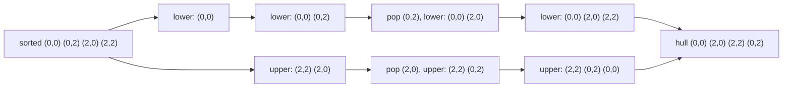

# 367 — Compute convex hull (Andrew monotone chain).

> **Tier:** Intermediate · **CTCI chapter:** Beyond — Graphics, Geometry & Robotics
> **Task spec:** [367-compute-convex-hull-andrew-monotone-chain.md](../../../tasks/intermediate/367-compute-convex-hull-andrew-monotone-chain.md)
> **Solutions:** [Python](../../../solutions/python/intermediate/367-compute-convex-hull-andrew-monotone-chain/solution.py) ·
> [Java](../../../solutions/java/intermediate/367-compute-convex-hull-andrew-monotone-chain/Solution.java) ·
> [JavaScript](../../../solutions/javascript/intermediate/367-compute-convex-hull-andrew-monotone-chain/solution.js) ·
> [C#](../../../solutions/csharp/intermediate/367-compute-convex-hull-andrew-monotone-chain/Solution.cs)

## 1. Problem restatement

**Input:** `n` integer points in the plane.

**Output:** the convex hull, counter-clockwise, starting at the lexicographically smallest point
(minimum `x`, then minimum `y`), with no point repeated and with collinear points on hull edges
dropped.

The task is the monotone-chain sibling of [366](../../../tasks/intermediate/366-compute-convex-hull-graham-scan.md),
and its solution files make that relationship explicit: each of them also carries a copy of the
Graham scan so both hulls can be compared on every test. The hand-checked sets and expectations
are identical:

| Input | Hull |
| --- | --- |
| `[(0,0), (2,0), (2,2), (0,2)]` | `[[0,0], [2,0], [2,2], [0,2]]` |
| `[(0,0), (2,0), (2,2), (0,2), (1,1)]` | `[[0,0], [2,0], [2,2], [0,2]]` |
| `[(0,0), (1,0), (2,0), (3,0)]` | `[[0,0], [3,0]]` |
| `[(0,0), (1,1), (2,2), (3,3), (0,3)]` | `[[0,0], [3,3], [0,3]]` |
| `[(0,0), (0,0), (2,0), (2,0), (2,2), (0,2), (2,2)]` | `[[0,0], [2,0], [2,2], [0,2]]` |
| `[(0,0), (4,0), (2,3)]` | `[[0,0], [4,0], [2,3]]` |
| `[(5,7)]`, `[(0,0), (1,1)]`, `[]` | returned as-is, in lexicographic order |

Two further guarantees are asserted:

- `signed_area2(monotone_chain(square)) == 8`, i.e. the output ring is counter-clockwise (twice
  the area `4` is positive);
- `normalize` restores the canonical form from a clockwise ring
  (`[[0,0], [0,2], [2,2], [2,0]]`) and from a rotated ring (`[[2,2], [0,2], [0,0], [2,0]]`), both
  times producing `[[0,0], [2,0], [2,2], [0,2]]`.

The LCG cross-check runs 80 trials of `count = 1 + seed % 45` points with coordinates
`seed % (5 + seed % 25)` — small moduli so that collinear triples are common — and requires the
normalized monotone chain to equal the normalized Graham scan, to have non-negative signed area,
and to be strictly convex.

## 2. Intuition

A convex hull is the union of two chains between its leftmost and rightmost points: the **lower
hull** (the points you touch when sweeping along the bottom) and the **upper hull**. Graham scan
builds both at once by sorting by polar angle around a pivot; monotone chain builds them
separately, and the only sorting needed is the ordinary lexicographic one.

The key insight is that each chain is itself a monotone path: sorted lexicographically by `x`, the
lower hull turns left at every vertex when walked left-to-right, and the upper hull turns left at
every vertex when walked right-to-left. That means the *same* stack sweep works twice — once over
the sorted list, once over its reverse — with only the same strict-left-turn pop rule.

No polar angle, no pivot, no cross-quadrant comparator: the greedy sweep only needs to know whether
the last two chosen points and the incoming point turn left. The concatenation
`lower[:-1] + upper[:-1]` drops each endpoint exactly once, because the lexicographically smallest
and largest points appear at the ends of both chains.



Because the collinear pop rule is `cross ≤ 0`, a straight run along an edge contributes its two
extreme endpoints and nothing else — the same convention task 366 uses, which is what allows the
two hulls to be compared point for point.

## 3. Algorithm

1. **Deduplicate and sort** the points lexicographically; if two or fewer remain, return them.
2. **Lower sweep:** for each point in sorted order, pop while the last two chosen points and the
   point make a non-strict left turn (`cross ≤ 0`), then push it.
3. **Upper sweep:** repeat over the reverse of the sorted list.
4. **Concatenate:** `lower[:-1] + upper[:-1]`. The two dropped points are the coincident endpoints
   of the chains.
5. **Normalize** (only if the caller wants the canonical form): reverse the ring when the shoelace
   sign is negative, then rotate so the lexicographically smallest point comes first.

```text
function cross(o, a, b)
    return (a.x - o.x) * (b.y - o.y) - (a.y - o.y) * (b.x - o.x)
end

function monotone_chain(points)
    unique ← sorted distinct points lexicographically
    if length(unique) ≤ 2 then
        return unique
    end
    lower ← empty stack
    for each p in unique do
        while length(lower) ≥ 2 and cross(lower[-2], lower[-1], p) ≤ 0 do
            remove the last element of lower
        end
        append p to lower
    end
    upper ← empty stack
    for each p in reverse of unique do
        while length(upper) ≥ 2 and cross(upper[-2], upper[-1], p) ≤ 0 do
            remove the last element of upper
        end
        append p to upper
    end
    return lower[0 .. length(lower) - 2] joined with upper[0 .. length(upper) - 2]
end

function normalize(hull)
    if length(hull) ≤ 1 then
        return hull
    end
    if signed_area2(hull) < 0 then
        reverse hull
    end
    rotate hull so that the lexicographically smallest point is first
    return hull
end
```

The pop loop is identical in both sweeps, which is the whole economy of this algorithm: one
comparator-free convexity rule, applied to a list and its reverse.



Both sweeps are linear in the number of sorted points, so the whole algorithm is dominated by the
lexicographic sort.

## 4. Worked example

Take the square `[(0,0), (2,0), (2,2), (0,2)]`. The sorted unique list is
`[(0,0), (0,2), (2,0), (2,2)]` — note that lexicographic order interleaves the left and right
columns, which is exactly why the lower sweep starts with the *upper-left* corner.

Lower sweep:

| Point | Stack before | Cross `(last two, point)` | Action | Stack after |
| --- | --- | --- | --- | --- |
| `(0,0)` | `[]` | — | push | `[(0,0)]` |
| `(0,2)` | `[(0,0)]` | — | push | `[(0,0), (0,2)]` |
| `(2,0)` | `[(0,0), (0,2)]` | `0·0 - 2·2 = -4 ≤ 0` | pop `(0,2)`, push | `[(0,0), (2,0)]` |
| `(2,2)` | `[(0,0), (2,0)]` | `2·2 - 0·2 = 4 > 0` | push | `[(0,0), (2,0), (2,2)]` |

Upper sweep over `[(2,2), (2,0), (0,2), (0,0)]`:

| Point | Stack before | Cross | Action | Stack after |
| --- | --- | --- | --- | --- |
| `(2,2)` | `[]` | — | push | `[(2,2)]` |
| `(2,0)` | `[(2,2)]` | — | push | `[(2,2), (2,0)]` |
| `(0,2)` | `[(2,2), (2,0)]` | `0·(-2) - (-2)·(-2) = -4 ≤ 0` | pop `(2,0)`, push | `[(2,2), (0,2)]` |
| `(0,0)` | `[(2,2), (0,2)]` | `(-2)·(-2) - 0·(-2) = 4 > 0` | push | `[(2,2), (0,2), (0,0)]` |

Concatenating `lower[:-1] = [(0,0), (2,0)]` with `upper[:-1] = [(2,2), (0,2)]` gives
`[[0,0], [2,0], [2,2], [0,2]]` — counter-clockwise, starting at the lexicographically smallest
point, exactly as asserted. The inner point `(1,1)` never survives a sweep, and a collinear run
such as `[(0,0), (1,0), (2,0), (3,0)]` collapses to `[[0,0], [3,0]]` because the straight turns are
popped by the `≤ 0` rule.



The `normalize` helper exists because the two chains are only *almost* canonical: a chain produced
by a sweep always starts at an endpoint of the sorted list, but a hull handed in from outside may
be clockwise or rotated. The files assert both repairs explicitly.

## 5. Complexity

Let `n` be the number of distinct input points and `h` the hull size.

| Measure | Bound | Why it holds |
| --- | --- | --- |
| Time | O(n log n) | the lexicographic sort dominates; the two sweeps are each `O(n)` |
| Time, sweeps | O(n) | each point is pushed once per sweep and popped at most once per sweep |
| Space | O(n) | the sorted array plus the two stacks, each at most `n` long |
| Output size | ≤ n | each chain holds at most all points, and the concatenation drops two |
| Signed area / normalization | O(h) | one shoelace pass plus one scan for the smallest point |
| Graham scan, for comparison | O(n log n) | equal asymptotics but with a comparator that evaluates cross products and distances during the sort |

The practical difference from Graham scan is the constant factor rather than the asymptotics: the
sort here compares two integers at a time, while the polar comparator in task 366 evaluates cross
products and squared distances per comparison. Monotone chain also needs no pivot, so it has no
degenerate "all points share an angle" case.

## 6. Pitfalls and edge cases

- **Zero, one and two points.** `[]` returns `[]`, `[(5,7)]` returns `[[5,7]]`, and two points come
  back in lexicographic order. The early return runs before any sweep.
- **Duplicates must be removed first.** Duplicate points would be pushed and popped repeatedly,
  and `cross == 0` comparisons between identical points are meaningless. The files deduplicate with
  a set (Python, JavaScript), a sorted-unique pass (C#) or an explicit comparison (Java).
- **Collinear runs.** The pop rule is `cross ≤ 0`, so `[(0,0), (1,0), (2,0), (3,0)]` yields exactly
  two points and `[(0,0), (1,1), (2,2), (3,3), (0,3)]` yields three. A `< 0` rule would leave the
  interior collinear points in place and break both the Graham comparison and the strict-convexity
  assertion.
- **Both sweeps are mandatory.** The lower hull alone is not a hull. The files build `upper` by
  iterating `reversed(sorted)`; forgetting the reversal, or concatenating without dropping the
  duplicated endpoints, produces a ring with a repeated vertex.
- **Ordering of the output.** The raw chain output is counter-clockwise starting at the
  lexicographically smallest point, but `normalize` is what makes the canonical form explicit and
  idempotent: it flips a clockwise ring (`signed_area2 < 0`) and rotates a ring that starts
  elsewhere.
- **Signed area sign convention.** `signed_area2` is positive for counter-clockwise rings, `0` for
  a degenerate (all-collinear) hull, and negative for clockwise ones. The tests assert
  `signed_area2(chain) >= 0` after normalization.
- **Strict convexity in the cross-check.** For every consecutive triple the tests require
  `cross > 0` (skipped when the hull has at most two points), so a hull that keeps a collinear
  vertex fails immediately.
- **Small coordinate ranges are deliberate.** The LCG sets use `modulus = 5 + seed % 25`, which
  makes collinear triples and duplicate coordinates common, i.e. exactly the cases the `≤ 0` rule
  and the dedup step exist for.
- **Integer overflow.** The cross product multiplies two coordinate differences; Java and C# use
  `long`, Python is unbounded and JavaScript stays exact within the asserted ranges.
- **Degenerate output for all-collinear input.** The hull is a segment, and the convexity loop in
  the tests is guarded by `len(chain) <= 2`.

## 7. Variants and follow-ups

- **Graham scan.** The polar-angle alternative, with the extra pivot and comparator machinery, is
  [366-compute-convex-hull-graham-scan.md](../../../tasks/intermediate/366-compute-convex-hull-graham-scan.md);
  the two agree on every asserted input after normalization.
- **Diameter after the hull.** Rotating calipers walk the finished ring in linear time —
  [373-implement-rotating-calipers-for-diameter-of-convex-polygon.md](../../../tasks/intermediate/373-implement-rotating-calipers-for-diameter-of-convex-polygon.md).
- **Area of the ring.** The same shoelace sum that decides the winding sign is the subject of
  [372-implement-polygon-area-shoelace-formula.md](../../../tasks/intermediate/372-implement-polygon-area-shoelace-formula.md).
- **Using the hull as test geometry.** The task-368 solutions build convex test polygons with this
  very monotone chain and then classify grid points against them, which is a good example of one
  task's structure serving as another's fixture —
  [368-point-in-polygon-test-ray-casting.md](../../../tasks/intermediate/368-point-in-polygon-test-ray-casting.md).
- **Upper envelope instead of a hull.** The skyline merge of
  [365-implement-skyline-of-buildings-via-divide-conquer-detailed.md](../../../tasks/intermediate/365-implement-skyline-of-buildings-via-divide-conquer-detailed.md)
  keeps the maximum profile rather than the extreme points, but both reduce to "keep the strictly
  turning chain".

## 8. Check yourself

1. Why does the lower sweep still start correctly even though lexicographic order visits the
   upper-left corner before the lower-right corner?

<details><summary>Show answer</summary>

Because the sweep does not assume the stack is sorted by `x` in a geometric sense; it only assumes
each new point comes no earlier than the previous one, which lexicographic order guarantees. The
first two pushes establish a temporary chain that the pop rule repairs as soon as a point below it
appears — `(2,0)` pops `(0,2)` in the square example.

</details>

2. How many points must be dropped when the two chains are concatenated, and which ones?

<details><summary>Show answer</summary>

Two: the last point of the lower chain and the last point of the upper chain, because both chains
start at the lexicographically smallest point and end at the lexicographically largest one. The
code writes `lower[:-1] + upper[:-1]`, so each shared endpoint appears exactly once in the result.

</details>

3. What changes if the pop rule becomes `cross < 0` instead of `cross <= 0`?

<details><summary>Show answer</summary>

Collinear points on hull edges would be kept. `[(0,0), (1,0), (2,0), (3,0)]` would return four
points instead of `[[0,0], [3,0]]`, the comparison with the task-366 Graham scan (which pops on
`≤ 0`) would fail, and the strict-convexity assertion `cross > 0` for consecutive triples would
fail too.

</details>

4. Why is `normalize` still needed when the sweep output is already counter-clockwise?

<details><summary>Show answer</summary>

Because the sweep output is canonical only for input that came through the sweep. A hull arriving
from elsewhere may be clockwise or rotated — the files assert exactly that with
`[[0,0], [0,2], [2,2], [2,0]]` (clockwise, negative signed area) and
`[[2,2], [0,2], [0,0], [2,0]]` (rotated). `normalize` flips the winding when the shoelace sign is
negative and then rotates the ring to start at the smallest point, which makes it idempotent.

</details>

5. Monotone chain and Graham scan have the same asymptotic time. Where does the practical
   difference come from?

<details><summary>Show answer</summary>

The sort. Graham scan sorts by polar angle around a pivot, so every comparison evaluates cross
products and, on equal angles, squared distances. Monotone chain sorts lexicographically, which
compares two integers, and it postpones all orientation tests to the two linear sweeps. It also
has no pivot, so the degenerate "many points share an angle with the pivot" case never arises.

</details>
