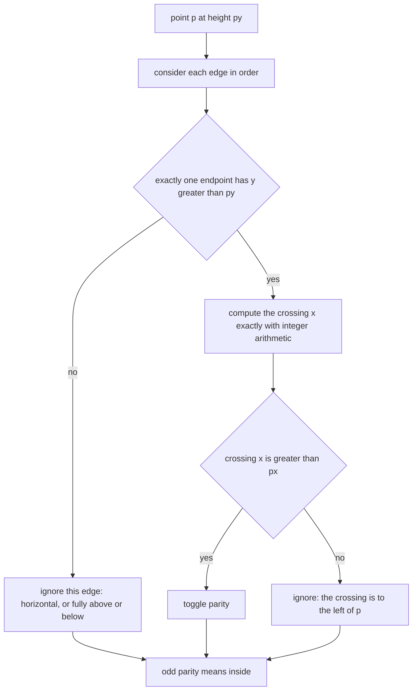
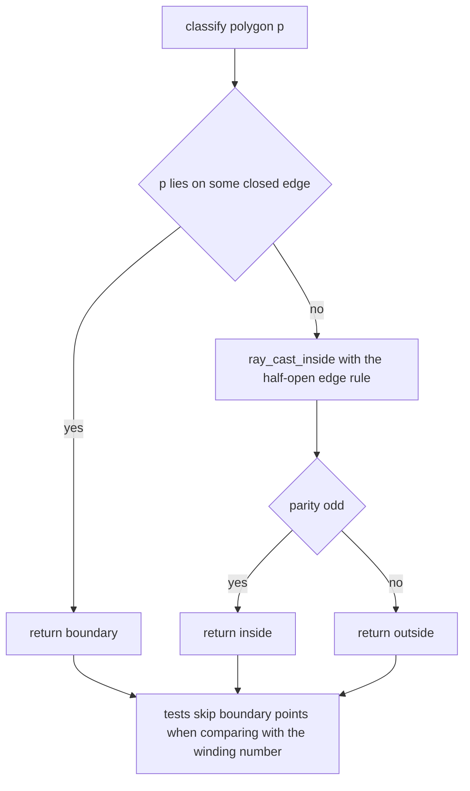
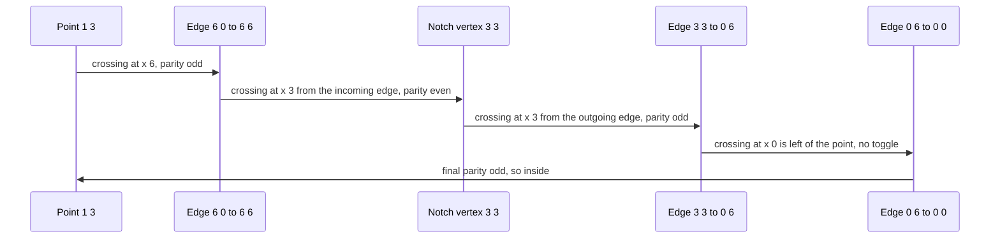

# 368 — Point-in-polygon test (ray casting).

> **Tier:** Intermediate · **CTCI chapter:** Beyond — Graphics, Geometry & Robotics
> **Task spec:** [368-point-in-polygon-test-ray-casting.md](../../../tasks/intermediate/368-point-in-polygon-test-ray-casting.md)
> **Solutions:** [Python](../../../solutions/python/intermediate/368-point-in-polygon-test-ray-casting/solution.py) ·
> [Java](../../../solutions/java/intermediate/368-point-in-polygon-test-ray-casting/Solution.java) ·
> [JavaScript](../../../solutions/javascript/intermediate/368-point-in-polygon-test-ray-casting/solution.js) ·
> [C#](../../../solutions/csharp/intermediate/368-point-in-polygon-test-ray-casting/Solution.cs)

## 1. Problem restatement

**Input:** a simple polygon given as a list of integer vertices — possibly clockwise or
counter-clockwise, possibly concave — and a query point `p`.

**Output:** one of three answers, from `classify`:

| Answer | Meaning |
| --- | --- |
| `boundary` | `p` lies on a polygon edge (the closed segment between two consecutive vertices) |
| `inside` | `p` is strictly inside |
| `outside` | `p` is strictly outside |

The same files also expose `ray_cast_inside` (a plain boolean, using the even-odd rule) and
`winding_number` (the alternative classical formulation), and they must agree on every
non-boundary point.

Hand-checked expectations on the square `(0,0), (4,0), (4,4), (0,4)`:

| Point | Answer | Why |
| --- | --- | --- |
| `(2,2)` | `inside` | strictly inside |
| `(5,2)`, `(-1,2)`, `(2,5)` | `outside` | right, left and above |
| `(4,4)` | `boundary` | a vertex |
| `(0,2)` | `boundary` | left edge |
| `(2,0)` | `boundary` | bottom edge |
| `(0,0)` | `boundary` | corner |
| `(-1,0)` | `outside` | the horizontal ray passes exactly through the vertices `(0,0)` and `(4,0)` |

The concave "arrow" `(0,0), (6,0), (6,6), (3,3), (0,6)` — a square with a triangular notch cut out
of the top — is the case that separates correct implementations from nearly correct ones:

| Point | Answer | Why |
| --- | --- | --- |
| `(3,1)`, `(1,4)`, `(5,4)` | `inside` | the notch only removes the middle of the top |
| `(3,4)`, `(2,6)` | `outside` | inside the notch / above the polygon |
| `(3,3)` | `boundary` | the notch vertex |
| `(5,5)` | `boundary` | on the edge `y = x` from `(6,6)` to `(3,3)` |
| `(0,3)` | `boundary` | on the left edge |
| `(1,3)` | `inside` | the ray `y = 3` hits the notch vertex and the edge at `x = 6` |

After the hand cases every solution sweeps an integer grid (`x, y ∈ -2 … 8` for the square,
triangle and arrow; `x, y ∈ -2 … 13` for 30 LCG-built convex hulls, `seed = (seed * 75 + 74) % 65537`)
and asserts `ray_cast_inside(p) == (winding_number(p) != 0)` at every non-boundary point.

## 2. Intuition

The even-odd rule is a child's drawing rule: draw a ray from `p` to infinity and count how many
polygon edges it crosses; an odd count means `p` is inside.

The naive version of that rule is full of traps, and they all come from the *degenerate* crossings:
a ray that passes exactly through a vertex, or along an edge, or through a T-junction. Approximate
fixes (nudging the ray, adding epsilon comparisons, sampling in floating point) produce answers that
are right most of the time and wrong on the inputs that matter.

The key insight in these solutions is a **half-open edge rule** that needs no epsilon at all: an
edge `(y1, y2)` counts as crossing the horizontal ray at height `py` only when *exactly one* of its
endpoints satisfies `y > py`. In other words the edge's y-interval is treated as `[y_low, y_high)`:
the lower endpoint counts, the upper one does not.



Two properties fall out of that rule for free. A horizontal edge never crosses a horizontal ray, so
the `(y1 > py) == (y2 > py)` test skips it. A shared vertex is counted exactly once when the polygon
passes through the ray there, and exactly twice (cancelling) when the ray merely touches the
polygon's silhouette — which is why `(1,3)` in the arrow polygon, whose ray passes through the
notch vertex, still comes out `inside`.

The second insight is exactness: the crossing comparison never divides. Instead of computing
`x_intersection = x1 + (py - y1) · dx / dy` and comparing it to `px`, the code evaluates

```text
lhs = (x1 - px) · dy + (py - y1) · dx
```

and tests `(lhs > 0) == (dy > 0)`, which is the sign of `(x_intersection - px) · dy` and therefore
equivalent to `x_intersection > px` regardless of the sign of `dy`. No division, no rounding, no
epsilon.

## 3. Algorithm

1. **Boundary first:** for each edge, `cross(a, b, p) == 0` and `p` inside the edge's bounding box
   means `p` is on the boundary, and `classify` returns `boundary`.
2. **Ray cast:** start with `inside = false`. For each edge `(a, b)` in cyclic order:
   - skip the edge when `(a.y > p.y) == (b.y > p.y)`;
   - otherwise compute `dy = b.y - a.y` and
     `lhs = (a.x - p.x) · dy + (p.y - a.y) · (b.x - a.x)`;
   - toggle `inside` when `(lhs > 0) == (dy > 0)`, i.e. when the crossing lies strictly right of `p`.
3. **Return** `inside ? "inside" : "outside"`.
4. **Cross-check** with the winding number: `+1` when `a.y ≤ p.y < b.y` and `cross(a, b, p) > 0`,
   `-1` when `a.y > p.y ≥ b.y` and `cross(a, b, p) < 0`; `inside` iff the winding number is not
   zero.

```text
function on_segment(a, b, p)
    if cross(a, b, p) ≠ 0 then
        return false
    end
    return min(a.x, b.x) ≤ p.x ≤ max(a.x, b.x) and min(a.y, b.y) ≤ p.y ≤ max(a.y, b.y)
end

function ray_cast_inside(polygon, p)
    px ← p.x
    py ← p.y
    inside ← false
    for i ← 0 to length(polygon) - 1 do
        a ← polygon[i]
        b ← polygon[(i + 1) mod length(polygon)]
        if (a.y > py) = (b.y > py) then
            continue
        end
        dy ← b.y - a.y
        lhs ← (a.x - px) * dy + (py - a.y) * (b.x - a.x)
        if (lhs > 0) = (dy > 0) then
            inside ← not inside
        end
    end
    return inside
end

function winding_number(polygon, p)
    winding ← 0
    for i ← 0 to length(polygon) - 1 do
        a ← polygon[i]
        b ← polygon[(i + 1) mod length(polygon)]
        if a.y ≤ p.y then
            if b.y > p.y and cross(a, b, p) > 0 then
                winding ← winding + 1
            end
        else
            if b.y ≤ p.y and cross(a, b, p) < 0 then
                winding ← winding - 1
            end
        end
    end
    return winding
end
```

The winding-number routine uses exactly the same half-open convention on `y` (`a.y ≤ p.y < b.y` on
one side, mirrored on the other), which is why the two agree on every non-boundary point instead of
disagreeing on the vertex cases.



`boundary` is a separate answer rather than a special case of inside or outside, and the tests rely
on that: the grid sweeps skip every on-boundary point precisely because the task defines the
polygon as a closed set whose boundary is reported separately.

## 4. Worked example

**The easy case.** Square `(0,0), (4,0), (4,4), (0,4)` and `p = (2,2)`, ray `y = 2` cast to the
right:

| Edge | Endpoints above `y = 2` | Skip? | Crossing `x` | Right of `px = 2`? | Parity |
| --- | --- | --- | --- | --- | --- |
| `(0,0)-(4,0)` | none | yes (horizontal) | — | — | false |
| `(4,0)-(4,4)` | `(4,4)` only | no | `4` | yes | true |
| `(4,4)-(0,4)` | both | yes (horizontal) | — | — | true |
| `(0,4)-(0,0)` | `(0,4)` only | no | `0` | no | true |

Odd parity → `inside`, as asserted.

**The vertex case.** `p = (-1, 0)` on the same square: the ray `y = 0` runs exactly along the
bottom edge and through the vertices `(0,0)` and `(4,0)`.

| Edge | Endpoints above `y = 0` | Skip? | Crossing `x` | Right of `px = -1`? | Parity |
| --- | --- | --- | --- | --- | --- |
| `(0,0)-(4,0)` | none | yes (horizontal) | — | — | false |
| `(4,0)-(4,4)` | `(4,4)` only | no | `4` | yes | true |
| `(4,4)-(0,4)` | both | yes | — | — | true |
| `(0,4)-(0,0)` | `(0,4)` only | no | `0` | yes | false |

Two crossings, even parity → `outside`. The half-open rule is what makes this work: the bottom edge
is skipped as horizontal, and each *vertical* edge is counted exactly once even though the ray
touches the polygon at both of its bottom vertices. The winding number for the same point is `0`,
confirming the answer.

**The concave case.** Arrow `(0,0), (6,0), (6,6), (3,3), (0,6)` with `p = (1,3)`, ray `y = 3`:

| Edge | Endpoints above `y = 3` | Skip? | Crossing `x` | Right of `px = 1`? | Parity |
| --- | --- | --- | --- | --- | --- |
| `(0,0)-(6,0)` | none | yes | — | — | false |
| `(6,0)-(6,6)` | `(6,6)` only | no | `6` | yes | true |
| `(6,6)-(3,3)` | `(6,6)` only | no | `3` | yes | false |
| `(3,3)-(0,6)` | `(0,6)` only | no | `3` | yes | true |
| `(0,6)-(0,0)` | `(0,6)` only | no | `0` | no | true |

Four crossings, and the two at `x = 3` — the notch vertex, entered by one edge and left by the
next — cancel each other, leaving the single real crossing at `x = 6`. Odd parity → `inside`, which
matches the file's own explanation, and the winding number agrees (`1`).



## 5. Complexity

Let `m` be the number of polygon vertices.

| Measure | Bound | Why it holds |
| --- | --- | --- |
| `ray_cast_inside` | O(m) | one pass over the edges with constant work per edge |
| `on_boundary` | O(m) | one exact cross product plus a bounding-box test per edge |
| `classify` | O(m) | the boundary test and the ray cast each pass over the edges |
| `winding_number` | O(m) | the same single pass, accumulating `±1` |
| Space | O(1) | a handful of integers; the polygon is read, never copied |
| Floating-point alternative | O(m) | same asymptotics, but every comparison is inexact once `x_intersection` is divided |

The two quadratic-looking parts of the test suite are only about *coverage*, not complexity: the
grid sweep runs `O(m)` work per point for `11² = 121` points on the hand-built polygons and
`16² = 256` points per hull on 30 LCG polygons. Because everything is integer arithmetic the
answers are exactly reproducible, so equality between ray casting and the winding number is a real
check rather than an epsilon comparison.

## 6. Pitfalls and edge cases

- **Horizontal edges.** They never cross a horizontal ray; the skip test
  `(y1 > py) == (y2 > py)` catches them because both endpoints are on the same side of `py` (or
  exactly on it, which counts as "not above").
- **A ray through a vertex.** The half-open `[y_low, y_high)` convention makes a shared vertex
  contribute exactly one crossing when the polygon passes through the ray there, and exactly two
  mutually cancelling crossings when the ray only grazes the silhouette. `(-1,0)` on the square
  (even → outside) and `(1,3)` on the arrow (odd → inside) are the two asserted shapes of this
  case.
- **Points on the boundary are reported, not classified as inside or outside.** `classify` checks
  the boundary first, using an exact `cross == 0` plus a bounding-box test.
- **Exactness.** The comparison is `(lhs > 0) == (dy > 0)` with
  `lhs = (x1 - px)·dy + (py - y1)·dx`. Computing `x_intersection` as a float and comparing to `px`
  is wrong for large coordinates, and choosing an epsilon is arbitrary; the integer form avoids
  both problems.
- **Clockwise or counter-clockwise input.** Ray casting does not care about orientation — only the
  winding number does, and its sign flips with the winding direction. The tests therefore compare
  `ray_cast_inside(p) == (winding_number(p) != 0)`, which is orientation-independent.
- **Concave polygons are the point of the exercise.** The arrow polygon's notch makes `(3,4)`
  outside while `(1,4)` and `(5,4)` are inside, which no convexity assumption can reproduce.
- **Self-intersecting polygons are undefined.** The even-odd and nonzero rules differ for them;
  the task, the docstrings and the tests all assume a simple polygon.
- **Degenerate polygons.** Fewer than three vertices, or collinear vertices, are not exercised: the
  LCG trials skip hulls with fewer than three vertices before classifying.
- **The LCG polygons are convex hulls.** They are built with the monotone chain of
  [367](../../../tasks/intermediate/367-compute-convex-hull-andrew-monotone-chain.md), so those
  trials test the algorithms on convex rings over a fine grid; the concave coverage comes from the
  hand-built arrow.
- **Boundary points are excluded from the agreement check.** The task documents boundary as
  undefined for the even-odd/winding comparison; both loops `continue` when `on_boundary` is true.

## 7. Variants and follow-ups

- **Winding number instead of parity.** Already shipped side by side here; the sign of the winding
  number also tells the *orientation* of the polygon, which is the primitive used by
  [372-implement-polygon-area-shoelace-formula.md](../../../tasks/intermediate/372-implement-polygon-area-shoelace-formula.md).
- **Build the polygon first.** The convex test rings are produced by
  [367-compute-convex-hull-andrew-monotone-chain.md](../../../tasks/intermediate/367-compute-convex-hull-andrew-monotone-chain.md)
  and [366-compute-convex-hull-graham-scan.md](../../../tasks/intermediate/366-compute-convex-hull-graham-scan.md).
- **Segment intersection instead of containment.** Ray casting answers "does a segment cross this
  edge?" once per edge, which is the primitive the sweep of
  [371-detect-line-segment-intersection-bentley-ottmann-outline.md](../../../tasks/intermediate/371-detect-line-segment-intersection-bentley-ottmann-outline.md)
  needs in bulk.
- **Largest empty/degenerate shapes.** The same orientation predicate appears in the calipers walk
  of [373-implement-rotating-calipers-for-diameter-of-convex-polygon.md](../../../tasks/intermediate/373-implement-rotating-calipers-for-diameter-of-convex-polygon.md).
- **Spatial indexing for many queries.** For repeated containment queries over many shapes, a tree
  such as [364-implement-quad-tree-for-2d-region-queries.md](../../../tasks/intermediate/364-implement-quad-tree-for-2d-region-queries.md)
  prunes the shapes before the O(m) test is run.

## 8. Check yourself

1. Why does the code skip an edge when `(y1 > py) == (y2 > py)`?

<details><summary>Show answer</summary>

Because then both endpoints are on the same side of the ray (or on it), so the edge cannot cross the
horizontal line `y = py` in a way that matters. This one test covers horizontal edges, edges
entirely above the ray, and edges entirely below it — and it implements the half-open
`[y_low, y_high)` convention that makes vertex handling consistent.

</details>

2. Why is `(lhs > 0) == (dy > 0)` equivalent to `x_intersection > px`?

<details><summary>Show answer</summary>

`lhs` is `(x1 - px)·dy + (py - y1)·dx`, which is `(x_intersection - px) · dy` when
`x_intersection = x1 + (py - y1)·dx/dy`. Dividing by `dy` preserves the inequality only when `dy`
is positive; the test compensates by requiring `dy` and `lhs` to have the same sign, which is
exactly "the crossing is to the right of `p`" for both orientations of the edge.

</details>

3. For the square and `p = (-1, 0)`, how many crossings does the ray find, and what would a
   closed-interval edge rule report instead?

<details><summary>Show answer</summary>

Two crossings, both vertical edges (`x = 4` and `x = 0`), giving even parity and `outside`. A
closed rule that counted both the lower and the upper endpoint of every edge would count the bottom
vertices twice and could report `inside`, which is the classic off-by-one-in-the-vertex bug.

</details>

4. Why must `classify` test the boundary before ray casting?

<details><summary>Show answer</summary>

Because ray casting is defined only away from the polygon's boundary: a point on an edge gives a
result that depends on how the coincident crossing is counted. The task reports such points as
`boundary`, using an exact `cross == 0` plus a bounding-box check, and the tests skip these points
when comparing ray casting with the winding number.

</details>

5. Why does the file's LCG cross-check ignore polygons with fewer than three vertices?

<details><summary>Show answer</summary>

Because a hull of one or two points is not a polygon: there is no interior, ray casting over a
degenerate ring would be measuring a segment, and the winding number is meaningless. The trial loop
skips those cases rather than defining behaviour for them.

</details>
