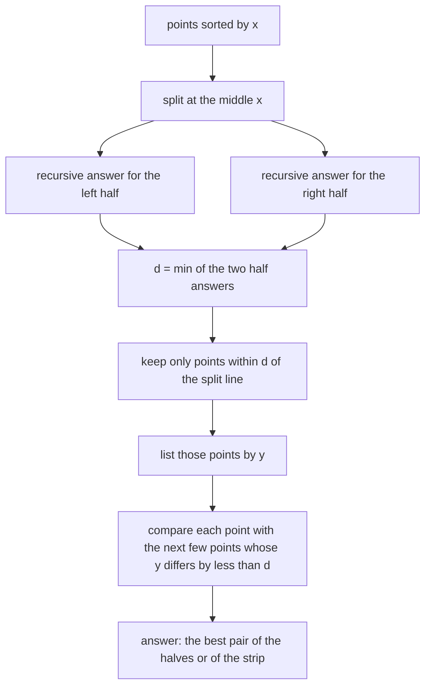
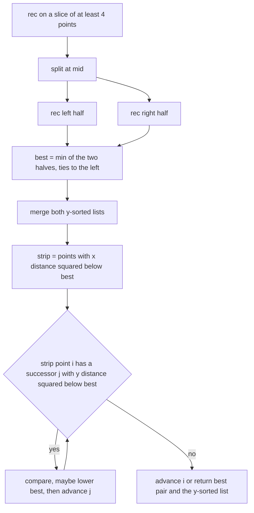
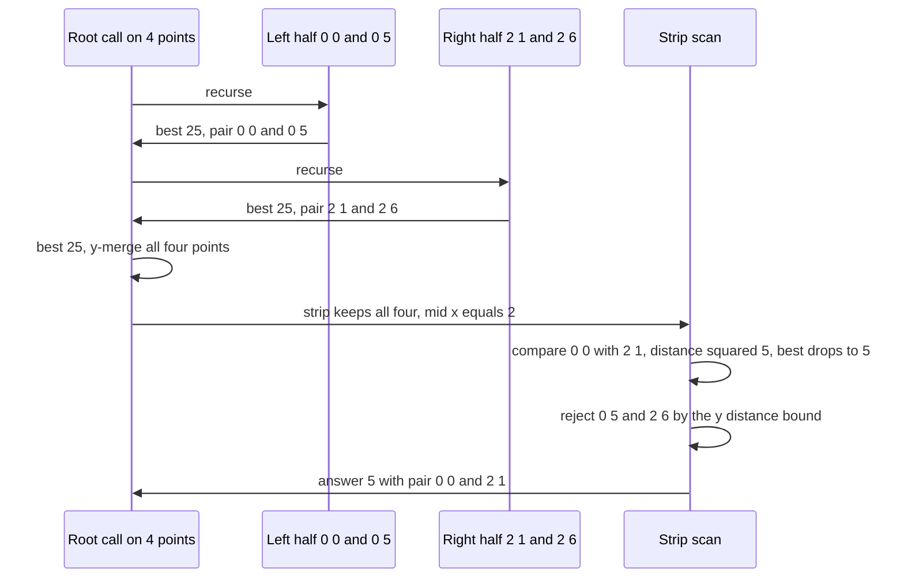

# 369 — Closest pair of points (divide & conquer).

> **Tier:** Intermediate · **CTCI chapter:** Beyond — Graphics, Geometry & Robotics
> **Task spec:** [369-closest-pair-of-points-divide-conquer.md](../../../tasks/intermediate/369-closest-pair-of-points-divide-conquer.md)
> **Solutions:** [Python](../../../solutions/python/intermediate/369-closest-pair-of-points-divide-conquer/solution.py) ·
> [Java](../../../solutions/java/intermediate/369-closest-pair-of-points-divide-conquer/Solution.java) ·
> [JavaScript](../../../solutions/javascript/intermediate/369-closest-pair-of-points-divide-conquer/solution.js) ·
> [C#](../../../solutions/csharp/intermediate/369-closest-pair-of-points-divide-conquer/Solution.cs)

## 1. Problem restatement

**Input:** at least two integer points in the plane.

**Output:** the pair with the smallest Euclidean distance, reported as
`(squared distance, [p, q])`. Squared distances keep everything in exact integer arithmetic — no
square root, no epsilon. Fewer than two points is an error (`need at least two points` in Python;
the other languages throw their own exception with the same message).

| Input | Result | Why |
| --- | --- | --- |
| `[(0,0), (3,4), (7,1)]` | `25` | `(0,0)-(3,4)` is `9 + 16 = 25`; `(3,4)-(7,1)` ties at `25`, the first found wins |
| `[(5,5), (5,5), (9,9)]` | `0` | duplicate points are allowed and give distance `0` |
| `[(0,0), (-3,-4)]` | `25` | negative coordinates are fine |
| the 16 points of the `4 × 4` grid | `1` | adjacent grid points |
| `[(7, y) for y in 0…59]` | `1` | a vertical line, the worst shape for the strip |

Ties are resolved by "first found wins", which for the recursive algorithm means the left half is
preferred when `left_best ≤ right_best`, and within the strip scan the earliest improving pair is
kept.

Cross-checks: 30 LCG sets with `size = 2 + seed % 59` and coordinates `seed % (10 + seed % 90)`
(`seed = (seed * 75 + 74) % 65537`, starting at `271828`), 10 duplicate-heavy sets with coordinates
`seed % 5` (starting at `13579`), and the vertical line — all compared against an independent
`O(n²)` brute-force oracle, with the extra assertion that both returned points really occur in the
input.

## 2. Intuition

The brute-force answer compares all `n(n-1)/2` pairs, which is `O(n²)`. Sorting by `x` and dividing
is the classic fix, and the interesting part is what happens *across* the dividing line.

Split the points by `x` into halves. Recursively find each half's closest pair; let `d` be the
smaller of the two distances. Any pair closer than `d` must be a cross pair, and a cross pair must
have one point in the left half and one in the right — so both of its points lie in the **vertical
strip** of width `2d` centred on the split line, and their `y` values differ by less than `d`.
Everything outside that strip can be discarded without looking at its pairs.

The key insight is the packing argument inside the strip: if the two halves each have minimum
distance at least `d`, any `d × 2d` box in the strip can contain only a bounded number of points
(at most eight), so for each strip point only a constant number of subsequent points in `y` order
need to be examined. The strip therefore costs `O(n)` rather than `O(n²)`.



Two implementation details make the strip cheap and correct. First, each recursive call *returns*
its half's points sorted by `y` (obtained by merging the two children's y-sorted lists), so the
strip never needs an extra sort. Second, `best` is updated while the strip is scanned, so the
pruning bound `(dy)² < best` shrinks as improvements are found — the scan gets stricter, never
looser.

## 3. Algorithm

1. **Sort** the points by `x` (the files sort full tuples, so equal `x` is broken by `y`).
2. **Recurse** `solve(pts_by_x) -> (best_sq, pair, pts_by_y)`:
   - **base case** `n ≤ 3`: brute-force all pairs, and return the slice sorted by `(y, x)`;
   - **otherwise** split at `mid = n / 2`, recurse on both halves, set
     `(best, pair)` to the left result when `left_best ≤ right_best` and to the right result
     otherwise;
   - **merge** the two y-sorted lists into `merged_y`;
   - **strip:** take `mid_x = pts_by_x[mid].x` and keep every point with `(x - mid_x)² < best`;
   - **scan the strip** in `y` order: for each `i`, walk `j > i` while `(y[j] - y[i])² < best`,
     and update `best`/`pair` whenever `dist2(strip[i], strip[j]) < best`;
   - return `(best, pair, merged_y)`.
3. **Report** `(best, [p, q])`.

```text
function dist2(a, b)
    return (a.x - b.x) * (a.x - b.x) + (a.y - b.y) * (a.y - b.y)
end

function closest_pair(points)
    pts ← points sorted lexicographically
    if length(pts) < 2 then
        raise "need at least two points"
    end
    best, pair, ignored ← rec(pts)
    return best, pair
end

function rec(pts_by_x)
    n ← length(pts_by_x)
    if n ≤ 3 then
        best ← none
        pair ← none
        for i ← 0 to n - 1 do
            for j ← i + 1 to n - 1 do
                d ← dist2(pts_by_x[i], pts_by_x[j])
                if best is none or d < best then
                    best ← d
                    pair ← (pts_by_x[i], pts_by_x[j])
                end
            end
        end
        return best, pair, pts_by_x sorted by y then x
    end

    mid ← n div 2
    left_best, left_pair, left_y ← rec(pts_by_x[0 .. mid - 1])
    right_best, right_pair, right_y ← rec(pts_by_x[mid ..])
    if left_best ≤ right_best then
        best ← left_best
        pair ← left_pair
    else
        best ← right_best
        pair ← right_pair
    end

    merged_y ← merge left_y and right_y by y then x
    mid_x ← pts_by_x[mid].x
    strip ← points p in merged_y with (p.x - mid_x) * (p.x - mid_x) < best
    for i ← 0 to length(strip) - 1 do
        j ← i + 1
        while j < length(strip) and (strip[j].y - strip[i].y) * (strip[j].y - strip[i].y) < best do
            d ← dist2(strip[i], strip[j])
            if d < best then
                best ← d
                pair ← (strip[i], strip[j])
            end
            j ← j + 1
        end
    end
    return best, pair, merged_y
end
```

The strip filter uses `(x - mid_x)² < best`, which is a squared comparison, so it is equivalent to
`|x - mid_x| < sqrt(best)` without ever computing the root.



## 4. Worked example

Take `points = [(0,0), (0,5), (2,1), (2,6)]`, already sorted by `x` (`n = 4`, so the split is at
`mid = 2`).

| Call | Slice | Base case | `best` | `pair` | Returned y-order |
| --- | --- | --- | --- | --- | --- |
| left | `[(0,0), (0,5)]` | yes | `25` | `(0,0)-(0,5)` | `[(0,0), (0,5)]` |
| right | `[(2,1), (2,6)]` | yes | `25` | `(2,1)-(2,6)` | `[(2,1), (2,6)]` |
| root | all four | no | `25` (left wins the tie) | `(0,0)-(0,5)` | merged `[(0,0), (2,1), (0,5), (2,6)]` |

Both halves stop at distance `25` because each is a vertical pair of length `5`. The root then merges
the y-sorted lists and builds the strip around `mid_x = 2`:

| Point | `(x - 2)²` | In strip? |
| --- | --- | --- |
| `(0,0)` | `4` | yes, `4 < 25` |
| `(2,1)` | `0` | yes |
| `(0,5)` | `4` | yes |
| `(2,6)` | `0` | yes |

Strip scan, with `best = 25` initially:

| `i` | `strip[i]` | `j` | `strip[j]` | `(y_j - y_i)² < best`? | `dist2` | `best` after |
| --- | --- | --- | --- | --- | --- | --- |
| 0 | `(0,0)` | 1 | `(2,1)` | `1 < 25` yes | `5` | `5`, pair `(0,0)-(2,1)` |
| 0 | `(0,0)` | 2 | `(0,5)` | `25 < 5` no | — | `5` |
| 1 | `(2,1)` | 2 | `(0,5)` | `16 < 5` no | — | `5` |
| 2 | `(0,5)` | 3 | `(2,6)` | `1 < 5` yes | `5` | `5` (not strictly smaller) |
| 3 | `(2,6)` | — | — | — | — | `5` |

The answer `(5, [(0,0), (2,1)])` comes entirely from the strip: neither half found it, and the
winning pair straddles the split line at `x = 2`. Notice how quickly the pruning tightens — after
`best` drops to `5`, the pairs with `dy² = 25` and `dy² = 16` are rejected without computing their
distances at all.



## 5. Complexity

Let `n` be the number of points.

| Measure | Bound | Why it holds |
| --- | --- | --- |
| Time | O(n log n) | the recurrence is `T(n) = 2·T(n/2) + O(n)`: the y-merge is linear and the strip scan is linear |
| Time, strip scan | O(n) overall | the packing argument bounds the number of points in any `d × 2d` box, so each strip point compares against a constant number of successors; the `(dy)² < best` bound only tightens as `best` falls |
| Time, y-merge | O(n) | two sorted lists are merged with two pointers; no comparison sort is performed below the root |
| Space | O(n) live | each call returns a y-sorted list and holds the merged list, so the live lists along one root-to-leaf path total `O(n)`; the implementation also re-slices the x-sorted array per call, which allocates `O(n log n)` over the whole run but not at once |
| Brute-force oracle | O(n²) | the independent comparator in the same files compares all pairs |
| Input sort | O(n log n) | the only sort in the algorithm |

The vertical line `[(7, y) for y in 0…59]` is the asserted worst-case shape: every point has the
same `x`, so `mid_x` equals that `x` and the strip filter keeps everything except the pairs the
`y` bound rejects — the answer is `1`, and the scan still behaves because the `y` bound, not the
`x` bound, does the pruning inside the strip.

## 6. Pitfalls and edge cases

- **Fewer than two points.** `closest_pair([])` and `closest_pair([(5,7)])` raise
  `need at least two points`; there is no meaningful pair to return, so the function does not
  invent `0` or `None`.
- **Duplicate points.** `[(5,5), (5,5), (9,9)]` yields distance `0`, and the duplicate-heavy LCG
  sets (`seed % 5` coordinates) make sure the base case and the strip both handle it. Distance `0`
  can never be improved, so the tie-break returns the first duplicate pair found.
- **Exact distance `0` in the strip scan.** The pruning test `(dy)² < best` is strict, so once
  `best` reaches `0` no further pairs are examined — correct, because nothing can be smaller.
- **Ties in `best`.** `left_best ≤ right_best` prefers the left half, and inside the strip only
  `d < best` updates, leaving the equality case to the pair found first. The hand case
  `[(0,0), (3,4), (7,1)]` asserts that both pairs at distance `25` exist and that the reported pair
  really has distance `25`.
- **Both returned points must exist in the input.** Duplicate coordinates mean a returned pair can
  look "new"; the files assert membership in the input multiset explicitly.
- **The strip must use a squared comparison.** `(x - mid_x)² < best` is `|x - mid_x| < sqrt(best)`
  without the root; using `< best` on the unsquared difference compares unlike quantities and
  changes which points are considered.
- **The `y` bound must be strict too.** The inner loop runs while `(dy)² < best`; a `≤` bound would
  only add equal-distance pairs that cannot improve the answer, and a missing bound would make the
  strip scan quadratic.
- **`best` shrinking during the scan is safe.** The invariant is that any still-unexamined pair
  closer than the *current* `best` cannot have `y` separation at or above the current bound, and
  lowering `best` can only shorten the examined suffix. Points before `i` are never revisited, so
  no pair is skipped.
- **The recursion must return the y-sorted list.** If it returned only the answer, the strip would
  need a sort at every level and the total would become `O(n log² n)` instead of `O(n log n)`.
- **Base case size 3 is a choice, not a requirement.** Any small constant works; the files use
  `n ≤ 3` so the pair loops stay trivial and the y-sorted return is a three-element sort.
- **Integer overflow.** Squared distances multiply two coordinate differences; Java and C# use
  `long`, Python is unbounded and JavaScript is exact in the tested ranges.
- **Equal `x` coordinates.** Sorting full tuples breaks the tie by `y`, so the split is
  deterministic, which matters for the all-equal-`x` vertical-line case.

## 7. Variants and follow-ups

- **Nearest neighbour with a query point.** When the query is not one of the stored points, the
  kd-tree of [363-implement-kd-tree-for-2d-nearest-neighbor-basic.md](../../../tasks/intermediate/363-implement-kd-tree-for-2d-nearest-neighbor-basic.md)
  answers many queries in a row instead of solving one global problem.
- **Farthest pair instead of closest.** The maximum distance is attained on the convex hull and is
  found in linear time by [373-implement-rotating-calipers-for-diameter-of-convex-polygon.md](../../../tasks/intermediate/373-implement-rotating-calipers-for-diameter-of-convex-polygon.md)
  after the hull is built by [366](../../../tasks/intermediate/366-compute-convex-hull-graham-scan.md)
  or [367](../../../tasks/intermediate/367-compute-convex-hull-andrew-monotone-chain.md).
- **Rectangle area union.** The same "sweep and keep an aggregate" shape appears with a segment tree
  in [370-line-sweep-for-rectangle-area-union.md](../../../tasks/intermediate/370-line-sweep-for-rectangle-area-union.md),
  where the aggregate is covered length rather than a minimum distance.
- **Segment intersections.** The strip's "only nearby objects can interact" argument is the local
  precondition that makes [371-detect-line-segment-intersection-bentley-ottmann-outline.md](../../../tasks/intermediate/371-detect-line-segment-intersection-bentley-ottmann-outline.md)
  work.
- **Points in a grid instead of a plane.** For dense regular data the quad tree of
  [364-implement-quad-tree-for-2d-region-queries.md](../../../tasks/intermediate/364-implement-quad-tree-for-2d-region-queries.md)
  replaces the strip with region decomposition.

## 8. Check yourself

1. Why can the algorithm ignore the pairs that lie entirely inside one half after the recursion
   returns?

<details><summary>Show answer</summary>

Because each half already returned its own minimum, and `best` is the smaller of the two. Any pair
inside a half has distance at least that half's minimum, hence at least `best`, so it cannot
improve the answer. Only cross pairs remain to be checked, and they must sit in the strip.

</details>

2. Why does the strip scan only compare a point with successors whose `y` difference is below
   `sqrt(best)`?

<details><summary>Show answer</summary>

A pair closer than `best` must satisfy both `|dx| < sqrt(best)` (that is the strip filter) and
`|dy| < sqrt(best)` (the inner loop bound). The inner bound is applied to squared values as
`(y_j - y_i)² < best`, so no root is needed, and because the strip is `y`-sorted, the inner loop
can simply stop at the first violation.

</details>

3. Why does the recursion return a `y`-sorted copy of its slice?

<details><summary>Show answer</summary>

So the parent can build the strip without sorting. The two children's y-sorted lists are merged in
linear time, and the strip is a filter of that merge, which keeps `y` order. Without it, every level
would need an `O(n log n)` sort and the total would degrade to `O(n log² n)`.

</details>

4. What is the answer for `[(0,0), (0,5), (2,1), (2,6)]`, and which recursion level finds it?

<details><summary>Show answer</summary>

`5`, from the pair `(0,0)-(2,1)`, found at the **root** by the strip scan. Both halves only find
distance `25` (their own vertical pairs), so the improvement is a cross pair: `1² + 2² = 5`. The
strip then rejects the other candidates because their `y` separation squared (`16` and `25`) no
longer fits under `best = 5`.

</details>

5. The vertical line `[(7, y) for y in 0…59]` gives `best = 1`. Does the strip filter or the inner
   loop do the pruning there?

<details><summary>Show answer</summary>

The inner loop. Every point shares the same `x`, so `mid_x` is `7` and the strip filter
`(x - mid_x)² < best` keeps every point that is not yet excluded. The `y` bound
`(y_j - y_i)² < best` is what stops the scan after the immediate neighbour once `best` has fallen to
`1`.

</details>
