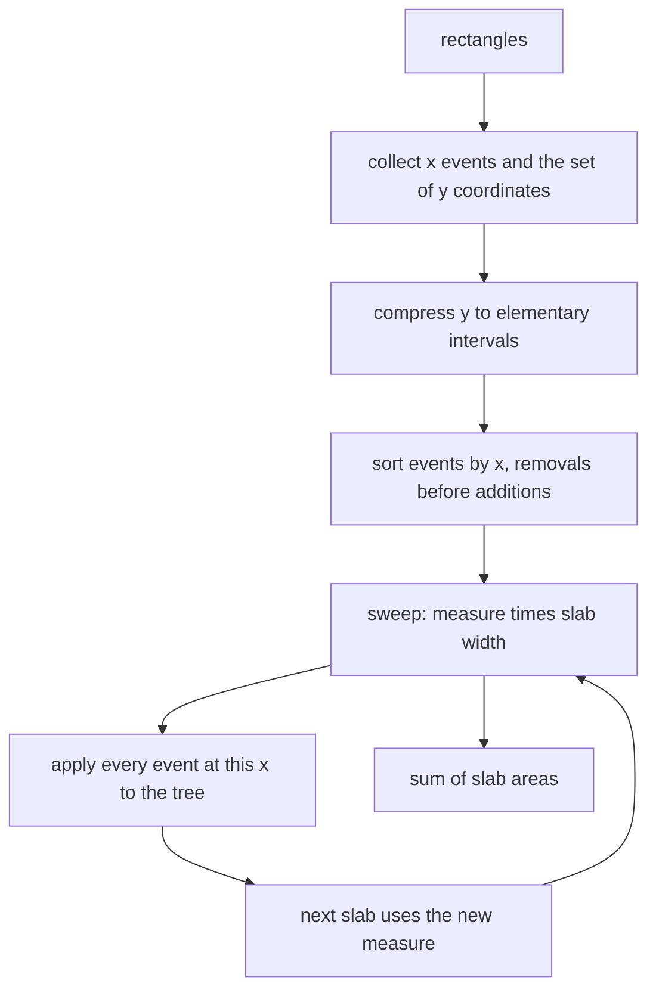
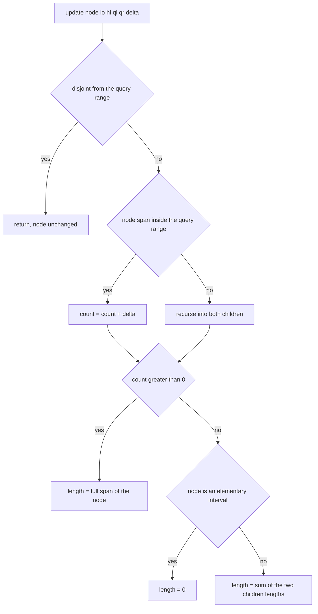
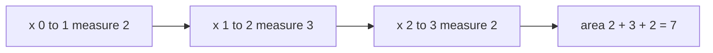

# 370 — Line sweep for rectangle area union.

> **Tier:** Intermediate · **CTCI chapter:** Beyond — Graphics, Geometry & Robotics
> **Task spec:** [370-line-sweep-for-rectangle-area-union.md](../../../tasks/intermediate/370-line-sweep-for-rectangle-area-union.md)
> **Solutions:** [Python](../../../solutions/python/intermediate/370-line-sweep-for-rectangle-area-union/solution.py) ·
> [Java](../../../solutions/java/intermediate/370-line-sweep-for-rectangle-area-union/Solution.java) ·
> [JavaScript](../../../solutions/javascript/intermediate/370-line-sweep-for-rectangle-area-union/solution.js) ·
> [C#](../../../solutions/csharp/intermediate/370-line-sweep-for-rectangle-area-union/Solution.cs)

## 1. Problem restatement

**Input:** axis-aligned rectangles `[x1, y1, x2, y2]`, possibly overlapping, possibly identical,
possibly touching, possibly degenerate.

**Output:** the total area covered by at least one rectangle, counted **once**.

Rectangles with `x1 ≥ x2` or `y1 ≥ y2` have zero or negative area and are dropped before the sweep.

| Input | Area | Why |
| --- | --- | --- |
| `[[0,0,2,2], [1,1,3,3]]` | `7` | `4 + 4 - 1` overlap |
| `[[0,0,1,1], [2,2,3,3]]` | `2` | disjoint, areas add |
| `[[0,0,10,10], [2,2,4,4]]` | `100` | nested, the outer wins |
| `[[1,1,3,3], [1,1,3,3]]` | `4` | identical, counted once |
| `[[0,0,2,2], [2,0,4,2]]` | `8` | sharing an edge is not overlapping |
| `[[0,0,1,1], [1,1,2,2]]` | `2` | sharing a corner is not overlapping |
| `[[5,5,5,9]]`, `[[5,5,5,5]]` | `0` | zero-area rectangles |
| `[[0,0,3,3], [1,1,1,4]]` | `9` | a degenerate slab inside a real rectangle |
| `[[2,3,7,9]]` | `30` | a single rectangle |
| `[[0,0,4,4], [0,0,4,4], [1,1,3,3]]` | `16` | duplicates plus a nested one |
| `[[0,0,3,3], [1,0,4,3], [0,1,3,4]]` | `15` | three-way overlap |
| `[]` | `0` | nothing to sweep |

The three-way overlap is the case that separates counting from a boolean "is this y covered" flag:
the measure is `4` on the band `y ∈ [0,1)`, still `4` on `y ∈ [1,3)` (height `2`), and `3` on
`y ∈ [3,4)`, giving `4·1 + 4·2 + 3·1 = 15`. Cross-checks run 40 LCG sets with `count = 1 + seed % 8`,
`modulus = 8 + seed % 10` (`seed = (seed * 75 + 74) % 65537`, starting at `1618`), including
zero-width and zero-height rectangles (width and height are `seed % (modulus / 2)`, so `0` occurs)
and a negative shift `offset = -(seed % 7)`, against an independent coordinate-compression grid
oracle.

## 2. Intuition

The straightforward approach is a rasterisation: discretise the plane into a grid of cells, mark
covered cells, count them. It is correct but its cost depends on the *magnitude* of the
coordinates, not on the number of rectangles.

The sweep-line idea removes that dependence. Sort all vertical edges by `x` and sweep a line across
the plane. Between two consecutive distinct `x` values nothing changes: the same set of rectangles
is active, so the covered `y`-length is constant. The union area is therefore

```text
area = sum over slabs of measure(slab) · width(slab)
```

where `measure` is the total length of `y` covered by the active rectangles. The sweep needs only
to maintain `measure` between events.

The key insight is what a segment tree over the compressed `y` coordinates should store: **counts,
not booleans**. Each node keeps

- `count[node]` — how many active rectangles cover its span *completely*;
- `length[node]` — the covered length of its span.

The update rule then becomes local and lazy-free: if `count[node] > 0` the node is fully covered,
so `length[node]` is its full span `ys[hi] - ys[lo]` regardless of children; otherwise an elementary
interval (a leaf) contributes `0` and an internal node contributes the sum of its children. Counts
are exactly what make three-way overlaps and touching edges work — a boolean flag cannot represent
two rectangles both covering the same y range, and a rectangle pair that merely touches must not
contribute length.



## 3. Algorithm

1. **Filter** rectangles with `x1 ≥ x2` or `y1 ≥ y2`; if nothing remains, return `0`.
2. **Events:** push `(x1, +1, y1, y2)` and `(x2, -1, y1, y2)`; collect all `y` coordinates.
3. **Compress:** sort the distinct `y` values; the `m = len(ys) - 1` elementary intervals are the
   leaves of a segment tree of size `4m` (empty when `m = 0`).
4. **Sort events** by `(x, delta)` so that at equal `x` the removals come first.
5. **Sweep:** with `prev_x` initialised to the first event's `x`:
   - add `measure() · (x - prev_x)` to the area, using the tree state *before* this `x`;
   - apply every event at this `x`, each one a range add of `delta` over the compressed
     `y` interval `[index[y1], index[y2])`;
   - set `prev_x = x`.
6. **Return** the accumulated area.

```text
function range_add(y_lo, y_hi, delta)
    if m = 0 or y_lo ≥ y_hi then
        return
    end
    update(1, 0, m, y_lo, y_hi, delta)
end

function update(node, lo, hi, ql, qr, delta)
    if qr ≤ lo or hi ≤ ql then
        return
    end
    if ql ≤ lo and hi ≤ qr then
        count[node] ← count[node] + delta
    else
        mid ← (lo + hi) div 2
        update(2 * node, lo, mid, ql, qr, delta)
        update(2 * node + 1, mid, hi, ql, qr, delta)
    end
    if count[node] > 0 then
        length[node] ← ys[hi] - ys[lo]
    else if hi - lo = 1 then
        length[node] ← 0
    else
        length[node] ← length[2 * node] + length[2 * node + 1]
    end
end

function union_area(rectangles)
    events ← empty list
    ys ← empty set
    for each (x1, y1, x2, y2) in rectangles do
        if x1 ≥ x2 or y1 ≥ y2 then
            continue
        end
        append (x1, +1, y1, y2) and (x2, -1, y1, y2) to events
        add y1 and y2 to ys
    end
    if events is empty then
        return 0
    end
    ordered_ys ← sorted ys
    index ← map from y value to its rank in ordered_ys
    tree ← new tree over ordered_ys
    sort events by (x, delta)
    area ← 0
    prev_x ← events[0].x
    i ← 0
    while i < length(events) do
        x ← events[i].x
        area ← area + tree.measure() * (x - prev_x)
        while i < length(events) and events[i].x = x do
            tree.range_add(index[events[i].y1], index[events[i].y2], events[i].delta)
            i ← i + 1
        end
        prev_x ← x
    end
    return area
end
```

Two details keep the recomputation correct: a partially covered internal node always recomputes
from *both* children, and the recomputation happens after the recursive calls, so a parent's
`length` never sees a stale child.



## 4. Worked example

Trace the canonical pair `[0,0,2,2]` and `[1,1,3,3]`. The `y` coordinates are `{0, 1, 2, 3}`, so
`m = 3` elementary intervals: `I0 = [0,1)`, `I1 = [1,2)`, `I2 = [2,3)`.

Events sorted by `(x, delta)`:

| Order | `x` | `delta` | `y` range | Compressed interval |
| --- | --- | --- | --- | --- |
| 1 | `0` | `+1` | `[0,2]` | `I0, I1` |
| 2 | `1` | `+1` | `[1,3]` | `I1, I2` |
| 3 | `2` | `-1` | `[0,2]` | `I0, I1` |
| 4 | `3` | `-1` | `[1,3]` | `I1, I2` |

Sweep (`prev_x` starts at `0`):

| Iteration | `x` | `measure` before | Slab width | Area added | Area | Tree state after applying the events at `x` |
| --- | --- | --- | --- | --- | --- | --- |
| 1 | `0` | `0` | `0` | `0` | `0` | `I0, I1` active → measure `2` (spans `y = 0…2`) |
| 2 | `1` | `2` | `1` | `2` | `2` | `I1, I2` added → measure `3` (`y = 0…3`) |
| 3 | `2` | `3` | `1` | `3` | `5` | `I0, I1` removed → measure `2` (`y = 1…3`) |
| 4 | `3` | `2` | `1` | `2` | `7` | `I1, I2` removed → measure `0` |

Final area `7 = 4 + 4 - 1`, as asserted. The three slabs contribute `2`, `3` and `2` — the middle
slab is wider in `y` because both rectangles are active there.

What the tree does internally for the first event is worth spelling out, because it shows why
`count` and `length` are separate arrays:

| Node | Span | Action | `count` | `length` |
| --- | --- | --- | --- | --- |
| 1 | `[0,3)` | not fully covered, recurse | `0` | `1 + 1 = 2` |
| 2 | `[0,1)` | fully covered by the range | `1` | `1` (full span) |
| 3 | `[1,3)` | partially covered, recurse | `0` | `1 + 0 = 1` |
| 6 | `[1,2)` | fully covered by the range | `1` | `1` |
| 7 | `[2,3)` | disjoint, unchanged | `0` | `0` |



## 5. Complexity

Let `n` be the number of rectangles actually swept, so there are at most `2n` events and at most
`2n` distinct `y` coordinates.

| Measure | Bound | Why it holds |
| --- | --- | --- |
| Time | O(n log n) | sorting the events and the `y` coordinates, plus one `O(log n)` range add per event |
| Time, per event | O(log n) | the segment tree has `m ≤ 2n - 1` leaves, so its depth is `O(log n)` |
| Time, per slab | O(1) | `measure()` reads `length[1]` directly |
| Space | O(n) | `4m` counters and `4m` lengths for the tree, plus the `2n` events and the coordinate list |
| Grid oracle | O(#xs · #ys · n) | the comparator tests every compressed cell against every rectangle until one covers it |
| Rasterisation alternative | O(span_x · span_y) | depends on coordinate magnitude, which is what the sweep removes |

The tree is allocated as `4m` arrays rather than `2m` because the recursive layout indexes children
as `2·node` and `2·node + 1` on arbitrary ranges; the extra factor is a constant, and `m = 0`
degenerates to empty arrays with `measure() == 0`.

## 6. Pitfalls and edge cases

- **Zero-area rectangles must be dropped.** `[[5,5,5,9]]` and `[[5,5,5,5]]` contribute `0`; the
  filter `x1 ≥ x2 or y1 ≥ y2` removes them before they can produce events with an empty `y` range.
- **Touching is not overlapping.** `[[0,0,2,2], [2,0,4,2]]` shares the edge `x = 2` and still sums
  to `8`; `[[0,0,1,1], [1,1,2,2]]` shares only a corner and sums to `2`. Because each rectangle
  spans a half-open range in the sweep, the shared boundary contributes no width.
- **Identical rectangles count once.** `[[1,1,3,3], [1,1,3,3]]` gives `4`; the second add simply
  pushes `count` to `2` on the same nodes, and `length` is the same either way.
- **Nested rectangles.** `[[0,0,10,10], [2,2,4,4]]` gives `100`; the inner rectangle only raises
  counts inside an already fully covered region.
- **Overlaps of three or more rectangles are why the tree counts instead of flagging.**
  `[[0,0,3,3], [1,0,4,3], [0,1,3,4]]` gives `15`. A boolean "covered" node would drop a rectangle
  whose removal should not clear the coverage, because the count would have been 2.
- **Events at the same `x` must be applied together.** The slab `[prev_x, x)` is measured before
  any event at `x` is applied, and all events at `x` are then applied in one batch, so a rectangle
  that ends exactly where another begins does not create a zero-width slab with a wrong measure.
  The `(x, delta)` sort makes the batch order deterministic, with removals first.
- **The first event's `x` initialises `prev_x`,** so the sweep never adds a phantom slab to the
  left of everything, and the last event's `x` is where the final slab ends.
- **Empty input and all-degenerate input.** `union_area([]) == 0`, and the early `if not events`
  guard covers the case of rectangles that were filtered out.
- **Negative coordinates.** The LCG trials shift every rectangle by `offset = -(seed % 7)`, so the
  sweep regularly sees negative `x` and `y`; nothing in the algorithm depends on the sign.
- **Compression must use `y1` and `y2` of surviving rectangles only,** otherwise the coordinate
  list contains values no event ever uses and `measure()` reads untouched nodes.
- **`length` recomputation order.** A node with `count > 0` reports its full span and ignores its
  children; a node with `count == 0` reports the sum of its children's lengths. Getting the order
  backwards loses the "covered by an ancestor" contribution and undercounts overlapping unions.
- **Integer arithmetic.** Areas are sums of products of coordinate differences; Java and C# use
  `long`, Python is unbounded and JavaScript stays exact for the tested ranges.

## 7. Variants and follow-ups

- **Skyline of buildings.** Replacing the covered *length* by the *maximum* height gives the
  profile problem of
  [365-implement-skyline-of-buildings-via-divide-conquer-detailed.md](../../../tasks/intermediate/365-implement-skyline-of-buildings-via-divide-conquer-detailed.md),
  whose oracle is an event sweep of the same shape.
- **Stabbing queries.** The range-add/point-query duality of the same tree is the subject of
  [361-implement-interval-stabbing-queries-with-segment-tree.md](../../../tasks/intermediate/361-implement-interval-stabbing-queries-with-segment-tree.md).
- **Segment intersection.** A sweep that also has to maintain an ordered set of active segments,
  rather than a length, is outlined in
  [371-detect-line-segment-intersection-bentley-ottmann-outline.md](../../../tasks/intermediate/371-detect-line-segment-intersection-bentley-ottmann-outline.md).
- **2D range sums.** If the query is a sum over a rectangle rather than an area union, the nested
  segment tree of [362-implement-2d-segment-tree-for-range-sum-conceptual.md](../../../tasks/intermediate/362-implement-2d-segment-tree-for-range-sum-conceptual.md)
  answers without any sweep.
- **Region counting on a grid.** For binary grids, the quad tree of
  [364-implement-quad-tree-for-2d-region-queries.md](../../../tasks/intermediate/364-implement-quad-tree-for-2d-region-queries.md)
  avoids coordinates entirely by splitting the grid.

## 8. Check yourself

1. Why does the tree need `count` in addition to `length`?

<details><summary>Show answer</summary>

Because coverage is not a boolean: several active rectangles may cover the same span, and each
removal must decrement rather than clear. With only a flag, removing one of three overlapping
rectangles would erase the coverage contributed by the other two. `count` also makes the lazy-free
recomputation valid, since a node with `count > 0` is fully covered by every ancestor that spans it.

</details>

2. In the canonical example, why is the measure `3` on the slab `x ∈ [1, 2)` but `2` on
   `x ∈ [2, 3)`?

<details><summary>Show answer</summary>

Both rectangles are active on `[1, 2)`: `[0,0,2,2]` covers `y ∈ [0,2)` and `[1,1,3,3]` covers
`y ∈ [1,3)`, so the union spans `y ∈ [0,3)` — length `3`. At `x = 2` the first rectangle ends, so
only the second remains and the measure drops to `2`. That drop accounts for the missing `1` in
`4 + 4 - 1 = 7`.

</details>

3. Why are events at the same `x` applied as one batch, after the area has been added?

<details><summary>Show answer</summary>

The measure is constant on the half-open slab `[prev_x, x)`, and the events at `x` only affect the
*salt next* slab. Measuring after applying them would attribute the new coverage to the whole
previous slab and overcount; measuring and then applying all events at `x` before advancing
`prev_x` keeps each slab measured with exactly the rectangles that are active throughout it.

</details>

4. What does the tree do for an elementary interval that no longer has any active rectangle?

<details><summary>Show answer</summary>

Its `count` is `0` and `hi - lo == 1`, so `length` is set to `0` — an elementary interval has no
children to inherit coverage from, and its own span is a point-zero measure once nothing covers it.
Its parent then recomputes by summing the children.

</details>

5. The three-rectangle example gives `15`. What would a boolean-coverage implementation most
   likely report, and why?

<details><summary>Show answer</summary>

It could report less than `15`, because after the first two rectangles cover `y ∈ [0,3)` for
`x ∈ 1…3`, removing one of them would clear that span even though the other still covers it. The
counts keep the coverage alive until the last covering event removes it, and the asserted value
`15 = 4·1 + 4·2 + 3·1` is the check that catches this.

</details>
