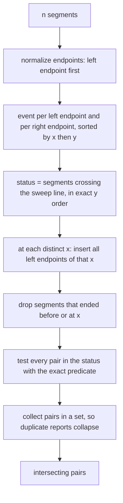
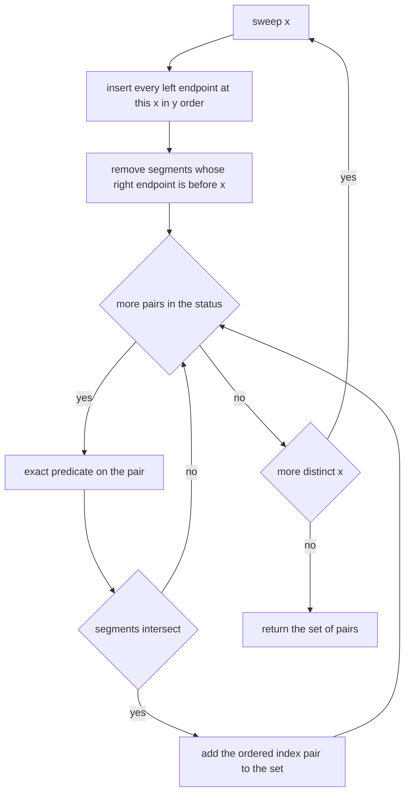
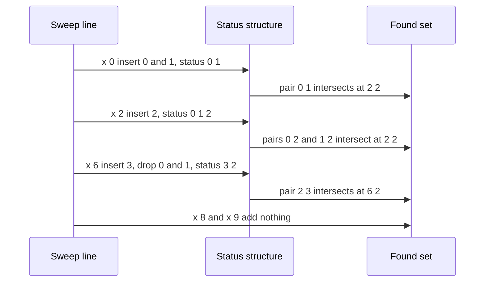

# 371 — Detect line segment intersection (Bentley–Ottmann outline).

> **Tier:** Intermediate · **CTCI chapter:** Beyond — Graphics, Geometry & Robotics
> **Task spec:** [371-detect-line-segment-intersection-bentley-ottmann-outline.md](../../../tasks/intermediate/371-detect-line-segment-intersection-bentley-ottmann-outline.md)
> **Solutions:** [Python](../../../solutions/python/intermediate/371-detect-line-segment-intersection-bentley-ottmann-outline/solution.py) ·
> [Java](../../../solutions/java/intermediate/371-detect-line-segment-intersection-bentley-ottmann-outline/Solution.java) ·
> [JavaScript](../../../solutions/javascript/intermediate/371-detect-line-segment-intersection-bentley-ottmann-outline/solution.js) ·
> [C#](../../../solutions/csharp/intermediate/371-detect-line-segment-intersection-bentley-ottmann-outline/Solution.cs)

## 1. Problem restatement

**Input:** `n` line segments, each given by two integer endpoints.

**Output:** the set of index pairs `(i, j)` whose segments intersect. Intersection is the **closed**
notion: a proper crossing, a shared endpoint, a T-touch where an endpoint lies inside the other
segment, and a collinear overlap all count.

The task is explicitly labelled *outline*, and the docstring states the contract precisely: the
full Bentley–Ottmann algorithm runs in `O((n + k) log n)` for `k` intersection points, while this
task implements the sweep **skeleton** — an event queue plus a status structure — and handles the
small cases the repository tests (`n` up to about `12`) exactly, with a plain `O(n²)` pair test as
the independent oracle.

The exact predicate is asserted on its own before the sweep is used:

| Pair | Intersects? | Case |
| --- | --- | --- |
| `((0,0),(4,4))` and `((0,4),(4,0))` | yes | proper crossing |
| `((0,0),(2,2))` and `((2,2),(4,0))` | yes | shared endpoint |
| `((0,0),(4,0))` and `((2,0),(6,0))` | yes | collinear overlap |
| `((0,0),(2,0))` and `((0,1),(2,1))` | no | parallel and disjoint |
| `((0,0),(4,0))` and `((2,0),(2,3))` | yes | T-touch |
| `((0,0),(1,1))` and `((3,0),(4,1))` | no | separated |
| `((0,0),(1,1))` and `((1,1),(2,0))` | yes | endpoint meet |

Then the sweep is checked against the oracle on a hand set with exactly four intersecting pairs
(`{(0,1), (0,2), (1,2), (2,3)}`), on a collinear/touch family (`{(0,1), (0,3), (2,3)}`), on a
disjoint set and on the empty input (`set()`), and finally on 40 LCG sets of
`5 + seed % 8` segments with coordinates `seed % 41` and distinct endpoints
(`seed = (seed * 75 + 74) % 65537`, starting at `37113`). Every predicate uses exact integer cross
products; no floating point appears anywhere.

## 2. Intuition

Testing all `n(n-1)/2` pairs is exact and simple, but quadratic. Bentley–Ottmann's idea is that a
vertical sweep line only ever needs to look at segments that are *neighbours* in the vertical order
at the sweep position, because two segments can only swap order at the `x` where they cross.

The full algorithm keeps that order in a balanced status structure, pushes every found intersection
back into the event queue, and reports a crossing exactly when two segments become adjacent. That is
the structure described in the docstring's four-point invariant: left endpoints insert, right
endpoints remove, found intersections re-order the status, and only status neighbours are tested.

Implementing it correctly is mostly about **degeneracies**: vertical segments, several events at the
same `x`, endpoint touches, collinear overlaps and overlapping collinear bundles all break the
"order is well defined and stable between events" assumption. The shipped outline therefore keeps
the skeleton — sorted events with a left/right kind, and a status list maintained in exact `y`
order — but replaces the delicate neighbour-only test with the exhaustive one on the *active set*.

The key insight that makes the outline exact for small inputs is this: **an intersecting pair always
spans the event `x = max(left_x1, left_x2)`**, the later segment's left endpoint. At that event both
segments are in the status, so testing every pair present in the status at every event x sees every
intersection at least once. Duplicate reports collapse into a set, so the result matches the
`O(n²)` oracle exactly.



## 3. Algorithm

1. **Normalize** every segment so its lexicographically smaller endpoint comes first.
2. **Build events** `(x, y, index, kind)` with `kind = 0` for a left endpoint and `kind = 1` for a
   right endpoint; sort them, which orders by `x`, then `y`, then index, then kind.
3. **Sweep** distinct `x` values in order:
   - insert every left endpoint at this `x` into the status list at the position that keeps the
     list sorted by `y` at the sweep line, using the exact fraction comparison;
   - drop every segment whose right endpoint has `x` strictly less than the current `x`;
   - test all pairs currently in the status with `segments_intersect`, adding the ordered index pair
     to a set.
4. **Return** the set.

```text
function orient(p, q, r)
    return (q.x - p.x) * (r.y - p.y) - (q.y - p.y) * (r.x - p.x)
end

function on_segment(p, q, r)
    return min(p.x, r.x) ≤ q.x ≤ max(p.x, r.x) and min(p.y, r.y) ≤ q.y ≤ max(p.y, r.y)
end

function segments_intersect(s, t)
    (p1, p2) ← s
    (p3, p4) ← t
    o1 ← orient(p1, p2, p3)
    o2 ← orient(p1, p2, p4)
    o3 ← orient(p3, p4, p1)
    o4 ← orient(p3, p4, p2)
    if o1 * o2 < 0 and o3 * o4 < 0 then
        return true
    end
    if o1 = 0 and on_segment(p1, p3, p2) then return true end
    if o2 = 0 and on_segment(p1, p4, p2) then return true end
    if o3 = 0 and on_segment(p3, p1, p4) then return true end
    if o4 = 0 and on_segment(p3, p2, p4) then return true end
    return false
end

function sweep_intersection_pairs(raw_segments)
    segments ← each segment with its smaller endpoint first
    events ← for each index: (left.x, left.y, index, 0) and (right.x, right.y, index, 1)
    sort events
    status ← empty list
    found ← empty set
    i ← 0
    while i < length(events) do
        x ← events[i].x
        j ← i
        while j < length(events) and events[j].x = x do
            if events[j].kind = 0 then
                insert events[j].index into status at the first position where its y at x is greater
            end
            j ← j + 1
        end
        status ← entries of status whose right endpoint x is at least x
        for each unordered pair (a, b) of status entries do
            if segments_intersect(segments[a], segments[b]) then
                add the ordered pair to found
            end
        end
        i ← j
    end
    return found
end
```

The status order is not what makes the answer correct in this outline — the exhaustive pair test
is — but it is maintained anyway, "to mirror the real Bentley–Ottmann skeleton", and the ordering
comparison is itself exact: `y_at` returns the `y` of the segment at the sweep `x` as the fraction
`(y1·(x2 − x1) + (y2 − y1)·(x − x1)) / (x2 − x1)`, so two segments are compared by cross-multiplying
two integers.



## 4. Worked example

Take the hand set from the solution files:

| Index | Segment | Left endpoint first |
| --- | --- | --- |
| 0 | `(0,0)-(4,4)` | `(0,0), (4,4)` |
| 1 | `(0,4)-(4,0)` | `(0,4), (4,0)` |
| 2 | `(2,2)-(6,2)` | `(2,2), (6,2)` |
| 3 | `(6,0)-(6,6)` | `(6,0), (6,6)` |
| 4 | `(8,8)-(9,9)` | `(8,8), (9,9)` |

Sweeping the distinct `x` values:

| `x` | Inserted | Status after inserts | Dropped | Status tested | Pairs found |
| --- | --- | --- | --- | --- | --- |
| `0` | 0, 1 | `[0, 1]` | none (`4 ≥ 0`) | `[0, 1]` | `(0,1)` |
| `2` | 2 | `[0, 1, 2]` | none | `[0, 1, 2]` | `(0,2)`, `(1,2)` |
| `4` | — | `[0, 1, 2]` | none (`4 ≥ 4`) | `[0, 1, 2]` | none new |
| `6` | 3 | `[3, 0, 1, 2]` | 0 and 1 (`4 < 6`) | `[3, 2]` | `(2,3)` |
| `8` | 4 | `[3, 2, 4]` | 3 and 2 (`6 < 8`) | `[4]` | none |
| `9` | — | `[4]` | none (`9 ≥ 9`) | `[4]` | none (a single segment has no pairs) |

The set ends as `{(0,1), (0,2), (1,2), (2,3)}`, exactly the asserted `expected` set of four
intersecting pairs. Note the interesting event: at `x = 6` the vertical segment 3 is inserted and
both long diagonals 0 and 1 are dropped, so the only pair tested is `(3, 2)` — and it succeeds
because segment 2 ends at exactly `(6,2)`, inside segment 3.



The collinear family behaves the same way and is worth checking against the status logic: with
`((0,0),(4,0))`, `((2,0),(6,0))`, `((0,1),(6,1))` and `((0,0),(0,1))`, the sweep reports
`{(0,1), (0,3), (2,3)}` — the overlapping pair, the vertical segment touching segment 0 at their
shared endpoint, and the vertical segment crossing segment 2.

## 5. Complexity

Let `n` be the number of segments, `k` the number of intersecting pairs, and `s ≤ n` the largest
status size.

| Measure | Bound | Why it holds |
| --- | --- | --- |
| Full Bentley–Ottmann | O((n + k) log n) | each event and each intersection is one balanced-tree operation, as the docstring states |
| This outline, per event `x` | O(s²) | every pair in the status is tested |
| This outline, total | O(n · s²), i.e. O(n³) worst case | at most `2n` events, each testing up to `n²/2` pairs — the price of dropping the "neighbours only" rule |
| Status insertion | O(s) | a linear scan with an exact fraction comparison per step, so O(n²) over the sweep |
| Exact predicate | O(1) | four cross products plus up to four bounding-box tests |
| `O(n²)` oracle | O(n²) | every pair is tested once, with the same predicate |

The outline is honest about the trade: it buys exactness on degeneracies for small `n` at the cost
of the near-linear running time. Its correctness argument — every intersecting pair spans the event
where the later left endpoint appears, so both segments are simultaneously in the status — is what
the `O(n²)` oracle verifies on 40 LCG sets of up to 12 segments, where a single wrong pair suffices
to fail the comparison.

## 6. Pitfalls and edge cases

- **The task is an outline, not the full algorithm.** The docstring lists the four invariant points
  of real Bentley–Ottmann (events, status order, neighbour-only crossing detection, intersection
  events) and then documents that degeneracies are only *partially* handled: vertical segments,
  equal-`x` events, endpoint touches, collinear overlaps and collinear bundles are caught by
  falling back to testing every pair active at an event `x`. Describing this as the full algorithm
  would be wrong.
- **Vertical segments.** `y_at` returns `(y1, 1)` for them, and a vertical segment exists entirely
  at one event `x`; the outline handles it by inserting it like any other segment and testing it
  against every active partner at that `x`.
- **Several events at the same `x`.** The inner `while` loop consumes all of them before any pair
  test, so segments starting and ending at the same `x` are visible to each other. Advancing one
  event at a time would miss the `(2,3)` pair of the worked example.
- **Touching is intersecting.** The predicate returns true for shared endpoints, T-touches and
  collinear overlaps; only strictly disjoint or parallel-and-separated pairs are rejected. The
  docstring calls this the "exact closed-segment intersection test".
- **The proper-crossing test needs both product signs.** `o1*o2 < 0 and o3*o4 < 0` is the strict
  straddle; if only one of the two holds, the pair can still intersect through a collinear touch,
  which the four `o == 0` branches then decide — using `on_segment` to check the point lies inside
  the *other* segment, not merely on its line.
- **`on_segment` includes the endpoints.** Its bounds are non-strict; making them strict would lose
  the shared-endpoint case `((0,0),(2,2))` / `((2,2),(4,0))`.
- **Duplicate reports.** A pair can be tested at several events; collecting into a set of ordered
  index pairs makes the result canonical, which is what allows an exact set comparison against the
  oracle.
- **Normalizing the endpoints matters for the events.** Each segment contributes exactly one left
  and one right event regardless of how the caller wrote it; without normalization, `(4,4)→(0,0)`
  would produce a "left" event at `x = 4` and the sweep would insert the segment too late.
- **Dropping finished segments.** The filter keeps entries whose right endpoint `x` is `≥` the
  current `x`, i.e. a segment is dropped only *after* the event where it stops being active — using
  `>` would remove a segment that still touches at its own right endpoint.
- **Exact ordering, no epsilon.** `compare_y` cross-multiplies the two fractions, so the status
  order is exact even where many segments meet at one point (the worked example has three segments
  all passing through `(2,2)`, where `compare_y` returns `0` three times).
- **Empty and non-intersecting inputs.** `sweep_intersection_pairs([])` and a set of mutually
  disjoint segments both return `set()`, which the files assert.
- **Endpoint-distinct LCG segments.** The generator rejects degenerate zero-length segments in a
  retry loop, so the random tests never feed the predicates a segment whose two endpoints coincide.

## 7. Variants and follow-ups

- **The complete algorithm.** Restoring the neighbour-only rule plus intersection events gives the
  `O((n + k) log n)` version; the sweep skeleton here is the same event queue and status structure
  with the delicate parts documented rather than implemented.
- **Rectangle area union.** A sweep that maintains a covered *length* instead of an ordered
  segment set, and needs no intersection events, is
  [370-line-sweep-for-rectangle-area-union.md](../../../tasks/intermediate/370-line-sweep-for-rectangle-area-union.md).
- **Point-in-polygon.** The orientation predicate `orient` is the same primitive used by
  [368-point-in-polygon-test-ray-casting.md](../../../tasks/intermediate/368-point-in-polygon-test-ray-casting.md)
  for its boundary test, and by
  [372-implement-polygon-area-shoelace-formula.md](../../../tasks/intermediate/372-implement-polygon-area-shoelace-formula.md)
  for the signed area.
- **Closest pair.** The mirror-image use of the "only nearby objects can interact" idea, with a
  strip instead of a status structure, is
  [369-closest-pair-of-points-divide-conquer.md](../../../tasks/intermediate/369-closest-pair-of-points-divide-conquer.md).
- **Hull edges as segments.** After computing a convex hull with
  [367-compute-convex-hull-andrew-monotone-chain.md](../../../tasks/intermediate/367-compute-convex-hull-andrew-monotone-chain.md),
  the hull's edges are segments whose pairwise intersections are known in advance — a useful sanity
  input for a sweep implementation.

## 8. Check yourself

1. Why is testing every pair in the status at every event still exact, even though it looks like a
   brute force?

<details><summary>Show answer</summary>

Because two intersecting segments always overlap in `x`: each spans from its own left endpoint to
its right endpoint, so they are both active at `x = max(left_x1, left_x2)`, the later left endpoint,
which is an event. At that event both are in the status (the drop rule removes only segments that
ended strictly before `x`), so the pair is tested. The set then removes duplicate reports.

</details>

2. What does "outline" mean in this task, precisely?

<details><summary>Show answer</summary>

The sweep skeleton — event queue, status structure maintained in exact `y` order, and exact
predicates — is implemented, but the neighbour-only crossing detection and the re-insertion of
found intersections that make the real algorithm `O((n + k) log n)` are only described. Degeneracies
are handled by the exhaustive pair test on the simultaneously active set, and the `O(n²)` pair test
is the oracle. The docstring states all of this.

</details>

3. In the worked example, why is the pair `(2,3)` found at `x = 6` and not earlier?

<details><summary>Show answer</summary>

Segment 3 is vertical with `x = 6`, so it does not exist at any earlier sweep position, and segment
2 reaches `(6,2)` only at that `x` — the shared point is an endpoint of both. The sweep inserts
segment 3 at `x = 6`, drops the two diagonals that ended at `x = 4`, and tests the remaining pair
`(3, 2)`, which touches.

</details>

4. Why does `segments_intersect` need four collinear branches rather than just the straddle test?

<details><summary>Show answer</summary>

The straddle test `o1*o2 < 0 and o3*o4 < 0` detects only *proper* crossings, where each segment's
endpoints lie on opposite sides of the other's line. Touches — a shared endpoint, an endpoint lying
inside the other segment, or a collinear overlap — have at least one orientation of zero, so each of
the four signs needs its own `o == 0 and on_segment(...)` check. The hand assertions cover all of
these cases.

</details>

5. What is the expected result for a set of segments that pairwise do not intersect, and why does
   the status still do work?

<details><summary>Show answer</summary>

The result is the empty set. The status still inserts, orders and drops segments as the sweep moves,
and it still tests pairs — for instance parallel segments far apart are tested whenever both are
active, and the predicate rejects them quickly. The answer is empty because none of those tests
succeeds, which the file asserts both for the hand-built disjoint set and for the empty input.

</details>
