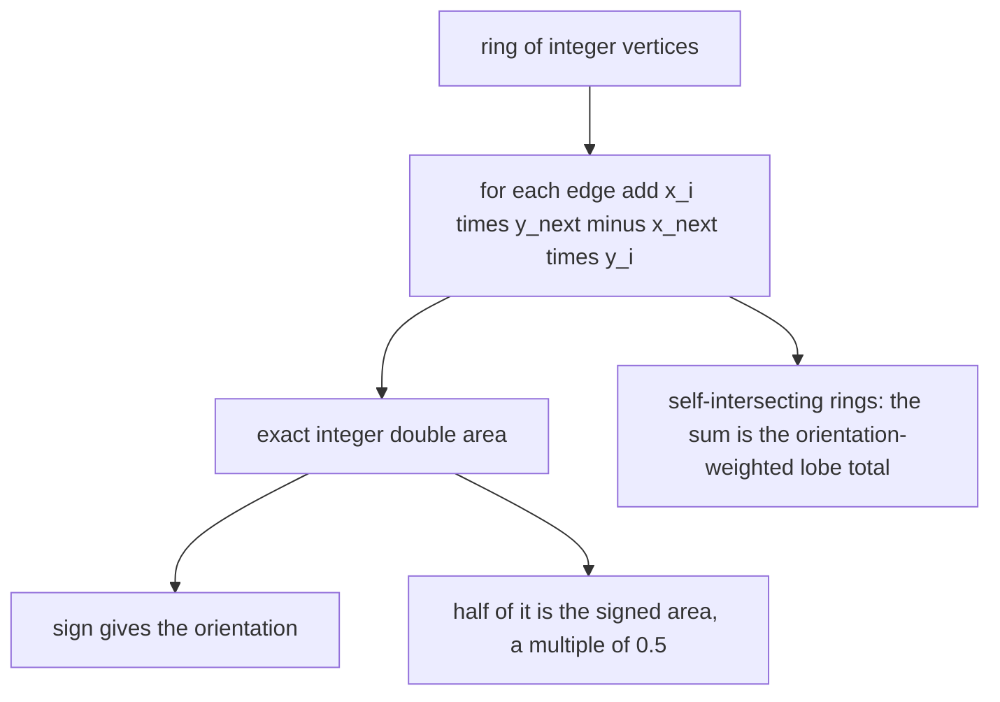
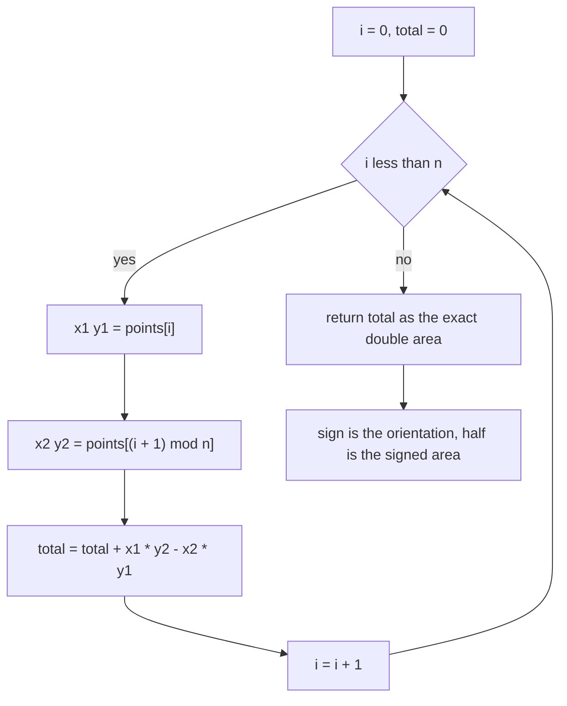
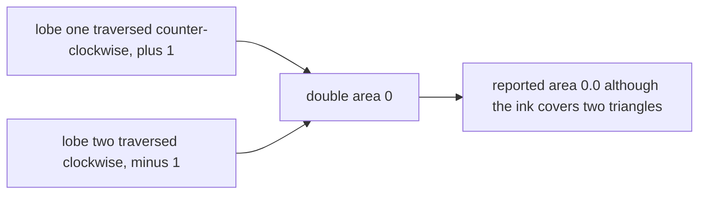

# 372 — Implement polygon area (shoelace formula).

> **Tier:** Intermediate · **CTCI chapter:** Beyond — Graphics, Geometry & Robotics
> **Task spec:** [372-implement-polygon-area-shoelace-formula.md](../../../tasks/intermediate/372-implement-polygon-area-shoelace-formula.md)
> **Solutions:** [Python](../../../solutions/python/intermediate/372-implement-polygon-area-shoelace-formula/solution.py) ·
> [Java](../../../solutions/java/intermediate/372-implement-polygon-area-shoelace-formula/Solution.java) ·
> [JavaScript](../../../solutions/javascript/intermediate/372-implement-polygon-area-shoelace-formula/solution.js) ·
> [C#](../../../solutions/csharp/intermediate/372-implement-polygon-area-shoelace-formula/Solution.cs)

## 1. Problem restatement

**Input:** a polygon as a cyclic list of integer vertices. The ring is closed implicitly: the last
vertex is joined back to the first. Whether the first vertex is repeated at the end makes no
difference.

**Output:** three related quantities, all computed from the same sum:

| Function | Result | Meaning |
| --- | --- | --- |
| `signed_double_area` | an exact integer | `Σ (xᵢ·yᵢ₊₁ − xᵢ₊₁·yᵢ)` over the edges of the closed ring |
| `polygon_area` | half of it | signed area: positive counter-clockwise, negative clockwise |
| `orientation` | `+1`, `-1` or `0` | counter-clockwise, clockwise, or degenerate (all collinear) |

Because the vertices are integers, the doubled area is an exact integer and the area is an exact
multiple of `0.5`. Every comparison in the files is therefore exact — no tolerance — except for the
deliberately tolerant rasterisation cross-check of a non-axis-aligned triangle.

| Input | Double area | Area | Orientation |
| --- | --- | --- | --- |
| `[(0,0), (2,0), (2,2), (0,2)]` | `8` | `4.0` | `+1` |
| `[(0,0), (1,0), (0,1)]` | — | `0.5` | `+1` |
| `[(0,0), (2,0), (0,2)]` | — | `2.0` | `+1` |
| `[(0,0), (0,2), (2,2), (2,0)]` | `-8` | `-4.0` | `-1` |
| `[(0,0), (3,0), (3,1), (1,1), (1,3), (0,3)]` | — | `5.0` | `+1` |
| `[(0,0), (5,1), (2,4)]` | — | `9.0` | `+1` |
| `[(0,0), (1,0), (2,0), (2,2), (0,2)]` | — | `4.0` | `+1` |
| `[(0,0), (2,2), (2,0), (0,2)]` (bowtie) | `0` | `0.0` | `0` |
| `[(0,0), (2,4), (2,0), (0,2)]` (skewed bowtie) | `-4` | `-2.0` | `-1` |

The independent oracle is `rasterized_area`, which counts cells of the bounding box whose centres
lie inside the polygon by ray casting. For polygons whose edges are axis-parallel with integer
coordinates, every cell is entirely inside or outside, so the count is **exact** and asserted equal
to the shoelace area. For the general triangle the comparison uses a documented tolerance. The LCG
cross-checks run 30 axis-parallel rectangles (`width = 1 + seed % 6`, `height = 1 + seed % 6`) and
30 L-shapes (`seed = (seed * 75 + 74) % 65537`, starting at `37211`), each with an exactly known
area, and reverse every rectangle to check that the signed area flips sign.

## 2. Intuition

The area of a polygon is not a sum of triangles you can see; it is a sum of **signed trapezoids**.
For each edge from `(xᵢ, yᵢ)` to `(xᵢ₊₁, yᵢ₊₁)`, the trailing-shape area is
`xᵢ·yᵢ₊₁ − xᵢ₊₁·yᵢ`. Adding that over the whole ring, everything that is not the polygon cancels:
each vertical strip between two consecutive vertex `x` values is counted exactly once, with the
sign of the direction in which the boundary crosses it.

The key insight is that this single sum is simultaneously the area and the orientation. Traverse
the ring counter-clockwise and the sum is positive; traverse it clockwise and the same sum is its
own negative. That is why the code never special-cases orientation — `orientation` is just the sign
of the double area, and the area's absolute value is the geometric area **for simple polygons**.

The second insight is a warning as much as an insight: for a **self-intersecting** ring the sum is
not an area at all. It is the sum of the lobe areas weighted by their traversal orientation, so two
equal lobes traversed in opposite directions cancel exactly and report `0`. The files document this
with two bowties, one of which cancels to `0` and one of which reports `-2.0`. `abs()` does not
repair it; only simple polygons are guaranteed to give the true area.



## 3. Algorithm

1. Let `n` be the number of vertices. If the ring is given with the first vertex repeated at the
   end, that vertex contributes a zero term, so no cleaning is required.
2. Accumulate `total = Σ xᵢ·yᵢ₊₁ − xᵢ₊₁·yᵢ` for `i = 0 … n−1`, with index `n` wrapping to `0`.
3. `signed_double_area` returns `total`; `polygon_area` returns `total / 2`; `orientation` returns
   `+1` when `total > 0`, `-1` when `total < 0` and `0` otherwise.
4. For verification, `rasterized_area` counts the cell centres of the bounding box that
   `point_in_polygon` reports inside, optionally at `samples_per_unit` sub-cell resolution, with a
   small `1e-6` nudge that keeps samples off exact integer and diagonal lines.

```text
function signed_double_area(points)
    total ← 0
    n ← length(points)
    for i ← 0 to n - 1 do
        x1, y1 ← points[i]
        x2, y2 ← points[(i + 1) mod n]
        total ← total + x1 * y2 - x2 * y1
    end
    return total
end

function polygon_area(points)
    return signed_double_area(points) / 2
end

function orientation(points)
    double_area ← signed_double_area(points)
    if double_area > 0 then return +1 end
    if double_area < 0 then return -1 end
    return 0
end
```

Three vertices are enough to make the formula useful: a triangle with integer corners has a
half-integer area, which is exactly why the result is stored as a multiple of `0.5` rather than
rounded.



## 4. Worked example

**Square, counter-clockwise.** `[(0,0), (2,0), (2,2), (0,2)]`:

| Edge | `x1·y2` | `x2·y1` | Term |
| --- | --- | --- | --- |
| `(0,0) → (2,0)` | `0·0 = 0` | `2·0 = 0` | `0` |
| `(2,0) → (2,2)` | `2·2 = 4` | `2·0 = 0` | `+4` |
| `(2,2) → (0,2)` | `2·2 = 4` | `0·2 = 0` | `+4` |
| `(0,2) → (0,0)` | `0·0 = 0` | `0·2 = 0` | `0` |

Total `8`, area `4.0`, orientation `+1`. The two trailing edges contribute nothing because they
run back along the axes — the sum only "sees" the vertical movement of each edge weighted by its
`x`. Reversing the ring negates every term, which is the asserted `-8` / `-4.0` / `-1` case.

**L-shape.** `[(0,0), (3,0), (3,1), (1,1), (1,3), (0,3)]`, area `5.0`:

| Edge | Term |
| --- | --- |
| `(0,0) → (3,0)` | `0·0 − 3·0 = 0` |
| `(3,0) → (3,1)` | `3·1 − 3·0 = +3` |
| `(3,1) → (1,1)` | `3·1 − 1·1 = +2` |
| `(1,1) → (1,3)` | `1·3 − 1·1 = +2` |
| `(1,3) → (0,3)` | `1·3 − 0·3 = +3` |
| `(0,3) → (0,0)` | `0·0 − 0·3 = 0` |

Total `10`, area `5.0` — a `3 × 1` arm plus a `1 × 2` arm. The LCG generator builds shapes of
exactly this form and asserts the closed form `a·b + c·(d − b)` against both the shoelace result and
the rasterised count.

**Bowties.** `[(0,0), (2,2), (2,0), (0,2)]`:

| Edge | Term |
| --- | --- |
| `(0,0) → (2,2)` | `0·2 − 2·0 = 0` |
| `(2,2) → (2,0)` | `2·0 − 2·2 = −4` |
| `(2,0) → (0,2)` | `2·2 − 0·0 = +4` |
| `(0,2) → (0,0)` | `0·0 − 0·2 = 0` |

Total `0`, area `0.0`. The two lobes are traversed in opposite directions and their signed areas
cancel. The skewed variant `[(0,0), (2,4), (2,0), (0,2)]` gives `-4`, i.e. `-2.0`, because its lobes
are `8/3` and `2/3` and no longer balance — the file uses both to document that the formula is not an
area for self-intersecting rings.



**Oracle agreement.** For the square the rasterised count is exactly `4.0` and for the L-shape
exactly `5.0`, because integer axis-parallel edges put every cell centre unambiguously inside or
outside. The general triangle `[(0,0), (5,1), (2,4)]` has area `9.0`; its rasterisation at 32
samples per unit is asserted to be within `0.5`, the documented tolerance for cells that the
diagonal boundary crosses.

## 5. Complexity

Let `n` be the number of vertices.

| Measure | Bound | Why it holds |
| --- | --- | --- |
| Time | O(n) | one pass over the edges, two multiplications and one subtraction each |
| Space | O(1) | one accumulator; the polygon is read in place |
| `orientation` | O(n) | it is the sign of the same sum |
| Rasterisation oracle | O(cells · n) | every sampled cell centre runs a full ray cast, so `samples_per_unit²` multiplies the cost |
| Exactness | — | integer inputs make `signed_double_area` exact and the area an exact multiple of `0.5`, which in binary floating point is also exact |

The rasterisation oracle is deliberately quadratic-ish and only used on small, hand-built polygons
and the LCG shapes, where its exactness (`samples_per_unit = 1`) makes it a genuinely independent
check. On the one diagonal-edge triangle the files switch to `samples_per_unit = 32` and a `0.5`
tolerance, documenting that cells crossed by the boundary can contribute at most roughly
`perimeter / samples_per_unit`.

## 6. Pitfalls and edge cases

- **Self-intersecting rings are not areas.** A bowtie's two lobes cancel, so the answer can be `0`
  (or the signed difference) for a shape that visibly covers area. The docstring says plainly that
  `abs()` does not repair this, and only simple polygons are guaranteed to yield the true area.
- **The sign is the orientation, and `abs` is the area** — for simple rings only. A clockwise ring
  gives the negated area; the tests assert `polygon_area(clockwise) == -4.0` and
  `abs(polygon_area(clockwise)) == 4.0`.
- **Degenerate rings report `0`.** Collinear vertices make the double area `0`, and `orientation`
  returns `0` for exactly that case (neither counter-clockwise nor clockwise).
- **Extra collinear vertices do not change the area.** `[(0,0), (1,0), (2,0), (2,2), (0,2)]` gives
  `4.0`, the same as without `(1,0)`, because the extra edge is collinear with its neighbours and its
  terms cancel.
- **A repeated closing vertex is harmless.** `[(0,0), (2,0), (2,2), (0,2), (0,0)]` has orientation
  `+1`; the duplicated vertex contributes the term `0·0 − 0·0 = 0`. This is why the implementation
  never strips or appends anything.
- **Fewer than three vertices.** `rasterized_area` returns `0.0` for such input, and the shoelace
  sum of one or two points is `0` as well, so degenerate input is consistent rather than crashing.
- **Exactness depends on integer input.** With fractional coordinates the double area is still exact
  only if the inputs are, and the "multiple of `0.5`" claim no longer holds. The assertions rely on
  integer vertices.
- **`total / 2` is safe in binary floating point.** The double area is an even integer for the
  asserted polygons, so the area is a multiple of `0.5` and representable exactly; the Java, C# and
  JavaScript versions likewise divide by `2.0` without tolerance-based comparisons.
- **Overflow in the cross terms.** `x1*y2` and `x2*y1` each multiply two coordinates; Java and C#
  keep the accumulator wide enough for the tested magnitudes, Python integers are unbounded.
- **The rasterisation epsilon.** `rasterized_area` nudges every sample by `1e-6` so that cell centres
  never land exactly on an integer coordinate or a diagonal edge; without it, ray casting would be
  asked about points the task defines as boundary.
- **The ray-casting helper is not the deliverable.** `point_in_polygon` here exists only to support
  the oracle; the point-in-polygon task with the full boundary handling is
  [368](../../../tasks/intermediate/368-point-in-polygon-test-ray-casting.md), whose predicate is
  exact rather than float-based.
- **Closed ring convention.** The edges are the `n` consecutive pairs plus the wrap-around edge; a
  ring given with the closing vertex repeated is still handled because the extra edge has zero
  contribution, but a ring given *without* the wrap is only correct because the modulo does the
  joining.

## 7. Variants and follow-ups

- **Hull area from the same formula.** The convex hull routines compute twice the signed area with
  the identical loop to check orientation and compare hulls:
  [366-compute-convex-hull-graham-scan.md](../../../tasks/intermediate/366-compute-convex-hull-graham-scan.md)
  uses it as `hull_area2`, and
  [367-compute-convex-hull-andrew-monotone-chain.md](../../../tasks/intermediate/367-compute-convex-hull-andrew-monotone-chain.md)
  uses `signed_area2` plus a rotation to canonical output.
- **Point-in-polygon.** Containment is the complementary query for the same ring; the exact
  boundary-aware version is
  [368-point-in-polygon-test-ray-casting.md](../../../tasks/intermediate/368-point-in-polygon-test-ray-casting.md).
- **Diameter of a convex polygon.** Rotating calipers read the ring's orientation to decide when to
  advance the antipodal point —
  [373-implement-rotating-calipers-for-diameter-of-convex-polygon.md](../../../tasks/intermediate/373-implement-rotating-calipers-for-diameter-of-convex-polygon.md).
- **Union of rectangles.** When the boundary is not a single ring but a union of boxes, summing
  shoelace terms is not enough and the sweep of
  [370-line-sweep-for-rectangle-area-union.md](../../../tasks/intermediate/370-line-sweep-for-rectangle-area-union.md)
  measures slabs instead.
- **Area from triangles.** Triangulating the ring (fan triangulation from one vertex) gives the same
  number for simple polygons, and it is the natural way to make a grid or mesh implementation
  incremental.

## 8. Check yourself

1. Why does the shoelace sum give the orientation for free?

<details><summary>Show answer</summary>

Each term `xᵢ·yᵢ₊₁ − xᵢ₊₁·yᵢ` is the signed area of the trapezoid under the edge, and its sign follows
the direction in which the boundary crosses that strip. Summing over the ring yields the signed
area, so reversing the traversal negates every term and the total. `orientation` is therefore just
the sign of the same accumulator.

</details>

2. What does `polygon_area([(0,0), (2,2), (2,0), (0,2)])` return, and why is that "wrong"?

<details><summary>Show answer</summary>

`0.0`. The ring is a bowtie: its two triangular lobes are traversed in opposite directions, so their
signed areas cancel and the double area is `0`. The shape visibly covers area, so the formula is not
computing an area here — for self-intersecting rings it computes the orientation-weighted sum of the
lobes, which the docstring documents explicitly.

</details>

3. Why is the right answer always an exact multiple of `0.5` for integer vertices?

<details><summary>Show answer</summary>

Because the doubled area is a sum of products of integers, hence an integer, and the area is half of
it. So the value is either an integer or an integer plus `0.5` — as in the unit triangle
`[(0,0), (1,0), (0,1)]`, whose area is exactly `0.5`. No rounding is involved.

</details>

4. Does inserting a collinear vertex on an edge change the reported area?

<details><summary>Show answer</summary>

No. `[(0,0), (1,0), (2,0), (2,2), (0,2)]` reports `4.0`, the same as the square without `(1,0)`. The
inserted vertex splits one edge into two edges that are collinear with it, and the shoelace terms
add to exactly the original edge's contribution. The assertion in the file pins this down.

</details>

5. When may the rasterisation oracle be compared without a tolerance, and when does it need one?

<details><summary>Show answer</summary>

Without a tolerance when every edge is axis-parallel with integer coordinates: then each unit cell
is entirely inside or entirely outside, so counting cell centres is exact, as asserted for the
square (`4.0`) and the L-shape (`5.0`). With a tolerance when the boundary is diagonal, because
cells crossed by the boundary contribute roughly `perimeter / samples_per_unit` of error — hence the
`0.5` bound for the triangle `[(0,0), (5,1), (2,4)]` at 32 samples per unit.

</details>
