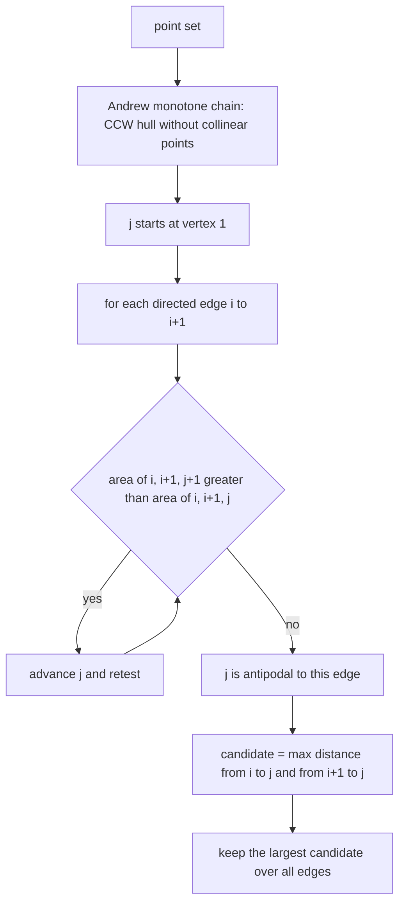
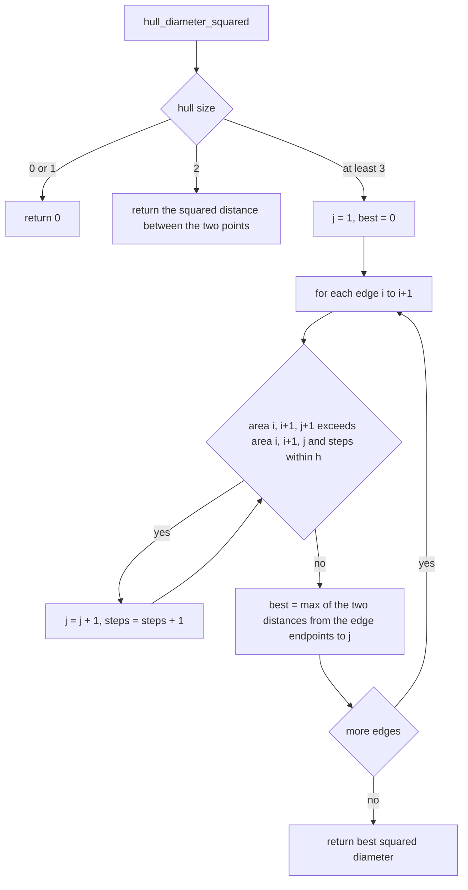
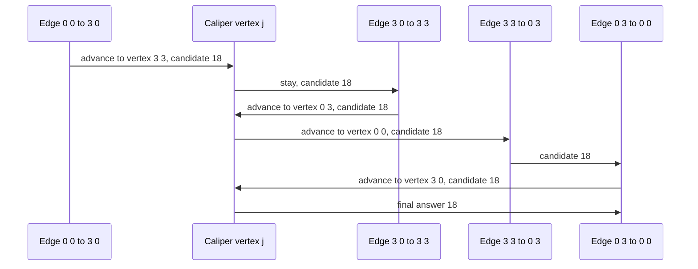

# 373 — Implement rotating calipers for diameter of convex polygon.

> **Tier:** Intermediate · **CTCI chapter:** Beyond — Graphics, Geometry & Robotics
> **Task spec:** [373-implement-rotating-calipers-for-diameter-of-convex-polygon.md](../../../tasks/intermediate/373-implement-rotating-calipers-for-diameter-of-convex-polygon.md)
> **Solutions:** [Python](../../../solutions/python/intermediate/373-implement-rotating-calipers-for-diameter-of-convex-polygon/solution.py) ·
> [Java](../../../solutions/java/intermediate/373-implement-rotating-calipers-for-diameter-of-convex-polygon/Solution.java) ·
> [JavaScript](../../../solutions/javascript/intermediate/373-implement-rotating-calipers-for-diameter-of-convex-polygon/solution.js) ·
> [C#](../../../solutions/csharp/intermediate/373-implement-rotating-calipers-for-diameter-of-convex-polygon/Solution.cs)

## 1. Problem restatement

**Input:** a set of integer points in the plane.

**Output:** two things at once — the **squared diameter** (the largest squared distance between any
two of the points) and the convex hull it was measured on. Squared distances keep the whole
computation in exact integers; a floating-point square root is taken only to compare against the
classic closed form for a square.

| Input | Diameter² | Hull | Why |
| --- | --- | --- | --- |
| `[(0,0), (3,0), (3,3), (0,3)]` | `18` | the 4 corners | the diagonal `3·√2`, squared is `2·3·3 = 18` |
| `[(7,7)]` | `0` | `[(7,7)]` | a single point |
| `[(1,1), (4,5)]` | `25` | the 2 points | the 3-4-5 triangle's hypotenuse, squared |
| `[(0,0), (4,0), (0,3)]` | `25` | 3 corners | `4² + 3² = 25` |
| `[(0,0), (2,0), (2,5), (0,5)]` | `29` | 4 corners | rectangle diagonal `2² + 5²` |
| `[(0,0), (1,1), (3,3)]` | `18` | `[(0,0), (3,3)]` | collinear input collapses to the two extreme points |
| `[(0,0), (3,0), (3,3), (0,3), (1,1)]` | `18` | the 4 corners | the interior point is dropped by the hull |

Documented degenerate cases: empty or one point gives diameter `0`; two distinct points, or a fully
collinear set, gives a hull consisting of the two extreme points.

Three numbers must agree throughout the tests: the calipers result, an `O(h²)` brute force over the
hull, and an `O(n²)` brute force over **every** input point. The last one is the strongest
statement: the farthest pair of a point set always lies on its convex hull, so all three oracles
have to produce the same value. The LCG sweep runs 60 trials of `count = 3 + seed % 10` points with
coordinates `seed % 50`, plus a 120-point set with extent `100`
(`seed = (seed * 75 + 74) % 65537`, starting at `37313`) where the hull is asserted to have at least
three vertices.

## 2. Intuition

Computing the diameter by testing all `n(n-1)/2` pairs is `O(n²)`, and it wastes almost all of that
work on points that cannot possibly be endpoints of the farthest pair: any point strictly inside the
convex hull is closer to *everything* than some hull point is. So the first step is to reduce the
problem to the hull — building it with Andrew's monotone chain, as in
[367](../../../tasks/intermediate/367-compute-convex-hull-andrew-monotone-chain.md).

On a convex polygon the diameter has a local structure: as you walk a directed edge, the farthest
vertex from that edge's *line* moves monotonically around the polygon — it is the **antipodal**
vertex. Rotating calipers exploit that: keep one index `j` and, for each edge `(i, i+1)`, advance
`j` while the triangle `(i, i+1, j+1)` has larger area than `(i, i+1, j)`. The area test is the
integer cross product, so "is the next vertex farther from this line?" costs two multiplications.

The key insight is that **every diameter pair is antipodal to some edge**. So instead of testing all
pairs, it suffices to test, for each edge, the two distances from its endpoints to the current `j`:
`candidate = max(dist²(i, j), dist²(i+1, j))`. Walking `j` once around the polygon and taking the
best candidate over all edges gives the exact diameter.



Because `j` only ever moves forward, the inner while loop does not restart for each edge: the total
amount of advancement is bounded by the number of hull vertices, with a `steps ≤ h` guard that
protects against degenerate ties.

## 3. Algorithm

1. **Build the hull**: deduplicate and sort the points; if two or fewer remain, they *are* the hull;
   otherwise sweep a lower chain left-to-right and an upper chain right-to-left, popping while the
   turn is not strictly left (`cross ≤ 0`), and concatenate `lower[:-1] + upper[:-1]`.
2. **Handle degenerate hulls**: `h ≤ 1` means diameter `0`; `h = 2` means the distance between the
   two points.
3. **Calipers**: start `j = 1`; for each `i` with `ni = (i + 1) mod h`:
   - advance `j` to `j + 1` while `area2(i, ni, j + 1) > area2(i, ni, j)` and the step count stays
     within `h`;
   - update `best = max(best, dist²(hull[i], hull[j]), dist²(hull[ni], hull[j]))`.
4. **Return** `best`, which is the exact squared diameter.

```text
function convex_hull(points)
    unique ← sorted distinct points
    if length(unique) ≤ 2 then
        return unique
    end
    lower ← empty stack
    for each p in unique do
        while length(lower) ≥ 2 and cross(lower[-2], lower[-1], p) ≤ 0 do
            remove the last element of lower
        end
        append p to lower
    end
    upper ← empty stack
    for each p in reverse of unique do
        while length(upper) ≥ 2 and cross(upper[-2], upper[-1], p) ≤ 0 do
            remove the last element of upper
        end
        append p to upper
    end
    return lower without its last element joined with upper without its last element
end

function area2(a, b, c)
    return (b.x - a.x) * (c.y - a.y) - (b.y - a.y) * (c.x - a.x)
end

function dist_squared(a, b)
    dx ← a.x - b.x
    dy ← a.y - b.y
    return dx * dx + dy * dy
end

function hull_diameter_squared(hull)
    h ← length(hull)
    if h ≤ 1 then
        return 0
    end
    if h = 2 then
        return dist_squared(hull[0], hull[1])
    end
    best ← 0
    j ← 1
    for i ← 0 to h - 1 do
        ni ← (i + 1) mod h
        steps ← 0
        while steps ≤ h do
            nj ← (j + 1) mod h
            if area2(hull[i], hull[ni], hull[nj]) > area2(hull[i], hull[ni], hull[j]) then
                j ← nj
                steps ← steps + 1
            else
                break
            end
        end
        best ← max(best, dist_squared(hull[i], hull[j]), dist_squared(hull[ni], hull[j]))
    end
    return best
end
```

The comparison is `>` on the areas, so a tie stops the walk. Stopping at the first non-improving
vertex is safe because the area as a function of the vertex index is unimodal around the polygon —
exactly the property that makes the calipers walk correct.



## 4. Worked example

The hull of `[(0,0), (3,0), (3,3), (0,3)]` comes out of the monotone chain as
`[(0,0), (3,0), (3,3), (0,3)]` — counter-clockwise, starting at the lexicographically smallest
point. The calipers then walk it:

| `i` | Edge | `j` start | Advance test | `j` end | Candidates | `best` |
| --- | --- | --- | --- | --- | --- | --- |
| 0 | `(0,0) → (3,0)` | 1 = `(3,0)` | `area((0,0),(3,0),(3,3)) = 9 > area(...,(3,0)) = 0` → advance; `area(...,(0,3)) = 9` not `> 9` → stop | 2 = `(3,3)` | `dist²((0,0),(3,3)) = 18`, `dist²((3,0),(3,3)) = 9` | `18` |
| 1 | `(3,0) → (3,3)` | 2 = `(3,3)` | `area((3,0),(3,3),(0,3)) = 9 > 0` → advance; `area(...,(0,0)) = 9` not `> 9` → stop | 3 = `(0,3)` | `dist²((3,0),(0,3)) = 18`, `dist²((3,3),(0,3)) = 9` | `18` |
| 2 | `(3,3) → (0,3)` | 3 = `(0,3)` | `area((3,3),(0,3),(0,0)) = 9 > 0` → advance; `area(...,(3,0)) = 9` not `> 9` → stop | 0 = `(0,0)` | `dist²((3,3),(0,0)) = 18`, `dist²((0,3),(0,0)) = 9` | `18` |
| 3 | `(0,3) → (0,0)` | 0 = `(0,0)` | `area((0,3),(0,0),(3,0)) = 9 > 0` → advance; `area(...,(3,3)) = 9` not `> 9` → stop | 1 = `(3,0)` | `dist²((0,3),(3,0)) = 18`, `dist²((0,0),(3,0)) = 9` | `18` |

The answer is `18`, i.e. `(3√2)²`, and the file confirms the floating-point sanity check
`sqrt(18) = 3·sqrt(2)` with a relative tolerance of `1e-12`. Notice that `j` never resets and never
moves backwards: it walks `1 → 2 → 3 → 0 → 1`, one full lap over the four edges, which is why the
total work is linear in the hull size rather than quadratic.



For the collinear input `[(0,0), (1,1), (3,3)]` the hull is the two extreme points, the `h = 2`
branch returns `dist²((0,0),(3,3)) = 18` immediately, and the `(1,1)` point is never considered —
the same value the `O(n²)` oracle over all three points reports.

## 5. Complexity

Let `n` be the number of input points and `h` the hull size.

| Measure | Bound | Why it holds |
| --- | --- | --- |
| Hull build | O(n log n) | the lexicographic sort dominates; the two sweeps are linear |
| Calipers | O(h) amortized | `j` only advances, so across all edges the total number of advancements is bounded by the hull size; the `steps ≤ h` guard caps the worst case at `O(h²)` without changing the result |
| Time, overall | O(n log n) | the hull build dominates for large inputs |
| Space | O(n) | the sorted point array and the hull |
| Hull brute force | O(h²) | every pair of hull vertices |
| All-points brute force | O(n²) | every pair of input points |
| Floating point | one `sqrt` in the tests only | the algorithm itself never leaves integer arithmetic |

The 120-point LCG set with extent `100` is the widest asserted case: the hull is required to have at
least three vertices, so the calipers path is genuinely exercised, and the result must still equal
the `O(n²)` all-points maximum.

## 6. Pitfalls and edge cases

- **Empty and single-point input.** `diameter_squared([(7,7)]) == (0, [(7,7)])`: the hull is one
  point and the diameter is `0`, with no pair to measure.
- **Two distinct points.** The `h = 2` branch returns their squared distance directly; the calipers
  loop requires an edge `(i, i+1)` with a distinct neighbour and would otherwise measure zero.
- **Fully collinear input.** The monotone chain drops collinear points, so `[(0,0), (1,1), (3,3)]`
  yields the hull `[(0,0), (3,3)]` and diameter `18`. The interior collinear point never becomes a
  candidate even though it is on the "hull edge".
- **Duplicate points.** Deduplicated before the hull is built, so duplicates cannot create a
  zero-length edge in the calipers walk.
- **Interior points.** `[(0,0), (3,0), (3,3), (0,3), (1,1)]` gives the same hull and the same
  diameter as without `(1,1)`; the interior point is provably never an endpoint of the farthest pair.
- **Ties stop the walk.** The advance condition is `>` on the triangle areas, so an antipodal tie
  keeps the current `j`. Advancing on `≥` would walk past the antipodal plateau; combined with the
  `steps ≤ h` guard this is what keeps the walk safe on degenerate polygons.
- **The guard is a safety net, not a feature.** `steps ≤ h` bounds the inner loop at one full lap;
  without it, a numerically impossible but structurally conceivable cycle would loop forever. The
  expected behaviour is that the loop breaks on the first non-improvement, usually after one or two
  steps.
- **Both endpoints of the edge must be measured.** The candidate is
  `max(dist²(i, j), dist²(i+1, j))`; the antipodal vertex maximizes the *area* with the edge, and the
  diameter pair may involve either endpoint, as `i = 1` in the square example shows (the pair
  `(3,0)-(0,3)` uses `i`, while `(0,0)-(3,3)` uses `i+1`).
- **Exact integers, one deliberate float.** The answer is an exact integer; the only float
  comparison is the documented `rel_tol = 1e-12` check of `sqrt(18)` against `3·sqrt(2)`, which
  exists to show the classic closed form agrees.
- **Orientation matters for the implicit expectation.** The hull is counter-clockwise from the
  monotone chain. The area-based advance works for either orientation as long as it is consistent,
  because the comparison is between areas of the same sign convention.
- **Answer must match the all-points oracle.** This is the assertion that catches a hull that lost a
  vertex: the diameter of a point set is a hull pair, so a missing hull point can only make the
  calipers answer smaller than the brute force.

## 7. Variants and follow-ups

- **Hull construction.** The calipers need a convex ring in consistent order; the monotone chain is
  inlined here and described in
  [367-compute-convex-hull-andrew-monotone-chain.md](../../../tasks/intermediate/367-compute-convex-hull-andrew-monotone-chain.md),
  with the polar-angle alternative in
  [366-compute-convex-hull-graham-scan.md](../../../tasks/intermediate/366-compute-convex-hull-graham-scan.md).
- **Closest pair instead of farthest.** The complementary extreme-pair problem, solved with a strip
  instead of calipers, is
  [369-closest-pair-of-points-divide-conquer.md](../../../tasks/intermediate/369-closest-pair-of-points-divide-conquer.md).
- **Hull area.** The same ring measured by the shoelace formula, including the sign convention the
  calipers rely on, is
  [372-implement-polygon-area-shoelace-formula.md](../../../tasks/intermediate/372-implement-polygon-area-shoelace-formula.md).
- **Minimum width and rotating-cardinality.** The same antipodal walk with a different objective
  (minimum width, minimum enclosing rectangle) reuses the area comparison verbatim.
- **Containment.** Whether a point lies inside the hull uses the orientation predicate of
  [368-point-in-polygon-test-ray-casting.md](../../../tasks/intermediate/368-point-in-polygon-test-ray-casting.md).

## 8. Check yourself

1. Why is it enough to measure only the distances from an edge's endpoints to the antipodal vertex?

<details><summary>Show answer</summary>

Because every diameter pair is antipodal to some edge: for the pair `(p, q)` there is a supporting
edge with `p` (or `q`) as an endpoint whose antipodal vertex is the other point. Testing both edge
endpoints against the antipodal index `j` for every edge therefore covers every candidate pair,
which is what makes the linear walk exact.

</details>

2. Why does the advance test compare triangle areas rather than distances?

<details><summary>Show answer</summary>

The area `area2(i, i+1, j)` is proportional to the distance from vertex `j` to the *line* through the
edge, and that distance, not the distance to a specific endpoint, is the unimodal quantity as `j`
moves around a convex polygon. Comparing areas is a single cross product, so the walk stays in exact
integer arithmetic while testing the correct geometric condition.

</details>

3. In the square example, `j` visits `1, 2, 3, 0, 1`. What would happen if `j` were reset to `1` for
   every edge?

<details><summary>Show answer</summary>

The walk would still be correct — it would re-find the same antipodal vertices — but each edge could
scan up to `h` vertices, making the calipers `O(h²)` and no better than the brute-force oracle. The
economy of rotating calipers comes precisely from `j` never moving backwards.

</details>

4. What is the diameter of `[(0,0), (1,1), (3,3)]`, and which branch of the code computes it?

<details><summary>Show answer</summary>

`18`, from the hull `[(0,0), (3,3)]` produced by the monotone chain (which drops `(1,1)` as collinear).
The `h = 2` branch of `hull_diameter_squared` returns `dist_squared` immediately. The all-points
oracle confirms the same value, since `(1,1)` is closer to both extremes than they are to each other.

</details>

5. Why do the files carry three implementations instead of one?

<details><summary>Show answer</summary>

The calipers answer, the `O(h²)` brute force over the hull, and the `O(n²)` brute force over all input
points test different properties: the first two agree even if the hull is wrong, while the third
verifies the invariant that the farthest pair lies on the hull. Agreement of all three across 60 LCG
trials plus the 120-point set is a much stronger statement than any single comparison.

</details>
