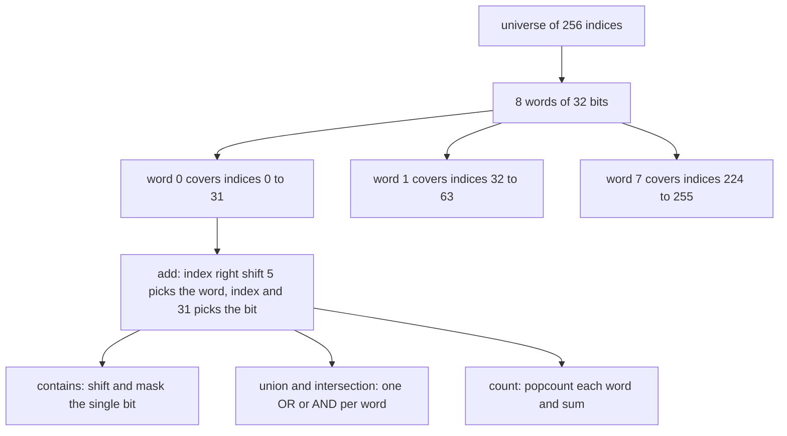
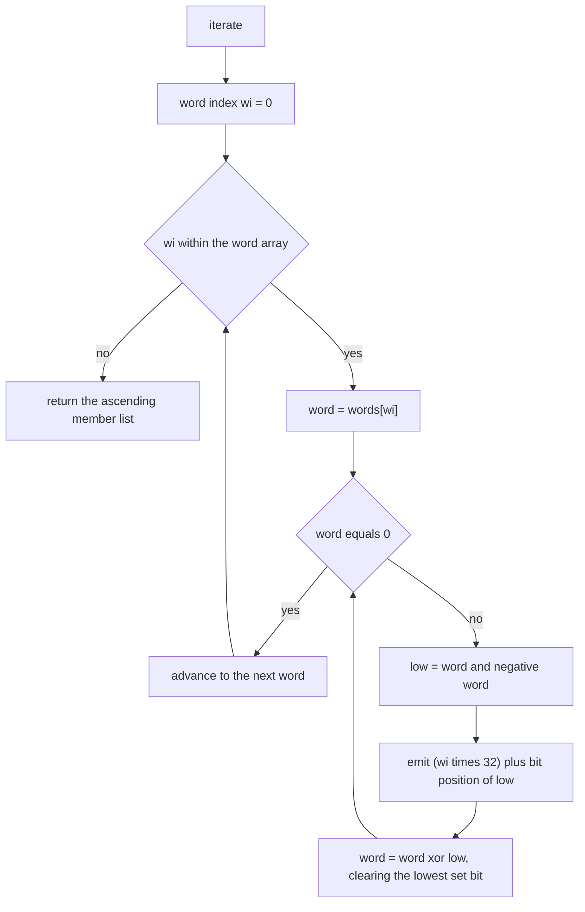
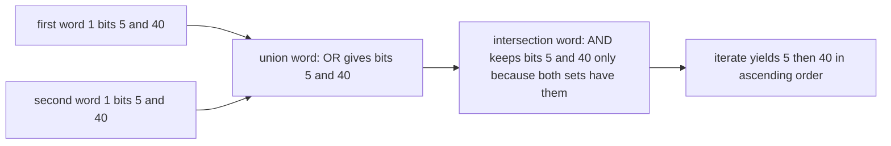

# 374 — Implement bitset operations for small-universe set (fast ops).

> **Tier:** Intermediate · **CTCI chapter:** Ch 5 — Bit Manipulation
> **Task spec:** [374-implement-bitset-operations-for-small-universe-set-fast-ops.md](../../../tasks/intermediate/374-implement-bitset-operations-for-small-universe-set-fast-ops.md)
> **Solutions:** [Python](../../../solutions/python/intermediate/374-implement-bitset-operations-for-small-universe-set-fast-ops/solution.py) ·
> [Java](../../../solutions/java/intermediate/374-implement-bitset-operations-for-small-universe-set-fast-ops/Solution.java) ·
> [JavaScript](../../../solutions/javascript/intermediate/374-implement-bitset-operations-for-small-universe-set-fast-ops/solution.js) ·
> [C#](../../../solutions/csharp/intermediate/374-implement-bitset-operations-for-small-universe-set-fast-ops/Solution.cs)

## 1. Problem restatement

**Input:** a fixed universe size `bits` (here `256`), then a sequence of set operations on indices
`0 … bits - 1`.

**Output:** a set type with the usual operations, where every piece of work is done a whole 32-bit
word at a time:

| Operation | Meaning | Cost |
| --- | --- | --- |
| `add(index)` | set the bit; idempotent | `O(1)` |
| `remove(index)` | clear the bit; removing an absent bit is a no-op | `O(1)` |
| `contains(index)` | test the bit | `O(1)` |
| `count()` | number of members, via popcount per word | `O(words)` |
| `union(other)` / `intersection(other)` | word-wise `|` / `&`, returning a new bitset | `O(words)` |
| `iterate()` | all members as indices in strictly ascending order | `O(words + members)` |

Errors are explicit: a non-positive universe raises `universe must be positive`, an out-of-range
index raises `index out of universe: <index>`, and combining bitsets of different sizes raises
`universe size mismatch`.

Boundary indices are asserted directly, because they are where the word packing is most likely to be
wrong:

| Action | Membership afterwards | `iterate()` |
| --- | --- | --- |
| add `0, 31, 32, 33, 63, 64, 255` | `count() == 7` | `[0, 31, 32, 33, 63, 64, 255]` |
| add `0` again (already present) | `count() == 7` | unchanged |
| remove `1` (absent) | `count() == 7` | unchanged |
| remove `0` | `count() == 6`, `contains(0)` false | without `0` |

Two explicit small examples then fix the set algebra, on universe `64`:

| Set | Members | `count()` |
| --- | --- | --- |
| `first` | `[1, 5, 40, 63]` | `4` |
| `second` | `[5, 7, 40, 41]` | `4` |
| `first ∪ second` | `[1, 5, 7, 40, 41, 63]` | `6` |
| `first ∩ second` | `[5, 40]` | `2` |
| `empty ∪ first` | `[1, 5, 40, 63]` | `4` |
| `empty ∩ first` | `[]` | `0` |

Finally the files cross-check 40 LCG trials (`seed = (seed * 75 + 74) % 65537`, starting at
`37413`) against the language's plain set type. Each trial performs 60 interleaved operations on two
bitsets, where `index = seed % 256` and `action = seed % 256`, with `action % 3 == 0` meaning
"remove" and anything else "add", and then asserts membership of **every** index, `count()`, the
ascending `iterate()` against the sorted oracle, and both union and intersection against the set
operations — including a check that the iteration is ascending and duplicate-free, and sampled
`contains` checks on every seventh index.

## 2. Intuition

A set over a small contiguous universe has a representation that no hash table can beat: one bit per
element, packed into machine words. Membership becomes a shift and a mask, insertion becomes an OR,
deletion becomes an AND-NOT, and — the real prize — *set algebra* becomes a whole-word operation.
Union and intersection touch `ceil(bits / 32)` words, not `bits` elements.

The key insight is the **word/bit split** of an index: `index >> 5` selects the word and
`index & 31` selects the bit inside it, both being shifts and masks rather than divisions. That
mapping is what makes `add`, `remove` and `contains` constant time, and it is also why the boundary
indices `31`, `32`, `63`, `64` and `255` are asserted explicitly — they sit exactly on the seams
between words.

The second insight is that iteration should never scan empty space. Extracting the lowest set bit of
a word with `word & -word`, mapping it back to an index, and clearing it, visits exactly the set
bits: an empty stretch of the universe costs nothing at all. The result is naturally in ascending
order, which is why the tests can compare it with `sorted(oracle)` directly.



## 3. Algorithm

1. **Construct** with `bits > 0`; allocate `ceil(bits / 32)` zero words.
2. **add(i)**: validate `0 ≤ i < bits`, then `words[i >> 5] |= 1 << (i & 31)`.
3. **remove(i)**: validate, then `words[i >> 5] &= 0xFFFFFFFF ^ (1 << (i & 31))` — an XOR with an
   all-ones mask, i.e. clearing that bit without disturbing the others.
4. **contains(i)**: validate, then test `(words[i >> 5] >> (i & 31)) & 1 == 1`.
5. **count()**: sum the popcount of each word.
6. **union / intersection**: check the universe sizes match, then combine word-wise with `|` or `&`.
7. **iterate()**: for each word in order, repeatedly take `low = word & -word`, emit
   `(wi << 5) + popcount_of(low) - 1` as the index, and clear the bit with `word ^= low`.

```text
function bitset(bits)
    if bits ≤ 0 then
        raise "universe must be positive"
    end
    return words ← array of (bits + 31) div 32 zeroes, bits ← bits
end

procedure add(set, index)
    validate(set, index)
    set.words[index >> 5] ← set.words[index >> 5] | (1 << (index & 31))
end

procedure remove(set, index)
    validate(set, index)
    set.words[index >> 5] ← set.words[index >> 5] & (0xFFFFFFFF ^ (1 << (index & 31)))
end

function contains(set, index)
    validate(set, index)
    return (set.words[index >> 5] >> (index & 31)) & 1 = 1
end

function count(set)
    total ← 0
    for each word in set.words do
        total ← total + popcount(word)
    end
    return total
end

function union(a, b)
    if a.bits ≠ b.bits then
        raise "universe size mismatch"
    end
    result ← bitset(a.bits)
    for i ← 0 to length(a.words) - 1 do
        result.words[i] ← a.words[i] | b.words[i]
    end
    return result
end

function iterate(set)
    members ← empty list
    for wi ← 0 to length(set.words) - 1 do
        word ← set.words[wi]
        while word ≠ 0 do
            low ← word & (0 - word)
            append (wi << 5) + bit_position(low) to members
            word ← word ^ low
        end
    end
    return members
end
```

`validate` is where the "small universe" contract is enforced, and it is the only place a
`bitset` operation can fail for a reason other than a universe mismatch.



Every iteration of the inner loop removes exactly one set bit, so the loop body runs once per
member, and the outer loop runs once per word: total work `O(words + members)` with no scan of the
universe's zeros.

## 4. Worked example

Universe `256` has `256 / 32 = 8` words. The boundary set adds indices
`0, 31, 32, 33, 63, 64, 255`, which land like this:

| Index | `index >> 5` (word) | `index & 31` (bit) | Word after the add |
| --- | --- | --- | --- |
| `0` | 0 | 0 | `0x00000001` |
| `31` | 0 | 31 | `0x80000001` |
| `32` | 1 | 0 | `0x00000001` |
| `33` | 1 | 1 | `0x00000003` |
| `63` | 1 | 31 | `0x80000003` |
| `64` | 2 | 0 | `0x00000001` |
| `255` | 7 | 31 | `0x80000000` |

`count()` sums the popcounts: `2 + 3 + 1 + 0 + 0 + 0 + 0 + 1 = 7`, matching the assertion. Inspecting
`iterate()` on word 1 (`0x80000003`) shows the lowest-set-bit loop in action:

| Step | `word` | `low = word & -word` | Emitted index | Purpose |
| --- | --- | --- | --- | --- |
| 1 | `0x80000003` | `0x00000001` | `(1 << 5) + 0 = 32` | lowest bit of word 1 |
| 2 | `0x80000002` | `0x00000002` | `(1 << 5) + 1 = 33` | next bit |
| 3 | `0x80000000` | `0x80000000` | `(1 << 5) + 31 = 63` | highest bit of word 1 |
| 4 | `0x00000000` | — | — | word exhausted, move to word 2 |

Words 3, 4, 5 and 6 are zero, so they cost one comparison each and emit nothing — that is the
"sorted `oracle`" property without a sort. The idempotent and no-op rows are equally direct:
adding `0` again ORs `0x00000001` into word 0, which is already `0x80000001`, and removing the
absent index `1` clears a bit that is already `0`.

Set algebra on the universe-64 example is one operation per word per set:

| Pair | Word-wise operation | Members |
| --- | --- | --- |
| `first` | — | `1, 5, 40, 63` |
| `second` | — | `5, 7, 40, 41` |
| `first ∪ second` | `OR` | `1, 5, 7, 40, 41, 63` |
| `first ∩ second` | `AND` | `5, 40` |



## 5. Complexity

Let `U` be the universe size in bits and `w = ceil(U / 32)` the number of words (here `U = 256`,
`w = 8`).

| Measure | Bound | Why it holds |
| --- | --- | --- |
| `add`, `remove`, `contains` | O(1) | one shift, one mask and one word access; no loop |
| `count` | O(w) = O(U / 32) | one popcount per word |
| `union`, `intersection` | O(w) = O(U / 32) | one `|` or `&` per word, versus `O(U)` for an element-wise loop |
| `iterate` | O(w + members) | each word is visited once and each set bit is extracted once |
| Space | O(w) words, i.e. `U / 8` bytes | 32 elements per word instead of one byte per element |
| Oracle comparison | O(U) per trial | the plain set is checked at every index, which is what makes the bitset checks exhaustive |

Two details of the arithmetic matter for the bounds: the map `index >> 5` and `index & 31` replaces a
division and a modulo, and the lowest-set-bit extraction `word & -word` is why `iterate` costs
`O(members)` rather than `O(U)`.

## 6. Pitfalls and edge cases

- **Word boundaries.** Indices `31`, `32`, `63`, `64` and `255` are asserted explicitly. `31` is the
  top bit of word 0 and `32` the bottom bit of word 1; an off-by-one in the `>> 5` / `& 31` split
  shows up here and nowhere else.
- **The last word is partial when `bits` is not a multiple of 32.** `ceil(bits / 32)` words are
  allocated, so a universe of, say, `70` bits has a third word with only 6 usable bits; the
  validator is what prevents writes into the unused ones.
- **Shifts must stay inside the word width.** Python integers are unbounded, but the other languages
  must mask and use unsigned shifts (`>>>` in Java and JavaScript, `uint` in C#) so that bit 31 does
  not turn into a sign bit. The docstring states that all four solutions treat words as unsigned bit
  patterns, which is why the LCG cross-check passes identically in all four.
- **`remove` clears a bit, it does not subtract.** The mask is `0xFFFFFFFF ^ (1 << bit)`, an
  AND-NOT; using subtraction would borrow from neighbouring bits when the target bit is already `0`.
- **Removing an absent index and adding a present one are no-ops, not errors.** Both are asserted
  (`boundary.remove(1)` leaves `count() == 7`, `boundary.add(0)` likewise), which is what makes the
  LCG trials — where the same index is added and removed repeatedly — meaningful.
- **Out-of-range indices fail loudly.** `0` and `bits - 1` are valid; `-1` and `bits` are not, and
  raise `index out of universe: <index>`. Silent masking of an invalid index would corrupt a valid
  one.
- **Universe mismatch is an error.** `union` and `intersection` require equal `bits`; combining a
  64-bit and a 256-bit set raises `universe size mismatch` instead of producing a silently truncated
  result.
- **Non-positive universe.** `Bitset(0)` raises `universe must be positive`; there is no meaningful
  empty universe to return.
- **`union` and `intersection` do not mutate.** Both allocate a new bitset and leave their operands
  untouched, which the tests rely on by comparing the operands' membership after the operation.
- **Ascending, duplicate-free iteration.** The word order gives ascending indices, and each bit is
  cleared as it is emitted, so no index can appear twice; the tests assert
  `union.iterate() == sorted(set(union.iterate()))` explicitly.
- **Popcount must be per word, not per bit.** Python uses `bin(word).count("1")` and
  `bit_length()`, Java `Integer.bitCount` and `Integer.numberOfTrailingZeros`, C#
  `BitOperations.PopCount` and `BitOperations.TrailingZeroCount`, and JavaScript a SWAR `popcount32`
  helper plus `31 - Math.clz32(low)`; all of them produce the totals and indices the oracle checks.
- **`count()` and `iterate()` must agree.** Both are asserted against the oracle in every trial; a
  bit counted but not iterated (or the reverse) is a contradiction the tests would catch.

## 7. Variants and follow-ups

- **Dynamic universes.** A hash set trades the `O(U / 32)` space for `O(members)` space and loses
  the word-parallel algebra; a bitset wins exactly when the universe is small and dense.
- **Bit tricks on integers.** The single-word operations here are the same primitives used by the
  bit-manipulation tasks in Ch 5, where `word & -word` isolates the lowest set bit and
  `word & (word - 1)` clears it.
- **Sets of small integers as bitmasks.** When the universe fits in one machine word (say 64
  elements), the whole bitset is a single integer and union/intersection become `|` and `&` on
  scalars — the pattern used in subset-DP tasks such as
  [378-implement-integer-partition-dp-count-ways.md](../../../tasks/intermediate/378-implement-integer-partition-dp-count-ways.md).
- **Bitsets inside other structures.** A fixed 256-bit universe fits in a quad tree's leaf
  statistics or a segment tree node's summary, which is a common way to make
  [361-implement-interval-stabbing-queries-with-segment-tree.md](../../../tasks/intermediate/361-implement-interval-stabbing-queries-with-segment-tree.md)
  style structures handle set-valued payloads.
- **Rank/select structures.** Answering "how many members are below index `i`" adds a prefix popcount
  table, trading `O(w)` time for `O(w)` extra space —
  a natural follow-up once `count()` is word-parallel.

## 8. Check yourself

1. Why is `index >> 5` the right word selector, and `index & 31` the right bit selector?

<details><summary>Show answer</summary>

Because each word holds 32 bits, the words form contiguous blocks of 32 indices: word `k` covers
`32k … 32k + 31`. Dividing by 32 is `>> 5`, and the remainder modulo 32 is `& 31`. Both are single
instructions, so `add`, `remove` and `contains` touch exactly one word and take constant time.

</details>

2. How many words does a universe of 256 bits need, and what does the last boundary index `255`
   look like?

<details><summary>Show answer</summary>

`256 / 32 = 8` words, indices `0 … 7`. Index `255` is word `255 >> 5 = 7`, bit `255 & 31 = 31`, so it
is the top bit of the last word; after adding it, word 7 is `0x80000000`, which is why the boundary
case is asserted rather than assumed.

</details>

3. Why does `iterate()` produce ascending order without sorting?

<details><summary>Show answer</summary>

The outer loop walks the words in index order, and inside one word the lowest-set-bit extraction
visits bits from least significant to most significant, which is index order within that block.
Since word `k` only holds indices `32k … 32k + 31`, the concatenated stream is globally ascending.

</details>

4. What is the difference between `count()` and `iterate()` in cost, and why does the test check
   both?

<details><summary>Show answer</summary>

`count()` is `O(w)` — one popcount per word, no dependence on the number of members — while
`iterate()` is `O(w + members)` because it emits each member. Checking both catches a bit that is
counted but never extracted (or vice versa), which would mean the word layout and the extraction
loop disagree about where a member lives.

</details>

5. Why does the LCG trial use `action % 3 == 0` to decide between removing and adding?

<details><summary>Show answer</summary>

So that roughly two thirds of the operations add and one third remove, producing sets that are dense
enough to exercise multi-word union and intersection but sparse enough to keep removals from simply
emptying the set. Both operations are no-op-safe — removing an absent index and adding a present one
change nothing — so the oracle's `discard` / `add` calls stay in lockstep with the bitset.

</details>
