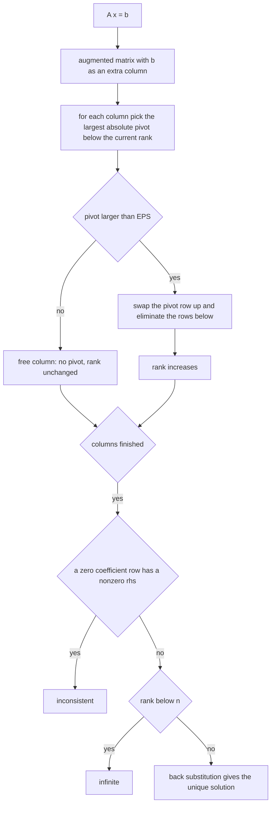
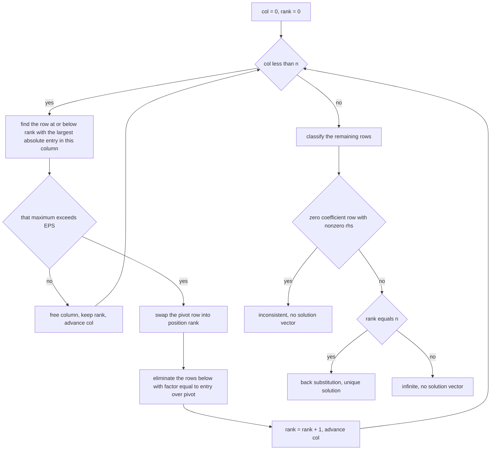
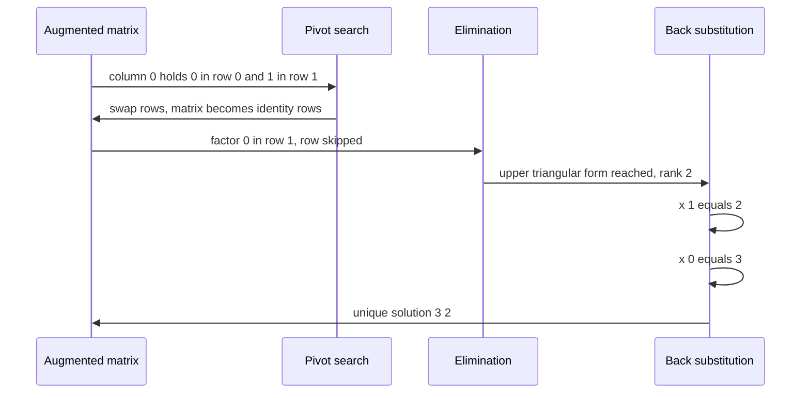

# 375 — Implement Gaussian elimination for solving linear systems (double).

> **Tier:** Intermediate · **CTCI chapter:** Beyond — Numerical & Scientific Computing
> **Task spec:** [375-implement-gaussian-elimination-for-solving-linear-systems-double.md](../../../tasks/intermediate/375-implement-gaussian-elimination-for-solving-linear-systems-double.md)
> **Solutions:** [Python](../../../solutions/python/intermediate/375-implement-gaussian-elimination-for-solving-linear-systems-double/solution.py) ·
> [Java](../../../solutions/java/intermediate/375-implement-gaussian-elimination-for-solving-linear-systems-double/Solution.java) ·
> [JavaScript](../../../solutions/javascript/intermediate/375-implement-gaussian-elimination-for-solving-linear-systems-double/solution.js) ·
> [C#](../../../solutions/csharp/intermediate/375-implement-gaussian-elimination-for-solving-linear-systems-double/Solution.cs)

## 1. Problem restatement

**Input:** a small dense matrix `A` of `n × n` doubles and a right-hand side vector `b`.

**Output:** a status string and, when the system has exactly one solution, the vector `x`:

| Status | Meaning | `x` |
| --- | --- | --- |
| `"unique"` | rank `n`, exactly one solution | the solution vector |
| `"infinite"` | rank `< n` and consistent | `None` |
| `"inconsistent"` | some row became `0 = nonzero` | `None` |

Two thresholds are documented constants of the elimination, not tunable knobs:

- `EPS = 1e-12` — a pivot whose remaining column entries are all `≤ EPS` in absolute value is
  treated as a free column, and `|rhs| > EPS` on an all-zero coefficient row marks the system
  inconsistent;
- `TOL = 1e-9` — the absolute tolerance used to verify a solution by substitution.

| System | Status | Solution |
| --- | --- | --- |
| `[[1,1],[1,-1]]`, `[3,1]` | `unique` | `(2, 1)` |
| `[[0,1],[1,0]]`, `[2,3]` | `unique` | `(3, 2)` — needs a pivot swap |
| `[[0,0,1],[0,1,0],[1,0,0]]`, `[3,2,1]` | `unique` | `(1, 2, 3)` |
| `[[1,1,1],[0,2,5],[2,5,-1]]`, `[6,-4,27]` | `unique` | `(5, 3, -2)` |
| `[[2,1,1,1],[1,2,1,1],[1,1,2,1],[1,1,1,2]]`, `[11,12,13,14]` | `unique` | `(1, 2, 3, 4)` |
| `[[1,1],[2,2]]`, `[1,2]` | `infinite` | `None` — the second equation is the first, doubled |
| `[[1,1],[2,2]]`, `[1,2.5]` | `inconsistent` | `None` — `x + y = 1` and `x + y = 1.25` |
| `[[1,0,0],[0,1,0],[1,1,0]]`, `[1,2,3]` | `infinite` | `None` — `row3 = row1 + row2`, rank 2 |
| same matrix, `[1,2,4]` | `inconsistent` | `None` |

Each solution is verified independently by `residual`, the maximum of `|A x − b|` over the rows,
which must be below `TOL`. The LCG sweep runs 80 trials (`seed = (seed * 75 + 74) % 65537`, starting
at `37513`) with `size = 2 + seed % 3`, coefficients `seed % 11 - 5` and a planted integer solution
`x*`, taking `b = A x*`; whenever the elimination reports `unique` the recovered vector must match
the planted one to `1e-6` and the residual must be below `TOL`. Singular random matrices are skipped
by design, and the file asserts that at least 40 of the 80 trials were unique, so the check is not
vacuous.

## 2. Intuition

Solving by Cramer's rule or by computing `A⁻¹` is a trap: the inverse requires `n` separate solves
and the determinant is numerically hopeless. Gaussian elimination instead reduces the system to an
upper-triangular one with row operations that do not change the solution set, and then reads the
answer off the last row upwards.

Two ideas make the reduction work in floating point. The first is **partial pivoting**: before
eliminating column `k`, swap in the row with the largest absolute value in that column. If the
natural pivot is zero the swap is mandatory; more importantly, if it is merely *small*, dividing by
it amplifies rounding error, and choosing the largest entry keeps the multipliers `|factor| ≤ 1`.

The second is that the elimination itself reveals the structure of the answer. A column with no
usable pivot is a free variable: the system cannot have a unique solution. What remains is to
distinguish the two failure modes, and that is a comparison on the right-hand side — a row whose
coefficient part is all zeros is either `0 = 0` (consistent, infinitely many solutions) or
`0 = nonzero` (inconsistent).



`EPS` is the bridge between exact mathematics and floating-point reality: an exact rank test would
ask whether a value *is* zero, while the elimination asks whether it is small enough that treating
it as zero is the better answer.

## 3. Algorithm

1. **Build** the augmented matrix: each row is `A[i]` plus `b[i]` as column `n`.
2. **Forward elimination**, for `col = 0 … n−1`:
   - among rows `rank … n−1`, find the one with the largest `|augmented[row][col]|`;
   - if that maximum is `≤ EPS`, this is a free column: leave `rank` unchanged and continue;
   - otherwise swap the pivot row into position `rank`, and for every row below it compute
     `factor = augmented[row][col] / augmented[rank][col]`, skipping the row when the factor is
     exactly `0.0`, and subtract `factor · augmented[rank][k]` from `augmented[row][k]` for
     `k = col … n`;
   - increment `rank`.
3. **Classify** the result: any row `rank … n−1` with `|rhs| > EPS` is inconsistent; otherwise
   `rank < n` means infinitely many solutions; otherwise the system is unique.
4. **Back substitution**, for `row = n−1 … 0`:
   `x[row] = (augmented[row][n] − Σ_{col > row} augmented[row][col]·x[col]) / augmented[row][row]`.
5. **Return** `("unique", x)` or the sentinel status with `None`.

```text
function solve(matrix, rhs)
    n ← number of rows
    augmented ← rows of matrix with rhs appended as column n
    rank ← 0
    for col ← 0 to n - 1 do
        pivot_row ← -1
        pivot_size ← 0.0
        for row ← rank to n - 1 do
            if absolute(augmented[row][col]) > pivot_size then
                pivot_size ← absolute(augmented[row][col])
                pivot_row ← row
            end
        end
        if pivot_row = -1 or pivot_size ≤ EPS then
            continue
        end
        swap augmented[rank] with augmented[pivot_row]
        for row ← rank + 1 to n - 1 do
            factor ← augmented[row][col] / augmented[rank][col]
            if factor ≠ 0.0 then
                for k ← col to n do
                    augmented[row][k] ← augmented[row][k] - factor * augmented[rank][k]
                end
            end
        end
        rank ← rank + 1
    end

    for row ← rank to n - 1 do
        if absolute(augmented[row][n]) > EPS then
            return "inconsistent", none
        end
    end
    if rank < n then
        return "infinite", none
    end

    x ← array of n zeroes
    for row ← n - 1 down to 0 do
        total ← augmented[row][n]
        for col ← row + 1 to n - 1 do
            total ← total - augmented[row][col] * x[col]
        end
        x[row] ← total / augmented[row][row]
    end
    return "unique", x
end
```

The pivot search is what makes the algorithm usable in floating point: on a diagonally dominant
matrix like the asserted `4 × 4` it confirms the diagonal, and on `[[0,1],[1,0]]` it rescues a
zero pivot by swapping in the row below.



## 4. Worked example

**A clean `2 × 2`.** `[[1,1],[1,-1]]` with `b = [3,1]`:

| Step | Augmented matrix | Action |
| --- | --- | --- |
| start | `[[1, 1, 3], [1, -1, 1]]` | — |
| `col = 0` | — | pivot search finds row 0 (size `1`), no swap needed |
| eliminate | `[[1, 1, 3], [0, -2, -2]]` | `factor = 1/1 = 1`; row 1 minus row 0 |
| `col = 1` | — | pivot row 1 (size `2`), `rank` becomes `2` |
| classify | — | no rows below `rank`, `rank = n = 2` → unique |
| back substitution | `x[1] = -2 / -2 = 1`, `x[0] = (3 − 1·1)/1 = 2` | solution `(2, 1)` |

**A pivot swap.** `[[0,1],[1,0]]` with `b = [2,3]`:

| Step | Augmented matrix | Action |
| --- | --- | --- |
| start | `[[0, 1, 2], [1, 0, 3]]` | — |
| `col = 0` | — | the largest entry in column 0 is `1` at row 1, so the rows swap |
| after swap | `[[1, 0, 3], [0, 1, 2]]` | `rank` becomes `1` |
| `col = 1` | — | pivot `1` at row 1, no rows below, `rank` becomes `2` |
| back substitution | `x[1] = 2`, `x[0] = (3 − 0·2)/1 = 3` | solution `(3, 2)` |

The elimination of row 1 in the second step uses `factor = 0/1 = 0`, which the `if factor != 0.0`
guard skips entirely — the row is already in the right shape, and skipping it avoids a full row
subtraction that could not change anything. The permutation-style system
`[[0,0,1],[0,1,0],[1,0,0]]` exercises the same swap logic twice and returns `(1, 2, 3)` exactly as
planted by the right-hand side `[3,2,1]`.



## 5. Complexity

Let `n` be the number of unknowns.

| Measure | Bound | Why it holds |
| --- | --- | --- |
| Time | O(n³) | column `col` performs `n − rank` row subtractions of length `n − col`, summing to about `n³/3` floating-point operations |
| Pivot search | O(n²) total | each column scans the remaining entries once |
| Back substitution | O(n²) | a growing inner product per row |
| Space | O(n²) | the augmented `n × (n + 1)` matrix, mutated in place |
| Residual check | O(n²) | one row-by-row evaluation of `A x − b` |
| LCG sweep | 80 systems of size `2 … 4` | small by construction, so the whole suite stays instant |

Partial pivoting does not change the asymptotics; it changes the *accuracy*, bounding the multipliers
by `1` in absolute value and keeping the rounding error of a well-conditioned system near machine
precision. The `EPS` rank decision is the price of that: a genuinely singular system and a system
whose pivot is `1e-13` cannot be distinguished without a tolerance.

## 6. Pitfalls and edge cases

- **Zero pivot without a swap.** `[[0,1],[1,0]]` would divide by zero if the pivot were taken as
  `augmented[rank][col]` unconditionally; the pivot search moves `1` into place and the system is
  solved exactly. The class of `n × n` permutation matrices is asserted through the `3 × 3` case.
- **Small but non-zero pivots.** The test is `pivot_size ≤ EPS`, with `EPS = 1e-12`, so pivots below
  that are treated as free columns rather than divided by. Choosing `EPS` smaller invites overflow
  in the multipliers; choosing it larger misclassifies ill-conditioned systems as singular.
- **Rank-deficient but consistent → `infinite`.** `[[1,1],[2,2]]` with `[1,2]` reduces to
  `x + y = 1` plus `0 = 0`; the status is `infinite` and `x` is `None`, not an arbitrary particular
  solution. The files deliberately return `None` rather than inventing one.
- **Rank-deficient and contradictory → `inconsistent`.** The same matrix with `[1,2.5]` produces a
  zero row whose `rhs` is `0.5 > EPS`, and that is detected *before* the `rank < n` test — the order
  of the two checks is what separates the two statuses.
- **Three-way dependence.** `[[1,0,0],[0,1,0],[1,1,0]]` has `row3 = row1 + row2`, so the rank is `2`
  and the third column is free: `[1,2,3]` is consistent (`1 + 2 = 3`) and `[1,2,4]` is not.
- **The `factor != 0.0` skip.** It is an optimisation, not a correctness requirement — subtracting a
  zero multiple leaves the row unchanged — but it is what makes the identity-like systems cheap and
  it avoids introducing `-0.0` noise into the row.
- **Elimination starts at `k = col`,** not `k = 0`: the entries left of the pivot are already zero by
  construction, and rewriting them could reintroduce rounding noise.
- **Tolerances are documented and distinct.** `EPS = 1e-12` governs the elimination's rank decisions;
  `TOL = 1e-9` governs the substitution check. Using one for the other is a common mistake: the
  residual of a solved system is typically far below `EPS`'s scale but the *comparisons* on the
  solution need the looser bound.
- **Integral solutions in a double solver.** The hand systems all have small integer solutions that
  the elimination reproduces far inside `TOL`, which is why the assertions compare with `abs(x[i] - expected) < TOL`.
- **Singular random systems are skipped, not asserted.** The LCG sweep checks only the `unique`
  trials — a random integer matrix may legitimately be singular — but the file also asserts that at
  least 40 of the 80 trials were unique, so the skip cannot hide a solver that always claims
  `infinite`.
- **Verification is independent.** The residual is computed from the original `A` and `b`, not from
  the augmented matrix, so a transcription error in the elimination cannot make the check pass.
- **No scaling or equilibration.** Rows of wildly different magnitude are not rescaled; for the small
  integer systems in the tests this never matters, but it is the standard next refinement for
  ill-conditioned input.

## 7. Variants and follow-ups

- **Exact rationals instead of doubles.** The same elimination with exact fractions removes both the
  tolerance and the need for pivoting:
  [376-solve-linear-equations-with-integer-coefficients-rational-small.md](../../../tasks/intermediate/376-solve-linear-equations-with-integer-coefficients-rational-small.md)
  carries a compact double solver of its own and requires the two results to agree to `1e-9`, which
  is the documented link between the two tasks.
- **Rank and determinant.** The elimination already produces the rank; keeping the sign of the swaps
  and multiplying the pivots gives the determinant as a by-product, and the free-column count gives
  the nullity.
- **Least squares for over-determined systems.** When `A` is not square and no exact solution
  exists, normal equations or QR factorisation minimise `‖A x − b‖`, and the residual helper here is
  exactly the quantity they minimise.
- **Sparse systems.** Dense `O(n³)` elimination is the wrong tool once most entries are zero;
  iterative methods (conjugate gradient, GMRES) or sparse factorisations take over.
- **Linear programming.** The pivoting machinery is shared with the simplex method, which is the
  subject of [377-implement-simplex-algorithm-outline-for-small-lp.md](../../../tasks/intermediate/377-implement-simplex-algorithm-outline-for-small-lp.md).

## 8. Check yourself

1. Why does partial pivoting swap in the row with the largest absolute pivot rather than the first
   non-zero one?

<details><summary>Show answer</summary>

Accuracy. Every eliminated row is multiplied by `factor = entry / pivot`, and choosing the largest
available pivot keeps `|factor| ≤ 1`, which prevents the multipliers from amplifying rounding error
and keeps the growth of the remaining entries small. A small non-zero pivot would produce huge
multipliers and lose most of the significant digits of the solution.

</details>

2. What distinguishes `"infinite"` from `"inconsistent"` in the code?

<details><summary>Show answer</summary>

The right-hand side of the rows below the rank. A row whose coefficient part is entirely zero is
either `0 = 0`, which leaves a free variable and means infinitely many solutions, or `0 = c` with
`|c| > EPS`, which means no solution at all. The code tests the inconsistent case first and only then
checks `rank < n`, so the two statuses cannot be confused.

</details>

3. Why does the assertion suite compare solutions with `1e-9` rather than checking equality?

<details><summary>Show answer</summary>

Because the elimination runs in double precision, so `x` carries rounding error even when the true
solution is an integer. `EPS = 1e-12` decides rank during the elimination and `TOL = 1e-9` is the
documented absolute tolerance for accepting a solution; the residual check `max|A x − b| < TOL`
backs it up. Exact equality is only possible in the rational variant, task 376.

</details>

4. What does `solve` return for `[[1,1],[2,2]]` with `b = [1, 2]`, and why is that the right answer
   rather than a particular solution?

<details><summary>Show answer</summary>

`("infinite", None)`. The second equation is the first doubled, so the rank is `1` and the system has
a one-parameter family of solutions; returning any single member of that family would misrepresent
the answer set. The file's sentinel convention is `x = None` for everything that is not unique.

</details>

5. Why does the elimination loop start its row subtraction at `k = col` instead of `k = 0`?

<details><summary>Show answer</summary>

Because every entry to the left of the pivot column is already zero in both rows — the previous
columns were eliminated — so those subtractions would compute `0 − factor·0` and could add rounding
noise to structurally zero entries, or even turn a stored `0.0` into `-0.0`. Starting at `col` keeps
the triangular structure exact and saves work.

</details>
