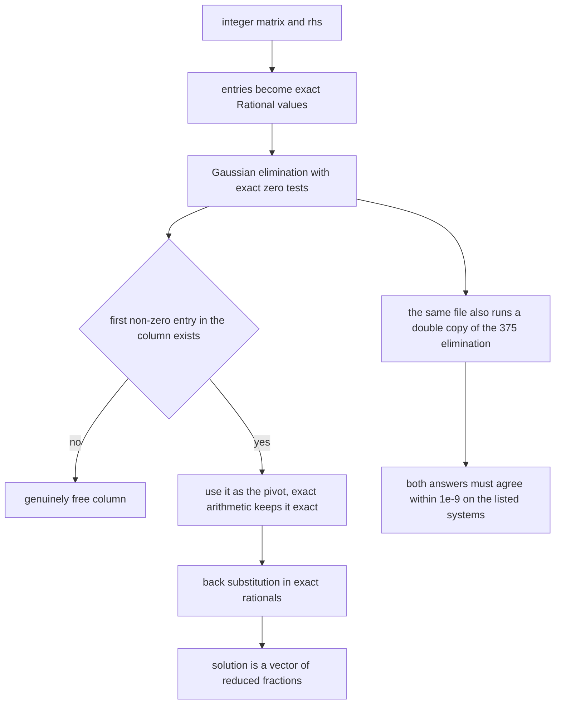
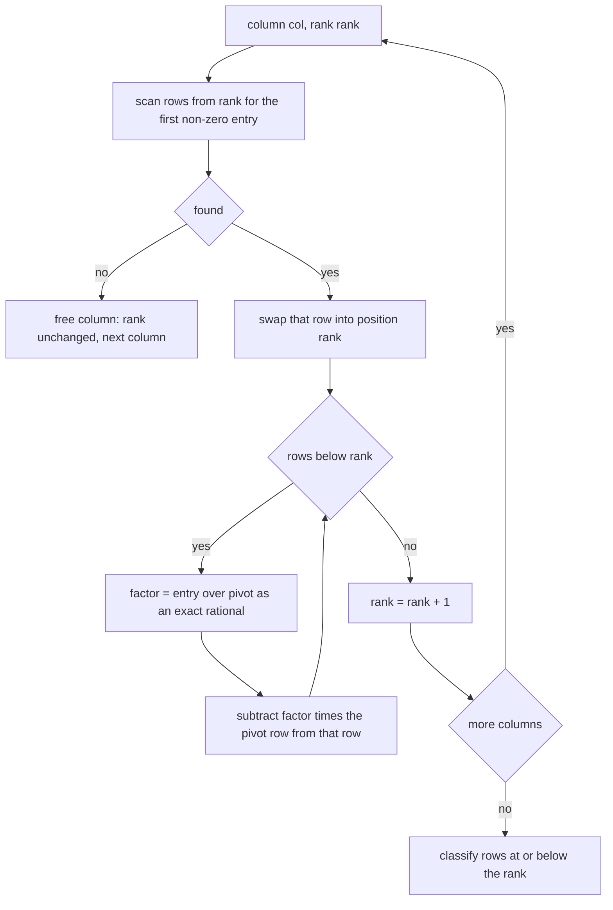
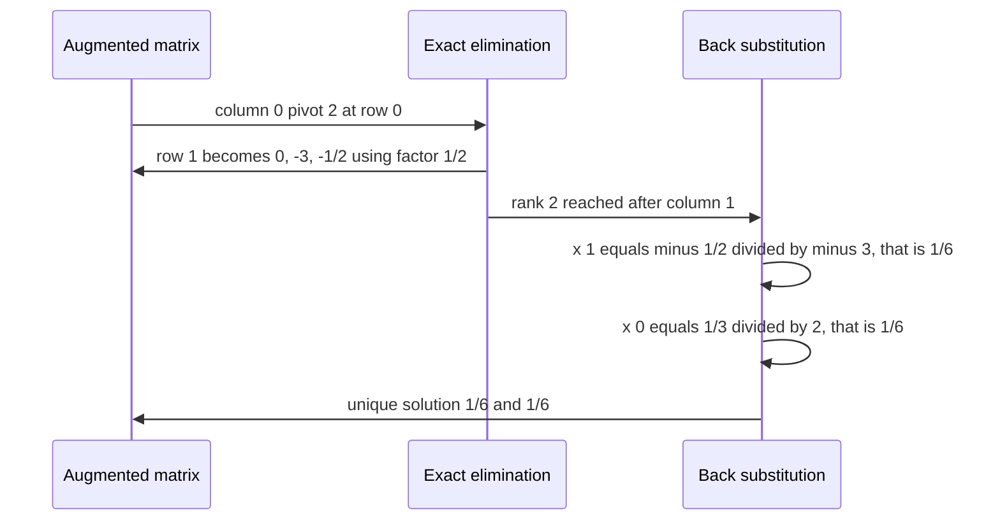

# 376 — Solve linear equations with integer coefficients (rational) small.

> **Tier:** Intermediate · **CTCI chapter:** Beyond — Numerical & Scientific Computing
> **Task spec:** [376-solve-linear-equations-with-integer-coefficients-rational-small.md](../../../tasks/intermediate/376-solve-linear-equations-with-integer-coefficients-rational-small.md)
> **Solutions:** [Python](../../../solutions/python/intermediate/376-solve-linear-equations-with-integer-coefficients-rational-small/solution.py) ·
> [Java](../../../solutions/java/intermediate/376-solve-linear-equations-with-integer-coefficients-rational-small/Solution.java) ·
> [JavaScript](../../../solutions/javascript/intermediate/376-solve-linear-equations-with-integer-coefficients-rational-small/solution.js) ·
> [C#](../../../solutions/csharp/intermediate/376-solve-linear-equations-with-integer-coefficients-rational-small/Solution.cs)

## 1. Problem restatement

**Input:** a small `n × n` system `A x = b` whose coefficients and right-hand side are **integers**.

**Output:** the same three-way status as the double-precision task, but with an *exact* solution
vector:

| Status | Meaning | `x` |
| --- | --- | --- |
| `"unique"` | rank `n` | exact rationals |
| `"infinite"` | rank `< n`, consistent | `None` |
| `"inconsistent"` | a zero coefficient row with a nonzero `rhs` | `None` |

Every result is a `Rational` with a numeric `num` and a positive, gcd-reduced `den`, so the
assertions are **equalities of rationals, not tolerance checks**:

| System | Status | Solution |
| --- | --- | --- |
| `[[1,1],[1,-1]]`, `[3,1]` | `unique` | `2`, `1` (`num = 2, den = 1`) |
| `[[0,1],[1,0]]`, `[2,3]` | `unique` | `3`, `2` |
| `[[1,1,1],[0,2,5],[2,5,-1]]`, `[6,-4,27]` | `unique` | `5`, `3`, `-2` |
| `[[2,1,1,1],[1,2,1,1],[1,1,2,1],[1,1,1,2]]`, `[11,12,13,14]` | `unique` | `1`, `2`, `3`, `4` |
| `[[3]]`, `[1]` | `unique` | `1/3` |
| `[[2,4],[1,-1]]`, `[1,0]` | `unique` | `1/6`, `1/6` |
| `[[5,2],[1,1]]`, `[1,0]` | `unique` | `1/3`, `-1/3` |
| `[[1,1],[2,2]]`, `[1,2]` | `infinite` | `None` |
| `[[1,1],[2,2]]`, `[1,5]` | `inconsistent` | `None` |
| `[[1,0,0],[0,1,0],[1,1,0]]`, `[1,2,3]` | `infinite` | `None` |
| same matrix, `[1,4]` | `inconsistent` | `None` |

The genuinely fractional cases — `1/3`, `1/6`, `-1/3` — cannot be represented exactly as doubles,
which is the point of the task. As a bridge to the double implementation, the same file also carries
`solve_double`, a compact copy of
[375](../../../tasks/intermediate/375-implement-gaussian-elimination-for-solving-linear-systems-double.md)'s
elimination, and asserts that it agrees with the exact result to `1e-9` on six listed systems. The
LCG sweep runs 80 trials (`seed = (seed * 75 + 74) % 65537`, starting at `37613`, `size = 2 + seed % 3`,
coefficients `seed % 11 - 5`) with a planted integer solution, and requires the recovered `x` to be
**exactly equal** to the planted rationals, the substitution `A x == b` to hold exactly, and the
double solver to agree to `1e-9`; at least 40 of the 80 trials must be unique.

## 2. Intuition

Task 375 solves the same equations in double precision and pays for it with two tolerances: `EPS` to
decide whether a pivot is zero, and `TOL` to decide whether a solution is right. Both exist because
binary floating point cannot represent `1/3`, and because a matrix whose pivot *should* be zero may
hold `1e-17` instead.

The key insight here is that for integer coefficients none of that is necessary. If every entry is a
rational number stored exactly, then a zero pivot **is** zero, arithmetic never rounds, and therefore
no pivoting strategy is needed — the first non-zero entry in the column can be taken as the pivot.
That is not a heuristic; it is a consequence of exactness, and the file documents it as such.



The second insight is that a small `Rational` type is enough — no library needed. A pair of integers,
normalised so the denominator is positive and the fraction is reduced by `gcd`, gives exact `+`, `-`,
`*`, `/`, an exact `is_zero` test, and a canonical equality. Because `Rational(1, 2) == Rational(2, 4)`
holds after reduction, comparing two solutions is a plain `==`, and the LCG trials can assert exact
recovery of a planted vector.

## 3. Algorithm

1. **Represent** every entry as a `Rational`, normalising sign and dividing both terms by their `gcd`;
   `0` is stored as `0/1` and a zero denominator raises `rational with zero denominator`.
2. **Forward elimination**, for `col = 0 … n−1`:
   - find the first row at or below `rank` whose entry in this column `is_zero()` is false;
   - if none exists, the column is genuinely free: keep `rank` and continue;
   - otherwise swap that row into position `rank`, and for each row below it, skip the row when the
     entry is zero, else compute `factor = entry / pivot` and subtract `factor · pivot_row` for
     `k = col … n`;
   - increment `rank`.
3. **Classify**: a row at or below `rank` with a non-zero `rhs` is `inconsistent`; otherwise
   `rank < n` is `infinite`; otherwise the system is unique.
4. **Back substitute** in exact rationals:
   `x[row] = (augmented[row][n] − Σ_{col > row} augmented[row][col]·x[col]) / augmented[row][row]`.
5. **Return** `("unique", x)` with `x` a list of rationals, or the sentinel status with `None`.

```text
function rational(num, den)
    if den = 0 then
        raise "rational with zero denominator"
    end
    if den < 0 then
        num ← -num
        den ← -den
    end
    g ← gcd(absolute(num), den)
    if g = 0 then
        return (num ← 0, den ← 1)
    end
    return (num ← num div g, den ← den div g)
end

function solve_rational(matrix, rhs)
    n ← number of rows
    augmented ← rows of matrix, each entry as rational, with rational(rhs[i]) appended
    rank ← 0
    for col ← 0 to n - 1 do
        pivot_row ← -1
        for row ← rank to n - 1 do
            if augmented[row][col] is not zero then
                pivot_row ← row
                break
            end
        end
        if pivot_row = -1 then
            continue
        end
        swap augmented[rank] with augmented[pivot_row]
        for row ← rank + 1 to n - 1 do
            if augmented[row][col] is zero then
                continue
            end
            factor ← augmented[row][col] / augmented[rank][col]
            for k ← col to n do
                augmented[row][k] ← augmented[row][k] - factor * augmented[rank][k]
            end
        end
        rank ← rank + 1
    end

    for row ← rank to n - 1 do
        if augmented[row][n] is not zero then
            return "inconsistent", none
        end
    end
    if rank < n then
        return "infinite", none
    end

    x ← array of n rational zeroes
    for row ← n - 1 down to 0 do
        total ← augmented[row][n]
        for col ← row + 1 to n - 1 do
            total ← total - augmented[row][col] * x[col]
        end
        x[row] ← total / augmented[row][row]
    end
    return "unique", x
end
```

The `is_zero` test replaces 375's `EPS` threshold, and the missing pivot search replaces 375's
partial pivoting. Both substitutions are exact, and both are documented as consequences of using
rationals rather than as simplifications of convenience. Division by zero is still guarded: dividing
by a zero rational raises `division by zero rational`, so a programming error surfaces instead of
producing a silent infinity.



## 4. Worked example

Trace `[[2,4],[1,-1]]` with `b = [1,0]`, whose exact solution is `x = y = 1/6`:

| Step | Augmented matrix (rationals) | Action |
| --- | --- | --- |
| start | `[[2, 4, 1], [1, -1, 0]]` | all entries already reduced |
| `col = 0` | — | first non-zero entry in column 0 is `2` at row 0, so no swap |
| eliminate | `[[2, 4, 1], [0, -3, -1/2]]` | `factor = 1/2`; row 1 becomes `[1, -1, 0] − (1/2)·[2, 4, 1] = [1−1, −1−2, 0−1/2]` |
| `col = 1` | — | first non-zero entry at or below row 1 is `-3`, so `rank` becomes `2` |
| classify | — | no rows below `rank`, `rank = n = 2` → unique |
| back substitution | `x[1] = (-1/2) / (-3) = 1/6` | then `x[0] = (1 − 4·(1/6)) / 2 = (2/3)/2 = 1/6` |

Both components come out as `1/6`, asserted by exact equality against `Rational(1, 6)`. Every
intermediate value is a reduced fraction, so `1/3` is stored as `num = 1, den = 3` rather than as the
double `0.333…`, and the final comparison cannot be fooled by rounding.

The `1 × 1` system `[[3]]` with `b = [1]` is the smallest fractional case: `rank` becomes `1`, the
back substitution computes `1/3`, and the file asserts both the equality `x == [Rational(1, 3)]` and
the field values `num == 1, den == 3`.



For the LCG trials the planted vector is an integer vector, and the recovered vector must equal
`[Rational(v) for v in planted]` — component by component, exactly. The suite also substitutes the
result back into the *original* integer matrix using rational arithmetic and requires `A x == b`
as an exact equality, so a solution that merely rounds to the planted vector cannot pass.

## 5. Complexity

Let `n` be the number of unknowns and let the systems here be small (`2 … 4`, plus hand cases up to
`4 × 4`).

| Measure | Bound | Why it holds |
| --- | --- | --- |
| Time, rational operations | O(n³) | the same elimination structure as 375, but each arithmetic step is a `Rational` operation instead of a float operation |
| Cost per rational operation | O(gcd) plus integer multiplications | `gcd` on the operand magnitudes, then cross-multiplications and a division |
| Numerical stability | exact, no tolerance | rational arithmetic never rounds, so pivoting is unnecessary and `is_zero` is a true test |
| Space | O(n²) rationals | the augmented matrix, each entry a numerator/denominator pair |
| Double cross-check | O(n³) | one extra run of 375's elimination per asserted system |
| Practical limit | small `n` | numerators and denominators can grow during elimination, so the exact solver is intended for the small systems the task asserts |

The exact solver trades speed for certainty: coefficients can swell as elimination proceeds (the
classic expression-swell problem), which is why the task is titled *small* and why the tests use
`2 … 4` unknowns and small coefficients (`seed % 11 - 5`). Within those bounds the arithmetic stays
tiny, and the payoff is a status and a solution that can be compared with `==`.

## 6. Pitfalls and edge cases

- **A zero denominator must fail loudly.** `Rational(1, 0)` raises `rational with zero denominator`;
  silently mapping it to zero or infinity would corrupt any system that reaches it.
- **Division by a zero rational raises** `division by zero rational`. The elimination guard is the
  `is_zero` skip, so this only fires on a genuine mistake rather than on legitimate elimination.
- **Normalisation is what makes equality work.** The constructor flips the sign when `den < 0` and
  divides both terms by `gcd`, so `Rational(-1, -2) == Rational(1, 2)` and the LCG assertions can use
  `==` on whole vectors. Without reduction, `2/4` and `1/2` would compare unequal.
- **Zero is canonicalised to `0/1`.** `gcd(0, den)` is `den`, and the code stores `0, 1` explicitly,
  so `is_zero` is a numerator test and there is exactly one representation of zero.
- **No partial pivoting is needed — and that is documented.** Because the arithmetic is exact, a zero
  pivot really is zero, so the first non-zero entry can be used. 375's pivoting exists to limit
  *rounding*, which cannot happen here.
- **Rank-deficient but consistent → `infinite`.** `[[1,1],[2,2]]` with `[1,2]` has rank `1`, a free
  column, and exactly one free parameter; the result is `("infinite", None)`.
- **Rank-deficient and contradictory → `inconsistent`.** With `b = [1,5]` the elimination produces a
  row `0 = 3`; because the check on the right-hand side comes before the rank test, the status is
  `inconsistent`. `[[1,0,0],[0,1,0],[1,1,0]]` with `[1,2,4]` is the same story in three dimensions
  (`1 + 2 ≠ 4`).
- **Fractional solutions are asserted exactly.** `[[3]]=[1]` gives `1/3`, `[[2,4],[1,-1]]=[1,0]`
  gives `1/6` twice, and `[[5,2],[1,1]]=[1,0]` gives `1/3` and `-1/3`. These are precisely the values
  a double solver can only approximate, which is why the two implementations coexist.
- **The double cross-check is a bridge, not the deliverable.** `solve_double` duplicates 375's
  algorithm inside this file on purpose, so the *documented* relationship between the two tasks can
  be asserted directly: agreement within `1e-9` on six systems, and on every unique LCG trial.
- **Singular random systems are skipped.** The LCG loop `continue`s when the status is not `unique`,
  and separately asserts `unique_count >= 40`, so the skip cannot mask a solver that reports
  `infinite` for everything.
- **Exact substitution uses the original matrix.** `A x == b` is recomputed from the integer inputs
  with rationals, which makes the verification independent of the augmented matrix the elimination
  mutated.
- **Integers are converted, not divided.** `Rational(coefficient)` has denominator `1`, so integer
  inputs stay exact through the first operations; only the elimination factors and solutions become
  proper fractions.
- **Sentinels match 375 exactly.** The status strings are `unique`, `infinite`, `inconsistent`, and
  `x` is `None` for everything that is not unique — the two tasks are drop-in replacements for each
  other apart from the solution type.

## 7. Variants and follow-ups

- **Double precision instead of exact rationals.** The tolerance-based sibling, with `EPS`, `TOL` and
  partial pivoting, is
  [375-implement-gaussian-elimination-for-solving-linear-systems-double.md](../../../tasks/intermediate/375-implement-gaussian-elimination-for-solving-linear-systems-double.md);
  this task's `solve_double` is a copy of it and the two must agree to `1e-9`.
- **Fraction-free elimination.** Bareiss's algorithm keeps every intermediate entry an integer by
  dividing by the previous pivot, which removes the denominator growth that makes naive rational
  elimination expensive on larger systems.
- **Exact determinant and rank.** The same elimination yields the rank from the pivot count, and the
  product of the pivots (with the swap sign) yields the determinant exactly.
- **Modular arithmetic.** For systems over a finite field the same elimination runs with `mod p`
  inverses, which is how exact linear algebra is done at scale — and how
  [379-implement-combinatorics-ncr-modulo-prime-precompute-factorials.md](../../../tasks/intermediate/379-implement-combinatorics-ncr-modulo-prime-precompute-factorials.md)
  handles its modular inverses.
- **Linear programming.** The simplex method performs the same row operations while maintaining
  feasibility, as outlined in
  [377-implement-simplex-algorithm-outline-for-small-lp.md](../../../tasks/intermediate/377-implement-simplex-algorithm-outline-for-small-lp.md).

## 8. Check yourself

1. Why can this solver skip partial pivoting when the double-precision version cannot?

<details><summary>Show answer</summary>

Because with exact rational arithmetic a pivot that is zero really is zero — no rounding can turn a
non-zero value into a stored zero or vice versa. Pivoting exists to bound the *rounding* error of
division, and there is none here, so taking the first non-zero entry is safe. The file documents
this as a consequence of exactness, not as a simplification.

</details>

2. Why does `Rational` reduce by `gcd` in its constructor?

<details><summary>Show answer</summary>

To give every value a single canonical representation. Without reduction, `2/4` and `1/2` would be
different objects, `==` would need a cross-multiplication, and the assertions that compare whole
solution vectors — including `x == [Rational(v) for v in planted]` in the LCG trials — would be
unreliable. Reduction plus the positive-denominator rule makes equality a term-by-term comparison.

</details>

3. What is the exact solution of `[[2,4],[1,-1]]` with `b = [1,0]`, and why is the double image of it
   inexact?

<details><summary>Show answer</summary>

`x = y = 1/6`. `1/6` is not a binary fraction — its denominator has a factor `3` — so no double can
represent it exactly; the double solver returns the nearest representable value, which is why the
cross-check uses `1e-9` while the rational solver asserts equality. Substituting back exactly:
`2·(1/6) + 4·(1/6) = 1` and `1/6 − 1/6 = 0`.

</details>

4. What happens to a system whose coefficient matrix is singular and whose right-hand side is
   consistent?

<details><summary>Show answer</summary>

The elimination finds a column with no non-zero entry at or below the current rank, leaves `rank`
below `n`, and finds no row with a non-zero right-hand side below the rank — so the status is
`infinite` and `x` is `None`. `[[1,1],[2,2]]` with `[1,2]` and `[[1,0,0],[0,1,0],[1,1,0]]` with
`[1,2,3]` are both asserted in that state.

</details>

5. Why does the file implement a double solver at all, when it already has the exact one?

<details><summary>Show answer</summary>

To assert the documented link between this task and task 375. The double solver is a copy of 375's
elimination, and the file requires it to agree with the exact rational result to `1e-9` on six listed
systems and on every unique LCG trial. That makes the two tasks verifiably consistent instead of
merely similar, and it demonstrates concretely that the exact answers are the ones the doubles
approximate.

</details>
