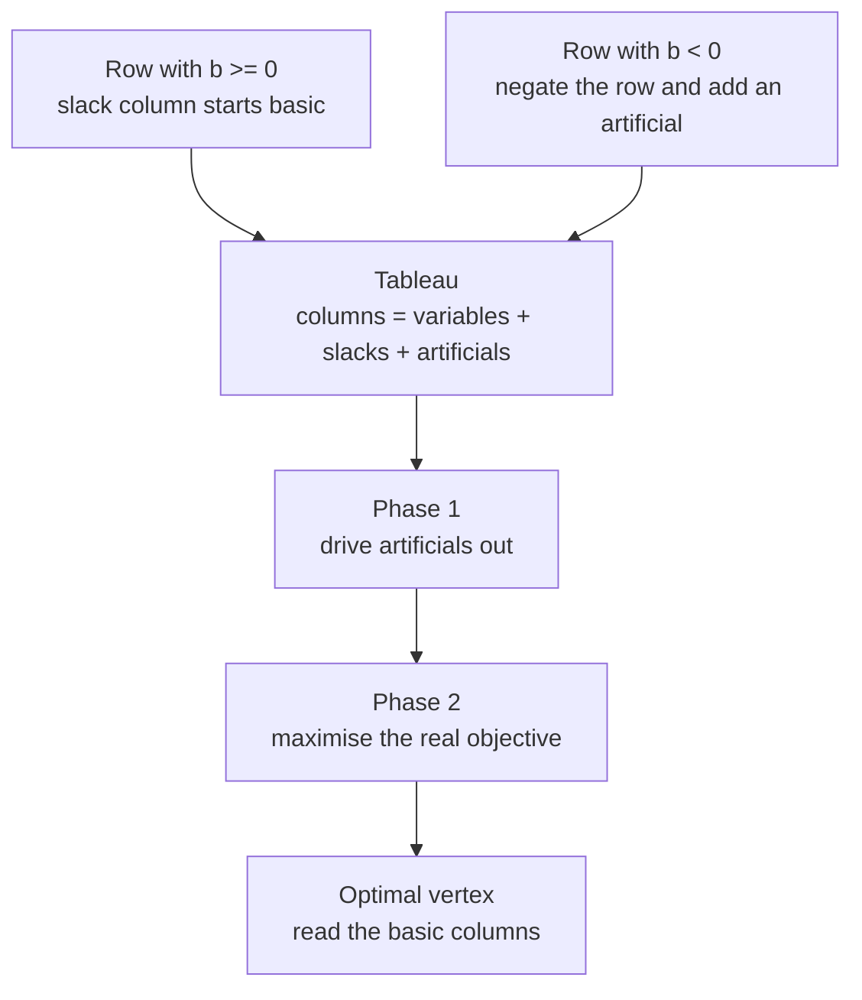
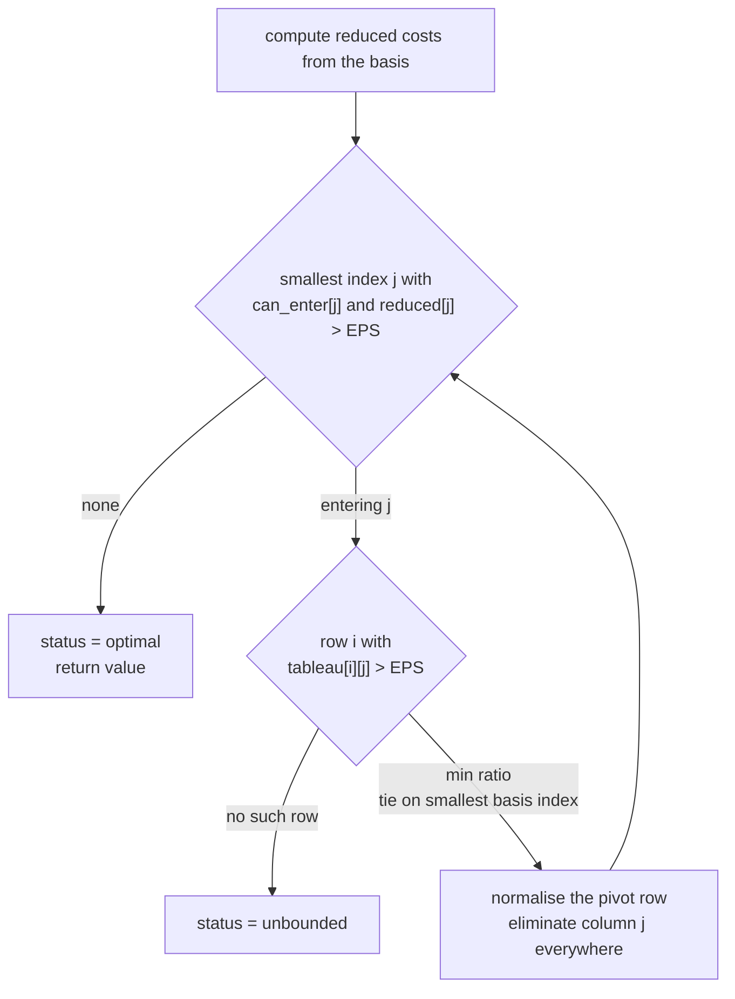
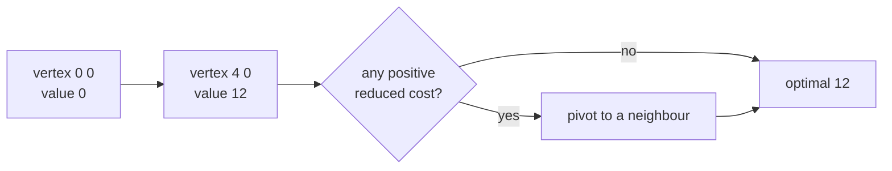

# 377 — Implement simplex algorithm outline for small LP.

> **Tier:** Intermediate · **CTCI chapter:** Beyond — Numerical & Scientific Computing
> **Task spec:** [377-implement-simplex-algorithm-outline-for-small-lp.md](../../../tasks/intermediate/377-implement-simplex-algorithm-outline-for-small-lp.md)
> **Solutions:** [Python](../../../solutions/python/intermediate/377-implement-simplex-algorithm-outline-for-small-lp/solution.py) ·
> [Java](../../../solutions/java/intermediate/377-implement-simplex-algorithm-outline-for-small-lp/Solution.java) ·
> [JavaScript](../../../solutions/javascript/intermediate/377-implement-simplex-algorithm-outline-for-small-lp/solution.js) ·
> [C#](../../../solutions/csharp/intermediate/377-implement-simplex-algorithm-outline-for-small-lp/Solution.cs)

## 1. Problem restatement

**Input:** an objective row `objective` of `n` coefficients, a constraint matrix `constraints`
with `m` rows and `n` columns, and a bound vector `bounds` of `m` values. The LP is in standard
form:

    maximise  c · x     subject to  A x <= b,   x >= 0

**Output:** a triple `(status, x, value)`. The status is one of three documented sentinels:

| `status` | `x` | `value` | Meaning |
| --- | --- | --- | --- |
| `"optimal"` | the optimal vertex | the optimal objective value | a bounded optimum exists |
| `"unbounded"` | `None` (null / NaN in the other languages) | `None` | the objective grows without bound |
| `"infeasible"` | `None` | `None` | the constraints contradict each other |

The four solution files fix the exact contract with these assertions (all quoted from the
Python `main`, mirrored in Java, JavaScript and C#):

| Call | Result | Why |
| --- | --- | --- |
| `simplex([3, 2], [[1, 1], [1, 3]], [4, 6])` | `optimal`, `(4, 0)`, `12` | the vertex `(4, 0)` beats the intersection `(3, 1)` |
| `simplex([2, 3], [[1, 1], [2, 1]], [4, 5])` | `optimal`, `(0, 4)`, `12` | hand-solved vertices `(0,0)=0`, `(2.5,0)=5`, `(0,4)=12`, `(1,3)=11` |
| `simplex([3, 2, 4], [[1, 1, 1], [2, 1, 3]], [5, 9])` | `optimal`, value `14` | `(4,1,0)`, `(2,2,1)` and `(0,3,2)` are all optimal |
| `simplex([1], [], [])` | `unbounded` | nothing constrains `x` from above |
| `simplex([1], [[1], [-1]], [1, -3])` | `infeasible` | `x <= 1` and `x >= 3` cannot both hold |
| `simplex([1], [[1], [-1]], [5, -2])` | `optimal`, `(5)`, `5` | `2 <= x <= 5`, so phase 1 is needed |

The brief that generated this task suggested that `max 3x + 2y` with `x + y <= 4` and
`x + 3y <= 6` has optimum `(3, 1)` with value `11`. The files re-derive it: `(3, 1)` is only the
intersection of the two lines, and `(4, 0)` is feasible (`4 + 0 = 4`, `4 + 0 <= 6`) with value
`3·4 + 2·0 = 12`. All four solutions assert `12`, and the Python file records the correction in a
comment. Row order matters for which optimal vertex a solver reports, never for the optimal
*value*.

## 2. Intuition

The naive idea is to read the answer straight out of the geometry. A bounded LP in standard form
has an optimal solution at a **vertex** of the feasible polyhedron, and every vertex is the
intersection of `n` of the `m + n` hyperplanes (the `m` constraint rows plus the `n`
non-negativity planes `x_j = 0`). So pick every `n`-subset of hyperplanes, solve the small square
system by Cramer's rule, throw away the points that violate some constraint, and keep the best.
That is exactly what `brute_force_lp` does, and it is a fine **oracle**, but it costs
`C(m + n, n)` linear systems — for `m = n = 20` that is over a hundred billion systems.

The simplex method replaces "try every vertex" with "walk to a better neighbour". Two facts make
the walk legal:

1. From a vertex, moving along one edge means *raising one non-basic variable* until some basic
   variable hits zero. The first constraint to become tight is found by a **minimum ratio test**.
2. If the objective's reduced cost for a non-basic variable is positive, raising that variable
   increases the objective, so the walk never steps downhill.

The whole state of the walk fits in a **tableau**: one row per constraint, one column per
variable plus one slack column per constraint (plus one artificial column for each constraint
whose bound is negative), and a right-hand-side column. The current basis is a list of the
columns that are allowed to be non-zero.



The corner of the feasible region where all slack variables are basic corresponds to `x = 0`.
When every bound is non-negative that point is feasible, so the walk can start immediately;
a negative bound means `x = 0` violates that row, and an artificial variable is bolted on to
give the tableau a legal starting point.

## 3. Algorithm

The core routine `_run_simplex` walks the tableau; `simplex` builds the tableau and drives the
two phases. The four files implement the same five steps:

1. **Build the tableau.** For row `i`: if `bounds[i] >= 0`, copy the row and put a `+1` in slack
   column `n + i`, then make slack `n + i` the basic variable of that row. If `bounds[i] < 0`,
   copy the *negated* row, put `-1` in slack column `n + i` and `+1` in a fresh artificial column,
   and use the artificial as that row's basic variable. The right-hand side is the absolute value
   of the bound, so it is always non-negative.
2. **Phase 1** (only when at least one artificial exists). Run the simplex core with the cost
   vector `-1` on the artificial columns and `0` elsewhere. This maximises the negative sum of the
   artificials, so a maximum of `0` means they can all be driven to zero. The core always returns
   `"optimal"` here because the objective is bounded above by `0`. If the optimum is negative
   (`< -EPS`), some artificial stayed positive: return `"infeasible"`.
3. **Phase 2.** Run the core again with the real objective on the `n` decision columns, `0` on the
   slack columns, and artificial columns marked **forbidden to enter** (`can_enter[j] = False`).
4. **Pivot until nothing improves.** Each iteration picks an entering column and a leaving row,
   normalises the pivot row, eliminates the entering column from every other row *and from the
   reduced-cost row*, then updates the basis.
5. **Read the answer.** `x[j] = rhs[row]` for the row whose basic column is the decision variable
   `j`; every non-basic decision variable is `0`.

**Bland's rule** fixes the choices in step 4 and is what makes termination certain: the entering
column is the *smallest index* with reduced cost `> EPS`, and the leaving row is the smallest ratio,
with ties broken by the *smallest basic-variable index*. The files also keep a cap
(`MAX_ITERATIONS = 10000` in Python and Java) that raises an assertion rather than looping
forever; it is a failure sentinel and the test problems never reach it.

```text
procedure run_simplex(tableau, rhs, basis, cost, can_enter)
    rows ← number of rows of tableau
    columns ← length of cost
    reduced ← copy of cost
    value ← 0
    for i ← 0 to rows - 1 do
        basic_cost ← cost[basis[i]]
        if basic_cost != 0 then
            value ← value + basic_cost * rhs[i]
            for j ← 0 to columns - 1 do
                reduced[j] ← reduced[j] - basic_cost * tableau[i][j]
            end
        end
    end

    iterations ← 0
    while true do
        iterations ← iterations + 1
        if iterations > MAX_ITERATIONS then
            fail "iteration cap exceeded"
        end

        entering ← -1
        for j ← 0 to columns - 1 do
            if can_enter[j] and reduced[j] > EPS then
                entering ← j
                break
            end
        end
        if entering = -1 then
            return "optimal", value
        end

        leaving ← -1
        best_ratio ← 0
        for i ← 0 to rows - 1 do
            if tableau[i][entering] > EPS then
                ratio ← rhs[i] / tableau[i][entering]
                if leaving = -1 or ratio < best_ratio - 1e-12 then
                    leaving ← i
                    best_ratio ← ratio
                else if abs(ratio - best_ratio) <= 1e-12 and basis[i] < basis[leaving] then
                    leaving ← i
                    best_ratio ← ratio
                end
            end
        end
        if leaving = -1 then
            return "unbounded", none
        end

        pivot ← tableau[leaving][entering]
        divide row leaving by pivot, and rhs[leaving] by pivot
        for i ← 0 to rows - 1 do
            if i != leaving and tableau[i][entering] != 0 then
                subtract tableau[i][entering] copies of the pivot row from row i
                rhs[i] ← rhs[i] - factor * rhs[leaving]
            end
        end
        factor ← reduced[entering]
        reduced ← reduced - factor * pivot row
        value ← value + factor * rhs[leaving]
        basis[leaving] ← entering
    end
end
```



Every pivot keeps one invariant: the columns listed in `basis` form an identity pattern, so
`rhs` always holds the values of the basic variables. That is why step 5 can read `x` off the
right-hand side without any extra work.

## 4. Worked example

Trace the first LP from `main`, `simplex([3, 2], [[1, 1], [1, 3]], [4, 6])`. Both bounds are
positive, so there are no artificial columns: the tableau has `n + m = 4` columns (`x`, `y`, and
the slacks `s1`, `s2`) and the basis is `[2, 3]`.

| Step | Tableau (x, y, s1, s2) | rhs | basis | reduced costs | value |
| --- | --- | --- | --- | --- | --- |
| build | `[1, 1, 1, 0]`, `[1, 3, 0, 1]` | `[4, 6]` | `[2, 3]` | `[3, 2, 0, 0]` | 0 |
| iteration 1 | entering `j = 0` (`x`), ratios `4/1 = 4` and `6/1 = 6` | `[4, 6]` | `[2, 3]` | `[3, 2, 0, 0]` | 0 |
| pivot row 0 | `[1, 1, 1, 0]` (already normalised, pivot is 1) | `[4, 2]` | `[0, 3]` | `[0, -1, -3, 0]` | 12 |
| iteration 2 | no reduced cost above `EPS` | `[4, 2]` | `[0, 3]` | `[0, -1, -3, 0]` | 12 |

Reading the answer: `basis[0] = 0 < n = 2`, so `x[0] = rhs[0] = 4`; `basis[1] = 3 >= n`, which is
the slack `s2`, so `x[1]` stays `0`. The result is `("optimal", [4, 0], 12)`, matching the
asserted value, and `brute_force_lp` confirms `12` from the Cramer-rule side.

The same walk in vertex terms: the feasible region is the quadrilateral with corners `(0,0)`,
`(4,0)`, `(3,1)` (the line intersection) and `(0,2)`. The first pivot moves from `(0,0)` to
`(4,0)`; the second pivot finds that no neighbour improves the objective, so the walk stops.



A three-variable instance behaves the same way but stops on a face of optima:
`max 3x + 2y + 4z` with `x + y + z <= 5` and `2x + y + 3z <= 9` has `(4,1,0)`, `(2,2,1)` and
`(0,3,2)` all giving `14`. Bland's rule picks deterministically among them, and the files only
assert the value and feasibility, not which vertex is returned.

## 5. Complexity

Write `C = n + m + a` for the number of tableau columns (`a` = number of artificial columns) and
`m` for the number of rows.

| Measure | Bound | Why it holds |
| --- | --- | --- |
| Tableau build | O(m · C) | one row of `C` entries per constraint, filled once |
| Reduced-cost initialisation | O(m · C) | each basic row with a non-zero cost is subtracted from the reduced-cost row once |
| One pivot | O(m · C) | normalise the pivot row, then eliminate the entering column from the other `m - 1` rows and the cost row |
| One iteration's selection | O(C) entering scan + O(m) ratio test | both are single linear sweeps |
| Space | O(m · C) | the tableau is the only large object; `rhs`, `basis` and `reduced` are O(m) or O(C) |
| Number of iterations | not polynomially bounded | simplex can visit exponentially many vertices in the worst case; Bland's rule only guarantees that it *terminates* |
| Vertex enumeration oracle | O(C(m + n, n) · n²) | `n`-subsets of the `m + n` hyperplanes, each solved by recursive determinants |
| LCG cross-check | 40 random LPs, agreement to `1e-6` | the files assert `abs(value - brute_force_lp(...)) < 1e-6` on every trial |

The honest reading of that table: simplex is fast in practice and the per-pivot cost is
predictable, but no one has a polynomial bound on the pivots. The `MAX_ITERATIONS = 10000` guard
exists precisely because the worst case is real; the test suite never reaches it, which the
Python docstring calls out.

## 6. Pitfalls and edge cases

- **The brief's expected value was wrong.** `(3, 1)` with value `11` is the line intersection, not
  the optimum; `(4, 0)` gives `12`. The solutions assert `12` and comment the correction — if an
  interviewer quotes `11`, walk them through the vertex `(4, 0)`.
- **Floating-point tolerances.** The tableau arithmetic is in doubles, so the code compares
  reduced costs against `EPS = 1e-9` and breaks ratio ties within `1e-12`. Testing `> 0` exactly
  makes the solver oscillate on mathematically degenerate tableaux.
- **Degeneracy and cycling.** A tie in the ratio test means a zero-length pivot; with a naive
  entering rule the tableau can cycle forever. Bland's rule (smallest index, then smallest basis
  index) provably avoids it. The duplicate-constraint case `simplex([1], [[1], [1]], [3, 3])`
  is a degenerate vertex and still returns `x = 3` with value `3`.
- **Unbounded detection needs the sign test.** The entering column must have some
  `tableau[i][entering] > EPS`; if every entry is non-positive, raising the variable costs nothing
  and the objective is unbounded. `simplex([1], [], [])` (no constraints at all) and
  `simplex([1], [[-1]], [-1])` (that is `x >= 1`) both take this path.
- **Infeasibility is a phase-1 verdict, not a phase-2 one.** `value_one < -EPS` means an
  artificial could not leave; the code returns `"infeasible"` before phase 2 ever runs, as in
  `simplex([1], [[1], [-1]], [1, -3])`.
- **Negative bounds need the negated row.** `simplex([1], [[1], [-1]], [5, -2])` describes
  `2 <= x <= 5`; the second row is negated to `-x <= 2`, gets slack coefficient `-1` and an
  artificial, and phase 1 pushes the artificial out. The same instance with objective `[-1]`
  minimises and returns `x = 2`, value `-2` — a minimisation is a maximisation of the negated
  objective.
- **Sentinels differ per language.** Python returns `None, None`; Java, JavaScript and C# return
  `null` coordinates with `NaN` (or `double.NaN`) for the value. Any caller must branch on the
  status string first.
- **Reading `x`.** Only basic columns with index `< n` carry a value; slacks and artificials must
  not be written into `x`. A row whose basis entry is a slack contributes nothing.
- **Scaling.** With coefficients of very different magnitudes the `1e-9` tolerance becomes
  meaningless. The test problems are small integers, and the docstrings say the values are exact
  integers — do not port this tolerance to a badly scaled model without thought.

## 7. Variants and follow-ups

- **Big-M instead of two phases.** Put `-M` on the artificial columns and run a single objective.
  Fewer moving parts, but the choice of `M` is a numerical hazard; the two-phase split used here
  avoids it.
- **Revised simplex.** Keep only the basis inverse and regenerate columns on demand, giving
  O(m²) work per pivot instead of O(m · C) and much better memory for sparse `A` — the standard
  choice for real solvers.
- **Different pivot rules.** Dantzig's most-negative rule takes bigger objective steps but can
  cycle; Bland's rule is slow but terminating; steepest-edge is a practical compromise. Compare
  them by counting iterations on the same tableau.
- **Integer programming on top.** The LP here is the relaxation that branch-and-bound consumes;
  the packing flavour of the same modelling problem appears in
  [295-0-1-knapsack-dp-with-reconstruction.md](../../../tasks/intermediate/295-0-1-knapsack-dp-with-reconstruction.md),
  and its greedy LP-style relaxation in
  [296-fractional-knapsack-greedy.md](../../../tasks/intermediate/296-fractional-knapsack-greedy.md).
- **The geometry side.** The feasible region's extreme points are the subject of
  [366-compute-convex-hull-graham-scan.md](../../../tasks/intermediate/366-compute-convex-hull-graham-scan.md);
  the oracle in this task solves linear systems at vertices the same way the hull code compares
  turns.
- **Counting problems next door.** [378](../../../tasks/intermediate/378-implement-integer-partition-dp-count-ways.md)
  and [379](../../../tasks/intermediate/379-implement-combinatorics-ncr-modulo-prime-precompute-factorials.md)
  are the exact-arithmetic companions to a solver that has to live with doubles.

## 8. Check yourself

1. Why does the second phase forbid artificial columns from entering the basis?

<details><summary>Show answer</summary>

Because an artificial variable is not part of the original problem. Its column is only a
scaffolding used to find a starting basis; if it re-entered the basis, the reported vertex could
have a positive artificial coordinate, which is not a feasible point of `A x <= b`. Phase 2
therefore passes `can_enter[j] = False` for those columns and keeps the solution inside the real
feasible set.

</details>

2. What exactly makes the algorithm report `"unbounded"`, and what makes it report `"infeasible"`?

<details><summary>Show answer</summary>

Unbounded: an entering column was chosen (positive reduced cost) but no row has a positive
coefficient in that column, so raising the variable never tightens a constraint. Infeasible:
during phase 1 the artificial sum could not reach `0`, i.e. the phase-1 optimum is `< -EPS`;
the code returns before phase 2.

</details>

3. The tableau for `max 2x + 3y` with `x + y <= 4`, `2x + y <= 5` has vertices `(0,0) = 0`,
`(2.5, 0) = 5`, `(0, 4) = 12` and `(1, 3) = 11`. Which vertex do the files assert, and why is
that enough?

<details><summary>Show answer</summary>

They assert only the *value* `12`, not the vertex. `(0, 4)` is the unique optimum here, but in
general several vertices can share the optimal value (the three-variable test has three), and
which one a simplex implementation reports depends on the pivoting rule. Asserting the value is
the robust check; the extra assertions verify `x >= 0` and that every row is satisfied.

</details>

4. Why does `simplex([1], [], [])` return `"unbounded"` rather than `"optimal"` with value `0`?

<details><summary>Show answer</summary>

With no constraints there are no rows, so no row can hold a basis for `x`. The reduced cost of
`x` is `1 > EPS`, so `x` enters, but the ratio test scans zero rows and finds no leaving
variable — the sign that the objective has no upper bound. The starting point `x = 0` has value
`0`, which is feasible but not optimal.

</details>

5. Bland's rule makes simplex terminate, so why keep a 10000-iteration cap?

<details><summary>Show answer</summary>

Termination is guaranteed for exact arithmetic; the tableau is computed in doubles, where
`1e-9`-scale comparisons can produce a pivot sequence that is not the exact one and could in
principle revisit a basis. The cap converts "something went wrong" into a loud assertion instead
of a hang. The Python docstring records that the test problems never hit it.

</details>
