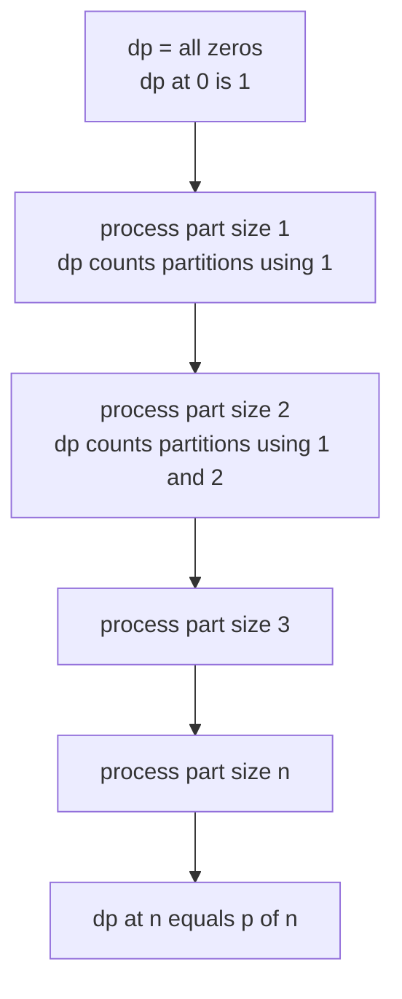
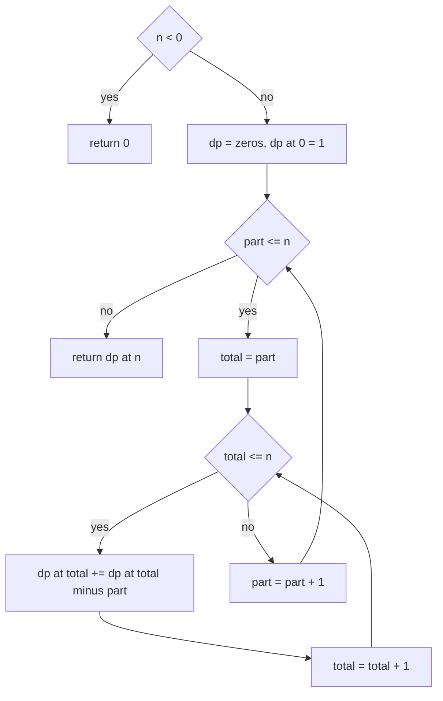
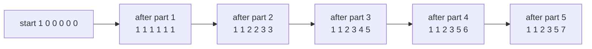

# 378 — Implement integer partition DP (count ways).

> **Tier:** Intermediate · **CTCI chapter:** Ch 6 — Math and Logic Puzzles
> **Task spec:** [378-implement-integer-partition-dp-count-ways.md](../../../tasks/intermediate/378-implement-integer-partition-dp-count-ways.md)
> **Solutions:** [Python](../../../solutions/python/intermediate/378-implement-integer-partition-dp-count-ways/solution.py) ·
> [Java](../../../solutions/java/intermediate/378-implement-integer-partition-dp-count-ways/Solution.java) ·
> [JavaScript](../../../solutions/javascript/intermediate/378-implement-integer-partition-dp-count-ways/solution.js) ·
> [C#](../../../solutions/csharp/intermediate/378-implement-integer-partition-dp-count-ways/Solution.cs)

## 1. Problem restatement

**Input:** an integer `n`. The four files accept any value, including `n = 0` and negative `n`.

**Output:** `p(n)`, the number of ways to write `n` as a sum of positive integers where **order
does not matter**. `(2, 1, 1)` and `(1, 2, 1)` are the same partition of `4`, so they are counted
once. A partition is a multiset of parts, and the order in which the code walks the parts must not
influence the count.

The contract is pinned by the assertions in `main`, which every language mirrors:

| Call | Result | Why |
| --- | --- | --- |
| `partition_count(0)` | `1` | the empty partition is the one way to sum nothing |
| `partition_count(1)` | `1` | `1` |
| `partition_count(4)` | `5` | `4`; `3+1`; `2+2`; `2+1+1`; `1+1+1+1` |
| `partition_count(5)` | `7` | those five, plus `5` and `3+2` |
| `partition_count(10)` | `42` | classic value, re-derived by both oracles |
| `partition_count(20)` | `627` | classic value |
| `partition_count(50)` | `204226` | classic value |
| `partition_count(100)` | `190569292` | classic value |
| `partition_count(-3)` | `0` | the docstring convention: negative input has no partitions |

Two independent oracles guard the table: `brute_force_partitions(n, max_part)` counts recursively
by choosing the largest remaining part, and `brute_force_via_ascending_parts(n)` walks explicit
non-decreasing lists. Both are asserted to agree with the DP for every `n <= 20`, and the file
records the `p(100) = 190569292` milestone as the large check. The relevant CTCI framing is the
"count the ways" style of problem, where a recursion without memoisation blows up but a
one-dimensional table is enough.

## 2. Intuition

The naive idea is to enumerate: for each `n`, try every part size, recurse on the remainder, and
count the leaves of the recursion tree. That is correct, and it is what the two oracles do — but
the number of partitions grows fast (`p(100) = 190569292`), so the recursive walk does an
exponential amount of work. Worse, the bare recursion *double counts*: if it is allowed to pick
any part at every level, both `2 + 1 + 1` and `1 + 2 + 1` reach `n = 4`, and the answer is no
longer `p(4)`.

The insight is to make the recursion *canonical* by processing the part sizes in a fixed order.
Fix the rule: "part sizes are considered from small to large, and once you are done with size `k`
you may never use a part smaller than `k` again." Then each multiset of parts is produced exactly
once, because a multiset has exactly one sorted representation. That single trick turns an
exponential enumeration into a table with a nested loop, and it is the same idea as the
unbounded coin-change DP: the outer loop iterates over the *item types*, and only the inner loop
iterates over the *amount*.

The table is one-dimensional. `dp[s]` means "the number of partitions of `s` using only part
sizes `<= k`", where `k` is the part currently being processed. Two readings of the same state
are useful:

- Before any part is processed, `dp[0] = 1` and everything else is `0`.
- After the outer loop finishes, `dp[s]` uses parts `<= n`, and no partition of `s <= n` can
  contain a part larger than `n`, so `dp[n] = p(n)`.



Reusing the same array is what makes this a DP rather than a table of tables: after part `k` has
been folded in, the numbers for part `k - 1` are still exactly what the update needs, and nothing
else is required.

## 3. Algorithm

1. Handle the degenerate input: if `n < 0`, return `0`; if `n = 0`, the array has one slot and the
   answer is the initial `1`.
2. Allocate `dp` with `n + 1` slots, all `0`, and set `dp[0] = 1`. The `1` is the empty
   partition, not a placeholder: it is what makes the recursion `partition(s) = sum over parts
   partition(s - part)` terminate at `s = 0`.
3. Loop `part` from `1` to `n` — one iteration per allowed part size, ascending.
4. For each `part`, loop `total` from `part` to `n` ascending, and do
   `dp[total] += dp[total - part]`. The inner loop starts at `part` because a total smaller than
   the part being added cannot use it.
5. Return `dp[n]`.

The inner loop direction matters. Ascending `total` allows the same part to be used again in the
same pass (`dp[total - part]` may already include `part`), which is correct here: `1 + 1 + 1 + 1`
uses four ones and must be counted. Using the table as an unbounded-knapsack accumulator is
precisely the "order does not matter" fix, because the *outer* loop decides the order in which
values are inserted and the inner loop only consumes what is already available.

```text
procedure partition_count(n)
    if n &lt; 0 then
        return 0
    end
    dp ← array of n + 1 zeros
    dp[0] ← 1
    for part ← 1 to n do
        for total ← part to n do
            dp[total] ← dp[total] + dp[total - part]
        end
    end
    return dp[n]
end
```



The invariant to hold on to while reading the code: *immediately after the pass for `part = k`,
`dp[s]` is the number of partitions of `s` whose largest part is at most `k`.* The invariant is
initialised by `dp[0] = 1` (the empty partition uses no part) and preserved by the inner loop,
which either ignores the new part or appends one copy of it to a partition counted by
`dp[total - part]`.

## 4. Worked example

Trace `partition_count(5)`. The array starts as `[1, 0, 0, 0, 0, 0]`; each row below is the state
after the whole inner loop for one part size.

| Part size | Inner loop updates | `dp[0..5]` after the pass | Meaning |
| --- | --- | --- | --- |
| — | initial | `[1, 0, 0, 0, 0, 0]` | only the empty partition |
| `1` | `dp[1..5] += dp[0]` | `[1, 1, 1, 1, 1, 1]` | each total is `1 + 1 + ...`, one way |
| `2` | `dp[2] += dp[0]`, `dp[3] += dp[1]`, `dp[4] += dp[2]`, `dp[5] += dp[3]` | `[1, 1, 2, 2, 3, 3]` | partitions using `1` and `2` |
| `3` | `dp[3] += dp[0]`, `dp[4] += dp[1]`, `dp[5] += dp[2]` | `[1, 1, 2, 3, 4, 5]` | partitions using `1`, `2`, `3` |
| `4` | `dp[4] += dp[0]`, `dp[5] += dp[1]` | `[1, 1, 2, 3, 5, 6]` | partitions using `1..4` |
| `5` | `dp[5] += dp[0]` | `[1, 1, 2, 3, 5, 7]` | partitions using `1..5`, so `p(5) = 7` |

The interesting rows are the middle ones, because they show the canonical ordering at work. When
part `3` is processed, `dp[5] += dp[2]` adds the partitions of `2` — which at that moment are
`2` and `1 + 1` — in front of a `3`, giving `3 + 2` and `3 + 1 + 1`. The partition `3 + 1 + 1` is
never also produced as `1 + 3 + 1`, because parts smaller than `3` were frozen before this pass.

The final column also matches the milestone list: `p(4) = 5`, `p(5) = 7`, and the same table read
at `n = 10` gives `42` and at `n = 100` gives `190569292`.



The oracles confirm the trace independently. `brute_force_partitions(5, 5)` picks the largest part
and recurses: `5`; `4 + 1`; `3 + 2`; `3 + 1 + 1`; `2 + 2 + 1`; `2 + 1 + 1 + 1`; `1 + 1 + 1 + 1 + 1`
— seven leaves. `brute_force_via_ascending_parts(5)` reaches the same seven lists from the other
direction, walking non-decreasing parts and ending each list exactly when the remainder is `0`.

## 5. Complexity

Let `n` be the input.

| Measure | Bound | Why it holds |
| --- | --- | --- |
| Time, DP | O(n²) | the outer loop runs `n` times and the inner loop at most `n` times per outer step |
| Time, best | O(n²) as well | even `n = 0` and `n = 1` are the two ends of the same quadratic shape; there is no early exit to exploit |
| Space, DP | O(n) | one array of `n + 1` counters, updated in place |
| Space, oracle | O(n) recursion depth | `brute_force_partitions` recurses at most `n` levels deep |
| Time, recursive oracle | exponential in `n` | it enumerates every partition, so it costs about `p(n)` leaves; fine for the `n <= 20` checks, hopeless at `n = 100` |
| Value growth | `p(100) = 190569292` | the answer itself is large; the files use 64-bit counters (Java `long[]`, C# `long[]`) so that larger inputs do not silently wrap |

The memoised table beats enumeration by a wide margin, but note that the *output* can be large —
`p(100)` is already nine digits and the count is not polynomial in the number of digits of the
input, which is why partition numbers are used as a testing ground for arbitrary-precision
arithmetic. The DP table itself is only `n + 1` counters, so memory is never the constraint.

## 6. Pitfalls and edge cases

- **Order-blindness is the whole problem.** Building the table with the loops the wrong way round
  (amount outside, parts inside) counts *compositions* instead: for `n = 4` that would give `8`
  instead of `5`. The files fix the order by putting the part loop outside.
- **`dp[0] = 1` is not optional.** Without the empty-partition seed every `dp[total]` update adds
  `0` and the answer for every positive `n` comes out `0`.
- **Inner loop starts at `part`.** Starting at `0` would read `dp[total - part]` for unreachable
  indices, and starting at `1` would add the empty partition repeatedly.
- **Ascending inner loop.** Descending would turn the table into a 0/1 knapsack and lose
  partitions that use the same part twice, such as `1 + 1 + 1 + 1` or `2 + 2`.
- **Zero and negatives.** `partition_count(0) = 1` is asserted by all four files, because the empty
  sum is a partition of nothing. The `n < 0` guard returns `0` and is asserted with `-3`.
- **Monotonicity sanity check.** The Python file also asserts `p(n) > p(n - 1)` for all
  `n <= 25`. It is a cheap guard against off-by-one bookkeeping that still produces plausible
  numbers.
- **Matching the oracle means matching the convention.** `brute_force_partitions(0)` must return
  `1` as well, otherwise the "agrees for all `n <= 20`" loop would fail on the first iteration.
  64-bit counters are used in Java and C# because the asserted milestones grow (204226 at `n = 50`,
  190569292 at `n = 100`) and an `int` table would overflow on larger inputs without warning.

## 7. Variants and follow-ups

- **Counting compositions instead of partitions.** Drop the "parts ascending" rule — the world
  where `2 + 1 + 1` and `1 + 2 + 1` are different — and the answer becomes `2^(n-1)`, computable
  with a single modular exponentiation.
- **Unbounded coin change is the same loop.** `dp[total] += dp[total - coin]` over a fixed coin
  set appears in
  [293-coin-change-number-of-ways-dp.md](../../../tasks/intermediate/293-coin-change-number-of-ways-dp.md);
  integer partitions are the special case where the coin set is `1..n`.
- **Minimum coins and 0/1 knapsack.** The `min` variant of the same table is
  [294-coin-change-minimum-coins-dp.md](../../../tasks/intermediate/294-coin-change-minimum-coins-dp.md),
  and the version where each item may be used at most once is
  [295-0-1-knapsack-dp-with-reconstruction.md](../../../tasks/intermediate/295-0-1-knapsack-dp-with-reconstruction.md).
- **Enumeration as an oracle.** The recursive deepest-part walk here is the same shape as the
  subset enumeration in
  [287-combination-sum-backtracking.md](../../../tasks/intermediate/287-combination-sum-backtracking.md),
  where the paths are returned instead of counted.
- **Modular counting next door.** When `p(n)` overflows even 64-bit arithmetic, the count moves
  into modular tables; the same factorial-and-inverse machinery is the subject of
  [379-implement-combinatorics-ncr-modulo-prime-precompute-factorials.md](../../../tasks/intermediate/379-implement-combinatorics-ncr-modulo-prime-precompute-factorials.md).

## 8. Check yourself

1. What exactly does `dp[s]` mean while the outer loop is at `part = k`, and why does that make
   the final value `p(n)`?

<details><summary>Show answer</summary>

It counts partitions of `s` whose parts are all at most `k`. When the outer loop reaches
`part = n`, every part size that can appear in a partition of `s <= n` has been processed, so
`dp[s]` counts all partitions of `s`. In particular the answer read at `s = n` is `p(n)`.

</details>

2. Why does the inner loop run from `part` to `n` in ascending order rather than descending?

<details><summary>Show answer</summary>

Ascending order lets the pass reuse the part it is currently adding, which is what allows repeated
parts (`1 + 1 + 1 + 1`, `2 + 2`). Descending would make each part usable once, turning the answer
into a count of partitions into distinct parts. Starting at `part` avoids reading indices below
the part currently being folded in.

</details>

3. The naive recursive count double counts. Where exactly does the DP avoid the double count?

<details><summary>Show answer</summary>

By fixing the order in which part sizes are introduced. A multiset has exactly one sorted list, so
requiring "once you have used part `k`, you may never use a smaller part" leaves exactly one path
to every partition. The DP enforces that by processing sizes in the outer loop and never looking
back at smaller ones.

</details>

4. What is `partition_count(4)` and which five partitions does it count?

<details><summary>Show answer</summary>

`5`: the partitions are `4`, `3 + 1`, `2 + 2`, `2 + 1 + 1` and `1 + 1 + 1 + 1`. The files assert
that number and also assert both oracles return it, and one comment spells the five lists out.

</details>

5. Which counter type would be safe for `p(50)` in C, and when does that stop being true?

<details><summary>Show answer</summary>

`p(50) = 204226` fits in a 32-bit `int`. But `p(100) = 190569292` is already close to the `int`
limit of 2147483647, and the very next milestone overshoots. The solution files use 64-bit
counters (Java `long`, C# `long`) so that larger inputs do not wrap silently.

</details>
